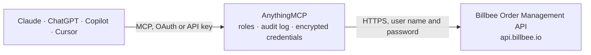

<!-- Generated by scripts/export-github-catalog.mjs in the anythingmcp-website repository. Do not edit by hand. -->

# Billbee Order Management MCP connector

Manage orders, products, customers, stock and shipments in Billbee, the leading German/DACH multichannel order-management (Warenwirtschaft) platform used by 20,000+ online retailers: read orders and … The AnythingMCP connector gives Claude, ChatGPT, Microsoft Copilot, Cursor and Gemini 17 MCP tools for Billbee Order Management: 9 read and 8 can change data.

**Category:** [E-commerce](../e-commerce.md) · **Tools:** 17 · **Setup guide:** [anythingmcp.com](https://anythingmcp.com/guides/billbee-to-mcp) · [Deutsch](https://anythingmcp.com/de/guides/billbee-to-mcp) · [Italiano](https://anythingmcp.com/it/guides/billbee-to-mcp) · [Español](https://anythingmcp.com/es/guides/billbee-to-mcp) · [日本語](https://anythingmcp.com/ja/guides/billbee-to-mcp) · [Русский](https://anythingmcp.com/ru/guides/billbee-to-mcp) · [中文](https://anythingmcp.com/zh/guides/billbee-to-mcp)

## Start without code

No installation and no terminal: AnythingMCP Cloud runs the Billbee Order Management connector for you, operated by helpcode.ai in Frankfurt, Germany.

1. **Click the button above** and create an account or sign in. The Billbee Order Management connector opens, ready to install.
2. **Paste the API key or token from your Billbee Order Management account.** Every click is in the [step-by-step guide](https://anythingmcp.com/guides/billbee-to-mcp).
3. **Click Install.** AnythingMCP shows the address of your MCP server.
4. **Add that address to your assistant:** [Claude](https://anythingmcp.com/guides/connect-billbee-to-claude) · [ChatGPT](https://anythingmcp.com/guides/connect-billbee-to-chatgpt) · [Microsoft Copilot](https://anythingmcp.com/guides/connect-billbee-to-copilot) · [Cursor](https://anythingmcp.com/guides/connect-billbee-to-cursor) · [Gemini CLI](https://anythingmcp.com/guides/connect-billbee-to-gemini) · [Meta Muse](https://anythingmcp.com/guides/connect-billbee-to-muse).
5. **Ask your first question**, for example: *Find order SHOP-2026-0458 and tell me its Billbee id, total and current state.*

Prefer help with the setup? [Talk to us](https://anythingmcp.com/contact).

## How it works

- **The AI client** speaks MCP (Streamable HTTP) to AnythingMCP and only sees tool names, descriptions and results. It never gets the Billbee Order Management credentials.
- **AnythingMCP** checks the client's role, builds the call from the tool definition, adds the credentials (user name and password), calls Billbee Order Management, logs the call and returns the result.
- **Billbee Order Management** sees an ordinary API client with the rights of the account the credentials belong to.

## Tools

| Tool | What it does | Access |
|---|---|---|
| [`billbee_list_orders`](#billbee_list_orders) | List orders from Billbee with filtering by order date range, modification date (incremental sync) and pagination. | read |
| [`billbee_get_order`](#billbee_get_order) | Get a single Billbee order by its internal Billbee order id, returning full detail including line items, addresses, payment and shipping info. | read |
| [`billbee_get_order_by_extref`](#billbee_get_order_by_extref) | Look up a Billbee order by its external reference (the marketplace/shop order number), returning the full order detail. | read |
| [`billbee_list_products`](#billbee_list_products) | List products/articles from Billbee with pagination. | read |
| [`billbee_get_product`](#billbee_get_product) | Get a single Billbee product by id (or by SKU/EAN via lookupBy), returning full article detail including pricing and stock. | read |
| [`billbee_list_customers`](#billbee_list_customers) | List customers from Billbee with pagination. | read |
| [`billbee_get_customer_orders`](#billbee_get_customer_orders) | List all orders belonging to a specific Billbee customer by customer id, with pagination. | read |
| [`billbee_list_shipping_providers`](#billbee_list_shipping_providers) | List the shipping providers configured in the Billbee account, returning provider names and their available shipping products. | read |
| [`billbee_list_stocks`](#billbee_list_stocks) | List the stock locations (Lager) defined in the Billbee account, with their ids. | read |
| [`billbee_set_order_state`](#billbee_set_order_state) | Change the main state of one order, e.g. to paid (3) or shipped (4). | write |
| [`billbee_add_shipment_to_order`](#billbee_add_shipment_to_order) | Attach a shipment you already created elsewhere (a tracking number from DHL, DPD, a carrier portal...) to an order. | write |
| [`billbee_ship_order_with_label`](#billbee_ship_order_with_label) | Create a shipping label for an order through a carrier connected in Billbee (DHL, DPD, GLS, Deutsche Post...), using the account's own carrier contract. | write |
| [`billbee_update_stock`](#billbee_update_stock) | Set the stock quantity of one article, by SKU. | write |
| [`billbee_add_order_tags`](#billbee_add_order_tags) | Add tags to an order. | write |
| [`billbee_update_order`](#billbee_update_order) | Change one or more fields of an order. | write |
| [`billbee_update_product`](#billbee_update_product) | Change one or more fields of a product. | write |
| [`billbee_create_invoice`](#billbee_create_invoice) | Create the invoice for an existing order with the account's invoice template. | write |

## Tool reference

Every parameter as the AI client sees it in `tools/list`. Source: [`packages/backend/src/adapters/de/billbee.json`](../../../packages/backend/src/adapters/de/billbee.json).

### `billbee_list_orders`

List orders from Billbee with filtering by order date range, modification date (incremental sync) and pagination. Returns a paged envelope of order summaries.

**Access:** read · **Call:** `GET /orders`

| Parameter | Type | Required | Description |
|---|---|---|---|
| `page` | number | no | Page number, 1-based (default 1) |
| `pageSize` | number | no | Results per page (max 250) |
| `minOrderDate` | string | no | Only orders created on/after this date-time (ISO 8601, e.g. 2026-01-01) |
| `maxOrderDate` | string | no | Only orders created on/before this date-time (ISO 8601) |
| `modifiedAtMin` | string | no | Only orders modified on/after this date-time (ISO 8601) — use for incremental sync |
| `modifiedAtMax` | string | no | Only orders modified on/before this date-time (ISO 8601) |

### `billbee_get_order`

Get a single Billbee order by its internal Billbee order id, returning full detail including line items, addresses, payment and shipping info.

**Access:** read · **Call:** `GET /orders/{id}`

| Parameter | Type | Required | Description |
|---|---|---|---|
| `id` | string | yes | The internal Billbee order id |

### `billbee_get_order_by_extref`

Look up a Billbee order by its external reference (the marketplace/shop order number), returning the full order detail.

**Access:** read · **Call:** `GET /orders/findbyextref/{extRef}`

| Parameter | Type | Required | Description |
|---|---|---|---|
| `extRef` | string | yes | The external order number / reference from the marketplace or shop |

### `billbee_list_products`

List products/articles from Billbee with pagination. Returns article ids, SKUs, titles, prices and stock fields.

**Access:** read · **Call:** `GET /products`

| Parameter | Type | Required | Description |
|---|---|---|---|
| `page` | number | no | Page number, 1-based (default 1) |
| `pageSize` | number | no | Results per page (max 250) |
| `minCreatedAt` | string | no | Only products created on/after this date-time (ISO 8601) |

### `billbee_get_product`

Get a single Billbee product by id (or by SKU/EAN via lookupBy), returning full article detail including pricing and stock.

**Access:** read · **Call:** `GET /products/{id}`

| Parameter | Type | Required | Description |
|---|---|---|---|
| `id` | string | yes | The product identifier (Billbee article id by default) |
| `lookupBy` | string | no | How to interpret id: 'id' (default), 'sku' or 'ean' |

### `billbee_list_customers`

List customers from Billbee with pagination. Returns customer ids, names, contact details and addresses.

**Access:** read · **Call:** `GET /customers`

| Parameter | Type | Required | Description |
|---|---|---|---|
| `page` | number | no | Page number, 1-based (default 1) |
| `pageSize` | number | no | Results per page (max 250) |

### `billbee_get_customer_orders`

List all orders belonging to a specific Billbee customer by customer id, with pagination. Useful for customer history and support lookups.

**Access:** read · **Call:** `GET /customers/{id}/orders`

| Parameter | Type | Required | Description |
|---|---|---|---|
| `id` | string | yes | The Billbee customer id |
| `page` | number | no | Page number, 1-based (default 1) |
| `pageSize` | number | no | Results per page (max 250) |

### `billbee_list_shipping_providers`

List the shipping providers configured in the Billbee account, returning provider names and their available shipping products.

**Access:** read · **Call:** `GET /shipment/shippingproviders`

No parameters.

### `billbee_list_stocks`

List the stock locations (Lager) defined in the Billbee account, with their ids. Needed for billbee_update_stock when the multi-stock feature is on.

**Access:** read · **Call:** `GET /products/stocks`

No parameters.

### `billbee_set_order_state`

Change the main state of one order, e.g. to paid (3) or shipped (4). Billbee passes the new state on to the shop or marketplace if that is configured, so the buyer may be notified.

**Access:** write · **Call:** `PUT /orders/{id}/orderstate`

| Parameter | Type | Required | Description |
|---|---|---|---|
| `id` | string | yes | The internal Billbee order id (BillBeeOrderId from billbee_list_orders or billbee_get_order, not the shop order number) |
| `newStateId` | `1` \| `2` \| `3` \| `4` \| `5` \| `6` \| `7` \| `8` \| `9` \| `11` \| `12` \| `13` \| `14` \| `15` \| `16` | yes | New state: 1 ordered, 2 confirmed, 3 paid, 4 shipped, 5 reclamation, 6 deleted, 7 closed, 8 canceled, 9 archived, 11 demand note 1, 12 demand note 2, 13 packed, 14 offered, 15 payment reminder, 16 fulfilling |

### `billbee_add_shipment_to_order`

Attach a shipment you already created elsewhere (a tracking number from DHL, DPD, a carrier portal...) to an order. It does not create a label and does not change the order state; use billbee_set_order_state for that.

**Access:** write · **Call:** `POST /orders/{id}/shipment`

| Parameter | Type | Required | Description |
|---|---|---|---|
| `id` | string | yes | The internal Billbee order id (BillBeeOrderId from billbee_list_orders or billbee_get_order, not the shop order number) |
| `shippingId` | string | yes | Tracking number (Sendungsnummer) of the shipment |
| `shippingProviderId` | integer | no | Id of a shipping provider in this Billbee account, from billbee_list_shipping_providers |
| `shippingProviderProductId` | integer | no | Id of that provider's product, from billbee_list_shipping_providers |
| `carrierId` | integer | no | Id of the carrier, overrides the carrier of the provider |
| `shipmentType` | `0` \| `1` | no | 0 shipment (default), 1 return (Retoure) |
| `comment` | string | no | Text stored with the shipment |
| `orderNumber` | string | no | A different order number for this shipment, if there is one |

### `billbee_ship_order_with_label`

Create a shipping label for an order through a carrier connected in Billbee (DHL, DPD, GLS, Deutsche Post...), using the account's own carrier contract. Returns the shipment with its tracking number and the label. Each call books a real, billable shipment with the carrier.

**Access:** write · **Call:** `POST /shipment/shipwithlabel`

| Parameter | Type | Required | Description |
|---|---|---|---|
| `orderId` | integer | yes | The internal Billbee order id |
| `providerId` | integer | yes | Shipping provider id, from billbee_list_shipping_providers |
| `productId` | integer | yes | Shipping product id of that provider, from billbee_list_shipping_providers |
| `changeStateToSend` | boolean | no | Set the order to shipped after the label is created |
| `weightInGram` | integer | no | Parcel weight in grams, overrides the weight Billbee calculates from the articles |
| `shipDate` | string | no | Ship date sent to the carrier (ISO 8601 date) |
| `clientReference` | string | no | Reference text printed on the label (not supported by every carrier) |
| `dimension` | object | no | Parcel size in cm: {"length": 30, "width": 20, "height": 10} |
| `printerName` | string | no | Name of a cloud printer connected in Billbee to send the label to |

### `billbee_update_stock`

Set the stock quantity of one article, by SKU. The quantity is absolute (the new total), not a change. Billbee sends the new stock on to the connected shops and marketplaces.

**Access:** write · **Call:** `POST /products/updatestock`

| Parameter | Type | Required | Description |
|---|---|---|---|
| `sku` | string | yes | SKU of the article |
| `newQuantity` | number | yes | New absolute stock quantity |
| `billbeeId` | integer | no | Billbee product id, if the SKU is not unique |
| `stockId` | integer | no | Stock location id from billbee_list_stocks, when multi-stock is on |
| `reason` | string | no | Reason stored with the stock change |
| `autosubtractReservedAmount` | boolean | no | Subtract the quantity reserved by open orders from newQuantity |
| `forceSendStockToShops` | boolean | no | Send the stock to the shops even if it did not change |

### `billbee_add_order_tags`

Add tags to an order. Existing tags stay; tags already on the order are ignored, and tags are not case sensitive.

**Access:** write · **Call:** `POST /orders/{id}/tags`

| Parameter | Type | Required | Description |
|---|---|---|---|
| `id` | string | yes | The internal Billbee order id (BillBeeOrderId from billbee_list_orders or billbee_get_order, not the shop order number) |
| `tags` | string[] | yes | Tags to add, e.g. ["express", "check address"] |

### `billbee_update_order`

Change one or more fields of an order. Only the fields you pass change. Use Billbee's field names as billbee_get_order returns them, e.g. {"SellerComment": "Call before delivery"}. For the state use billbee_set_order_state, for tags billbee_add_order_tags.

**Access:** write · **Call:** `PATCH /orders/{id}`

| Parameter | Type | Required | Description |
|---|---|---|---|
| `id` | string | yes | The internal Billbee order id (BillBeeOrderId from billbee_list_orders or billbee_get_order, not the shop order number) |
| `fields` | object | yes | Fields to change, with Billbee order field names (PascalCase) |

### `billbee_update_product`

Change one or more fields of a product. Only the fields you pass change. Use Billbee's field names as billbee_get_product returns them, e.g. {"Price": 19.9, "Weight": 450}. For stock use billbee_update_stock.

**Access:** write · **Call:** `PATCH /products/{id}`

| Parameter | Type | Required | Description |
|---|---|---|---|
| `id` | string | yes | The Billbee product id |
| `fields` | object | yes | Fields to change, with Billbee product field names (PascalCase) |

### `billbee_create_invoice`

Create the invoice for an existing order with the account's invoice template. Billbee allows this at most once per order every 5 minutes. Returns the invoice number and, with includeInvoicePdf, the PDF as base64.

**Access:** write · **Call:** `POST /orders/CreateInvoice/{id}`

| Parameter | Type | Required | Description |
|---|---|---|---|
| `id` | string | yes | The internal Billbee order id (BillBeeOrderId from billbee_list_orders or billbee_get_order, not the shop order number) |
| `includeInvoicePdf` | boolean | no | Include the invoice PDF (base64) in the response |
| `templateId` | integer | no | Invoice template id, instead of the one assigned to the order |
| `sendToCloudId` | integer | no | Id of a connected cloud printer or cloud storage to send the invoice to |

## Run it yourself

AnythingMCP is open source (AGPL-3.0). [Run it with Docker](../../../README.md#run-it-yourself), open **Connectors → Store**, pick **Billbee Order Management** and enter `BILLBEE_API_KEY`, `BILLBEE_LOGIN_EMAIL`, `BILLBEE_API_PASSWORD`, then add your MCP server URL to the AI client.

[← E-commerce connectors](../e-commerce.md) · [All categories](../README.md)
