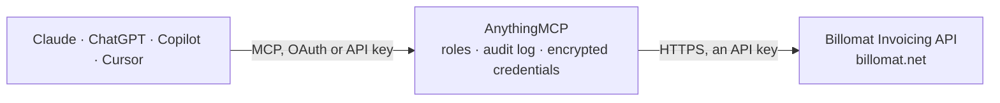

<!-- Generated by scripts/export-github-catalog.mjs in the anythingmcp-website repository. Do not edit by hand. -->

# Billomat Invoicing MCP connector

Manage invoices, clients, articles, and accounting with Billomat. The AnythingMCP connector gives Claude, ChatGPT, Microsoft Copilot, Cursor and Gemini 6 MCP tools for Billomat Invoicing, all read-only.

**Category:** [Finance](../finance.md) · **Tools:** 6 · **Setup guide:** [anythingmcp.com](https://anythingmcp.com/guides/billomat-to-mcp) · [Deutsch](https://anythingmcp.com/de/guides/billomat-to-mcp) · [Italiano](https://anythingmcp.com/it/guides/billomat-to-mcp) · [Español](https://anythingmcp.com/es/guides/billomat-to-mcp) · [日本語](https://anythingmcp.com/ja/guides/billomat-to-mcp) · [Русский](https://anythingmcp.com/ru/guides/billomat-to-mcp) · [中文](https://anythingmcp.com/zh/guides/billomat-to-mcp)

## Start without code

No installation and no terminal: AnythingMCP Cloud runs the Billomat Invoicing connector for you, operated by helpcode.ai in Frankfurt, Germany.

1. **Click the button above** and create an account or sign in. The Billomat Invoicing connector opens, ready to install.
2. **Paste the API key or token from your Billomat Invoicing account.** Every click is in the [step-by-step guide](https://anythingmcp.com/guides/billomat-to-mcp).
3. **Click Install.** AnythingMCP shows the address of your MCP server.
4. **Add that address to your assistant:** [Claude](https://anythingmcp.com/guides/connect-billomat-to-claude) · [ChatGPT](https://anythingmcp.com/guides/connect-billomat-to-chatgpt) · [Microsoft Copilot](https://anythingmcp.com/guides/connect-billomat-to-copilot) · [Cursor](https://anythingmcp.com/guides/connect-billomat-to-cursor) · [Gemini CLI](https://anythingmcp.com/guides/connect-billomat-to-gemini) · [Meta Muse](https://anythingmcp.com/guides/connect-billomat-to-muse).
5. **Ask your first question**, for example: *Find invoice RE2026-019 for client Büro Schulz and show totals, date and status*

Prefer help with the setup? [Talk to us](https://anythingmcp.com/contact).

## How it works

- **The AI client** speaks MCP (Streamable HTTP) to AnythingMCP and only sees tool names, descriptions and results. It never gets the Billomat Invoicing credentials.
- **AnythingMCP** checks the client's role, builds the call from the tool definition, adds the credentials (an API key), calls Billomat Invoicing, logs the call and returns the result.
- **Billomat Invoicing** sees an ordinary API client with the rights of the account the credentials belong to.

## Tools

| Tool | What it does | Access |
|---|---|---|
| [`billomat_list_clients`](#billomat_list_clients) | List clients from Billomat. | read |
| [`billomat_get_client`](#billomat_get_client) | Get detailed information about a specific client by ID. | read |
| [`billomat_list_invoices`](#billomat_list_invoices) | List invoices from Billomat. | read |
| [`billomat_get_invoice`](#billomat_get_invoice) | Get one invoice by its internal ID: number, status, dates, client, net and gross totals, taxes, paid and open amount. | read |
| [`billomat_list_articles`](#billomat_list_articles) | List articles (products/services) from Billomat. | read |
| [`billomat_list_offers`](#billomat_list_offers) | List offers (quotes) from Billomat. | read |

## Tool reference

Every parameter as the AI client sees it in `tools/list`. Source: [`packages/backend/src/adapters/de/billomat.json`](../../../packages/backend/src/adapters/de/billomat.json).

### `billomat_list_clients`

List clients from Billomat. Returns client name, number, address, email, and payment terms.

**Access:** read · **Call:** `GET /clients`

| Parameter | Type | Required | Description |
|---|---|---|---|
| `page` | number | no | Page number (default: 1) |
| `per_page` | number | no | Results per page (default: 100, max: 1000) |
| `name` | string | no | Filter by client name |

### `billomat_get_client`

Get detailed information about a specific client by ID.

**Access:** read · **Call:** `GET /clients/{clientId}`

| Parameter | Type | Required | Description |
|---|---|---|---|
| `clientId` | string | yes | The Billomat client ID |

### `billomat_list_invoices`

List invoices from Billomat. Returns invoice number, date, total, status, and client info.

**Access:** read · **Call:** `GET /invoices`

| Parameter | Type | Required | Description |
|---|---|---|---|
| `page` | number | no | Page number (default: 1) |
| `per_page` | number | no | Results per page (default: 100, max: 1000) |
| `client_id` | string | no | Filter by client ID |
| `status` | string | no | Filter by status: DRAFT, OPEN, OVERDUE, PAID, CANCELED |

### `billomat_get_invoice`

Get one invoice by its internal ID: number, status, dates, client, net and gross totals, taxes, paid and open amount. Line items, comments and payments are separate Billomat resources and are not included.

**Access:** read · **Call:** `GET /invoices/{invoiceId}`

| Parameter | Type | Required | Description |
|---|---|---|---|
| `invoiceId` | string | yes | The Billomat invoice ID |

### `billomat_list_articles`

List articles (products/services) from Billomat. Returns article number, title, unit price, and tax info.

**Access:** read · **Call:** `GET /articles`

| Parameter | Type | Required | Description |
|---|---|---|---|
| `page` | number | no | Page number (default: 1) |
| `per_page` | number | no | Results per page (default: 100, max: 1000) |

### `billomat_list_offers`

List offers (quotes) from Billomat. Returns offer number, date, total, status, and client info.

**Access:** read · **Call:** `GET /offers`

| Parameter | Type | Required | Description |
|---|---|---|---|
| `page` | number | no | Page number (default: 1) |
| `per_page` | number | no | Results per page (default: 100, max: 1000) |
| `client_id` | string | no | Filter by client ID |

## Run it yourself

AnythingMCP is open source (AGPL-3.0). [Run it with Docker](../../../README.md#run-it-yourself), open **Connectors → Store**, pick **Billomat Invoicing** and enter `BILLOMAT_SUBDOMAIN`, `BILLOMAT_API_KEY`, then add your MCP server URL to the AI client.

[← Finance connectors](../finance.md) · [All categories](../README.md)
