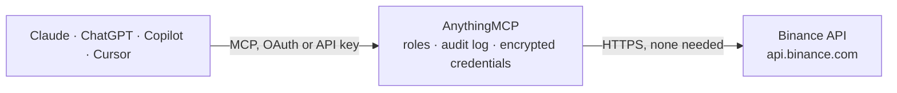

<!-- Generated by scripts/export-github-catalog.mjs in the anythingmcp-website repository. Do not edit by hand. -->

# Binance MCP connector

Let your AI read live crypto market data from Binance: spot prices and 24 hour changes of every pair, order books, recent trades and price history, and for USD-M futures the mark price, funding … The AnythingMCP connector gives Claude, ChatGPT, Microsoft Copilot, Cursor and Gemini 21 MCP tools for Binance, all read-only.

**Category:** [Finance](../finance.md) · **Tools:** 21 · **Setup guide:** [anythingmcp.com](https://anythingmcp.com/guides/binance-to-mcp) · [Deutsch](https://anythingmcp.com/de/guides/binance-to-mcp) · [Italiano](https://anythingmcp.com/it/guides/binance-to-mcp) · [Español](https://anythingmcp.com/es/guides/binance-to-mcp) · [日本語](https://anythingmcp.com/ja/guides/binance-to-mcp) · [Русский](https://anythingmcp.com/ru/guides/binance-to-mcp) · [中文](https://anythingmcp.com/zh/guides/binance-to-mcp)

## Start without code

No installation and no terminal: AnythingMCP Cloud runs the Binance connector for you, operated by helpcode.ai in Frankfurt, Germany.

1. **Click the button above** and create an account or sign in. The Binance connector opens, ready to install.
2. **Nothing to enter:** this connector needs no credentials. Every click is in the [step-by-step guide](https://anythingmcp.com/guides/binance-to-mcp).
3. **Click Install.** AnythingMCP shows the address of your MCP server.
4. **Add that address to your assistant:** [Claude](https://anythingmcp.com/guides/connect-binance-to-claude) · [ChatGPT](https://anythingmcp.com/guides/connect-binance-to-chatgpt) · [Microsoft Copilot](https://anythingmcp.com/guides/connect-binance-to-copilot) · [Cursor](https://anythingmcp.com/guides/connect-binance-to-cursor) · [Gemini CLI](https://anythingmcp.com/guides/connect-binance-to-gemini) · [Meta Muse](https://anythingmcp.com/guides/connect-binance-to-muse).
5. **Ask your first question**, for example: *What's the current BTC price in EUR (pair BTCEUR) right now for our daily ledger?*

Prefer help with the setup? [Talk to us](https://anythingmcp.com/contact).

## How it works

- **The AI client** speaks MCP (Streamable HTTP) to AnythingMCP and only sees tool names, descriptions and results. It never gets the Binance credentials.
- **AnythingMCP** checks the client's role, builds the call from the tool definition, adds the credentials (none needed), calls Binance, logs the call and returns the result.
- **Binance** sees an ordinary API client with the rights of the account the credentials belong to.

## Tools

| Tool | What it does | Access |
|---|---|---|
| [`binance_get_server_time`](#binance_get_server_time) | Read Binance's current server time as Unix milliseconds (weight 1). | read |
| [`binance_list_symbols`](#binance_list_symbols) | List the spot trading pairs that are trading on Binance right now (symbol names only, about 1,400, e.g. BTCUSDT, ETHBTC, SOLEUR). | read |
| [`binance_get_symbol_info`](#binance_get_symbol_info) | Read the trading rules of one Binance spot pair: status, base and quote asset, precisions, order types and filters such as tick size (PRICE_FILTER), step… | read |
| [`binance_get_price`](#binance_get_price) | Read the latest spot price of one Binance pair, several pairs (symbols) or, with neither, every pair. | read |
| [`binance_get_24h_ticker`](#binance_get_24h_ticker) | Read 24 hour statistics of Binance spot pairs: last price, change and change in percent, open, high, low, weighted average price, volume in the base asset… | read |
| [`binance_get_rolling_ticker`](#binance_get_rolling_ticker) | Read price change statistics of Binance spot pairs over a window other than 24 hours, from 1 minute to 7 days: open, high, low, last price, change in… | read |
| [`binance_get_book_ticker`](#binance_get_book_ticker) | Read the best bid and best ask (price and quantity) of one Binance spot pair, several (symbols) or all. | read |
| [`binance_get_avg_price`](#binance_get_avg_price) | Read the current average price of a Binance spot pair over the last few minutes (mins), the reference Binance uses for some order filters. | read |
| [`binance_get_order_book`](#binance_get_order_book) | Read the order book of a Binance spot pair: the best bids and asks as [price, quantity] pairs, best first. | read |
| [`binance_get_recent_trades`](#binance_get_recent_trades) | Read the most recent public trades of a Binance spot pair: price, quantity in the base asset, value in the quote asset, time (Unix milliseconds) and… | read |
| [`binance_get_klines`](#binance_get_klines) | Read price history of a Binance spot pair as candles (klines), oldest first: open time, open, high, low, close, volume in the base asset, quote volume,… | read |
| [`binance_futures_list_symbols`](#binance_futures_list_symbols) | List the USD-M futures contracts trading on Binance right now (symbol names only), grouped into crypto perpetuals, perpetuals on stocks, commodities and… | read |
| [`binance_futures_get_price`](#binance_futures_get_price) | Read the latest traded price of one Binance USD-M futures contract, or of all with no symbol. | read |
| [`binance_futures_get_24h_ticker`](#binance_futures_get_24h_ticker) | Read 24 hour statistics of Binance USD-M futures contracts: last price, change in percent, open, high, low, weighted average price, volume in contracts'… | read |
| [`binance_futures_get_klines`](#binance_futures_get_klines) | Read price history of a Binance USD-M futures contract as candles (klines), oldest first: open time, open, high, low, close, volume, quote volume, trade… | read |
| [`binance_futures_get_mark_price`](#binance_futures_get_mark_price) | Read the mark price, index price and current funding rate of Binance USD-M perpetual contracts, with the time of the next funding (Unix milliseconds). | read |
| [`binance_futures_get_funding_rate_history`](#binance_futures_get_funding_rate_history) | Read past funding rates of a Binance USD-M perpetual contract, oldest first: funding time (Unix milliseconds), fundingRate as a fraction (0.0001 is 0.01 %)… | read |
| [`binance_futures_get_open_interest`](#binance_futures_get_open_interest) | Read the current open interest of a Binance USD-M futures contract: the number of open contracts in the base asset (BTC for BTCUSDT) and the time. | read |
| [`binance_futures_get_open_interest_history`](#binance_futures_get_open_interest_history) | Read the open interest history of a Binance USD-M futures contract per period: sumOpenInterest in the base asset, sumOpenInterestValue in the quote asset,… | read |
| [`binance_futures_get_long_short_ratio`](#binance_futures_get_long_short_ratio) | Read the long/short account ratio of a Binance USD-M futures contract per period: the share of all accounts with a net long position (longAccount), with a… | read |
| [`binance_futures_get_order_book`](#binance_futures_get_order_book) | Read the order book of a Binance USD-M futures contract: the best bids and asks as [price, quantity] pairs, best first. | read |

## Tool reference

Every parameter as the AI client sees it in `tools/list`. Source: [`packages/backend/src/adapters/intl/binance.json`](../../../packages/backend/src/adapters/intl/binance.json).

### `binance_get_server_time`

Read Binance's current server time as Unix milliseconds (weight 1). Needs nothing; use it to work out startTime and endTime for the kline, funding rate and statistics tools, and as a quick check that Binance answers from this server.

**Access:** read · **Call:** `GET /api/v3/time`

No parameters.

### `binance_list_symbols`

List the spot trading pairs that are trading on Binance right now (symbol names only, about 1,400, e.g. BTCUSDT, ETHBTC, SOLEUR). Weight 20 and a large download: when you already know the symbol, call binance_get_symbol_info or a price tool instead.

**Access:** read · **Call:** `GET /api/v3/exchangeInfo`

No parameters.

### `binance_get_symbol_info`

Read the trading rules of one Binance spot pair: status, base and quote asset, precisions, order types and filters such as tick size (PRICE_FILTER), step size (LOT_SIZE) and minimum order value (NOTIONAL). Weight 20. A symbol that does not exist answers 400 with code -1121.

**Access:** read · **Call:** `GET /api/v3/exchangeInfo`

| Parameter | Type | Required | Description |
|---|---|---|---|
| `symbol` | string | yes | Binance symbol: base and quote asset in capitals with no separator, e.g. BTCUSDT, ETHBTC or BNBEUR. Find them with binance_list_symbols. |

### `binance_get_price`

Read the latest spot price of one Binance pair, several pairs (symbols) or, with neither, every pair. Weight 2 for one symbol, 4 otherwise. Prices are strings in the quote asset (BTCUSDT is priced in USDT). Always returns a list of {symbol, price}. Market data is informational, not financial advice.

**Access:** read · **Call:** `GET /api/v3/ticker/price`

| Parameter | Type | Required | Description |
|---|---|---|---|
| `symbol` | string | no | Binance symbol: base and quote asset in capitals with no separator, e.g. BTCUSDT, ETHBTC or BNBEUR. Find them with binance_list_symbols. |
| `symbols` | string | no | Several symbols at once as a JSON array of strings with no spaces, e.g. ["BTCUSDT","ETHUSDT"] (at most 100). Use either symbol or symbols, not both. |

### `binance_get_24h_ticker`

Read 24 hour statistics of Binance spot pairs: last price, change and change in percent, open, high, low, weighted average price, volume in the base asset (volume) and in the quote asset (quoteVolume), best bid and ask and trade count. Pass symbol, or symbols for up to 100 at once. Weight 2 for 1 to 20 symbols, 40 for 21 to 100, 80 without either (then every pair is returned and the answer is cut off, so always pass one). Always returns a list. Market data is informational, not financial advice.

**Access:** read · **Call:** `GET /api/v3/ticker/24hr`

| Parameter | Type | Required | Description |
|---|---|---|---|
| `symbol` | string | no | Binance symbol: base and quote asset in capitals with no separator, e.g. BTCUSDT, ETHBTC or BNBEUR. Find them with binance_list_symbols. |
| `symbols` | string | no | Several symbols at once as a JSON array of strings with no spaces, e.g. ["BTCUSDT","ETHUSDT"] (at most 100). Use either symbol or symbols, not both. |

### `binance_get_rolling_ticker`

Read price change statistics of Binance spot pairs over a window other than 24 hours, from 1 minute to 7 days: open, high, low, last price, change in percent, volumes and trade count. Pass symbol, or symbols for up to 100. Weight 4 per symbol, at most 200. Always returns a list. Market data is informational, not financial advice.

**Access:** read · **Call:** `GET /api/v3/ticker`

| Parameter | Type | Required | Description |
|---|---|---|---|
| `symbol` | string | no | Binance symbol: base and quote asset in capitals with no separator, e.g. BTCUSDT, ETHBTC or BNBEUR. Find them with binance_list_symbols. |
| `symbols` | string | no | Several symbols at once as a JSON array of strings with no spaces, e.g. ["BTCUSDT","ETHUSDT"] (at most 100). Use either symbol or symbols, not both. |
| `windowSize` | string | no | Window length: 1m to 59m, 1h to 23h, or 1d to 7d (default 1d). Units cannot be combined: 90m is not allowed, use 1h or 2h. |

### `binance_get_book_ticker`

Read the best bid and best ask (price and quantity) of one Binance spot pair, several (symbols) or all. Weight 2 for one symbol, 4 otherwise. Use it for the current spread. Always returns a list. Market data is informational, not financial advice.

**Access:** read · **Call:** `GET /api/v3/ticker/bookTicker`

| Parameter | Type | Required | Description |
|---|---|---|---|
| `symbol` | string | no | Binance symbol: base and quote asset in capitals with no separator, e.g. BTCUSDT, ETHBTC or BNBEUR. Find them with binance_list_symbols. |
| `symbols` | string | no | Several symbols at once as a JSON array of strings with no spaces, e.g. ["BTCUSDT","ETHUSDT"] (at most 100). Use either symbol or symbols, not both. |

### `binance_get_avg_price`

Read the current average price of a Binance spot pair over the last few minutes (mins), the reference Binance uses for some order filters. Weight 2. Market data is informational, not financial advice.

**Access:** read · **Call:** `GET /api/v3/avgPrice`

| Parameter | Type | Required | Description |
|---|---|---|---|
| `symbol` | string | yes | Binance symbol: base and quote asset in capitals with no separator, e.g. BTCUSDT, ETHBTC or BNBEUR. Find them with binance_list_symbols. |

### `binance_get_order_book`

Read the order book of a Binance spot pair: the best bids and asks as [price, quantity] pairs, best first. limit sets the levels per side (default 20 here). Weight 5 up to 100 levels, 25 up to 500. Market data is informational, not financial advice.

**Access:** read · **Call:** `GET /api/v3/depth`

| Parameter | Type | Required | Description |
|---|---|---|---|
| `symbol` | string | yes | Binance symbol: base and quote asset in capitals with no separator, e.g. BTCUSDT, ETHBTC or BNBEUR. Find them with binance_list_symbols. |
| `limit` | integer | no | Price levels per side (default 20, at most 500 here). |

### `binance_get_recent_trades`

Read the most recent public trades of a Binance spot pair: price, quantity in the base asset, value in the quote asset, time (Unix milliseconds) and isBuyerMaker (true means the seller was the taker). Weight 25. Market data is informational, not financial advice.

**Access:** read · **Call:** `GET /api/v3/trades`

| Parameter | Type | Required | Description |
|---|---|---|---|
| `symbol` | string | yes | Binance symbol: base and quote asset in capitals with no separator, e.g. BTCUSDT, ETHBTC or BNBEUR. Find them with binance_list_symbols. |
| `limit` | integer | no | Number of trades (default 20, at most 500 here). |

### `binance_get_klines`

Read price history of a Binance spot pair as candles (klines), oldest first: open time, open, high, low, close, volume in the base asset, quote volume, trade count and taker buy volumes. Without startTime and endTime the most recent candles are returned. Weight 2. Market data is informational, not financial advice. Past prices say nothing certain about future ones.

**Access:** read · **Call:** `GET /api/v3/klines`

| Parameter | Type | Required | Description |
|---|---|---|---|
| `symbol` | string | yes | Binance symbol: base and quote asset in capitals with no separator, e.g. BTCUSDT, ETHBTC or BNBEUR. Find them with binance_list_symbols. |
| `interval` | `1s` \| `1m` \| `3m` \| `5m` \| `15m` \| `30m` \| `1h` \| `2h` \| `4h` \| `6h` \| `8h` \| `12h` \| `1d` \| `3d` \| `1w` \| `1M` | yes | Candle length: 1s, 1m to 30m, 1h to 12h, 1d, 3d, 1w, or 1M (one month). Case-sensitive: 1m is a minute, 1M a month. |
| `startTime` | integer | no | Optional start of the window as Unix milliseconds (UTC), e.g. 1792195200000. binance_get_server_time gives the current value. |
| `endTime` | integer | no | Optional end of the window as Unix milliseconds (UTC). |
| `timeZone` | string | no | Optional time zone for day, week and month candle boundaries, e.g. 8 or -1:00 or 05:45 (default 0, UTC). startTime and endTime stay in UTC. |
| `limit` | integer | no | Number of candles (default 100, at most 500 here). |

### `binance_futures_list_symbols`

List the USD-M futures contracts trading on Binance right now (symbol names only), grouped into crypto perpetuals, perpetuals on stocks, commodities and other traditional assets (tradfiPerpetual) and quarterly delivery contracts. Weight 1 but a large download.

**Access:** read · **Call:** `GET https://fapi.binance.com/fapi/v1/exchangeInfo`

No parameters.

### `binance_futures_get_price`

Read the latest traded price of one Binance USD-M futures contract, or of all with no symbol. Weight 1 for one symbol, 2 for all. This is the last trade price; the mark price used for liquidations comes from binance_futures_get_mark_price. Always returns a list. Market data is informational, not financial advice.

**Access:** read · **Call:** `GET https://fapi.binance.com/fapi/v2/ticker/price`

| Parameter | Type | Required | Description |
|---|---|---|---|
| `symbol` | string | no | USD-M futures symbol in capitals, e.g. BTCUSDT or ETHUSDC for perpetuals, BTCUSDT_261225 for a quarterly contract. Find them with binance_futures_list_symbols. |

### `binance_futures_get_24h_ticker`

Read 24 hour statistics of Binance USD-M futures contracts: last price, change in percent, open, high, low, weighted average price, volume in contracts' base asset and quoteVolume, sorted by quoteVolume, most traded first. Pass symbol for one contract (weight 1); without it every contract is returned (weight 40) and the answer keeps the most traded ones. Market data is informational, not financial advice.

**Access:** read · **Call:** `GET https://fapi.binance.com/fapi/v1/ticker/24hr`

| Parameter | Type | Required | Description |
|---|---|---|---|
| `symbol` | string | no | USD-M futures symbol in capitals, e.g. BTCUSDT or ETHUSDC for perpetuals, BTCUSDT_261225 for a quarterly contract. Find them with binance_futures_list_symbols. |

### `binance_futures_get_klines`

Read price history of a Binance USD-M futures contract as candles (klines), oldest first: open time, open, high, low, close, volume, quote volume, trade count and taker buy volumes. Without startTime and endTime the most recent candles are returned. Weight 1 below 100 candles, 2 up to 499, 5 at 500. Market data is informational, not financial advice.

**Access:** read · **Call:** `GET https://fapi.binance.com/fapi/v1/klines`

| Parameter | Type | Required | Description |
|---|---|---|---|
| `symbol` | string | yes | USD-M futures symbol in capitals, e.g. BTCUSDT or ETHUSDC for perpetuals, BTCUSDT_261225 for a quarterly contract. Find them with binance_futures_list_symbols. |
| `interval` | `1m` \| `3m` \| `5m` \| `15m` \| `30m` \| `1h` \| `2h` \| `4h` \| `6h` \| `8h` \| `12h` \| `1d` \| `3d` \| `1w` \| `1M` | yes | Candle length: 1m to 30m, 1h to 12h, 1d, 3d, 1w, or 1M (one month). Case-sensitive. |
| `startTime` | integer | no | Optional start of the window as Unix milliseconds (UTC), e.g. 1792195200000. binance_get_server_time gives the current value. |
| `endTime` | integer | no | Optional end of the window as Unix milliseconds (UTC). |
| `limit` | integer | no | Number of candles (default 100, at most 500 here). |

### `binance_futures_get_mark_price`

Read the mark price, index price and current funding rate of Binance USD-M perpetual contracts, with the time of the next funding (Unix milliseconds). lastFundingRate is a fraction per funding interval: 0.0001 is 0.01 %; positive means longs pay shorts. Pass symbol for one contract (weight 1); without it every contract is returned (weight 10), sorted by the size of the funding rate, most extreme first. Market data is informational, not financial advice.

**Access:** read · **Call:** `GET https://fapi.binance.com/fapi/v1/premiumIndex`

| Parameter | Type | Required | Description |
|---|---|---|---|
| `symbol` | string | no | USD-M futures symbol in capitals, e.g. BTCUSDT or ETHUSDC for perpetuals, BTCUSDT_261225 for a quarterly contract. Find them with binance_futures_list_symbols. |

### `binance_futures_get_funding_rate_history`

Read past funding rates of a Binance USD-M perpetual contract, oldest first: funding time (Unix milliseconds), fundingRate as a fraction (0.0001 is 0.01 %) and the mark price at that time. Perpetuals fund every 8 or 4 hours, a few every hour. Without startTime and endTime the most recent records are returned. Shares a limit of 500 requests per 5 minutes per IP. Market data is informational, not financial advice.

**Access:** read · **Call:** `GET https://fapi.binance.com/fapi/v1/fundingRate`

| Parameter | Type | Required | Description |
|---|---|---|---|
| `symbol` | string | yes | USD-M futures symbol in capitals, e.g. BTCUSDT or ETHUSDC for perpetuals, BTCUSDT_261225 for a quarterly contract. Find them with binance_futures_list_symbols. |
| `startTime` | integer | no | Optional start of the window as Unix milliseconds (UTC), e.g. 1792195200000. binance_get_server_time gives the current value. |
| `endTime` | integer | no | Optional end of the window as Unix milliseconds (UTC). |
| `limit` | integer | no | Number of records (default 100, at most 500 here). |

### `binance_futures_get_open_interest`

Read the current open interest of a Binance USD-M futures contract: the number of open contracts in the base asset (BTC for BTCUSDT) and the time. Weight 1. For history and the value in USD use binance_futures_get_open_interest_history. Market data is informational, not financial advice.

**Access:** read · **Call:** `GET https://fapi.binance.com/fapi/v1/openInterest`

| Parameter | Type | Required | Description |
|---|---|---|---|
| `symbol` | string | yes | USD-M futures symbol in capitals, e.g. BTCUSDT or ETHUSDC for perpetuals, BTCUSDT_261225 for a quarterly contract. Find them with binance_futures_list_symbols. |

### `binance_futures_get_open_interest_history`

Read the open interest history of a Binance USD-M futures contract per period: sumOpenInterest in the base asset, sumOpenInterestValue in the quote asset, and the timestamp. Only the last 30 days are available; at most 1,000 requests per 5 minutes per IP. Market data is informational, not financial advice.

**Access:** read · **Call:** `GET https://fapi.binance.com/futures/data/openInterestHist`

| Parameter | Type | Required | Description |
|---|---|---|---|
| `symbol` | string | yes | USD-M futures symbol in capitals, e.g. BTCUSDT or ETHUSDC for perpetuals, BTCUSDT_261225 for a quarterly contract. Find them with binance_futures_list_symbols. |
| `period` | `5m` \| `15m` \| `30m` \| `1h` \| `2h` \| `4h` \| `6h` \| `12h` \| `1d` | yes | Length of each data point, from 5m to 1d. |
| `startTime` | integer | no | Optional start of the window as Unix milliseconds (UTC), e.g. 1792195200000. binance_get_server_time gives the current value. |
| `endTime` | integer | no | Optional end of the window as Unix milliseconds (UTC). |
| `limit` | integer | no | Number of data points (default 30, at most 500). |

### `binance_futures_get_long_short_ratio`

Read the long/short account ratio of a Binance USD-M futures contract per period: the share of all accounts with a net long position (longAccount), with a net short one (shortAccount, both fractions), and their ratio. It counts accounts, not position size. Only the last 30 days are available; at most 1,000 requests per 5 minutes per IP. Market data is informational, not financial advice.

**Access:** read · **Call:** `GET https://fapi.binance.com/futures/data/globalLongShortAccountRatio`

| Parameter | Type | Required | Description |
|---|---|---|---|
| `symbol` | string | yes | USD-M futures symbol in capitals, e.g. BTCUSDT or ETHUSDC for perpetuals, BTCUSDT_261225 for a quarterly contract. Find them with binance_futures_list_symbols. |
| `period` | `5m` \| `15m` \| `30m` \| `1h` \| `2h` \| `4h` \| `6h` \| `12h` \| `1d` | yes | Length of each data point, from 5m to 1d. |
| `startTime` | integer | no | Optional start of the window as Unix milliseconds (UTC), e.g. 1792195200000. binance_get_server_time gives the current value. |
| `endTime` | integer | no | Optional end of the window as Unix milliseconds (UTC). |
| `limit` | integer | no | Number of data points (default 30, at most 500). |

### `binance_futures_get_order_book`

Read the order book of a Binance USD-M futures contract: the best bids and asks as [price, quantity] pairs, best first. Weight 2 for up to 50 levels per side, 5 for 100, 10 for 500. Market data is informational, not financial advice.

**Access:** read · **Call:** `GET https://fapi.binance.com/fapi/v1/depth`

| Parameter | Type | Required | Description |
|---|---|---|---|
| `symbol` | string | yes | USD-M futures symbol in capitals, e.g. BTCUSDT or ETHUSDC for perpetuals, BTCUSDT_261225 for a quarterly contract. Find them with binance_futures_list_symbols. |
| `limit` | `5` \| `10` \| `20` \| `50` \| `100` \| `500` | no | Price levels per side: 5, 10, 20 (default), 50, 100 or 500. |

## Run it yourself

AnythingMCP is open source (AGPL-3.0). [Run it with Docker](../../../README.md#run-it-yourself), open **Connectors → Store**, pick **Binance**, then add your MCP server URL to the AI client.

[← Finance connectors](../finance.md) · [All categories](../README.md)
