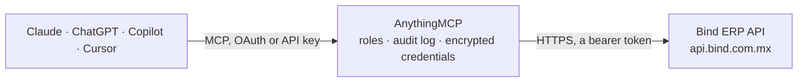

<!-- Generated by scripts/export-github-catalog.mjs in the anythingmcp-website repository. Do not edit by hand. -->

# Bind ERP MCP connector

Connect Bind ERP, the Mexican cloud ERP, to Claude or ChatGPT: clients and prospects, providers, products and inventory per warehouse, orders, quotes, sales with their CFDI XML, purchase orders, … The AnythingMCP connector gives Claude, ChatGPT, Microsoft Copilot, Cursor and Gemini 54 MCP tools for Bind ERP: 46 read and 8 can change data.

**Category:** [ERP](../erp.md) · **Tools:** 54 · **Setup guide:** [anythingmcp.com](https://anythingmcp.com/guides/binderp-to-mcp) · [Deutsch](https://anythingmcp.com/de/guides/binderp-to-mcp) · [Italiano](https://anythingmcp.com/it/guides/binderp-to-mcp) · [Español](https://anythingmcp.com/es/guides/binderp-to-mcp) · [日本語](https://anythingmcp.com/ja/guides/binderp-to-mcp) · [Русский](https://anythingmcp.com/ru/guides/binderp-to-mcp) · [中文](https://anythingmcp.com/zh/guides/binderp-to-mcp)

## Start without code

No installation and no terminal: AnythingMCP Cloud runs the Bind ERP connector for you, operated by helpcode.ai in Frankfurt, Germany.

1. **Click the button above** and create an account or sign in. The Bind ERP connector opens, ready to install.
2. **Paste the API key or token from your Bind ERP account.** Every click is in the [step-by-step guide](https://anythingmcp.com/guides/binderp-to-mcp).
3. **Click Install.** AnythingMCP shows the address of your MCP server.
4. **Add that address to your assistant:** [Claude](https://anythingmcp.com/guides/connect-binderp-to-claude) · [ChatGPT](https://anythingmcp.com/guides/connect-binderp-to-chatgpt) · [Microsoft Copilot](https://anythingmcp.com/guides/connect-binderp-to-copilot) · [Cursor](https://anythingmcp.com/guides/connect-binderp-to-cursor) · [Gemini CLI](https://anythingmcp.com/guides/connect-binderp-to-gemini) · [Meta Muse](https://anythingmcp.com/guides/connect-binderp-to-muse).
5. **Ask your first question**, for example: *What's the balance and credit days for client Industrias Soltera S.A. de C.V., RFC ISS210726I1?*

Prefer help with the setup? [Talk to us](https://anythingmcp.com/contact).

## How it works

- **The AI client** speaks MCP (Streamable HTTP) to AnythingMCP and only sees tool names, descriptions and results. It never gets the Bind ERP credentials.
- **AnythingMCP** checks the client's role, builds the call from the tool definition, adds the credentials (a bearer token), calls Bind ERP, logs the call and returns the result.
- **Bind ERP** sees an ordinary API client with the rights of the account the credentials belong to.

## Tools

| Tool | What it does | Access |
|---|---|---|
| [`binderp_get_company_profile`](#binderp_get_company_profile) | Read the company profile of the Bind ERP account: legal and commercial name, RFC, tax regime, address and when the CFDI signing certificate (CSD) expires. | read |
| [`binderp_get_user_profile`](#binderp_get_user_profile) | Read the profile of the Bind user the API token belongs to: name, email and role. | read |
| [`binderp_list_users`](#binderp_list_users) | List the users of the Bind account (salespeople, credit contacts), whose IDs appear on clients, orders and invoices. | read |
| [`binderp_list_locations`](#binderp_list_locations) | List branches (sucursales) of the company. | read |
| [`binderp_list_warehouses`](#binderp_list_warehouses) | List warehouses (almacenes) with their IDs, for inventory and order tools. | read |
| [`binderp_list_price_lists`](#binderp_list_price_lists) | List price lists (listas de precios) with their IDs and currency. | read |
| [`binderp_list_categories`](#binderp_list_categories) | List the product categories (three levels: Category1, Category2, Category3) used to classify products. | read |
| [`binderp_list_currencies`](#binderp_list_currencies) | List the currencies configured in Bind (MXN, USD, ...) with their IDs, for orders, quotes and invoices. | read |
| [`binderp_list_bank_accounts`](#binderp_list_bank_accounts) | List the company's bank and cash accounts (cuentas bancarias) with their balances. | read |
| [`binderp_list_banks`](#binderp_list_banks) | List the bank catalogue Bind uses for bank accounts and payment references. | read |
| [`binderp_list_series`](#binderp_list_series) | List the document number series (series y folios) for a document type, with the current number and the branches that use each series. | read |
| [`binderp_list_states`](#binderp_list_states) | List the states of Mexico in Bind's catalogue, for client addresses. | read |
| [`binderp_list_cities`](#binderp_list_cities) | List the cities of one state (from binderp_list_states), for client addresses. | read |
| [`binderp_list_clients`](#binderp_list_clients) | List clients with RFC, legal and commercial name, credit days and limit, price list and status. | read |
| [`binderp_get_client`](#binderp_get_client) | Read one client in full: RFC, names, credit terms, price list, contacts, branch and balance. | read |
| [`binderp_list_client_addresses`](#binderp_list_client_addresses) | List the addresses of a client (fiscal and delivery), for orders and invoices. | read |
| [`binderp_list_prospects`](#binderp_list_prospects) | List prospects (prospectos): leads not yet clients, with company, contact, email, phone and salesperson. | read |
| [`binderp_get_prospect`](#binderp_get_prospect) | Read one prospect in full: contact, company, email, phone, salesperson and comments. | read |
| [`binderp_list_providers`](#binderp_list_providers) | List providers (proveedores, suppliers) with RFC, names and credit terms. | read |
| [`binderp_list_products`](#binderp_list_products) | List products with code, SKU, title, cost, price, unit and categories. | read |
| [`binderp_get_product`](#binderp_get_product) | Read one product in full: codes, prices, costs, taxes (VAT, IEPS), SAT product and unit keys and categories. | read |
| [`binderp_list_products_with_price_and_inventory`](#binderp_list_products_with_price_and_inventory) | List every product with its price in one price list and its stock in one warehouse, including volume prices. | read |
| [`binderp_list_services`](#binderp_list_services) | List services (conceptos de venta) with title, price and SAT keys. | read |
| [`binderp_get_service`](#binderp_get_service) | Read one service (concepto de venta) in full: title, price, taxes and SAT product and unit keys. | read |
| [`binderp_list_formulas`](#binderp_list_formulas) | List production formulas (fórmulas, bills of materials) with the product they make. | read |
| [`binderp_get_formula`](#binderp_get_formula) | Read one production formula with its component items and quantities. | read |
| [`binderp_get_inventory`](#binderp_get_inventory) | Get stock per product in one warehouse: on hand, ordered by clients, ordered from providers, balance and value. | read |
| [`binderp_list_merchandise_receptions`](#binderp_list_merchandise_receptions) | List merchandise receptions (recepciones de mercancía): goods received into warehouses. | read |
| [`binderp_list_transfers`](#binderp_list_transfers) | List stock transfers between warehouses (transferencias de mercancía). | read |
| [`binderp_list_invoices`](#binderp_list_invoices) | List sales (ventas: CFDI invoices and notes) with serie and number, UUID, client and RFC, subtotal, taxes, total, payments, credit notes and status. | read |
| [`binderp_get_invoice`](#binderp_get_invoice) | Read one sale in full, by ID or by number: client, products and services, taxes, payments and CFDI data. | read |
| [`binderp_list_invoice_payments`](#binderp_list_invoice_payments) | List the payments received on one sale (venta), with date, method and amount. | read |
| [`binderp_get_invoice_xml`](#binderp_get_invoice_xml) | Get the CFDI XML of a stamped sale (the fiscal document registered with the SAT) as text. | read |
| [`binderp_list_orders`](#binderp_list_orders) | List client orders (pedidos) with client, dates, totals and status. | read |
| [`binderp_get_order`](#binderp_get_order) | Read one client order with its products and services, taxes, totals and status. | read |
| [`binderp_list_quotes`](#binderp_list_quotes) | List quotes (cotizaciones) with client or prospect, dates, totals and status. | read |
| [`binderp_get_quote`](#binderp_get_quote) | Read one quote with its items, client or prospect, totals and status. | read |
| [`binderp_list_purchase_orders`](#binderp_list_purchase_orders) | List purchase orders to providers (órdenes de compra) with provider, dates, totals and status. | read |
| [`binderp_get_purchase_order`](#binderp_get_purchase_order) | Read one purchase order to a provider with its products, quantities, costs and status. | read |
| [`binderp_get_expense`](#binderp_get_expense) | Read one expense order (orden de gasto): provider, document, amounts, VAT and status. | read |
| [`binderp_list_expense_payments`](#binderp_list_expense_payments) | List the payments made on one expense order (orden de gasto). | read |
| [`binderp_list_accounts`](#binderp_list_accounts) | List the chart of accounts (cuentas contables) with number, name and category. | read |
| [`binderp_list_account_categories`](#binderp_list_account_categories) | List the categories of the chart of accounts (assets, liabilities, income, expenses...). | read |
| [`binderp_list_accounting_journals`](#binderp_list_accounting_journals) | List accounting journal entries (pólizas contables) with date, type, number and amounts. | read |
| [`binderp_list_activities`](#binderp_list_activities) | List CRM activities (actividades): calls, meetings and tasks with dates and the record they belong to. | read |
| [`binderp_list_comments`](#binderp_list_comments) | List comments on a record (client, prospect, order...), filtered by its ExternalID. | read |
| [`binderp_create_client`](#binderp_create_client) | Create a client with its fiscal data and address. | write |
| [`binderp_update_client`](#binderp_update_client) | Change a client's fiscal data, credit terms, price list or contacts. | write |
| [`binderp_create_prospect`](#binderp_create_prospect) | Create a prospect (lead) with contact, company, email and phone. | write |
| [`binderp_add_comment`](#binderp_add_comment) | Add a comment to a client, prospect, order or other record. | write |
| [`binderp_create_product`](#binderp_create_product) | Create a product with code, title, cost, price and categories. | write |
| [`binderp_create_order`](#binderp_create_order) | Create a client order (pedido) with product and service lines. | write |
| [`binderp_create_quote`](#binderp_create_quote) | Create a quote (cotización) for a client or prospect. | write |
| [`binderp_create_invoice`](#binderp_create_invoice) | Create a sale and, with IsFiscalInvoice true, stamp it as a CFDI with the SAT. | write |

## Tool reference

Every parameter as the AI client sees it in `tools/list`. Source: [`packages/backend/src/adapters/intl/binderp.json`](../../../packages/backend/src/adapters/intl/binderp.json).

### `binderp_get_company_profile`

Read the company profile of the Bind ERP account: legal and commercial name, RFC, tax regime, address and when the CFDI signing certificate (CSD) expires.

**Access:** read · **Call:** `GET /api/CompanyProfile`

No parameters.

### `binderp_get_user_profile`

Read the profile of the Bind user the API token belongs to: name, email and role. Quick check that the token works.

**Access:** read · **Call:** `GET /api/UserProfile`

No parameters.

### `binderp_list_users`

List the users of the Bind account (salespeople, credit contacts), whose IDs appear on clients, orders and invoices. OData paging and filters; the answer holds value, count and nextLink.

**Access:** read · **Call:** `GET /api/Users`

| Parameter | Type | Required | Description |
|---|---|---|---|
| `filter` | string | no | OData filter, e.g. Name eq 'Ana'. Strings in single quotes, GUIDs as guid'...', dates as datetime'2026-10-01T00:00:00'. |
| `orderby` | string | no | OData sort, e.g. Date desc. |
| `top` | integer | no | Rows to return, 1 to 100 (default 50). |
| `skip` | integer | no | Rows to skip, for paging with top. |

### `binderp_list_locations`

List branches (sucursales) of the company. Most documents need a LocationID. OData paging and filters; the answer holds value, count and nextLink.

**Access:** read · **Call:** `GET /api/Locations`

| Parameter | Type | Required | Description |
|---|---|---|---|
| `filter` | string | no | OData filter, e.g. Name eq 'Matriz'. Strings in single quotes, GUIDs as guid'...', dates as datetime'2026-10-01T00:00:00'. |
| `orderby` | string | no | OData sort, e.g. Date desc. |
| `top` | integer | no | Rows to return, 1 to 100 (default 50). |
| `skip` | integer | no | Rows to skip, for paging with top. |

### `binderp_list_warehouses`

List warehouses (almacenes) with their IDs, for inventory and order tools. OData paging and filters; the answer holds value, count and nextLink.

**Access:** read · **Call:** `GET /api/Warehouses`

| Parameter | Type | Required | Description |
|---|---|---|---|
| `filter` | string | no | OData filter, e.g. Name eq 'General'. Strings in single quotes, GUIDs as guid'...', dates as datetime'2026-10-01T00:00:00'. |
| `orderby` | string | no | OData sort, e.g. Date desc. |
| `top` | integer | no | Rows to return, 1 to 100 (default 50). |
| `skip` | integer | no | Rows to skip, for paging with top. |

### `binderp_list_price_lists`

List price lists (listas de precios) with their IDs and currency. OData paging and filters; the answer holds value, count and nextLink.

**Access:** read · **Call:** `GET /api/PriceLists`

| Parameter | Type | Required | Description |
|---|---|---|---|
| `filter` | string | no | OData filter, e.g. Name eq 'Mayoreo'. Strings in single quotes, GUIDs as guid'...', dates as datetime'2026-10-01T00:00:00'. |
| `orderby` | string | no | OData sort, e.g. Date desc. |
| `top` | integer | no | Rows to return, 1 to 100 (default 50). |
| `skip` | integer | no | Rows to skip, for paging with top. |

### `binderp_list_categories`

List the product categories (three levels: Category1, Category2, Category3) used to classify products.

**Access:** read · **Call:** `GET /api/Categories`

No parameters.

### `binderp_list_currencies`

List the currencies configured in Bind (MXN, USD, ...) with their IDs, for orders, quotes and invoices.

**Access:** read · **Call:** `GET /api/Currencies`

No parameters.

### `binderp_list_bank_accounts`

List the company's bank and cash accounts (cuentas bancarias) with their balances. OData paging and filters; the answer holds value, count and nextLink.

**Access:** read · **Call:** `GET /api/BankAccounts`

| Parameter | Type | Required | Description |
|---|---|---|---|
| `filter` | string | no | OData filter, e.g. Name eq 'BBVA'. Strings in single quotes, GUIDs as guid'...', dates as datetime'2026-10-01T00:00:00'. |
| `orderby` | string | no | OData sort, e.g. Date desc. |
| `top` | integer | no | Rows to return, 1 to 100 (default 50). |
| `skip` | integer | no | Rows to skip, for paging with top. |

### `binderp_list_banks`

List the bank catalogue Bind uses for bank accounts and payment references.

**Access:** read · **Call:** `GET /api/Banks`

No parameters.

### `binderp_list_series`

List the document number series (series y folios) for a document type, with the current number and the branches that use each series.

**Access:** read · **Call:** `GET /api/Series`

| Parameter | Type | Required | Description |
|---|---|---|---|
| `docType` | integer | yes | Document type code as Bind numbers them, e.g. 0 for invoices; try the types you need. |

### `binderp_list_states`

List the states of Mexico in Bind's catalogue, for client addresses.

**Access:** read · **Call:** `GET /api/States`

No parameters.

### `binderp_list_cities`

List the cities of one state (from binderp_list_states), for client addresses. OData paging and filters; the answer holds value, count and nextLink.

**Access:** read · **Call:** `GET /api/Cities`

| Parameter | Type | Required | Description |
|---|---|---|---|
| `stateID` | string | yes | ID (GUID) of the state. |
| `filter` | string | no | OData filter, e.g. Name eq 'Monterrey'. Strings in single quotes, GUIDs as guid'...', dates as datetime'2026-10-01T00:00:00'. |
| `orderby` | string | no | OData sort, e.g. Date desc. |
| `top` | integer | no | Rows to return, 1 to 100 (default 50). |
| `skip` | integer | no | Rows to skip, for paging with top. |

### `binderp_list_clients`

List clients with RFC, legal and commercial name, credit days and limit, price list and status. OData paging and filters; the answer holds value, count and nextLink.

**Access:** read · **Call:** `GET /api/Clients`

| Parameter | Type | Required | Description |
|---|---|---|---|
| `filter` | string | no | OData filter, e.g. RFC eq 'XAXX010101000' or substringof('ACME', LegalName). Strings in single quotes, GUIDs as guid'...', dates as datetime'2026-10-01T00:00:00'. |
| `orderby` | string | no | OData sort, e.g. Date desc. |
| `top` | integer | no | Rows to return, 1 to 100 (default 50). |
| `skip` | integer | no | Rows to skip, for paging with top. |

### `binderp_get_client`

Read one client in full: RFC, names, credit terms, price list, contacts, branch and balance.

**Access:** read · **Call:** `GET /api/Clients/{id}`

| Parameter | Type | Required | Description |
|---|---|---|---|
| `id` | string | yes | ID (GUID) of the client. |

### `binderp_list_client_addresses`

List the addresses of a client (fiscal and delivery), for orders and invoices.

**Access:** read · **Call:** `GET /api/Clients/{id}/Addresses`

| Parameter | Type | Required | Description |
|---|---|---|---|
| `id` | string | yes | ID (GUID) of the client. |

### `binderp_list_prospects`

List prospects (prospectos): leads not yet clients, with company, contact, email, phone and salesperson. OData paging and filters; the answer holds value, count and nextLink.

**Access:** read · **Call:** `GET /api/Prospects`

| Parameter | Type | Required | Description |
|---|---|---|---|
| `filter` | string | no | OData filter, e.g. substringof('ACME', CompanyName). Strings in single quotes, GUIDs as guid'...', dates as datetime'2026-10-01T00:00:00'. |
| `orderby` | string | no | OData sort, e.g. Date desc. |
| `top` | integer | no | Rows to return, 1 to 100 (default 50). |
| `skip` | integer | no | Rows to skip, for paging with top. |

### `binderp_get_prospect`

Read one prospect in full: contact, company, email, phone, salesperson and comments.

**Access:** read · **Call:** `GET /api/Prospects/{id}`

| Parameter | Type | Required | Description |
|---|---|---|---|
| `id` | string | yes | ID (GUID) of the prospect. |

### `binderp_list_providers`

List providers (proveedores, suppliers) with RFC, names and credit terms. OData paging and filters; the answer holds value, count and nextLink.

**Access:** read · **Call:** `GET /api/Providers`

| Parameter | Type | Required | Description |
|---|---|---|---|
| `filter` | string | no | OData filter, e.g. RFC eq 'XAXX010101000'. Strings in single quotes, GUIDs as guid'...', dates as datetime'2026-10-01T00:00:00'. |
| `orderby` | string | no | OData sort, e.g. Date desc. |
| `top` | integer | no | Rows to return, 1 to 100 (default 50). |
| `skip` | integer | no | Rows to skip, for paging with top. |

### `binderp_list_products`

List products with code, SKU, title, cost, price, unit and categories. OData paging and filters; the answer holds value, count and nextLink.

**Access:** read · **Call:** `GET /api/Products`

| Parameter | Type | Required | Description |
|---|---|---|---|
| `filter` | string | no | OData filter, e.g. Code eq 'P-001' or substringof('tornillo', Title). Strings in single quotes, GUIDs as guid'...', dates as datetime'2026-10-01T00:00:00'. |
| `orderby` | string | no | OData sort, e.g. Date desc. |
| `top` | integer | no | Rows to return, 1 to 100 (default 50). |
| `skip` | integer | no | Rows to skip, for paging with top. |

### `binderp_get_product`

Read one product in full: codes, prices, costs, taxes (VAT, IEPS), SAT product and unit keys and categories.

**Access:** read · **Call:** `GET /api/Products/{id}`

| Parameter | Type | Required | Description |
|---|---|---|---|
| `id` | string | yes | ID (GUID) of the product. |

### `binderp_list_products_with_price_and_inventory`

List every product with its price in one price list and its stock in one warehouse, including volume prices. Needs a warehouse and a price list ID.

**Access:** read · **Call:** `GET /api/ProductsPriceAndInventory`

| Parameter | Type | Required | Description |
|---|---|---|---|
| `warehouseId` | string | yes | ID (GUID) of the warehouse. |
| `priceListId` | string | yes | ID (GUID) of the price list. |

### `binderp_list_services`

List services (conceptos de venta) with title, price and SAT keys. OData paging and filters; the answer holds value, count and nextLink.

**Access:** read · **Call:** `GET /api/Services`

| Parameter | Type | Required | Description |
|---|---|---|---|
| `filter` | string | no | OData filter, e.g. substringof('Instalación', Title). Strings in single quotes, GUIDs as guid'...', dates as datetime'2026-10-01T00:00:00'. |
| `orderby` | string | no | OData sort, e.g. Date desc. |
| `top` | integer | no | Rows to return, 1 to 100 (default 50). |
| `skip` | integer | no | Rows to skip, for paging with top. |

### `binderp_get_service`

Read one service (concepto de venta) in full: title, price, taxes and SAT product and unit keys.

**Access:** read · **Call:** `GET /api/Services/{id}`

| Parameter | Type | Required | Description |
|---|---|---|---|
| `id` | string | yes | ID (GUID) of the service. |

### `binderp_list_formulas`

List production formulas (fórmulas, bills of materials) with the product they make. OData paging and filters; the answer holds value, count and nextLink.

**Access:** read · **Call:** `GET /api/Formulas`

| Parameter | Type | Required | Description |
|---|---|---|---|
| `filter` | string | no | OData filter, e.g. ProductCode eq 'P-001'. Strings in single quotes, GUIDs as guid'...', dates as datetime'2026-10-01T00:00:00'. |
| `orderby` | string | no | OData sort, e.g. Date desc. |
| `top` | integer | no | Rows to return, 1 to 100 (default 50). |
| `skip` | integer | no | Rows to skip, for paging with top. |

### `binderp_get_formula`

Read one production formula with its component items and quantities.

**Access:** read · **Call:** `GET /api/Formulas/{id}`

| Parameter | Type | Required | Description |
|---|---|---|---|
| `id` | string | yes | ID (GUID) of the formula. |

### `binderp_get_inventory`

Get stock per product in one warehouse: on hand, ordered by clients, ordered from providers, balance and value. OData paging and filters; the answer holds value, count and nextLink.

**Access:** read · **Call:** `GET /api/Inventory`

| Parameter | Type | Required | Description |
|---|---|---|---|
| `warehouseID` | string | yes | ID (GUID) of the warehouse. |
| `filter` | string | no | OData filter, e.g. SKU eq 'ABC-1'. Strings in single quotes, GUIDs as guid'...', dates as datetime'2026-10-01T00:00:00'. |
| `orderby` | string | no | OData sort, e.g. Date desc. |
| `top` | integer | no | Rows to return, 1 to 100 (default 50). |
| `skip` | integer | no | Rows to skip, for paging with top. |

### `binderp_list_merchandise_receptions`

List merchandise receptions (recepciones de mercancía): goods received into warehouses. OData paging and filters; the answer holds value, count and nextLink.

**Access:** read · **Call:** `GET /api/Inventory/GetMerchandiseReceptions`

| Parameter | Type | Required | Description |
|---|---|---|---|
| `filter` | string | no | OData filter, e.g. Date ge datetime'2026-10-01T00:00:00'. Strings in single quotes, GUIDs as guid'...', dates as datetime'2026-10-01T00:00:00'. |
| `orderby` | string | no | OData sort, e.g. Date desc. |
| `top` | integer | no | Rows to return, 1 to 100 (default 50). |
| `skip` | integer | no | Rows to skip, for paging with top. |

### `binderp_list_transfers`

List stock transfers between warehouses (transferencias de mercancía). OData paging and filters; the answer holds value, count and nextLink.

**Access:** read · **Call:** `GET /api/TransferMerchandise`

| Parameter | Type | Required | Description |
|---|---|---|---|
| `filter` | string | no | OData filter, e.g. Date ge datetime'2026-10-01T00:00:00'. Strings in single quotes, GUIDs as guid'...', dates as datetime'2026-10-01T00:00:00'. |
| `orderby` | string | no | OData sort, e.g. Date desc. |
| `top` | integer | no | Rows to return, 1 to 100 (default 50). |
| `skip` | integer | no | Rows to skip, for paging with top. |

### `binderp_list_invoices`

List sales (ventas: CFDI invoices and notes) with serie and number, UUID, client and RFC, subtotal, taxes, total, payments, credit notes and status. OData paging and filters; the answer holds value, count and nextLink.

**Access:** read · **Call:** `GET /api/Invoices`

| Parameter | Type | Required | Description |
|---|---|---|---|
| `filter` | string | no | OData filter, e.g. Date ge datetime'2026-10-01T00:00:00' and ClientID eq guid'...'. Strings in single quotes, GUIDs as guid'...', dates as datetime'2026-10-01T00:00:00'. |
| `orderby` | string | no | OData sort, e.g. Date desc. |
| `top` | integer | no | Rows to return, 1 to 100 (default 50). |
| `skip` | integer | no | Rows to skip, for paging with top. |

### `binderp_get_invoice`

Read one sale in full, by ID or by number: client, products and services, taxes, payments and CFDI data.

**Access:** read · **Call:** `GET /api/Invoices/{idOrNumber}`

| Parameter | Type | Required | Description |
|---|---|---|---|
| `idOrNumber` | string | yes | Invoice ID (GUID) or its number. |

### `binderp_list_invoice_payments`

List the payments received on one sale (venta), with date, method and amount. OData paging and filters; the answer holds value, count and nextLink.

**Access:** read · **Call:** `GET /api/Invoices/Payment/{invoiceID}`

| Parameter | Type | Required | Description |
|---|---|---|---|
| `invoiceID` | string | yes | ID (GUID) of the invoice. |
| `filter` | string | no | OData filter, e.g. Amount gt 0. Strings in single quotes, GUIDs as guid'...', dates as datetime'2026-10-01T00:00:00'. |
| `orderby` | string | no | OData sort, e.g. Date desc. |
| `top` | integer | no | Rows to return, 1 to 100 (default 50). |
| `skip` | integer | no | Rows to skip, for paging with top. |

### `binderp_get_invoice_xml`

Get the CFDI XML of a stamped sale (the fiscal document registered with the SAT) as text.

**Access:** read · **Call:** `GET /api/Invoices/{id}/xml`

| Parameter | Type | Required | Description |
|---|---|---|---|
| `id` | string | yes | ID (GUID) of the invoice. |

### `binderp_list_orders`

List client orders (pedidos) with client, dates, totals and status. OData paging and filters; the answer holds value, count and nextLink.

**Access:** read · **Call:** `GET /api/Orders`

| Parameter | Type | Required | Description |
|---|---|---|---|
| `filter` | string | no | OData filter, e.g. OrderDate ge datetime'2026-10-01T00:00:00'. Strings in single quotes, GUIDs as guid'...', dates as datetime'2026-10-01T00:00:00'. |
| `orderby` | string | no | OData sort, e.g. Date desc. |
| `top` | integer | no | Rows to return, 1 to 100 (default 50). |
| `skip` | integer | no | Rows to skip, for paging with top. |

### `binderp_get_order`

Read one client order with its products and services, taxes, totals and status.

**Access:** read · **Call:** `GET /api/Orders/{id}`

| Parameter | Type | Required | Description |
|---|---|---|---|
| `id` | string | yes | ID (GUID) of the order. |

### `binderp_list_quotes`

List quotes (cotizaciones) with client or prospect, dates, totals and status. OData paging and filters; the answer holds value, count and nextLink.

**Access:** read · **Call:** `GET /api/Quotes`

| Parameter | Type | Required | Description |
|---|---|---|---|
| `filter` | string | no | OData filter, e.g. Date ge datetime'2026-10-01T00:00:00'. Strings in single quotes, GUIDs as guid'...', dates as datetime'2026-10-01T00:00:00'. |
| `orderby` | string | no | OData sort, e.g. Date desc. |
| `top` | integer | no | Rows to return, 1 to 100 (default 50). |
| `skip` | integer | no | Rows to skip, for paging with top. |

### `binderp_get_quote`

Read one quote with its items, client or prospect, totals and status.

**Access:** read · **Call:** `GET /api/Quotes/{id}`

| Parameter | Type | Required | Description |
|---|---|---|---|
| `id` | string | yes | ID (GUID) of the quote. |

### `binderp_list_purchase_orders`

List purchase orders to providers (órdenes de compra) with provider, dates, totals and status. OData paging and filters; the answer holds value, count and nextLink.

**Access:** read · **Call:** `GET /api/Purchases/GetPurchaseOrders`

| Parameter | Type | Required | Description |
|---|---|---|---|
| `filter` | string | no | OData filter, e.g. Date ge datetime'2026-10-01T00:00:00'. Strings in single quotes, GUIDs as guid'...', dates as datetime'2026-10-01T00:00:00'. |
| `orderby` | string | no | OData sort, e.g. Date desc. |
| `top` | integer | no | Rows to return, 1 to 100 (default 50). |
| `skip` | integer | no | Rows to skip, for paging with top. |

### `binderp_get_purchase_order`

Read one purchase order to a provider with its products, quantities, costs and status.

**Access:** read · **Call:** `GET /api/Purchases/{id}`

| Parameter | Type | Required | Description |
|---|---|---|---|
| `id` | string | yes | ID (GUID) of the purchase order. |

### `binderp_get_expense`

Read one expense order (orden de gasto): provider, document, amounts, VAT and status.

**Access:** read · **Call:** `GET /api/Expenses/{id}`

| Parameter | Type | Required | Description |
|---|---|---|---|
| `id` | string | yes | ID (GUID) of the expense. |

### `binderp_list_expense_payments`

List the payments made on one expense order (orden de gasto). OData paging and filters; the answer holds value, count and nextLink.

**Access:** read · **Call:** `GET /api/Expenses/Payment/{expenseID}`

| Parameter | Type | Required | Description |
|---|---|---|---|
| `expenseID` | string | yes | ID (GUID) of the expense. |
| `filter` | string | no | OData filter, e.g. Amount gt 0. Strings in single quotes, GUIDs as guid'...', dates as datetime'2026-10-01T00:00:00'. |
| `orderby` | string | no | OData sort, e.g. Date desc. |
| `top` | integer | no | Rows to return, 1 to 100 (default 50). |
| `skip` | integer | no | Rows to skip, for paging with top. |

### `binderp_list_accounts`

List the chart of accounts (cuentas contables) with number, name and category. OData paging and filters; the answer holds value, count and nextLink.

**Access:** read · **Call:** `GET /api/Accounts`

| Parameter | Type | Required | Description |
|---|---|---|---|
| `filter` | string | no | OData filter, e.g. startswith(Number, '102'). Strings in single quotes, GUIDs as guid'...', dates as datetime'2026-10-01T00:00:00'. |
| `orderby` | string | no | OData sort, e.g. Date desc. |
| `top` | integer | no | Rows to return, 1 to 100 (default 50). |
| `skip` | integer | no | Rows to skip, for paging with top. |

### `binderp_list_account_categories`

List the categories of the chart of accounts (assets, liabilities, income, expenses...).

**Access:** read · **Call:** `GET /api/AccountCategories`

No parameters.

### `binderp_list_accounting_journals`

List accounting journal entries (pólizas contables) with date, type, number and amounts. OData paging and filters; the answer holds value, count and nextLink.

**Access:** read · **Call:** `GET /api/AccountingJournals`

| Parameter | Type | Required | Description |
|---|---|---|---|
| `filter` | string | no | OData filter, e.g. Date ge datetime'2026-10-01T00:00:00'. Strings in single quotes, GUIDs as guid'...', dates as datetime'2026-10-01T00:00:00'. |
| `orderby` | string | no | OData sort, e.g. Date desc. |
| `top` | integer | no | Rows to return, 1 to 100 (default 50). |
| `skip` | integer | no | Rows to skip, for paging with top. |

### `binderp_list_activities`

List CRM activities (actividades): calls, meetings and tasks with dates and the record they belong to. OData paging and filters; the answer holds value, count and nextLink.

**Access:** read · **Call:** `GET /api/Activities`

| Parameter | Type | Required | Description |
|---|---|---|---|
| `filter` | string | no | OData filter, e.g. StartDate ge datetime'2026-10-01T00:00:00'. Strings in single quotes, GUIDs as guid'...', dates as datetime'2026-10-01T00:00:00'. |
| `orderby` | string | no | OData sort, e.g. Date desc. |
| `top` | integer | no | Rows to return, 1 to 100 (default 50). |
| `skip` | integer | no | Rows to skip, for paging with top. |

### `binderp_list_comments`

List comments on a record (client, prospect, order...), filtered by its ExternalID. OData paging and filters; the answer holds value, count and nextLink.

**Access:** read · **Call:** `GET /api/Comments`

| Parameter | Type | Required | Description |
|---|---|---|---|
| `filter` | string | no | OData filter, e.g. ExternalID eq guid'...'. Strings in single quotes, GUIDs as guid'...', dates as datetime'2026-10-01T00:00:00'. |
| `orderby` | string | no | OData sort, e.g. Date desc. |
| `top` | integer | no | Rows to return, 1 to 100 (default 50). |
| `skip` | integer | no | Rows to skip, for paging with top. |

### `binderp_create_client`

Create a client with its fiscal data and address. Installed switched off: confirm with the user first.

**Access:** write · **Call:** `POST /api/Clients`

| Parameter | Type | Required | Description |
|---|---|---|---|
| `LegalName` | string | yes | Legal name (razón social), as registered with the SAT. |
| `CommercialName` | string | no | Commercial name. |
| `RFC` | string | yes | RFC (tax id). |
| `Email` | string | no | Email for invoices. |
| `Telephone` | string | no | Phone. |
| `CreditDays` | integer | no | Credit days. |
| `CreditAmount` | number | no | Credit limit. |
| `PriceListID` | string | no | ID (GUID) of the price list. |
| `LocationID` | string | no | ID (GUID) of the branch. |
| `SalesEmployeeID` | string | no | ID (GUID) of the salesperson (user). |
| `CreditEmployeeID` | string | no | ID (GUID) of the credit contact (user). |
| `PaymentMethod` | integer | no | Payment method code. |
| `PaymentTerm` | integer | no | Payment term code. |
| `AccountingNumber` | string | no | Accounting account number. |
| `AccountNumber` | string | no | Bank account number. |
| `DefaultDiscount` | number | no | Default discount. |
| `Comment` | string | no | Comment. |
| `Source` | string | no | Lead source. |
| `Address` | object | no | Address: {"StreetName": "Av. Juárez", "ExteriorNumber": "100", "InteriorNumber": "", "Colonia": "Centro", "ZipCode": "64000", "City": "Monterrey", "State": "Nuevo León"}. |

### `binderp_update_client`

Change a client's fiscal data, credit terms, price list or contacts. Send the fields to keep as well: Bind replaces the record. Installed switched off: confirm with the user first.

**Access:** write · **Call:** `PUT /api/Clients`

| Parameter | Type | Required | Description |
|---|---|---|---|
| `ID` | string | yes | ID (GUID) of the client. |
| `LegalName` | string | yes | Legal name (razón social), as registered with the SAT. |
| `CommercialName` | string | no | Commercial name. |
| `RFC` | string | yes | RFC (tax id). |
| `Email` | string | no | Email for invoices. |
| `Telephone` | string | no | Phone. |
| `CreditDays` | integer | no | Credit days. |
| `CreditAmount` | number | no | Credit limit. |
| `PriceListID` | string | no | ID (GUID) of the price list. |
| `LocationID` | string | no | ID (GUID) of the branch. |
| `SalesEmployeeID` | string | no | ID (GUID) of the salesperson (user). |
| `CreditEmployeeID` | string | no | ID (GUID) of the credit contact (user). |
| `PaymentMethod` | integer | no | Payment method code. |
| `PaymentTerm` | integer | no | Payment term code. |
| `AccountingNumber` | string | no | Accounting account number. |
| `AccountNumber` | string | no | Bank account number. |
| `DefaultDiscount` | number | no | Default discount. |
| `Comment` | string | no | Comment. |
| `Source` | string | no | Lead source. |

### `binderp_create_prospect`

Create a prospect (lead) with contact, company, email and phone. Installed switched off: confirm with the user first.

**Access:** write · **Call:** `POST /api/Prospects`

| Parameter | Type | Required | Description |
|---|---|---|---|
| `Name` | string | yes | Contact name. |
| `Company` | string | no | Company. |
| `Email` | string | no | Email. |
| `Phone` | string | no | Phone. |
| `PhoneExt` | string | no | Extension. |
| `Comments` | string | no | Comments. |
| `IsPublic` | boolean | no | true to share with all users. |

### `binderp_add_comment`

Add a comment to a client, prospect, order or other record. Installed switched off: confirm with the user first.

**Access:** write · **Call:** `POST /api/Comments`

| Parameter | Type | Required | Description |
|---|---|---|---|
| `ExternalID` | string | yes | ID (GUID) of the client, prospect, order or other record the comment belongs to. |
| `Comment` | string | yes | Comment text. |

### `binderp_create_product`

Create a product with code, title, cost, price and categories. Installed switched off: confirm with the user first.

**Access:** write · **Call:** `POST /api/Products`

| Parameter | Type | Required | Description |
|---|---|---|---|
| `Title` | string | yes | Product title. |
| `Code` | string | yes | Product code. |
| `SKU` | string | no | SKU. |
| `Description` | string | no | Description. |
| `Cost` | number | no | Cost. |
| `Price` | number | no | Base price. |
| `CurrencyId` | string | no | ID (GUID) of the currency. |
| `ExchangeRate` | number | no | Exchange rate when not MXN. |
| `Category1Id` | string | no | ID (GUID) of the category level 1. |
| `Category2Id` | string | no | ID (GUID) of the category level 2. |
| `Category3Id` | string | no | ID (GUID) of the category level 3. |
| `IEPS` | number | no | IEPS rate. |

### `binderp_create_order`

Create a client order (pedido) with product and service lines. No CFDI is stamped. Installed switched off: confirm with the user first.

**Access:** write · **Call:** `POST /api/Orders`

| Parameter | Type | Required | Description |
|---|---|---|---|
| `ClientID` | string | yes | ID (GUID) of the client. |
| `LocationID` | string | yes | ID (GUID) of the branch. |
| `WarehouseID` | string | yes | ID (GUID) of the warehouse. |
| `PriceListID` | string | yes | ID (GUID) of the price list. |
| `CurrencyID` | string | yes | ID (GUID) of the currency. |
| `ExchangeRate` | number | no | Exchange rate, 1 for MXN. |
| `VATRate` | number | no | VAT rate in percent, e.g. 16. |
| `Comments` | string | no | Comments. |
| `PurchaseOrder` | string | no | Client's purchase order number. |
| `Emails` | string[] | no | Emails to send the document to. |
| `Products` | object[] | no | Product lines: [{"ID": "<product GUID>", "Qty": 2, "Price": 150.0, "VAT": 16, "Comments": ""}]. VAT is the rate in percent. |
| `Services` | object[] | no | Service lines: [{"ID": "<service GUID>", "Title": "Instalación", "Qty": 1, "Price": 500.0, "VAT": 16}]. |
| `OrderDate` | string | yes | Order date, YYYY-MM-DD. |
| `AddressID` | string | no | ID (GUID) of the delivery address. |

### `binderp_create_quote`

Create a quote (cotización) for a client or prospect. Installed switched off: confirm with the user first.

**Access:** write · **Call:** `POST /api/Quotes`

| Parameter | Type | Required | Description |
|---|---|---|---|
| `LocationID` | string | yes | ID (GUID) of the branch. |
| `CurrencyID` | string | yes | ID (GUID) of the currency. |
| `PriceListID` | string | yes | ID (GUID) of the price list. |
| `ExchangeRate` | number | no | Exchange rate, 1 for MXN. |
| `VATRate` | number | no | VAT rate in percent. |
| `Items` | object[] | yes | Lines: [{"ID": "<product or service GUID>", "Title": "...", "Qty": 1, "Price": 100, "VAT": 16, "Type": 0}]. |
| `ClientProspect` | object | yes | Who the quote is for: {"isNew": false, "Client": {"ClientId": "<GUID>"}} or {"isNew": false, "Prospect": {"ID": "<GUID>"}}. |
| `Comments` | string | no | Comments. |
| `Emails` | string[] | no | Emails to send the quote to. |

### `binderp_create_invoice`

Create a sale and, with IsFiscalInvoice true, stamp it as a CFDI with the SAT. A stamped CFDI is a legal tax document: it can only be undone by a formal cancellation. Payments are not registered by this tool. Installed switched off: confirm client, lines, taxes and CFDI use with the user first.

**Access:** write · **Call:** `POST /api/Invoices`

| Parameter | Type | Required | Description |
|---|---|---|---|
| `ClientID` | string | yes | ID (GUID) of the client. |
| `LocationID` | string | yes | ID (GUID) of the branch. |
| `WarehouseID` | string | yes | ID (GUID) of the warehouse. |
| `PriceListID` | string | yes | ID (GUID) of the price list. |
| `CurrencyID` | string | yes | ID (GUID) of the currency. |
| `ExchangeRate` | number | no | Exchange rate, 1 for MXN. |
| `VATRate` | number | no | VAT rate in percent, e.g. 16. |
| `Comments` | string | no | Comments. |
| `PurchaseOrder` | string | no | Client's purchase order number. |
| `Emails` | string[] | no | Emails to send the document to. |
| `Products` | object[] | no | Product lines: [{"ID": "<product GUID>", "Qty": 2, "Price": 150.0, "VAT": 16, "Comments": ""}]. VAT is the rate in percent. |
| `Services` | object[] | no | Service lines: [{"ID": "<service GUID>", "Title": "Instalación", "Qty": 1, "Price": 500.0, "VAT": 16}]. |
| `InvoiceDate` | string | yes | Invoice date, YYYY-MM-DD. |
| `CFDIUse` | integer | no | CFDI use code (uso del CFDI) as Bind numbers it. |
| `IsFiscalInvoice` | boolean | no | true to stamp a CFDI with the SAT; false for a non-fiscal sale. |
| `Serie` | string | no | Series to number the invoice with. |
| `CreditDays` | integer | no | Credit days. |
| `PaymentTerm` | integer | no | Payment term code. |
| `Reference` | string | no | Reference. |

## Run it yourself

AnythingMCP is open source (AGPL-3.0). [Run it with Docker](../../../README.md#run-it-yourself), open **Connectors → Store**, pick **Bind ERP** and enter `BINDERP_API_TOKEN`, then add your MCP server URL to the AI client.

[← ERP connectors](../erp.md) · [All categories](../README.md)
