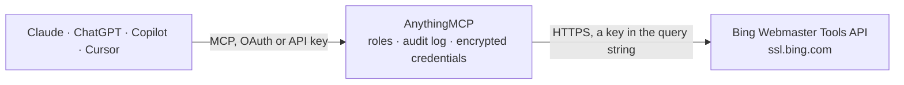

<!-- Generated by scripts/export-github-catalog.mjs in the anythingmcp-website repository. Do not edit by hand. -->

# Bing Webmaster Tools MCP connector

Bing Webmaster Tools: sites, search queries and pages with clicks, impressions and positions, crawl stats and issues, URL index details, inbound links, sitemaps, keyword research, URL and sitemap submission. The AnythingMCP connector gives Claude, ChatGPT, Microsoft Copilot, Cursor and Gemini 25 MCP tools for Bing Webmaster Tools: 22 read and 3 can change data.

**Category:** [Analytics](../analytics.md) · **Tools:** 25 · **Setup guide:** [anythingmcp.com](https://anythingmcp.com/guides/bing-webmaster-to-mcp) · [Deutsch](https://anythingmcp.com/de/guides/bing-webmaster-to-mcp) · [Italiano](https://anythingmcp.com/it/guides/bing-webmaster-to-mcp) · [Español](https://anythingmcp.com/es/guides/bing-webmaster-to-mcp) · [日本語](https://anythingmcp.com/ja/guides/bing-webmaster-to-mcp) · [Русский](https://anythingmcp.com/ru/guides/bing-webmaster-to-mcp) · [中文](https://anythingmcp.com/zh/guides/bing-webmaster-to-mcp)

## Start without code

No installation and no terminal: AnythingMCP Cloud runs the Bing Webmaster Tools connector for you, operated by helpcode.ai in Frankfurt, Germany.

1. **Click the button above** and create an account or sign in. The Bing Webmaster Tools connector opens, ready to install.
2. **Paste the API key or token from your Bing Webmaster Tools account.** Every click is in the [step-by-step guide](https://anythingmcp.com/guides/bing-webmaster-to-mcp).
3. **Click Install.** AnythingMCP shows the address of your MCP server.
4. **Add that address to your assistant:** [Claude](https://anythingmcp.com/guides/connect-bing-webmaster-to-claude) · [ChatGPT](https://anythingmcp.com/guides/connect-bing-webmaster-to-chatgpt) · [Microsoft Copilot](https://anythingmcp.com/guides/connect-bing-webmaster-to-copilot) · [Cursor](https://anythingmcp.com/guides/connect-bing-webmaster-to-cursor) · [Gemini CLI](https://anythingmcp.com/guides/connect-bing-webmaster-to-gemini) · [Meta Muse](https://anythingmcp.com/guides/connect-bing-webmaster-to-muse).
5. **Ask your first question**, for example: *Check Bing index status and last crawl for https://www.riverbank-books.com/collections/fiction/treasures*

Prefer help with the setup? [Talk to us](https://anythingmcp.com/contact).

## How it works

- **The AI client** speaks MCP (Streamable HTTP) to AnythingMCP and only sees tool names, descriptions and results. It never gets the Bing Webmaster Tools credentials.
- **AnythingMCP** checks the client's role, builds the call from the tool definition, adds the credentials (a key in the query string), calls Bing Webmaster Tools, logs the call and returns the result.
- **Bing Webmaster Tools** sees an ordinary API client with the rights of the account the credentials belong to.

## Tools

| Tool | What it does | Access |
|---|---|---|
| [`bing_webmaster_list_sites`](#bing_webmaster_list_sites) | List the sites in the Bing Webmaster Tools account with their URL, verification state and verification codes. | read |
| [`bing_webmaster_get_rank_and_traffic_stats`](#bing_webmaster_get_rank_and_traffic_stats) | Get the daily clicks and impressions of a site in Bing search over the last months. | read |
| [`bing_webmaster_get_query_stats`](#bing_webmaster_get_query_stats) | Get the top search queries that showed the site in Bing, with impressions, clicks, average impression position and average click position per query and period. | read |
| [`bing_webmaster_get_page_stats`](#bing_webmaster_get_page_stats) | Get the top pages of the site in Bing search with impressions, clicks and average positions. | read |
| [`bing_webmaster_get_query_page_stats`](#bing_webmaster_get_query_page_stats) | Get the pages of the site that appeared for one search query, with impressions, clicks and positions. | read |
| [`bing_webmaster_get_page_query_stats`](#bing_webmaster_get_page_query_stats) | Get the search queries for which one page of the site appeared in Bing, with impressions, clicks and positions per query. | read |
| [`bing_webmaster_get_query_traffic_stats`](#bing_webmaster_get_query_traffic_stats) | Get the daily clicks and impressions for one search query on the site. | read |
| [`bing_webmaster_get_query_page_detail_stats`](#bing_webmaster_get_query_page_detail_stats) | Get the daily impressions, clicks and positions for one query on one page of the site. | read |
| [`bing_webmaster_get_crawl_stats`](#bing_webmaster_get_crawl_stats) | Get daily crawl statistics for the site: pages crawled, crawl errors, pages in index, blocked by robots.txt, HTTP 2xx/3xx/4xx/5xx counts, DNS and connection… | read |
| [`bing_webmaster_get_crawl_issues`](#bing_webmaster_get_crawl_issues) | List URLs of the site with crawl issues found by Bingbot (for example 404, 500, blocked by robots.txt, DNS or timeout problems), with issue type and the… | read |
| [`bing_webmaster_get_url_info`](#bing_webmaster_get_url_info) | Get Bing's index details for one URL of the site: HTTP status, last crawl date, discovery date, document size, anchor count and whether it is a page or a… | read |
| [`bing_webmaster_get_url_traffic_info`](#bing_webmaster_get_url_traffic_info) | Get the clicks and impressions Bing recorded for one URL of the site or for a directory. | read |
| [`bing_webmaster_get_link_counts`](#bing_webmaster_get_link_counts) | List pages of the site that have inbound links from other sites, with the number of links for each. | read |
| [`bing_webmaster_get_url_links`](#bing_webmaster_get_url_links) | List the external pages that link to one URL of the site, with their URL and anchor text. | read |
| [`bing_webmaster_get_url_submission_quota`](#bing_webmaster_get_url_submission_quota) | Get how many URLs the site may still submit today and this month through the URL submission API. | read |
| [`bing_webmaster_list_sitemaps`](#bing_webmaster_list_sitemaps) | List the sitemaps and feeds submitted for the site with URL, type, status, last crawl date, submission date and number of URLs found. | read |
| [`bing_webmaster_get_sitemap_details`](#bing_webmaster_get_sitemap_details) | Get the child sitemaps of a sitemap index with their status, last crawl and URL counts. | read |
| [`bing_webmaster_get_crawl_settings`](#bing_webmaster_get_crawl_settings) | Get the crawl settings of the site: crawl rate by hour of day and whether the crawl-delay in robots.txt is respected. | read |
| [`bing_webmaster_list_blocked_urls`](#bing_webmaster_list_blocked_urls) | List the URLs and directories of the site that are blocked from Bing search results through the Block URLs tool, with type and expiry date. | read |
| [`bing_webmaster_get_keyword_stats`](#bing_webmaster_get_keyword_stats) | Get Bing's historical weekly search impressions for a keyword in a country and language. | read |
| [`bing_webmaster_get_keyword`](#bing_webmaster_get_keyword) | Get the total Bing search impressions for a keyword in a country and language over a date range, with broad and exact match counts. | read |
| [`bing_webmaster_get_related_keywords`](#bing_webmaster_get_related_keywords) | Get keywords related to a keyword, with their Bing search impressions in a country and language over a date range. | read |
| [`bing_webmaster_submit_url`](#bing_webmaster_submit_url) | Submit one URL of a verified site to Bing for crawling and indexing. | write |
| [`bing_webmaster_submit_url_batch`](#bing_webmaster_submit_url_batch) | Submit up to 500 URLs of a verified site to Bing in one call for crawling and indexing. | write |
| [`bing_webmaster_submit_sitemap`](#bing_webmaster_submit_sitemap) | Submit a sitemap or feed URL for a site so Bing crawls it regularly. | write |

## Tool reference

Every parameter as the AI client sees it in `tools/list`. Source: [`packages/backend/src/adapters/intl/bing-webmaster.json`](../../../packages/backend/src/adapters/intl/bing-webmaster.json).

### `bing_webmaster_list_sites`

List the sites in the Bing Webmaster Tools account with their URL, verification state and verification codes. Call this first: every other tool needs the site URL exactly as listed here.

**Access:** read · **Call:** `GET /GetUserSites`

No parameters.

### `bing_webmaster_get_rank_and_traffic_stats`

Get the daily clicks and impressions of a site in Bing search over the last months. Use it for the overall traffic trend before drilling into queries or pages.

**Access:** read · **Call:** `GET /GetRankAndTrafficStats`

| Parameter | Type | Required | Description |
|---|---|---|---|
| `site_url` | string | yes | Site URL exactly as registered in Bing Webmaster Tools, with scheme and trailing slash, for example https://www.example.com/. Get it from bing_webmaster_list_sites. |

### `bing_webmaster_get_query_stats`

Get the top search queries that showed the site in Bing, with impressions, clicks, average impression position and average click position per query and period.

**Access:** read · **Call:** `GET /GetQueryStats`

| Parameter | Type | Required | Description |
|---|---|---|---|
| `site_url` | string | yes | Site URL exactly as registered in Bing Webmaster Tools, with scheme and trailing slash, for example https://www.example.com/. Get it from bing_webmaster_list_sites. |

### `bing_webmaster_get_page_stats`

Get the top pages of the site in Bing search with impressions, clicks and average positions. Use it to see which URLs bring Bing traffic.

**Access:** read · **Call:** `GET /GetPageStats`

| Parameter | Type | Required | Description |
|---|---|---|---|
| `site_url` | string | yes | Site URL exactly as registered in Bing Webmaster Tools, with scheme and trailing slash, for example https://www.example.com/. Get it from bing_webmaster_list_sites. |

### `bing_webmaster_get_query_page_stats`

Get the pages of the site that appeared for one search query, with impressions, clicks and positions. Use it to find which URL ranks for a keyword.

**Access:** read · **Call:** `GET /GetQueryPageStats`

| Parameter | Type | Required | Description |
|---|---|---|---|
| `site_url` | string | yes | Site URL exactly as registered in Bing Webmaster Tools, with scheme and trailing slash, for example https://www.example.com/. Get it from bing_webmaster_list_sites. |
| `query` | string | yes | Search query exactly as returned by bing_webmaster_get_query_stats. |

### `bing_webmaster_get_page_query_stats`

Get the search queries for which one page of the site appeared in Bing, with impressions, clicks and positions per query.

**Access:** read · **Call:** `GET /GetPageQueryStats`

| Parameter | Type | Required | Description |
|---|---|---|---|
| `site_url` | string | yes | Site URL exactly as registered in Bing Webmaster Tools, with scheme and trailing slash, for example https://www.example.com/. Get it from bing_webmaster_list_sites. |
| `page_url` | string | yes | Full page URL, for example https://www.example.com/pricing. |

### `bing_webmaster_get_query_traffic_stats`

Get the daily clicks and impressions for one search query on the site. Use it to follow how a single keyword develops over time.

**Access:** read · **Call:** `GET /GetQueryTrafficStats`

| Parameter | Type | Required | Description |
|---|---|---|---|
| `site_url` | string | yes | Site URL exactly as registered in Bing Webmaster Tools, with scheme and trailing slash, for example https://www.example.com/. Get it from bing_webmaster_list_sites. |
| `query` | string | yes | Search query. |

### `bing_webmaster_get_query_page_detail_stats`

Get the daily impressions, clicks and positions for one query on one page of the site. The most detailed level of the search performance data.

**Access:** read · **Call:** `GET /GetQueryPageDetailStats`

| Parameter | Type | Required | Description |
|---|---|---|---|
| `site_url` | string | yes | Site URL exactly as registered in Bing Webmaster Tools, with scheme and trailing slash, for example https://www.example.com/. Get it from bing_webmaster_list_sites. |
| `query` | string | yes | Search query. |
| `page_url` | string | yes | Full page URL. |

### `bing_webmaster_get_crawl_stats`

Get daily crawl statistics for the site: pages crawled, crawl errors, pages in index, blocked by robots.txt, HTTP 2xx/3xx/4xx/5xx counts, DNS and connection failures.

**Access:** read · **Call:** `GET /GetCrawlStats`

| Parameter | Type | Required | Description |
|---|---|---|---|
| `site_url` | string | yes | Site URL exactly as registered in Bing Webmaster Tools, with scheme and trailing slash, for example https://www.example.com/. Get it from bing_webmaster_list_sites. |

### `bing_webmaster_get_crawl_issues`

List URLs of the site with crawl issues found by Bingbot (for example 404, 500, blocked by robots.txt, DNS or timeout problems), with issue type and the HTTP code.

**Access:** read · **Call:** `GET /GetCrawlIssues`

| Parameter | Type | Required | Description |
|---|---|---|---|
| `site_url` | string | yes | Site URL exactly as registered in Bing Webmaster Tools, with scheme and trailing slash, for example https://www.example.com/. Get it from bing_webmaster_list_sites. |

### `bing_webmaster_get_url_info`

Get Bing's index details for one URL of the site: HTTP status, last crawl date, discovery date, document size, anchor count and whether it is a page or a directory.

**Access:** read · **Call:** `GET /GetUrlInfo`

| Parameter | Type | Required | Description |
|---|---|---|---|
| `site_url` | string | yes | Site URL exactly as registered in Bing Webmaster Tools, with scheme and trailing slash, for example https://www.example.com/. Get it from bing_webmaster_list_sites. |
| `url` | string | yes | Full URL of the page to look up, for example https://www.example.com/blog/post. |

### `bing_webmaster_get_url_traffic_info`

Get the clicks and impressions Bing recorded for one URL of the site or for a directory. Use it to check the search traffic of a single page.

**Access:** read · **Call:** `GET /GetUrlTrafficInfo`

| Parameter | Type | Required | Description |
|---|---|---|---|
| `site_url` | string | yes | Site URL exactly as registered in Bing Webmaster Tools, with scheme and trailing slash, for example https://www.example.com/. Get it from bing_webmaster_list_sites. |
| `url` | string | yes | Full URL of the page or directory. |

### `bing_webmaster_get_link_counts`

List pages of the site that have inbound links from other sites, with the number of links for each. Paged with page starting at 0; TotalPages in the answer.

**Access:** read · **Call:** `GET /GetLinkCounts`

| Parameter | Type | Required | Description |
|---|---|---|---|
| `site_url` | string | yes | Site URL exactly as registered in Bing Webmaster Tools, with scheme and trailing slash, for example https://www.example.com/. Get it from bing_webmaster_list_sites. |
| `page` | integer | no | Result page, starting at 0. |

### `bing_webmaster_get_url_links`

List the external pages that link to one URL of the site, with their URL and anchor text. Paged with page starting at 0.

**Access:** read · **Call:** `GET /GetUrlLinks`

| Parameter | Type | Required | Description |
|---|---|---|---|
| `site_url` | string | yes | Site URL exactly as registered in Bing Webmaster Tools, with scheme and trailing slash, for example https://www.example.com/. Get it from bing_webmaster_list_sites. |
| `link` | string | yes | URL on your site whose inbound links you want, from bing_webmaster_get_link_counts. |
| `page` | integer | no | Result page, starting at 0. |

### `bing_webmaster_get_url_submission_quota`

Get how many URLs the site may still submit today and this month through the URL submission API. Check it before bing_webmaster_submit_url_batch.

**Access:** read · **Call:** `GET /GetUrlSubmissionQuota`

| Parameter | Type | Required | Description |
|---|---|---|---|
| `site_url` | string | yes | Site URL exactly as registered in Bing Webmaster Tools, with scheme and trailing slash, for example https://www.example.com/. Get it from bing_webmaster_list_sites. |

### `bing_webmaster_list_sitemaps`

List the sitemaps and feeds submitted for the site with URL, type, status, last crawl date, submission date and number of URLs found.

**Access:** read · **Call:** `GET /GetFeeds`

| Parameter | Type | Required | Description |
|---|---|---|---|
| `site_url` | string | yes | Site URL exactly as registered in Bing Webmaster Tools, with scheme and trailing slash, for example https://www.example.com/. Get it from bing_webmaster_list_sites. |

### `bing_webmaster_get_sitemap_details`

Get the child sitemaps of a sitemap index with their status, last crawl and URL counts. Use it when a sitemap index shows errors.

**Access:** read · **Call:** `GET /GetFeedDetails`

| Parameter | Type | Required | Description |
|---|---|---|---|
| `site_url` | string | yes | Site URL exactly as registered in Bing Webmaster Tools, with scheme and trailing slash, for example https://www.example.com/. Get it from bing_webmaster_list_sites. |
| `feed_url` | string | yes | Sitemap index URL from bing_webmaster_list_sitemaps. |

### `bing_webmaster_get_crawl_settings`

Get the crawl settings of the site: crawl rate by hour of day and whether the crawl-delay in robots.txt is respected.

**Access:** read · **Call:** `GET /GetCrawlSettings`

| Parameter | Type | Required | Description |
|---|---|---|---|
| `site_url` | string | yes | Site URL exactly as registered in Bing Webmaster Tools, with scheme and trailing slash, for example https://www.example.com/. Get it from bing_webmaster_list_sites. |

### `bing_webmaster_list_blocked_urls`

List the URLs and directories of the site that are blocked from Bing search results through the Block URLs tool, with type and expiry date.

**Access:** read · **Call:** `GET /GetBlockedUrls`

| Parameter | Type | Required | Description |
|---|---|---|---|
| `site_url` | string | yes | Site URL exactly as registered in Bing Webmaster Tools, with scheme and trailing slash, for example https://www.example.com/. Get it from bing_webmaster_list_sites. |

### `bing_webmaster_get_keyword_stats`

Get Bing's historical weekly search impressions for a keyword in a country and language. Use it for keyword research, independent of your sites.

**Access:** read · **Call:** `GET /GetKeywordStats`

| Parameter | Type | Required | Description |
|---|---|---|---|
| `q` | string | yes | Keyword or phrase, for example running shoes. |
| `country` | string | no | Country code in lower case, for example us, gb, de. Empty for all countries. |
| `language` | string | no | Language-market code, for example en-US, de-DE. Empty for all languages. |

### `bing_webmaster_get_keyword`

Get the total Bing search impressions for a keyword in a country and language over a date range, with broad and exact match counts.

**Access:** read · **Call:** `GET /GetKeyword`

| Parameter | Type | Required | Description |
|---|---|---|---|
| `q` | string | yes | Keyword or phrase, for example running shoes. |
| `country` | string | no | Country code in lower case, for example us, gb, de. Empty for all countries. |
| `language` | string | no | Language-market code, for example en-US, de-DE. Empty for all languages. |
| `start_date` | string | yes | Start date, ISO 8601, for example 2026-07-01. |
| `end_date` | string | yes | End date, ISO 8601. |

### `bing_webmaster_get_related_keywords`

Get keywords related to a keyword, with their Bing search impressions in a country and language over a date range. Use it to widen a keyword list.

**Access:** read · **Call:** `GET /GetRelatedKeywords`

| Parameter | Type | Required | Description |
|---|---|---|---|
| `q` | string | yes | Keyword or phrase, for example running shoes. |
| `country` | string | no | Country code in lower case, for example us, gb, de. Empty for all countries. |
| `language` | string | no | Language-market code, for example en-US, de-DE. Empty for all languages. |
| `start_date` | string | yes | Start date, ISO 8601. |
| `end_date` | string | yes | End date, ISO 8601. |

### `bing_webmaster_submit_url`

Submit one URL of a verified site to Bing for crawling and indexing. Uses one unit of the daily URL submission quota. Returns nothing on success.

**Access:** write · **Call:** `POST /SubmitUrl`

| Parameter | Type | Required | Description |
|---|---|---|---|
| `site_url` | string | yes | Site URL exactly as registered in Bing Webmaster Tools, with scheme and trailing slash, for example https://www.example.com/. Get it from bing_webmaster_list_sites. |
| `url` | string | yes | Full URL to submit, on the same site. |

### `bing_webmaster_submit_url_batch`

Submit up to 500 URLs of a verified site to Bing in one call for crawling and indexing. Each URL uses one unit of the daily quota; check the quota first.

**Access:** write · **Call:** `POST /SubmitUrlBatch`

| Parameter | Type | Required | Description |
|---|---|---|---|
| `site_url` | string | yes | Site URL exactly as registered in Bing Webmaster Tools, with scheme and trailing slash, for example https://www.example.com/. Get it from bing_webmaster_list_sites. |
| `url_list` | string[] | yes | URLs to submit, all on the same site, at most 500. |

### `bing_webmaster_submit_sitemap`

Submit a sitemap or feed URL for a site so Bing crawls it regularly. Use it after adding a new sitemap; it then appears in bing_webmaster_list_sitemaps.

**Access:** write · **Call:** `POST /SubmitFeed`

| Parameter | Type | Required | Description |
|---|---|---|---|
| `site_url` | string | yes | Site URL exactly as registered in Bing Webmaster Tools, with scheme and trailing slash, for example https://www.example.com/. Get it from bing_webmaster_list_sites. |
| `feed_url` | string | yes | Full URL of the sitemap, for example https://www.example.com/sitemap.xml. |

## Run it yourself

AnythingMCP is open source (AGPL-3.0). [Run it with Docker](../../../README.md#run-it-yourself), open **Connectors → Store**, pick **Bing Webmaster Tools** and enter `BING_WEBMASTER_API_KEY`, then add your MCP server URL to the AI client.

[← Analytics connectors](../analytics.md) · [All categories](../README.md)
