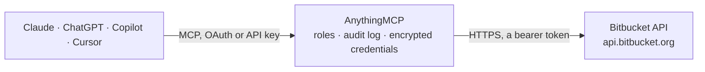

<!-- Generated by scripts/export-github-catalog.mjs in the anythingmcp-website repository. Do not edit by hand. -->

# Bitbucket MCP connector

Let your AI work in Bitbucket Cloud: browse repositories, branches, commits and files, review pull requests with diffs and comments, approve, comment and merge after you confirm, and check Bitbucket … The AnythingMCP connector gives Claude, ChatGPT, Microsoft Copilot, Cursor and Gemini 25 MCP tools for Bitbucket: 20 read and 5 can change data.

**Category:** [Infrastructure](../infrastructure.md) · **Tools:** 25 · **Setup guide:** [anythingmcp.com](https://anythingmcp.com/guides/bitbucket-to-mcp) · [Deutsch](https://anythingmcp.com/de/guides/bitbucket-to-mcp) · [Italiano](https://anythingmcp.com/it/guides/bitbucket-to-mcp) · [Español](https://anythingmcp.com/es/guides/bitbucket-to-mcp) · [日本語](https://anythingmcp.com/ja/guides/bitbucket-to-mcp) · [Русский](https://anythingmcp.com/ru/guides/bitbucket-to-mcp) · [中文](https://anythingmcp.com/zh/guides/bitbucket-to-mcp)

## Start without code

No installation and no terminal: AnythingMCP Cloud runs the Bitbucket connector for you, operated by helpcode.ai in Frankfurt, Germany.

1. **Click the button above** and create an account or sign in. The Bitbucket connector opens, ready to install.
2. **Paste the API key or token from your Bitbucket account.** Every click is in the [step-by-step guide](https://anythingmcp.com/guides/bitbucket-to-mcp).
3. **Click Install.** AnythingMCP shows the address of your MCP server.
4. **Add that address to your assistant:** [Claude](https://anythingmcp.com/guides/connect-bitbucket-to-claude) · [ChatGPT](https://anythingmcp.com/guides/connect-bitbucket-to-chatgpt) · [Microsoft Copilot](https://anythingmcp.com/guides/connect-bitbucket-to-copilot) · [Cursor](https://anythingmcp.com/guides/connect-bitbucket-to-cursor) · [Gemini CLI](https://anythingmcp.com/guides/connect-bitbucket-to-gemini) · [Meta Muse](https://anythingmcp.com/guides/connect-bitbucket-to-muse).
5. **Ask your first question**, for example: *What is the status, source and destination branches, and reviewers for PR 42 in workspace kestrel/repo-billing?*

Prefer help with the setup? [Talk to us](https://anythingmcp.com/contact).

## How it works

- **The AI client** speaks MCP (Streamable HTTP) to AnythingMCP and only sees tool names, descriptions and results. It never gets the Bitbucket credentials.
- **AnythingMCP** checks the client's role, builds the call from the tool definition, adds the credentials (a bearer token), calls Bitbucket, logs the call and returns the result.
- **Bitbucket** sees an ordinary API client with the rights of the account the credentials belong to.

## Tools

| Tool | What it does | Access |
|---|---|---|
| [`bitbucket_get_current_user`](#bitbucket_get_current_user) | Get the Bitbucket account the token belongs to: display name, nickname, uuid, account_id and profile link. | read |
| [`bitbucket_list_workspaces`](#bitbucket_list_workspaces) | List the workspaces the token's user belongs to: slug, name, uuid and whether the user is an administrator there. | read |
| [`bitbucket_list_repositories`](#bitbucket_list_repositories) | List repositories in a workspace, most recently updated first: full_name, slug, description, private flag, language, main branch, project key and web link. | read |
| [`bitbucket_get_repository`](#bitbucket_get_repository) | Get one repository: description, main branch, project, privacy, language, size, fork parent, clone URLs and web link. | read |
| [`bitbucket_list_branches`](#bitbucket_list_branches) | List branches of a repository with the latest commit of each (hash, date, message, author). | read |
| [`bitbucket_list_commits`](#bitbucket_list_commits) | List commits newest first: hash, date, message, author and parents. | read |
| [`bitbucket_get_commit`](#bitbucket_get_commit) | Get one commit: full hash, date, full message, author, parents and web link. | read |
| [`bitbucket_get_file`](#bitbucket_get_file) | Read a file or list a folder at a commit or branch. | read |
| [`bitbucket_list_pull_requests`](#bitbucket_list_pull_requests) | List pull requests of a repository, open ones by default: id, title, state, draft, author, source and destination branch, comment and task counts and web link. | read |
| [`bitbucket_get_pull_request`](#bitbucket_get_pull_request) | Get one pull request: title, description, state, branches and commits, merge commit, reviewers and participants with their approval state, counts and web link. | read |
| [`bitbucket_get_pull_request_diffstat`](#bitbucket_get_pull_request_diffstat) | List the files a pull request changes: status (added, removed, modified, renamed), old and new path, lines added and removed. | read |
| [`bitbucket_get_pull_request_diff`](#bitbucket_get_pull_request_diff) | Read the unified diff of a pull request as plain text. | read |
| [`bitbucket_list_pull_request_commits`](#bitbucket_list_pull_request_commits) | List the commits a pull request contains, newest first: hash, date, message and author. | read |
| [`bitbucket_list_pull_request_comments`](#bitbucket_list_pull_request_comments) | List comments on a pull request, oldest first: id, author, text, inline position (file and line) for code comments, parent id for replies, and created and… | read |
| [`bitbucket_create_pull_request`](#bitbucket_create_pull_request) | Open a pull request from a source branch into a destination branch of the same repository, as the token's user. | write |
| [`bitbucket_add_pull_request_comment`](#bitbucket_add_pull_request_comment) | Post a comment on a pull request as the token's user: a general comment, a reply (parent) or a code comment on a line (inline). | write |
| [`bitbucket_approve_pull_request`](#bitbucket_approve_pull_request) | Approve a pull request as the token's user. | write |
| [`bitbucket_merge_pull_request`](#bitbucket_merge_pull_request) | Merge an open pull request into its destination branch. | write |
| [`bitbucket_list_pipelines`](#bitbucket_list_pipelines) | List Bitbucket Pipelines runs of a repository, newest first: uuid, build number, state (PENDING, IN_PROGRESS, COMPLETED), result (SUCCESSFUL, FAILED, ERROR,… | read |
| [`bitbucket_get_pipeline`](#bitbucket_get_pipeline) | Get one pipeline run: state, result, branch or tag, commit, custom pipeline name, trigger, creator, start, end and duration. | read |
| [`bitbucket_list_pipeline_steps`](#bitbucket_list_pipeline_steps) | List the steps of a pipeline run: uuid, name, state, result, start, end, duration, build image name and script command names. | read |
| [`bitbucket_get_pipeline_step_log`](#bitbucket_get_pipeline_step_log) | Read the log of one pipeline step as plain text. | read |
| [`bitbucket_run_pipeline`](#bitbucket_run_pipeline) | Start a Bitbucket Pipelines run on a branch or tag, optionally a custom pipeline from bitbucket-pipelines.yml. | write |
| [`bitbucket_list_environments`](#bitbucket_list_environments) | List the deployment environments of a repository (for example Test, Staging, Production): uuid, name, type, rank and lock state. | read |
| [`bitbucket_list_deployments`](#bitbucket_list_deployments) | List deployments of a repository: environment uuid, state (UNDEPLOYED, IN_PROGRESS, COMPLETED), status (SUCCESSFUL, FAILED, STOPPED), who deployed, start… | read |

## Tool reference

Every parameter as the AI client sees it in `tools/list`. Source: [`packages/backend/src/adapters/intl/bitbucket.json`](../../../packages/backend/src/adapters/intl/bitbucket.json).

### `bitbucket_get_current_user`

Get the Bitbucket account the token belongs to: display name, nickname, uuid, account_id and profile link. A quick check that the token works. Read-only.

**Access:** read · **Call:** `GET /user`

No parameters.

### `bitbucket_list_workspaces`

List the workspaces the token's user belongs to: slug, name, uuid and whether the user is an administrator there. The slug is what every other tool calls workspace. Read-only.

**Access:** read · **Call:** `GET /user/workspaces`

| Parameter | Type | Required | Description |
|---|---|---|---|
| `administrator` | boolean | no | Only workspaces where the user is an administrator. |
| `sort` | string | no | Sort field, e.g. workspace.slug or -workspace.updated_on. |
| `page` | integer | no | Page number, from 1. When the answer has next, call again with the page number shown in that link. |
| `pagelen` | integer | no | Items per page (default 50, maximum 100). |

### `bitbucket_list_repositories`

List repositories in a workspace, most recently updated first: full_name, slug, description, private flag, language, main branch, project key and web link. Narrow with role or a query such as name ~ "api". Read-only.

**Access:** read · **Call:** `GET /repositories/{workspace}`

| Parameter | Type | Required | Description |
|---|---|---|---|
| `workspace` | string | yes | Workspace slug, the first part of bitbucket.org/<workspace>/<repo>, e.g. acme. From bitbucket_list_workspaces. |
| `role` | `member` \| `contributor` \| `admin` \| `owner` | no | Only repositories where the user has this role. |
| `q` | string | no | Bitbucket query filter, e.g. name ~ "api" or project.key = "WEB". |
| `sort` | string | no | Sort field; default -updated_on (newest first). |
| `page` | integer | no | Page number, from 1. When the answer has next, call again with the page number shown in that link. |
| `pagelen` | integer | no | Items per page (default 25, maximum 100). |

### `bitbucket_get_repository`

Get one repository: description, main branch, project, privacy, language, size, fork parent, clone URLs and web link. Read-only.

**Access:** read · **Call:** `GET /repositories/{workspace}/{repo_slug}`

| Parameter | Type | Required | Description |
|---|---|---|---|
| `workspace` | string | yes | Workspace slug, the first part of bitbucket.org/<workspace>/<repo>, e.g. acme. From bitbucket_list_workspaces. |
| `repo_slug` | string | yes | Repository slug, the second part of bitbucket.org/<workspace>/<repo>, e.g. web-app. From bitbucket_list_repositories. |

### `bitbucket_list_branches`

List branches of a repository with the latest commit of each (hash, date, message, author). Filter with q, e.g. name ~ "release". Read-only.

**Access:** read · **Call:** `GET /repositories/{workspace}/{repo_slug}/refs/branches`

| Parameter | Type | Required | Description |
|---|---|---|---|
| `workspace` | string | yes | Workspace slug, the first part of bitbucket.org/<workspace>/<repo>, e.g. acme. From bitbucket_list_workspaces. |
| `repo_slug` | string | yes | Repository slug, the second part of bitbucket.org/<workspace>/<repo>, e.g. web-app. From bitbucket_list_repositories. |
| `q` | string | no | Bitbucket query filter, e.g. name ~ "feature/". |
| `sort` | string | no | Sort field, e.g. -target.date for the most recently changed first. |
| `page` | integer | no | Page number, from 1. When the answer has next, call again with the page number shown in that link. |
| `pagelen` | integer | no | Items per page (default 25, maximum 100). |

### `bitbucket_list_commits`

List commits newest first: hash, date, message, author and parents. Without include it covers every branch; set include to a branch to read its history, path to see only commits that touched a file or folder. Read-only.

**Access:** read · **Call:** `GET /repositories/{workspace}/{repo_slug}/commits`

| Parameter | Type | Required | Description |
|---|---|---|---|
| `workspace` | string | yes | Workspace slug, the first part of bitbucket.org/<workspace>/<repo>, e.g. acme. From bitbucket_list_workspaces. |
| `repo_slug` | string | yes | Repository slug, the second part of bitbucket.org/<workspace>/<repo>, e.g. web-app. From bitbucket_list_repositories. |
| `include` | string | no | Branch, tag or commit whose history to list, e.g. main. |
| `exclude` | string | no | Leave out commits reachable from this branch, e.g. main, to see what a feature branch adds. |
| `path` | string | no | Only commits that changed this file or folder, e.g. src/app.ts. |
| `page` | string | no | Page token: copy the page value from next in the previous answer. Commit pages are not numbered. |
| `pagelen` | integer | no | Items per page (default 20, maximum 100). |

### `bitbucket_get_commit`

Get one commit: full hash, date, full message, author, parents and web link. Read-only.

**Access:** read · **Call:** `GET /repositories/{workspace}/{repo_slug}/commit/{commit}`

| Parameter | Type | Required | Description |
|---|---|---|---|
| `workspace` | string | yes | Workspace slug, the first part of bitbucket.org/<workspace>/<repo>, e.g. acme. From bitbucket_list_workspaces. |
| `repo_slug` | string | yes | Repository slug, the second part of bitbucket.org/<workspace>/<repo>, e.g. web-app. From bitbucket_list_repositories. |
| `commit` | string | yes | Commit hash (full or short), from bitbucket_list_commits. |

### `bitbucket_get_file`

Read a file or list a folder at a commit or branch. For a file it returns the raw text (cut at 200 KB); for a folder a page of entries with path, type (commit_file or commit_directory) and size. Leave path empty for the repository root. Set format to meta for a file's size and attributes without its content. Read-only.

**Access:** read · **Call:** `GET /repositories/{workspace}/{repo_slug}/src/{commit}/{path}`

| Parameter | Type | Required | Description |
|---|---|---|---|
| `workspace` | string | yes | Workspace slug, the first part of bitbucket.org/<workspace>/<repo>, e.g. acme. From bitbucket_list_workspaces. |
| `repo_slug` | string | yes | Repository slug, the second part of bitbucket.org/<workspace>/<repo>, e.g. web-app. From bitbucket_list_repositories. |
| `commit` | string | no | Commit hash or branch name; HEAD (default) is the main branch. For a branch whose name contains a slash, pass its commit hash from bitbucket_list_branches instead. |
| `path` | string | no | File or folder path inside the repository, e.g. src/app.ts or docs. Empty (default) lists the root. |
| `format` | `meta` | no | meta returns the file's metadata as JSON instead of its content. |
| `max_depth` | integer | no | For folders: also list subfolders this many levels deep (default 1). |
| `page` | integer | no | Page number, from 1. When the answer has next, call again with the page number shown in that link. |
| `pagelen` | integer | no | Items per page (default 100, maximum 100). |

### `bitbucket_list_pull_requests`

List pull requests of a repository, open ones by default: id, title, state, draft, author, source and destination branch, comment and task counts and web link. Read-only.

**Access:** read · **Call:** `GET /repositories/{workspace}/{repo_slug}/pullrequests`

| Parameter | Type | Required | Description |
|---|---|---|---|
| `workspace` | string | yes | Workspace slug, the first part of bitbucket.org/<workspace>/<repo>, e.g. acme. From bitbucket_list_workspaces. |
| `repo_slug` | string | yes | Repository slug, the second part of bitbucket.org/<workspace>/<repo>, e.g. web-app. From bitbucket_list_repositories. |
| `state` | `OPEN` \| `MERGED` \| `DECLINED` \| `SUPERSEDED`[] | no | States to include (default OPEN). Pass several, e.g. ["MERGED", "DECLINED"]. |
| `q` | string | no | Bitbucket query filter, e.g. author.nickname = "jane" or destination.branch.name = "main". |
| `sort` | string | no | Sort field; default -updated_on. |
| `page` | integer | no | Page number, from 1. When the answer has next, call again with the page number shown in that link. |
| `pagelen` | integer | no | Items per page (default 25, maximum 50). |

### `bitbucket_get_pull_request`

Get one pull request: title, description, state, branches and commits, merge commit, reviewers and participants with their approval state, counts and web link. Read-only.

**Access:** read · **Call:** `GET /repositories/{workspace}/{repo_slug}/pullrequests/{pull_request_id}`

| Parameter | Type | Required | Description |
|---|---|---|---|
| `workspace` | string | yes | Workspace slug, the first part of bitbucket.org/<workspace>/<repo>, e.g. acme. From bitbucket_list_workspaces. |
| `repo_slug` | string | yes | Repository slug, the second part of bitbucket.org/<workspace>/<repo>, e.g. web-app. From bitbucket_list_repositories. |
| `pull_request_id` | integer | yes | Pull request number (id), as shown in the UI as #12. From bitbucket_list_pull_requests. |

### `bitbucket_get_pull_request_diffstat`

List the files a pull request changes: status (added, removed, modified, renamed), old and new path, lines added and removed. Use it before bitbucket_get_pull_request_diff to see the size of the change. Read-only.

**Access:** read · **Call:** `GET /repositories/{workspace}/{repo_slug}/pullrequests/{pull_request_id}/diffstat`

| Parameter | Type | Required | Description |
|---|---|---|---|
| `workspace` | string | yes | Workspace slug, the first part of bitbucket.org/<workspace>/<repo>, e.g. acme. From bitbucket_list_workspaces. |
| `repo_slug` | string | yes | Repository slug, the second part of bitbucket.org/<workspace>/<repo>, e.g. web-app. From bitbucket_list_repositories. |
| `pull_request_id` | integer | yes | Pull request number (id), as shown in the UI as #12. From bitbucket_list_pull_requests. |
| `page` | integer | no | Page number, from 1. When the answer has next, call again with the page number shown in that link. |
| `pagelen` | integer | no | Items per page (default 100, maximum 500). |

### `bitbucket_get_pull_request_diff`

Read the unified diff of a pull request as plain text. Diffs over 200 KB are cut and marked _truncated; check bitbucket_get_pull_request_diffstat first for large changes. Read-only.

**Access:** read · **Call:** `GET /repositories/{workspace}/{repo_slug}/pullrequests/{pull_request_id}/diff`

| Parameter | Type | Required | Description |
|---|---|---|---|
| `workspace` | string | yes | Workspace slug, the first part of bitbucket.org/<workspace>/<repo>, e.g. acme. From bitbucket_list_workspaces. |
| `repo_slug` | string | yes | Repository slug, the second part of bitbucket.org/<workspace>/<repo>, e.g. web-app. From bitbucket_list_repositories. |
| `pull_request_id` | integer | yes | Pull request number (id), as shown in the UI as #12. From bitbucket_list_pull_requests. |

### `bitbucket_list_pull_request_commits`

List the commits a pull request contains, newest first: hash, date, message and author. Read-only.

**Access:** read · **Call:** `GET /repositories/{workspace}/{repo_slug}/pullrequests/{pull_request_id}/commits`

| Parameter | Type | Required | Description |
|---|---|---|---|
| `workspace` | string | yes | Workspace slug, the first part of bitbucket.org/<workspace>/<repo>, e.g. acme. From bitbucket_list_workspaces. |
| `repo_slug` | string | yes | Repository slug, the second part of bitbucket.org/<workspace>/<repo>, e.g. web-app. From bitbucket_list_repositories. |
| `pull_request_id` | integer | yes | Pull request number (id), as shown in the UI as #12. From bitbucket_list_pull_requests. |
| `page` | string | no | Page token from next in the previous answer. |
| `pagelen` | integer | no | Items per page (default 30, maximum 100). |

### `bitbucket_list_pull_request_comments`

List comments on a pull request, oldest first: id, author, text, inline position (file and line) for code comments, parent id for replies, and created and updated times. Read-only.

**Access:** read · **Call:** `GET /repositories/{workspace}/{repo_slug}/pullrequests/{pull_request_id}/comments`

| Parameter | Type | Required | Description |
|---|---|---|---|
| `workspace` | string | yes | Workspace slug, the first part of bitbucket.org/<workspace>/<repo>, e.g. acme. From bitbucket_list_workspaces. |
| `repo_slug` | string | yes | Repository slug, the second part of bitbucket.org/<workspace>/<repo>, e.g. web-app. From bitbucket_list_repositories. |
| `pull_request_id` | integer | yes | Pull request number (id), as shown in the UI as #12. From bitbucket_list_pull_requests. |
| `q` | string | no | Bitbucket query filter, e.g. deleted = false or inline.path = "src/app.ts". |
| `sort` | string | no | Sort field, e.g. -created_on for newest first. |
| `page` | integer | no | Page number, from 1. When the answer has next, call again with the page number shown in that link. |
| `pagelen` | integer | no | Items per page (default 50, maximum 100). |

### `bitbucket_create_pull_request`

Open a pull request from a source branch into a destination branch of the same repository, as the token's user. The branch must already be pushed. Show the user what will happen and call only after they confirm. Returns the new pull request with its id and web link.

**Access:** write · **Call:** `POST /repositories/{workspace}/{repo_slug}/pullrequests`

| Parameter | Type | Required | Description |
|---|---|---|---|
| `workspace` | string | yes | Workspace slug, the first part of bitbucket.org/<workspace>/<repo>, e.g. acme. From bitbucket_list_workspaces. |
| `repo_slug` | string | yes | Repository slug, the second part of bitbucket.org/<workspace>/<repo>, e.g. web-app. From bitbucket_list_repositories. |
| `title` | string | yes | Pull request title. |
| `source_branch` | string | yes | Branch with the changes, e.g. feature/login. |
| `destination_branch` | string | yes | Branch to merge into, e.g. main. bitbucket_get_repository shows the main branch. |
| `description` | string | no | Description in Markdown. |
| `close_source_branch` | boolean | no | Delete the source branch after the merge. |
| `draft` | boolean | no | Open it as a draft. |
| `reviewers` | object[] | no | Reviewers as objects with the account uuid including braces, e.g. [{"uuid": "{504c3b62-...}"}]; uuids come from bitbucket_get_pull_request participants or bitbucket_get_current_user. |

### `bitbucket_add_pull_request_comment`

Post a comment on a pull request as the token's user: a general comment, a reply (parent) or a code comment on a line (inline). Everyone on the pull request sees it and may get a notification. Show the user what will happen and call only after they confirm.

**Access:** write · **Call:** `POST /repositories/{workspace}/{repo_slug}/pullrequests/{pull_request_id}/comments`

| Parameter | Type | Required | Description |
|---|---|---|---|
| `workspace` | string | yes | Workspace slug, the first part of bitbucket.org/<workspace>/<repo>, e.g. acme. From bitbucket_list_workspaces. |
| `repo_slug` | string | yes | Repository slug, the second part of bitbucket.org/<workspace>/<repo>, e.g. web-app. From bitbucket_list_repositories. |
| `pull_request_id` | integer | yes | Pull request number (id), as shown in the UI as #12. From bitbucket_list_pull_requests. |
| `text` | string | yes | Comment text in Markdown. |
| `inline` | object | no | For a code comment: {"path": "src/app.ts", "to": 42} comments line 42 of the new version; use "from" instead of "to" for a line of the old version. |
| `parent` | object | no | To reply to a comment: {"id": <comment id>} from bitbucket_list_pull_request_comments. |

### `bitbucket_approve_pull_request`

Approve a pull request as the token's user. The approval counts toward merge checks and is shown to everyone on the pull request. Show the user what will happen and call only after they confirm.

**Access:** write · **Call:** `POST /repositories/{workspace}/{repo_slug}/pullrequests/{pull_request_id}/approve`

| Parameter | Type | Required | Description |
|---|---|---|---|
| `workspace` | string | yes | Workspace slug, the first part of bitbucket.org/<workspace>/<repo>, e.g. acme. From bitbucket_list_workspaces. |
| `repo_slug` | string | yes | Repository slug, the second part of bitbucket.org/<workspace>/<repo>, e.g. web-app. From bitbucket_list_repositories. |
| `pull_request_id` | integer | yes | Pull request number (id), as shown in the UI as #12. From bitbucket_list_pull_requests. |

### `bitbucket_merge_pull_request`

Merge an open pull request into its destination branch. This changes the destination branch for everyone, may start deployment pipelines and, with close_source_branch, deletes the source branch. Check bitbucket_get_pull_request (state, approvals) first, tell the user the branches and merge strategy, and call only after they confirm. If the merge takes long Bitbucket answers 202; check the state with bitbucket_get_pull_request.

**Access:** write · **Call:** `POST /repositories/{workspace}/{repo_slug}/pullrequests/{pull_request_id}/merge`

| Parameter | Type | Required | Description |
|---|---|---|---|
| `workspace` | string | yes | Workspace slug, the first part of bitbucket.org/<workspace>/<repo>, e.g. acme. From bitbucket_list_workspaces. |
| `repo_slug` | string | yes | Repository slug, the second part of bitbucket.org/<workspace>/<repo>, e.g. web-app. From bitbucket_list_repositories. |
| `pull_request_id` | integer | yes | Pull request number (id), as shown in the UI as #12. From bitbucket_list_pull_requests. |
| `merge_strategy` | `merge_commit` \| `squash` \| `fast_forward` \| `squash_fast_forward` \| `rebase_fast_forward` \| `rebase_merge` | no | How to merge; omit for the repository's default. |
| `message` | string | no | Commit message for the merge or squash commit. |
| `close_source_branch` | boolean | no | Delete the source branch after merging. |

### `bitbucket_list_pipelines`

List Bitbucket Pipelines runs of a repository, newest first: uuid, build number, state (PENDING, IN_PROGRESS, COMPLETED), result (SUCCESSFUL, FAILED, ERROR, STOPPED), branch or tag, commit, trigger, creator and duration. Read-only.

**Access:** read · **Call:** `GET /repositories/{workspace}/{repo_slug}/pipelines`

| Parameter | Type | Required | Description |
|---|---|---|---|
| `workspace` | string | yes | Workspace slug, the first part of bitbucket.org/<workspace>/<repo>, e.g. acme. From bitbucket_list_workspaces. |
| `repo_slug` | string | yes | Repository slug, the second part of bitbucket.org/<workspace>/<repo>, e.g. web-app. From bitbucket_list_repositories. |
| `branch` | string | no | Only runs for this branch. |
| `status` | string | no | Only runs in this state, e.g. COMPLETED or IN_PROGRESS. |
| `sort` | string | no | Sort field; default -created_on (newest first). |
| `page` | integer | no | Page number, from 1. When the answer has next, call again with the page number shown in that link. |
| `pagelen` | integer | no | Items per page (default 20, maximum 100). |

### `bitbucket_get_pipeline`

Get one pipeline run: state, result, branch or tag, commit, custom pipeline name, trigger, creator, start, end and duration. Variables are left out. Read-only.

**Access:** read · **Call:** `GET /repositories/{workspace}/{repo_slug}/pipelines/{pipeline_uuid}`

| Parameter | Type | Required | Description |
|---|---|---|---|
| `workspace` | string | yes | Workspace slug, the first part of bitbucket.org/<workspace>/<repo>, e.g. acme. From bitbucket_list_workspaces. |
| `repo_slug` | string | yes | Repository slug, the second part of bitbucket.org/<workspace>/<repo>, e.g. web-app. From bitbucket_list_repositories. |
| `pipeline_uuid` | string | yes | Pipeline UUID including the curly braces, e.g. {a1b2c3d4-...}, from bitbucket_list_pipelines. The braces are URL-encoded for you. |

### `bitbucket_list_pipeline_steps`

List the steps of a pipeline run: uuid, name, state, result, start, end, duration, build image name and script command names. Use a step uuid with bitbucket_get_pipeline_step_log. Read-only.

**Access:** read · **Call:** `GET /repositories/{workspace}/{repo_slug}/pipelines/{pipeline_uuid}/steps`

| Parameter | Type | Required | Description |
|---|---|---|---|
| `workspace` | string | yes | Workspace slug, the first part of bitbucket.org/<workspace>/<repo>, e.g. acme. From bitbucket_list_workspaces. |
| `repo_slug` | string | yes | Repository slug, the second part of bitbucket.org/<workspace>/<repo>, e.g. web-app. From bitbucket_list_repositories. |
| `pipeline_uuid` | string | yes | Pipeline UUID including the curly braces, e.g. {a1b2c3d4-...}, from bitbucket_list_pipelines. The braces are URL-encoded for you. |
| `page` | integer | no | Page number, from 1. When the answer has next, call again with the page number shown in that link. |
| `pagelen` | integer | no | Items per page (default 50, maximum 100). |

### `bitbucket_get_pipeline_step_log`

Read the log of one pipeline step as plain text. Logs over 200 KB are cut and marked _truncated, keeping the beginning; the error is usually at the end, so for long logs pass range, e.g. bytes=-150000 for the last 150 KB. Read-only.

**Access:** read · **Call:** `GET /repositories/{workspace}/{repo_slug}/pipelines/{pipeline_uuid}/steps/{step_uuid}/log`

| Parameter | Type | Required | Description |
|---|---|---|---|
| `workspace` | string | yes | Workspace slug, the first part of bitbucket.org/<workspace>/<repo>, e.g. acme. From bitbucket_list_workspaces. |
| `repo_slug` | string | yes | Repository slug, the second part of bitbucket.org/<workspace>/<repo>, e.g. web-app. From bitbucket_list_repositories. |
| `pipeline_uuid` | string | yes | Pipeline UUID including the curly braces, e.g. {a1b2c3d4-...}, from bitbucket_list_pipelines. The braces are URL-encoded for you. |
| `step_uuid` | string | yes | Step UUID including the curly braces, from bitbucket_list_pipeline_steps. |
| `range` | string | no | Optional HTTP Range, e.g. bytes=0-99999 for the first 100 KB or bytes=-150000 for the last 150 KB. |

### `bitbucket_run_pipeline`

Start a Bitbucket Pipelines run on a branch or tag, optionally a custom pipeline from bitbucket-pipelines.yml. This uses build minutes and runs whatever the pipeline does, including deployments. Tell the user the branch and pipeline and call only after they confirm. Returns the new run's uuid and build number.

**Access:** write · **Call:** `POST /repositories/{workspace}/{repo_slug}/pipelines`

| Parameter | Type | Required | Description |
|---|---|---|---|
| `workspace` | string | yes | Workspace slug, the first part of bitbucket.org/<workspace>/<repo>, e.g. acme. From bitbucket_list_workspaces. |
| `repo_slug` | string | yes | Repository slug, the second part of bitbucket.org/<workspace>/<repo>, e.g. web-app. From bitbucket_list_repositories. |
| `ref_name` | string | yes | Branch or tag name to run on, e.g. main. |
| `ref_type` | `branch` \| `tag` | no | branch (default) or tag. |
| `selector` | object | no | Which pipeline definition to run. Omit for the default pipeline of that branch. For a custom pipeline: {"type": "custom", "pattern": "deploy-to-staging"}. |
| `commit` | object | no | Optional specific commit on that branch: {"type": "commit", "hash": "<full hash>"}. Omit for the latest commit. |
| `variables` | object[] | no | Optional variables for a custom pipeline: [{"key": "ENV", "value": "staging"}]. Add "secured": true for a value that must not appear in logs. |

### `bitbucket_list_environments`

List the deployment environments of a repository (for example Test, Staging, Production): uuid, name, type, rank and lock state. Read-only.

**Access:** read · **Call:** `GET /repositories/{workspace}/{repo_slug}/environments`

| Parameter | Type | Required | Description |
|---|---|---|---|
| `workspace` | string | yes | Workspace slug, the first part of bitbucket.org/<workspace>/<repo>, e.g. acme. From bitbucket_list_workspaces. |
| `repo_slug` | string | yes | Repository slug, the second part of bitbucket.org/<workspace>/<repo>, e.g. web-app. From bitbucket_list_repositories. |

### `bitbucket_list_deployments`

List deployments of a repository: environment uuid, state (UNDEPLOYED, IN_PROGRESS, COMPLETED), status (SUCCESSFUL, FAILED, STOPPED), who deployed, start and end, and the released commit. Match environment uuids with bitbucket_list_environments. Read-only.

**Access:** read · **Call:** `GET /repositories/{workspace}/{repo_slug}/deployments`

| Parameter | Type | Required | Description |
|---|---|---|---|
| `workspace` | string | yes | Workspace slug, the first part of bitbucket.org/<workspace>/<repo>, e.g. acme. From bitbucket_list_workspaces. |
| `repo_slug` | string | yes | Repository slug, the second part of bitbucket.org/<workspace>/<repo>, e.g. web-app. From bitbucket_list_repositories. |
| `page` | integer | no | Page number, from 1. When the answer has next, call again with the page number shown in that link. |
| `pagelen` | integer | no | Items per page (default 25, maximum 100). |

## Run it yourself

AnythingMCP is open source (AGPL-3.0). [Run it with Docker](../../../README.md#run-it-yourself), open **Connectors → Store**, pick **Bitbucket** and enter `BITBUCKET_API_TOKEN`, then add your MCP server URL to the AI client.

[← Infrastructure connectors](../infrastructure.md) · [All categories](../README.md)
