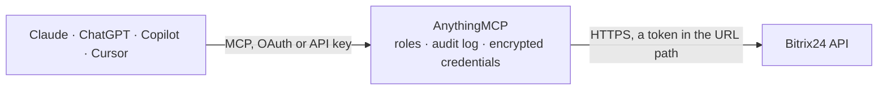

<!-- Generated by scripts/export-github-catalog.mjs in the anythingmcp-website repository. Do not edit by hand. -->

# Bitrix24 MCP connector

Manage Bitrix24 (CRM + tasks + workgroups + chat) via inbound webhooks from any AI agent. 10 tools, webhook-URL auth. The AnythingMCP connector gives Claude, ChatGPT, Microsoft Copilot, Cursor and Gemini 10 MCP tools for Bitrix24: 5 read and 5 can change data.

**Category:** [CRM](../crm.md) · **Tools:** 10 · **Setup guide:** [anythingmcp.com](https://anythingmcp.com/guides/bitrix24-to-mcp) · [Deutsch](https://anythingmcp.com/de/guides/bitrix24-to-mcp) · [Italiano](https://anythingmcp.com/it/guides/bitrix24-to-mcp) · [Español](https://anythingmcp.com/es/guides/bitrix24-to-mcp) · [日本語](https://anythingmcp.com/ja/guides/bitrix24-to-mcp) · [Русский](https://anythingmcp.com/ru/guides/bitrix24-to-mcp) · [中文](https://anythingmcp.com/zh/guides/bitrix24-to-mcp)

## Start without code

No installation and no terminal: AnythingMCP Cloud runs the Bitrix24 connector for you, operated by helpcode.ai in Frankfurt, Germany.

1. **Click the button above** and create an account or sign in. The Bitrix24 connector opens, ready to install.
2. **Paste the API key or token from your Bitrix24 account.** Every click is in the [step-by-step guide](https://anythingmcp.com/guides/bitrix24-to-mcp).
3. **Click Install.** AnythingMCP shows the address of your MCP server.
4. **Add that address to your assistant:** [Claude](https://anythingmcp.com/guides/connect-bitrix24-to-claude) · [ChatGPT](https://anythingmcp.com/guides/connect-bitrix24-to-chatgpt) · [Microsoft Copilot](https://anythingmcp.com/guides/connect-bitrix24-to-copilot) · [Cursor](https://anythingmcp.com/guides/connect-bitrix24-to-cursor) · [Gemini CLI](https://anythingmcp.com/guides/connect-bitrix24-to-gemini) · [Meta Muse](https://anythingmcp.com/guides/connect-bitrix24-to-muse).
5. **Ask your first question**, for example: *Show contact record for invoice@solvera-consulting.eu in CRM contacts.*

Prefer help with the setup? [Talk to us](https://anythingmcp.com/contact).

## How it works

- **The AI client** speaks MCP (Streamable HTTP) to AnythingMCP and only sees tool names, descriptions and results. It never gets the Bitrix24 credentials.
- **AnythingMCP** checks the client's role, builds the call from the tool definition, adds the credentials (a token in the URL path), calls Bitrix24, logs the call and returns the result.
- **Bitrix24** sees an ordinary API client with the rights of the account the credentials belong to.

## Tools

| Tool | What it does | Access |
|---|---|---|
| [`bitrix24_call`](#bitrix24_call) | Generic Bitrix24 method invoker. | write |
| [`bitrix24_list_deals`](#bitrix24_list_deals) | List CRM deals (opportunities). | read |
| [`bitrix24_get_deal`](#bitrix24_get_deal) | Get one deal by ID with all standard + custom fields. | read |
| [`bitrix24_add_deal`](#bitrix24_add_deal) | Create a new deal. | write |
| [`bitrix24_update_deal`](#bitrix24_update_deal) | Update a deal's fields. | write |
| [`bitrix24_list_contacts`](#bitrix24_list_contacts) | List CRM contacts. | read |
| [`bitrix24_add_contact`](#bitrix24_add_contact) | Create a contact. | write |
| [`bitrix24_list_companies`](#bitrix24_list_companies) | List CRM companies. | read |
| [`bitrix24_add_task`](#bitrix24_add_task) | Create a task. | write |
| [`bitrix24_list_users`](#bitrix24_list_users) | List users in the portal. | read |

## Tool reference

Every parameter as the AI client sees it in `tools/list`. Source: [`packages/backend/src/adapters/intl/bitrix24.json`](../../../packages/backend/src/adapters/intl/bitrix24.json).

### `bitrix24_call`

Generic Bitrix24 method invoker. Pass the `method` name and a `params` object holding the method's NATIVE top-level arguments (they are sent at the body root, NOT wrapped under a `params` key). Examples: tasks.task.get → {taskId: 123}; tasks.task.add → {fields: {TITLE: '...', RESPONSIBLE_ID: 1}}; crm.deal.list → {select: ['*'], filter: {STAGE_ID: 'NEW'}, start: 0}; crm.timeline.comment.add → {fields: {ENTITY_ID: 42, ENTITY_TYPE: 'deal', COMMENT: '...'}}. Use the method's exact argument names from the Bitrix REST docs.

**Access:** write · **Call:** `POST /{method}`

| Parameter | Type | Required | Description |
|---|---|---|---|
| `method` | string | yes | Bitrix method name, e.g. 'crm.deal.list', 'tasks.task.get'. |
| `params` | object | no | The method's native arguments, keyed exactly as Bitrix expects them at the top level (e.g. {taskId: 1} or {fields: {...}, filter: {...}}). The engine bracket-encodes nested objects/arrays as Bitrix's PHP-style form body requires. |

### `bitrix24_list_deals`

List CRM deals (opportunities). Returns each deal's ID, TITLE, STAGE_ID, OPPORTUNITY, CURRENCY_ID, ASSIGNED_BY_ID, COMPANY_ID, CONTACT_ID, DATE_CREATE.

**Access:** read · **Call:** `POST /crm.deal.list`

| Parameter | Type | Required | Description |
|---|---|---|---|
| `select` | any[] | no | Array of field names to return. '*' for all. |
| `filter` | object | no | Field-value filter map. |
| `order` | object | no | Field → 'ASC'\|'DESC' sort map. |
| `start` | integer | no | 0-based pagination offset (step 50). |

### `bitrix24_get_deal`

Get one deal by ID with all standard + custom fields.

**Access:** read · **Call:** `POST /crm.deal.get`

| Parameter | Type | Required | Description |
|---|---|---|---|
| `id` | integer | yes | Deal ID. |

### `bitrix24_add_deal`

Create a new deal. `fields` is an object of Bitrix deal field names → values (TITLE, STAGE_ID, OPPORTUNITY, CURRENCY_ID, CONTACT_ID, COMPANY_ID, ASSIGNED_BY_ID, CATEGORY_ID, COMMENTS, ...).

**Access:** write · **Call:** `POST /crm.deal.add`

| Parameter | Type | Required | Description |
|---|---|---|---|
| `fields` | object | yes | Deal field map. |
| `params` | object | no | Behaviour flags, e.g. {REGISTER_SONET_EVENT:'Y'}. |

### `bitrix24_update_deal`

Update a deal's fields.

**Access:** write · **Call:** `POST /crm.deal.update`

| Parameter | Type | Required | Description |
|---|---|---|---|
| `id` | integer | yes | Deal ID. |
| `fields` | object | yes | Field map to update. |

### `bitrix24_list_contacts`

List CRM contacts.

**Access:** read · **Call:** `POST /crm.contact.list`

| Parameter | Type | Required | Description |
|---|---|---|---|
| `select` | any[] | no | Field names. |
| `filter` | object | no | Filter map. |
| `order` | object | no | Sort map. |
| `start` | integer | no | Offset (step 50). |

### `bitrix24_add_contact`

Create a contact. Standard fields: NAME, LAST_NAME, SECOND_NAME, EMAIL (array of {VALUE,VALUE_TYPE}), PHONE (same shape), COMPANY_ID, ASSIGNED_BY_ID.

**Access:** write · **Call:** `POST /crm.contact.add`

| Parameter | Type | Required | Description |
|---|---|---|---|
| `fields` | object | yes | Contact field map. |

### `bitrix24_list_companies`

List CRM companies.

**Access:** read · **Call:** `POST /crm.company.list`

| Parameter | Type | Required | Description |
|---|---|---|---|
| `select` | any[] | no | Field names. |
| `filter` | object | no | Filter map. |
| `start` | integer | no | Offset. |

### `bitrix24_add_task`

Create a task. Required fields: TITLE, RESPONSIBLE_ID. Other useful: DESCRIPTION, DEADLINE (ISO 8601), PRIORITY (0=normal, 2=high), GROUP_ID (project), CREATED_BY.

**Access:** write · **Call:** `POST /tasks.task.add`

| Parameter | Type | Required | Description |
|---|---|---|---|
| `fields` | object | yes | Task field map. |

### `bitrix24_list_users`

List users in the portal. Returns each user's ID, NAME, LAST_NAME, EMAIL, WORK_POSITION, ACTIVE.

**Access:** read · **Call:** `POST /user.get`

| Parameter | Type | Required | Description |
|---|---|---|---|
| `FILTER` | object | no | Filter map. |
| `SORT` | string | no | Field name to sort by. |
| `ORDER` | string | no | ASC or DESC. |

## Run it yourself

AnythingMCP is open source (AGPL-3.0). [Run it with Docker](../../../README.md#run-it-yourself), open **Connectors → Store**, pick **Bitrix24** and enter `BITRIX24_WEBHOOK_URL`, then add your MCP server URL to the AI client.

[← CRM connectors](../crm.md) · [All categories](../README.md)
