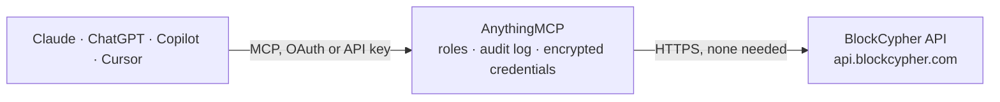

<!-- Generated by scripts/export-github-catalog.mjs in the anythingmcp-website repository. Do not edit by hand. -->

# BlockCypher MCP connector

Public blockchain data from BlockCypher for Bitcoin, Litecoin, Dogecoin, Dash and Ethereum: chain state and fee estimates, blocks, address balances, address transaction histories, single transactions and the mempool. The AnythingMCP connector gives Claude, ChatGPT, Microsoft Copilot, Cursor and Gemini 8 MCP tools for BlockCypher, all read-only.

**Category:** [Public Data](../data.md) · **Tools:** 8 · **Setup guide:** [anythingmcp.com](https://anythingmcp.com/guides/blockcypher-to-mcp) · [Deutsch](https://anythingmcp.com/de/guides/blockcypher-to-mcp) · [Italiano](https://anythingmcp.com/it/guides/blockcypher-to-mcp) · [Español](https://anythingmcp.com/es/guides/blockcypher-to-mcp) · [日本語](https://anythingmcp.com/ja/guides/blockcypher-to-mcp) · [Русский](https://anythingmcp.com/ru/guides/blockcypher-to-mcp) · [中文](https://anythingmcp.com/zh/guides/blockcypher-to-mcp)

## Start without code

No installation and no terminal: AnythingMCP Cloud runs the BlockCypher connector for you, operated by helpcode.ai in Frankfurt, Germany.

1. **Click the button above** and create an account or sign in. The BlockCypher connector opens, ready to install.
2. **Nothing to enter:** this connector needs no credentials. Every click is in the [step-by-step guide](https://anythingmcp.com/guides/blockcypher-to-mcp).
3. **Click Install.** AnythingMCP shows the address of your MCP server.
4. **Add that address to your assistant:** [Claude](https://anythingmcp.com/guides/connect-blockcypher-to-claude) · [ChatGPT](https://anythingmcp.com/guides/connect-blockcypher-to-chatgpt) · [Microsoft Copilot](https://anythingmcp.com/guides/connect-blockcypher-to-copilot) · [Cursor](https://anythingmcp.com/guides/connect-blockcypher-to-cursor) · [Gemini CLI](https://anythingmcp.com/guides/connect-blockcypher-to-gemini) · [Meta Muse](https://anythingmcp.com/guides/connect-blockcypher-to-muse).
5. **Ask your first question**, for example: *What is the balance and total received for BTC address 1LqbgM8YQk3z5f8tYVv9bPq9t6x8wZ2c3?*

Prefer help with the setup? [Talk to us](https://anythingmcp.com/contact).

## How it works

- **The AI client** speaks MCP (Streamable HTTP) to AnythingMCP and only sees tool names, descriptions and results. It never gets the BlockCypher credentials.
- **AnythingMCP** checks the client's role, builds the call from the tool definition, adds the credentials (none needed), calls BlockCypher, logs the call and returns the result.
- **BlockCypher** sees an ordinary API client with the rights of the account the credentials belong to.

## Tools

| Tool | What it does | Access |
|---|---|---|
| [`blockcypher_get_chain`](#blockcypher_get_chain) | Get the current state of a blockchain: height, hash and time of the latest block, previous block, unconfirmed transaction count, peer count and the fee… | read |
| [`blockcypher_get_block`](#blockcypher_get_block) | Get one block by its hash or its height: time, total amount transacted, fees, transaction count and the transaction hashes in block order (up to limit,… | read |
| [`blockcypher_get_address_balance`](#blockcypher_get_address_balance) | Get the balance of an address, fastest call: balance, unconfirmed_balance and final_balance, total_received, total_sent and the number of confirmed and… | read |
| [`blockcypher_get_address`](#blockcypher_get_address) | Get an address with its balance and transaction references (txrefs: tx_hash, block_height, value, spent, confirmations, tx_input_n / tx_output_n;… | read |
| [`blockcypher_get_address_full`](#blockcypher_get_address_full) | Get an address with its complete transactions (inputs, outputs, fees, confirmations, block height and time), newest first. | read |
| [`blockcypher_get_transaction`](#blockcypher_get_transaction) | Get one transaction by its hash: block height and hash, confirmations, received and confirmed time, total, fees, size, double_spend flag and its inputs and… | read |
| [`blockcypher_get_transaction_confidence`](#blockcypher_get_transaction_confidence) | Get the confidence that an unconfirmed transaction will be confirmed (confidence 0 to 1, receive_count, age_millis). | read |
| [`blockcypher_list_unconfirmed_transactions`](#blockcypher_list_unconfirmed_transactions) | List the latest transactions relayed to the network that are not yet in a block (mempool), newest first: hash, total, fees, inputs and outputs. | read |

## Tool reference

Every parameter as the AI client sees it in `tools/list`. Source: [`packages/backend/src/adapters/intl/blockcypher.json`](../../../packages/backend/src/adapters/intl/blockcypher.json).

### `blockcypher_get_chain`

Get the current state of a blockchain: height, hash and time of the latest block, previous block, unconfirmed transaction count, peer count and the fee estimates (high_fee_per_kb, medium_fee_per_kb, low_fee_per_kb in the smallest unit). Use it as the first call and to know the current block height for confirmations.

**Access:** read · **Call:** `GET /{network}`

| Parameter | Type | Required | Description |
|---|---|---|---|
| `network` | `btc/main` \| `btc/test3` \| `ltc/main` \| `doge/main` \| `dash/main` \| `eth/main` \| `bcy/test` \| `beth/test` | yes | Blockchain as coin/chain: btc/main (Bitcoin), ltc/main (Litecoin), doge/main (Dogecoin), dash/main (Dash), eth/main (Ethereum), btc/test3 (Bitcoin testnet), bcy/test and beth/test (BlockCypher test chains). |

### `blockcypher_get_block`

Get one block by its hash or its height: time, total amount transacted, fees, transaction count and the transaction hashes in block order (up to limit, default 20, max 500; page with txstart).

**Access:** read · **Call:** `GET /{network}/blocks/{block}`

| Parameter | Type | Required | Description |
|---|---|---|---|
| `network` | `btc/main` \| `btc/test3` \| `ltc/main` \| `doge/main` \| `dash/main` \| `eth/main` \| `bcy/test` \| `beth/test` | yes | Blockchain as coin/chain: btc/main (Bitcoin), ltc/main (Litecoin), doge/main (Dogecoin), dash/main (Dash), eth/main (Ethereum), btc/test3 (Bitcoin testnet), bcy/test and beth/test (BlockCypher test chains). |
| `block` | string | yes | Block hash (hex) or block height (integer as text), e.g. 294322. |
| `txstart` | integer | no | Only list transaction hashes after this index in the block (for paging). |
| `limit` | integer | no | Maximum transaction hashes to list, up to 500. |

### `blockcypher_get_address_balance`

Get the balance of an address, fastest call: balance, unconfirmed_balance and final_balance, total_received, total_sent and the number of confirmed and unconfirmed transactions. Amounts are in the smallest unit (satoshi, litoshi, koinu, duff, or wei on Ethereum).

**Access:** read · **Call:** `GET /{network}/addrs/{address}/balance`

| Parameter | Type | Required | Description |
|---|---|---|---|
| `network` | `btc/main` \| `btc/test3` \| `ltc/main` \| `doge/main` \| `dash/main` \| `eth/main` \| `bcy/test` \| `beth/test` | yes | Blockchain as coin/chain: btc/main (Bitcoin), ltc/main (Litecoin), doge/main (Dogecoin), dash/main (Dash), eth/main (Ethereum), btc/test3 (Bitcoin testnet), bcy/test and beth/test (BlockCypher test chains). |
| `address` | string | yes | Public address on that chain, e.g. 1DEP8i3QJCsomS4BSMY2RpU1upv62aGvhD (Bitcoin) or 738d145faabb1e00cf5a017588a9c0f998318012 (Ethereum, without 0x). A wallet name created with a token also works. |

### `blockcypher_get_address`

Get an address with its balance and transaction references (txrefs: tx_hash, block_height, value, spent, confirmations, tx_input_n / tx_output_n; unconfirmed ones in unconfirmed_txrefs), newest first. Lighter than blockcypher_get_address_full. Use unspent_only for UTXOs. Page with before = the lowest block_height of the previous page while hasMore is true.

**Access:** read · **Call:** `GET /{network}/addrs/{address}`

| Parameter | Type | Required | Description |
|---|---|---|---|
| `network` | `btc/main` \| `btc/test3` \| `ltc/main` \| `doge/main` \| `dash/main` \| `eth/main` \| `bcy/test` \| `beth/test` | yes | Blockchain as coin/chain: btc/main (Bitcoin), ltc/main (Litecoin), doge/main (Dogecoin), dash/main (Dash), eth/main (Ethereum), btc/test3 (Bitcoin testnet), bcy/test and beth/test (BlockCypher test chains). |
| `address` | string | yes | Public address on that chain, e.g. 1DEP8i3QJCsomS4BSMY2RpU1upv62aGvhD (Bitcoin) or 738d145faabb1e00cf5a017588a9c0f998318012 (Ethereum, without 0x). A wallet name created with a token also works. |
| `unspent_only` | boolean | no | Only unspent outputs (UTXOs). |
| `before` | integer | no | Only transactions below this block height (paging). |
| `after` | integer | no | Only transactions above this block height. |
| `limit` | integer | no | Minimum number of txrefs to return, default 200, max 2000. |
| `confirmations` | integer | no | Only count transactions with at least this many confirmations. |
| `include_confidence` | boolean | no | Add the confidence figure to unconfirmed txrefs. |

### `blockcypher_get_address_full`

Get an address with its complete transactions (inputs, outputs, fees, confirmations, block height and time), newest first. The slowest address call: default 10 transactions, max 50. Page with before = the lowest block_height of the previous page while hasMore is true; txlimit caps inputs and outputs per transaction.

**Access:** read · **Call:** `GET /{network}/addrs/{address}/full`

| Parameter | Type | Required | Description |
|---|---|---|---|
| `network` | `btc/main` \| `btc/test3` \| `ltc/main` \| `doge/main` \| `dash/main` \| `eth/main` \| `bcy/test` \| `beth/test` | yes | Blockchain as coin/chain: btc/main (Bitcoin), ltc/main (Litecoin), doge/main (Dogecoin), dash/main (Dash), eth/main (Ethereum), btc/test3 (Bitcoin testnet), bcy/test and beth/test (BlockCypher test chains). |
| `address` | string | yes | Public address on that chain, e.g. 1DEP8i3QJCsomS4BSMY2RpU1upv62aGvhD (Bitcoin) or 738d145faabb1e00cf5a017588a9c0f998318012 (Ethereum, without 0x). A wallet name created with a token also works. |
| `before` | integer | no | Only transactions below this block height (paging). |
| `after` | integer | no | Only transactions above this block height, e.g. to fetch only what is new since the last check. |
| `limit` | integer | no | Number of transactions, default 10, max 50. |
| `txlimit` | integer | no | Maximum inputs and outputs listed per transaction. |
| `confirmations` | integer | no | Only transactions with at least this many confirmations. |

### `blockcypher_get_transaction`

Get one transaction by its hash: block height and hash, confirmations, received and confirmed time, total, fees, size, double_spend flag and its inputs and outputs (addresses and values in the smallest unit). Inputs and outputs are capped by limit (default 20); page with instart / outstart.

**Access:** read · **Call:** `GET /{network}/txs/{tx_hash}`

| Parameter | Type | Required | Description |
|---|---|---|---|
| `network` | `btc/main` \| `btc/test3` \| `ltc/main` \| `doge/main` \| `dash/main` \| `eth/main` \| `bcy/test` \| `beth/test` | yes | Blockchain as coin/chain: btc/main (Bitcoin), ltc/main (Litecoin), doge/main (Dogecoin), dash/main (Dash), eth/main (Ethereum), btc/test3 (Bitcoin testnet), bcy/test and beth/test (BlockCypher test chains). |
| `tx_hash` | string | yes | Transaction hash (hex), e.g. f854aebae95150b379cc1187d848d58225f3c4157fe992bcd166f58bd5063449. |
| `limit` | integer | no | Maximum inputs and outputs to list, default 20. |
| `instart` | integer | no | Only list inputs from this index. |
| `outstart` | integer | no | Only list outputs from this index. |

### `blockcypher_get_transaction_confidence`

Get the confidence that an unconfirmed transaction will be confirmed (confidence 0 to 1, receive_count, age_millis). Needs a BLOCKCYPHER_TOKEN; the free tier allows 10 such lookups per hour.

**Access:** read · **Call:** `GET /{network}/txs/{tx_hash}/confidence`

| Parameter | Type | Required | Description |
|---|---|---|---|
| `network` | `btc/main` \| `btc/test3` \| `ltc/main` \| `doge/main` \| `dash/main` \| `eth/main` \| `bcy/test` \| `beth/test` | yes | Blockchain as coin/chain: btc/main (Bitcoin), ltc/main (Litecoin), doge/main (Dogecoin), dash/main (Dash), eth/main (Ethereum), btc/test3 (Bitcoin testnet), bcy/test and beth/test (BlockCypher test chains). |
| `tx_hash` | string | yes | Hash of an unconfirmed transaction (hex). |

### `blockcypher_list_unconfirmed_transactions`

List the latest transactions relayed to the network that are not yet in a block (mempool), newest first: hash, total, fees, inputs and outputs. Default 10, max 100.

**Access:** read · **Call:** `GET /{network}/txs`

| Parameter | Type | Required | Description |
|---|---|---|---|
| `network` | `btc/main` \| `btc/test3` \| `ltc/main` \| `doge/main` \| `dash/main` \| `eth/main` \| `bcy/test` \| `beth/test` | yes | Blockchain as coin/chain: btc/main (Bitcoin), ltc/main (Litecoin), doge/main (Dogecoin), dash/main (Dash), eth/main (Ethereum), btc/test3 (Bitcoin testnet), bcy/test and beth/test (BlockCypher test chains). |
| `limit` | integer | no | Number of transactions, default 10, max 100. |
| `min_value` | integer | no | Only transactions moving more than this amount, in the smallest unit. |

## Run it yourself

AnythingMCP is open source (AGPL-3.0). [Run it with Docker](../../../README.md#run-it-yourself), open **Connectors → Store**, pick **BlockCypher**, then add your MCP server URL to the AI client.

[← Public Data connectors](../data.md) · [All categories](../README.md)
