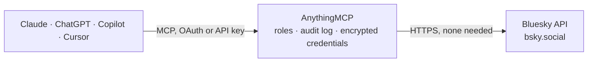

<!-- Generated by scripts/export-github-catalog.mjs in the anythingmcp-website repository. Do not edit by hand. -->

# Bluesky MCP connector

Read & post on Bluesky (the AT Protocol social network) from any AI agent. 9 tools, app-password auth. The AnythingMCP connector gives Claude, ChatGPT, Microsoft Copilot, Cursor and Gemini 9 MCP tools for Bluesky: 5 read and 4 can change data.

**Category:** [Social Media](../social.md) · **Tools:** 9 · **Setup guide:** [anythingmcp.com](https://anythingmcp.com/guides/bluesky-to-mcp) · [Deutsch](https://anythingmcp.com/de/guides/bluesky-to-mcp) · [Italiano](https://anythingmcp.com/it/guides/bluesky-to-mcp) · [Español](https://anythingmcp.com/es/guides/bluesky-to-mcp) · [日本語](https://anythingmcp.com/ja/guides/bluesky-to-mcp) · [Русский](https://anythingmcp.com/ru/guides/bluesky-to-mcp) · [中文](https://anythingmcp.com/zh/guides/bluesky-to-mcp)

## Start without code

No installation and no terminal: AnythingMCP Cloud runs the Bluesky connector for you, operated by helpcode.ai in Frankfurt, Germany.

1. **Click the button above** and create an account or sign in. The Bluesky connector opens, ready to install.
2. **Nothing to enter:** this connector needs no credentials. Every click is in the [step-by-step guide](https://anythingmcp.com/guides/bluesky-to-mcp).
3. **Click Install.** AnythingMCP shows the address of your MCP server.
4. **Add that address to your assistant:** [Claude](https://anythingmcp.com/guides/connect-bluesky-to-claude) · [ChatGPT](https://anythingmcp.com/guides/connect-bluesky-to-chatgpt) · [Microsoft Copilot](https://anythingmcp.com/guides/connect-bluesky-to-copilot) · [Cursor](https://anythingmcp.com/guides/connect-bluesky-to-cursor) · [Gemini CLI](https://anythingmcp.com/guides/connect-bluesky-to-gemini) · [Meta Muse](https://anythingmcp.com/guides/connect-bluesky-to-muse).
5. **Ask your first question**, for example: *Show me the public profile for partner.cafe.bsky.social (we need bio, followers, posts).*

Prefer help with the setup? [Talk to us](https://anythingmcp.com/contact).

## How it works

- **The AI client** speaks MCP (Streamable HTTP) to AnythingMCP and only sees tool names, descriptions and results. It never gets the Bluesky credentials.
- **AnythingMCP** checks the client's role, builds the call from the tool definition, adds the credentials (none needed), calls Bluesky, logs the call and returns the result.
- **Bluesky** sees an ordinary API client with the rights of the account the credentials belong to.

## Tools

| Tool | What it does | Access |
|---|---|---|
| [`bluesky_create_session`](#bluesky_create_session) | Exchange handle + app password for an access JWT (lasts ~2h) and refresh JWT. | write |
| [`bluesky_refresh_session`](#bluesky_refresh_session) | Refresh an access JWT using the refresh JWT. | write |
| [`bluesky_resolve_handle`](#bluesky_resolve_handle) | Resolve a Bluesky handle (e.g. `bsky.app`) to its DID. | read |
| [`bluesky_get_profile`](#bluesky_get_profile) | Get a user's public profile: handle, did, displayName, description, followers, follows, posts count, avatar URL. | read |
| [`bluesky_get_timeline`](#bluesky_get_timeline) | Get the authenticated user's home timeline (chronological feed of follows). | read |
| [`bluesky_get_author_feed`](#bluesky_get_author_feed) | Get posts by a specific user (their public feed). | read |
| [`bluesky_search_posts`](#bluesky_search_posts) | Full-text search across public posts. | read |
| [`bluesky_create_post`](#bluesky_create_post) | Post a new skeet. | write |
| [`bluesky_delete_post`](#bluesky_delete_post) | Delete one of your own posts by its rkey (record key, the last segment of the at:// URI). | write |

## Tool reference

Every parameter as the AI client sees it in `tools/list`. Source: [`packages/backend/src/adapters/intl/bluesky.json`](../../../packages/backend/src/adapters/intl/bluesky.json).

### `bluesky_create_session`

Exchange handle + app password for an access JWT (lasts ~2h) and refresh JWT. Returns `accessJwt`, `refreshJwt`, `handle`, `did`. Call this once at the start of a session, then pass `accessJwt` to other tools that need it.

**Access:** write · **Call:** `POST /xrpc/com.atproto.server.createSession`

| Parameter | Type | Required | Description |
|---|---|---|---|
| `identifier` | string | yes | Handle (e.g. you.bsky.social) or email. |
| `password` | string | yes | App password. |

### `bluesky_refresh_session`

Refresh an access JWT using the refresh JWT.

**Access:** write · **Call:** `POST /xrpc/com.atproto.server.refreshSession`

| Parameter | Type | Required | Description |
|---|---|---|---|
| `refresh_jwt` | string | yes | refreshJwt from create_session. |

### `bluesky_resolve_handle`

Resolve a Bluesky handle (e.g. `bsky.app`) to its DID. Public, no auth needed.

**Access:** read · **Call:** `GET /xrpc/com.atproto.identity.resolveHandle`

| Parameter | Type | Required | Description |
|---|---|---|---|
| `handle` | string | yes | Handle (no @). |

### `bluesky_get_profile`

Get a user's public profile: handle, did, displayName, description, followers, follows, posts count, avatar URL.

**Access:** read · **Call:** `GET /xrpc/app.bsky.actor.getProfile`

| Parameter | Type | Required | Description |
|---|---|---|---|
| `actor` | string | yes | Handle or DID. |
| `access_jwt` | string | yes | Access JWT from create_session. |

### `bluesky_get_timeline`

Get the authenticated user's home timeline (chronological feed of follows). Paginated.

**Access:** read · **Call:** `GET /xrpc/app.bsky.feed.getTimeline`

| Parameter | Type | Required | Description |
|---|---|---|---|
| `access_jwt` | string | yes | Access JWT. |
| `limit` | integer | no | Max posts (1-100). |
| `cursor` | string | no | Pagination cursor from previous response. |

### `bluesky_get_author_feed`

Get posts by a specific user (their public feed).

**Access:** read · **Call:** `GET /xrpc/app.bsky.feed.getAuthorFeed`

| Parameter | Type | Required | Description |
|---|---|---|---|
| `actor` | string | yes | Handle or DID. |
| `access_jwt` | string | yes | Access JWT. |
| `limit` | integer | no | Max posts (1-100). |
| `cursor` | string | no | Pagination cursor. |
| `filter` | string | no | 'posts_with_replies', 'posts_no_replies', 'posts_with_media', 'posts_and_author_threads'. |

### `bluesky_search_posts`

Full-text search across public posts.

**Access:** read · **Call:** `GET /xrpc/app.bsky.feed.searchPosts`

| Parameter | Type | Required | Description |
|---|---|---|---|
| `q` | string | yes | Search query. |
| `access_jwt` | string | yes | Access JWT. |
| `limit` | integer | no | Max results (1-100). |
| `cursor` | string | no | Pagination cursor. |
| `lang` | string | no | ISO language filter. |
| `sort` | string | no | 'top' or 'latest'. |

### `bluesky_create_post`

Post a new skeet. `text` is required (max 300 graphemes). Returns the post's URI + CID.

**Access:** write · **Call:** `POST /xrpc/com.atproto.repo.createRecord`

| Parameter | Type | Required | Description |
|---|---|---|---|
| `access_jwt` | string | yes | Access JWT. |
| `repo` | string | yes | Your DID (from create_session response). |
| `text` | string | yes | Post text, max 300 graphemes. |
| `created_at` | string | yes | RFC3339 datetime (defaults to now if omitted). |
| `langs` | any[] | no | ISO 639-1 language codes, e.g. ['en']. |

### `bluesky_delete_post`

Delete one of your own posts by its rkey (record key, the last segment of the at:// URI).

**Access:** write · **Call:** `POST /xrpc/com.atproto.repo.deleteRecord`

| Parameter | Type | Required | Description |
|---|---|---|---|
| `access_jwt` | string | yes | Access JWT. |
| `repo` | string | yes | Your DID. |
| `rkey` | string | yes | Record key — the last segment of the post's at:// URI. |

## Run it yourself

AnythingMCP is open source (AGPL-3.0). [Run it with Docker](../../../README.md#run-it-yourself), open **Connectors → Store**, pick **Bluesky** and enter `BLUESKY_HANDLE`, `BLUESKY_APP_PASSWORD`, then add your MCP server URL to the AI client.

[← Social Media connectors](../social.md) · [All categories](../README.md)
