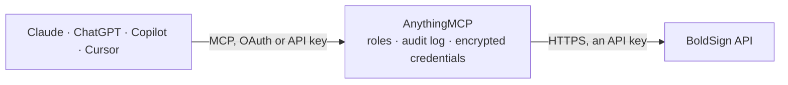

<!-- Generated by scripts/export-github-catalog.mjs in the anythingmcp-website repository. Do not edit by hand. -->

# BoldSign MCP connector

Let your AI work with BoldSign e-signatures (US, EU, CA or AU region): find documents and check who has signed, download signed PDFs and audit trails, send files or templates for signature, remind, … The AnythingMCP connector gives Claude, ChatGPT, Microsoft Copilot, Cursor and Gemini 32 MCP tools for BoldSign: 20 read and 12 can change data.

**Category:** [E-Signature](../e-signature.md) · **Tools:** 32 · **Setup guide:** [anythingmcp.com](https://anythingmcp.com/guides/boldsign-to-mcp) · [Deutsch](https://anythingmcp.com/de/guides/boldsign-to-mcp) · [Italiano](https://anythingmcp.com/it/guides/boldsign-to-mcp) · [Español](https://anythingmcp.com/es/guides/boldsign-to-mcp) · [日本語](https://anythingmcp.com/ja/guides/boldsign-to-mcp) · [Русский](https://anythingmcp.com/ru/guides/boldsign-to-mcp) · [中文](https://anythingmcp.com/zh/guides/boldsign-to-mcp)

## Start without code

No installation and no terminal: AnythingMCP Cloud runs the BoldSign connector for you, operated by helpcode.ai in Frankfurt, Germany.

1. **Click the button above** and create an account or sign in. The BoldSign connector opens, ready to install.
2. **Paste the API key or token from your BoldSign account.** Every click is in the [step-by-step guide](https://anythingmcp.com/guides/boldsign-to-mcp).
3. **Click Install.** AnythingMCP shows the address of your MCP server.
4. **Add that address to your assistant:** [Claude](https://anythingmcp.com/guides/connect-boldsign-to-claude) · [ChatGPT](https://anythingmcp.com/guides/connect-boldsign-to-chatgpt) · [Microsoft Copilot](https://anythingmcp.com/guides/connect-boldsign-to-copilot) · [Cursor](https://anythingmcp.com/guides/connect-boldsign-to-cursor) · [Gemini CLI](https://anythingmcp.com/guides/connect-boldsign-to-gemini) · [Meta Muse](https://anythingmcp.com/guides/connect-boldsign-to-muse).
5. **Ask your first question**, for example: *Status and signer list for invoice INV-2026-087 sent to Helix Energy Oy on 2026-10-05*

Prefer help with the setup? [Talk to us](https://anythingmcp.com/contact).

## How it works

- **The AI client** speaks MCP (Streamable HTTP) to AnythingMCP and only sees tool names, descriptions and results. It never gets the BoldSign credentials.
- **AnythingMCP** checks the client's role, builds the call from the tool definition, adds the credentials (an API key), calls BoldSign, logs the call and returns the result.
- **BoldSign** sees an ordinary API client with the rights of the account the credentials belong to.

## Tools

| Tool | What it does | Access |
|---|---|---|
| [`boldsign_list_documents`](#boldsign_list_documents) | List documents I sent or received, newest first: documentId, messageTitle, status, sender, signers with their status, cc, created, activity and expiry dates… | read |
| [`boldsign_list_team_documents`](#boldsign_list_team_documents) | List the documents of my team (team admins: of the teams they manage), with the same fields and filters as boldsign_list_documents plus filters by team and… | read |
| [`boldsign_list_behalf_documents`](#boldsign_list_behalf_documents) | List documents sent on behalf of others (through a sender identity), or sent on my behalf by others, with their status and signers. | read |
| [`boldsign_get_document`](#boldsign_get_document) | Read one document in full: title, status, files, sender, each signer (name, email, order, status, viewed, authentication, form fields with values), cc,… | read |
| [`boldsign_download_document`](#boldsign_download_document) | Download the document PDF: the signed PDF once completed, otherwise the current state. | read |
| [`boldsign_download_audit_log`](#boldsign_download_audit_log) | Download the audit trail PDF of a document: every event (sent, viewed, signed, declined) with time, email and IP address. | read |
| [`boldsign_get_embedded_sign_link`](#boldsign_get_embedded_sign_link) | Get a signing link for one signer of a document, to open the signing page directly (for example in your own app or to hand over in person). | read |
| [`boldsign_list_templates`](#boldsign_list_templates) | List templates: templateId, title, description, roles (index, name, default signer), created by, labels, sharing. | read |
| [`boldsign_get_template`](#boldsign_get_template) | Read one template: title, message, files, roles (index, name, default signer, signer type) with their form fields (id, type, page, required), cc, brand,… | read |
| [`boldsign_list_sender_identities`](#boldsign_list_sender_identities) | List sender identities (people you may send documents on behalf of): id, name, email, status (Pending, Verified, Denied), approval date, brand and… | read |
| [`boldsign_get_sender_identity`](#boldsign_get_sender_identity) | Read one sender identity by id or by email: name, email, status, brand, redirect URL and notification settings. | read |
| [`boldsign_list_contacts`](#boldsign_list_contacts) | List contacts in the address book: id, name, email, phone, job title and company. | read |
| [`boldsign_get_contact`](#boldsign_get_contact) | Read one contact of the address book: name, email, phone number, job title and company. | read |
| [`boldsign_list_teams`](#boldsign_list_teams) | List the teams of the organization: teamId, name, number of users and created date. | read |
| [`boldsign_get_team`](#boldsign_get_team) | Read one team: name, users with their roles and status, created and modified dates. | read |
| [`boldsign_list_users`](#boldsign_list_users) | List the users of the organization: userId, name, email, team, role (Admin, TeamAdmin, Member) and status (Active, Invited). | read |
| [`boldsign_get_user`](#boldsign_get_user) | Read one user: name, email, team, role, status, created and modified dates and metadata. | read |
| [`boldsign_list_brands`](#boldsign_list_brands) | List the brands of the account (logo, colours, email display name, signing page settings): brandId, brandName, isDefault. | read |
| [`boldsign_get_brand`](#boldsign_get_brand) | Read one brand in full: name, logo, colours, email display name, redirect URL, disclaimer, document time zone and other signing settings. | read |
| [`boldsign_get_api_credits`](#boldsign_get_api_credits) | Show the API credits of the plan: credits balance and how many are used. | read |
| [`boldsign_send_document`](#boldsign_send_document) | Send one or more PDF or Office files for signature. | write |
| [`boldsign_send_from_template`](#boldsign_send_from_template) | Send a document for signature from a template. | write |
| [`boldsign_send_draft`](#boldsign_send_draft) | Send a document that is still a draft (status Draft) to its signers. | write |
| [`boldsign_remind_document`](#boldsign_remind_document) | Email a reminder to signers who have not signed yet: all pending signers, or only the given emails. | write |
| [`boldsign_revoke_document`](#boldsign_revoke_document) | Revoke (cancel) a document that is in progress: signing stops and the signers are told why. | write |
| [`boldsign_delete_document`](#boldsign_delete_document) | Delete a document: it moves to the trash, or is erased for good with delete_permanently. | write |
| [`boldsign_extend_expiry`](#boldsign_extend_expiry) | Extend the expiry date of a document that is still in progress, optionally warning the signers. | write |
| [`boldsign_change_recipient`](#boldsign_change_recipient) | Replace a signer who has not signed yet with another person (new name and email); the new signer gets the request. | write |
| [`boldsign_prefill_fields`](#boldsign_prefill_fields) | Set the values of form fields of a document in progress before the signers fill them (field ids from boldsign_get_document). | write |
| [`boldsign_create_contacts`](#boldsign_create_contacts) | Add one or more contacts (name, email, phone, job title, company) to the address book. | write |
| [`boldsign_update_contact`](#boldsign_update_contact) | Change a contact of the address book: name, email, phone, job title, company (name and email are required). | write |
| [`boldsign_create_sender_identity`](#boldsign_create_sender_identity) | Ask a person to let you send documents on their behalf: BoldSign emails them an approval request; the identity is usable once its status is Verified. | write |

## Tool reference

Every parameter as the AI client sees it in `tools/list`. Source: [`packages/backend/src/adapters/intl/boldsign.json`](../../../packages/backend/src/adapters/intl/boldsign.json).

### `boldsign_list_documents`

List documents I sent or received, newest first: documentId, messageTitle, status, sender, signers with their status, cc, created, activity and expiry dates (Unix seconds), labels. Filter by text, status, date range, sender or signer email.

**Access:** read · **Call:** `GET /v1/document/list`

| Parameter | Type | Required | Description |
|---|---|---|---|
| `page` | integer | no | Page number, starting at 1 (default 1). |
| `page_size` | integer | no | Items per page, 1 to 100 (default 10). |
| `search` | string | no | Text to look for in the title, document id, sender or recipient names. |
| `status` | `None` \| `WaitingForMe` \| `WaitingForOthers` \| `NeedAttention` \| `Completed` \| `Declined` \| `Revoked` \| `Expired` \| `Draft` \| `Scheduled`[] | no | Only documents in these states: WaitingForMe, WaitingForOthers, NeedAttention, Completed, Declined, Revoked, Expired, Draft, Scheduled. |
| `transmit_type` | `Sent` \| `Received` \| `Both` | no | Sent (by me), Received (to sign by me) or Both (default). |
| `start_date` | string | no | Start of the date range, ISO 8601 (e.g. 2026-10-01T00:00:00Z). |
| `end_date` | string | no | End of the date range, ISO 8601. |
| `date_filter_type` | `SentBetween` \| `Expiring` | no | What the date range applies to: SentBetween (sent date) or Expiring (expiry date). |
| `labels` | string[] | no | Only documents with these labels. |
| `brand_ids` | string[] | no | Only documents of these brands (ids from boldsign_list_brands). |
| `next_cursor` | integer | no | Paging beyond 10,000 documents: the cursor of the last document of the previous page. |
| `sent_by` | string[] | no | Only documents sent by these emails. |
| `recipients` | string[] | no | Only documents with these signer emails. |

### `boldsign_list_team_documents`

List the documents of my team (team admins: of the teams they manage), with the same fields and filters as boldsign_list_documents plus filters by team and user.

**Access:** read · **Call:** `GET /v1/document/teamlist`

| Parameter | Type | Required | Description |
|---|---|---|---|
| `page` | integer | no | Page number, starting at 1 (default 1). |
| `page_size` | integer | no | Items per page, 1 to 100 (default 10). |
| `search` | string | no | Text to look for in the title, document id, sender or recipient names. |
| `status` | `None` \| `WaitingForMe` \| `WaitingForOthers` \| `NeedAttention` \| `Completed` \| `Declined` \| `Revoked` \| `Expired` \| `Draft` \| `Scheduled`[] | no | Only documents in these states: WaitingForMe, WaitingForOthers, NeedAttention, Completed, Declined, Revoked, Expired, Draft, Scheduled. |
| `transmit_type` | `Sent` \| `Received` \| `Both` | no | Sent (by me), Received (to sign by me) or Both (default). |
| `start_date` | string | no | Start of the date range, ISO 8601 (e.g. 2026-10-01T00:00:00Z). |
| `end_date` | string | no | End of the date range, ISO 8601. |
| `date_filter_type` | `SentBetween` \| `Expiring` | no | What the date range applies to: SentBetween (sent date) or Expiring (expiry date). |
| `labels` | string[] | no | Only documents with these labels. |
| `brand_ids` | string[] | no | Only documents of these brands (ids from boldsign_list_brands). |
| `next_cursor` | integer | no | Paging beyond 10,000 documents: the cursor of the last document of the previous page. |
| `team_ids` | string[] | no | Only documents of these teams (ids from boldsign_list_teams). |
| `user_ids` | string[] | no | Only documents of these users (ids from boldsign_list_users). |

### `boldsign_list_behalf_documents`

List documents sent on behalf of others (through a sender identity), or sent on my behalf by others, with their status and signers.

**Access:** read · **Call:** `GET /v1/document/behalfList`

| Parameter | Type | Required | Description |
|---|---|---|---|
| `page` | integer | no | Page number, starting at 1 (default 1). |
| `page_size` | integer | no | Items per page, 1 to 100 (default 10). |
| `page_type` | `BehalfOfOthers` \| `BehalfOfMe` | no | BehalfOfOthers (default: documents I sent for others) or BehalfOfMe (documents others sent for me). |
| `sender_emails` | string[] | no | Only documents sent on behalf of these sender identity emails. |
| `signers` | string[] | no | Only documents with these signer emails. |
| `search` | string | no | Text to look for in the title, document id, sender or recipient names. |
| `status` | `None` \| `WaitingForMe` \| `WaitingForOthers` \| `NeedAttention` \| `Completed` \| `Declined` \| `Revoked` \| `Expired` \| `Draft` \| `Scheduled`[] | no | Only documents in these states: WaitingForMe, WaitingForOthers, NeedAttention, Completed, Declined, Revoked, Expired, Draft, Scheduled. |
| `start_date` | string | no | Start of the date range, ISO 8601 (e.g. 2026-10-01T00:00:00Z). |
| `end_date` | string | no | End of the date range, ISO 8601. |
| `labels` | string[] | no | Only documents with these labels. |
| `brand_ids` | string[] | no | Only documents of these brands (ids from boldsign_list_brands). |
| `next_cursor` | integer | no | Paging beyond 10,000 documents: the cursor of the last document of the previous page. |

### `boldsign_get_document`

Read one document in full: title, status, files, sender, each signer (name, email, order, status, viewed, authentication, form fields with values), cc, history of events, expiry, reminder settings, labels, revoke or decline message.

**Access:** read · **Call:** `GET /v1/document/properties`

| Parameter | Type | Required | Description |
|---|---|---|---|
| `document_id` | string | yes | Document id (GUID), from boldsign_list_documents. |

### `boldsign_download_document`

Download the document PDF: the signed PDF once completed, otherwise the current state. Several files come as one combined PDF or, with format Individually, as a ZIP.

**Access:** read · **Call:** `GET /v1/document/download`

| Parameter | Type | Required | Description |
|---|---|---|---|
| `document_id` | string | yes | Document id (GUID), from boldsign_list_documents. |
| `format` | `Combined` \| `Individually` | no | Combined (one PDF) or Individually (a ZIP with one PDF per file). |
| `on_behalf_of` | string | no | Email of the sender identity when the document was sent on behalf of someone (behalfOf in the document). |

### `boldsign_download_audit_log`

Download the audit trail PDF of a document: every event (sent, viewed, signed, declined) with time, email and IP address.

**Access:** read · **Call:** `GET /v1/document/downloadAuditLog`

| Parameter | Type | Required | Description |
|---|---|---|---|
| `document_id` | string | yes | Document id (GUID), from boldsign_list_documents. |
| `on_behalf_of` | string | no | Email of the sender identity when the document was sent on behalf of someone (behalfOf in the document). |

### `boldsign_get_embedded_sign_link`

Get a signing link for one signer of a document, to open the signing page directly (for example in your own app or to hand over in person). Set sign_link_valid_till to limit how long the link works.

**Access:** read · **Call:** `GET /v1/document/getEmbeddedSignLink`

| Parameter | Type | Required | Description |
|---|---|---|---|
| `document_id` | string | yes | Document id (GUID), from boldsign_list_documents. |
| `signer_email` | string | no | Email of the signer. |
| `country_code` | string | no | Country calling code of the signer phone, for SMS signers (e.g. +49). |
| `phone_number` | string | no | Phone number of the signer, for SMS signers. |
| `sign_link_valid_till` | string | no | Expiry of the link, ISO 8601 date-time. |
| `redirect_url` | string | no | Address to open after signing. |

### `boldsign_list_templates`

List templates: templateId, title, description, roles (index, name, default signer), created by, labels, sharing. Filter by text, type (mine, shared, all), creator, labels or dates.

**Access:** read · **Call:** `GET /v1/template/list`

| Parameter | Type | Required | Description |
|---|---|---|---|
| `page` | integer | no | Page number, starting at 1 (default 1). |
| `page_size` | integer | no | Items per page, 1 to 100 (default 10). |
| `search` | string | no | Text to look for in the template title or id. |
| `template_type` | `mytemplates` \| `sharedtemplate` \| `all` | no | mytemplates, sharedtemplate or all (default). |
| `created_by` | string[] | no | Only templates created by these emails. |
| `template_labels` | string[] | no | Only templates with these labels. |
| `on_behalf_of` | string[] | no | Only templates of these sender identity emails. |
| `start_date` | string | no | Created from, ISO 8601. |
| `end_date` | string | no | Created until, ISO 8601. |
| `brand_ids` | string[] | no | Only templates of these brands. |
| `shared_with_team_ids` | string[] | no | Only templates shared with these teams. |

### `boldsign_get_template`

Read one template: title, message, files, roles (index, name, default signer, signer type) with their form fields (id, type, page, required), cc, brand, labels, settings. Role indexes and field ids are what boldsign_send_from_template needs.

**Access:** read · **Call:** `GET /v1/template/properties`

| Parameter | Type | Required | Description |
|---|---|---|---|
| `template_id` | string | yes | Template id (GUID), from boldsign_list_templates. |

### `boldsign_list_sender_identities`

List sender identities (people you may send documents on behalf of): id, name, email, status (Pending, Verified, Denied), approval date, brand and notification settings.

**Access:** read · **Call:** `GET /v1/senderIdentities/list`

| Parameter | Type | Required | Description |
|---|---|---|---|
| `page` | integer | no | Page number, starting at 1 (default 1). |
| `page_size` | integer | no | Items per page, 1 to 100 (default 10). |
| `search` | string | no | Text to look for in the name or email. |
| `brand_ids` | string[] | no | Only identities linked to these brands. |

### `boldsign_get_sender_identity`

Read one sender identity by id or by email: name, email, status, brand, redirect URL and notification settings.

**Access:** read · **Call:** `GET /v1/senderIdentities/properties`

| Parameter | Type | Required | Description |
|---|---|---|---|
| `id` | string | no | Sender identity id. |
| `email` | string | no | Sender identity email (instead of id). |

### `boldsign_list_contacts`

List contacts in the address book: id, name, email, phone, job title and company.

**Access:** read · **Call:** `GET /v1/contacts/list`

| Parameter | Type | Required | Description |
|---|---|---|---|
| `page` | integer | no | Page number, starting at 1 (default 1). |
| `page_size` | integer | no | Items per page, 1 to 100 (default 10). |
| `search` | string | no | Text to look for in the name or email. |
| `contact_type` | `MyContacts` \| `AllContacts` | no | MyContacts or AllContacts (default). |

### `boldsign_get_contact`

Read one contact of the address book: name, email, phone number, job title and company.

**Access:** read · **Call:** `GET /v1/contacts/get`

| Parameter | Type | Required | Description |
|---|---|---|---|
| `contact_id` | string | yes | Contact id, from boldsign_list_contacts. |

### `boldsign_list_teams`

List the teams of the organization: teamId, name, number of users and created date.

**Access:** read · **Call:** `GET /v1/teams/list`

| Parameter | Type | Required | Description |
|---|---|---|---|
| `page` | integer | no | Page number, starting at 1 (default 1). |
| `page_size` | integer | no | Items per page, 1 to 100 (default 10). |
| `search` | string | no | Text to look for in the team name. |

### `boldsign_get_team`

Read one team: name, users with their roles and status, created and modified dates.

**Access:** read · **Call:** `GET /v1/teams/get`

| Parameter | Type | Required | Description |
|---|---|---|---|
| `team_id` | string | yes | Team id, from boldsign_list_teams. |

### `boldsign_list_users`

List the users of the organization: userId, name, email, team, role (Admin, TeamAdmin, Member) and status (Active, Invited).

**Access:** read · **Call:** `GET /v1/users/list`

| Parameter | Type | Required | Description |
|---|---|---|---|
| `page` | integer | no | Page number, starting at 1 (default 1). |
| `page_size` | integer | no | Items per page, 1 to 100 (default 10). |
| `search` | string | no | Text to look for in the user name, email or id. |
| `user_ids` | string[] | no | Only these user ids. |

### `boldsign_get_user`

Read one user: name, email, team, role, status, created and modified dates and metadata.

**Access:** read · **Call:** `GET /v1/users/get`

| Parameter | Type | Required | Description |
|---|---|---|---|
| `user_id` | string | yes | User id, from boldsign_list_users. |

### `boldsign_list_brands`

List the brands of the account (logo, colours, email display name, signing page settings): brandId, brandName, isDefault. Use a brandId when sending to apply that branding.

**Access:** read · **Call:** `GET /v1/brand/list`

No parameters.

### `boldsign_get_brand`

Read one brand in full: name, logo, colours, email display name, redirect URL, disclaimer, document time zone and other signing settings.

**Access:** read · **Call:** `GET /v1/brand/get`

| Parameter | Type | Required | Description |
|---|---|---|---|
| `brand_id` | string | yes | Brand id, from boldsign_list_brands. |

### `boldsign_get_api_credits`

Show the API credits of the plan: credits balance and how many are used. Each document sent through the API uses credits on credit-based plans.

**Access:** read · **Call:** `GET /v1/plan/apiCreditsCount`

No parameters.

### `boldsign_send_document`

Send one or more PDF or Office files for signature. Give the files as public URLs (file_urls) or Base64 data URIs (files), the signers, and either form fields per signer, text tags in the document (use_text_tags) or auto_detect_fields. Returns the documentId; sending finishes in the background.

**Access:** write · **Call:** `POST /v1/document/send`

| Parameter | Type | Required | Description |
|---|---|---|---|
| `title` | string | yes | Title of the document, shown to signers. |
| `message` | string | no | Message in the signing request email. |
| `cc` | object[] | no | Copy recipients: [{"emailAddress": "..."}]. |
| `enable_signing_order` | boolean | no | true makes signers sign one after another in signerOrder. |
| `expiry_date_type` | `Days` \| `Hours` \| `SpecificDateTime` | no | Unit of expiry_value: Days (default), Hours or SpecificDateTime. |
| `expiry_value` | integer | no | When the request expires, in the unit of expiry_date_type (default 60 days). |
| `reminder_settings` | object | no | Automatic reminders: {"enableAutoReminder": true, "reminderDays": 3, "reminderCount": 3}. |
| `brand_id` | string | no | Brand to apply (id from boldsign_list_brands). |
| `labels` | string[] | no | Labels to tag the document with. |
| `disable_emails` | boolean | no | true sends no emails (use boldsign_get_embedded_sign_link to hand out signing links). |
| `on_behalf_of` | string | no | Send on behalf of this sender identity email (it must be Verified in boldsign_list_sender_identities). |
| `signers` | object[] | yes | Signers: [{"name", "emailAddress", "signerOrder"?, "signerType"?: Signer, Reviewer or InPersonSigner, "privateMessage"?, "formFields"?: [{"fieldType": "Signature", "pageNumber": 1, "bounds": {"x": 100, "y": 600, "width": 200, "height": 40}, "isRequired": true}]}]. Field types include Signature, Initial, CheckBox, TextBox, DateSigned, RadioButton, Dropdown, Name, Email; bounds {x, y, width, height} are measured from the top left of the page; field ids may use letters, digits and underscores only. |
| `file_urls` | string[] | no | Public URLs of the files to send (PDF, Word, images). BoldSign downloads them. Not together with files. |
| `files` | string[] | no | Files as Base64 data URIs, e.g. "data:application/pdf;base64,JVBERi0...". Not together with file_urls. |
| `use_text_tags` | boolean | no | true places fields from text tags written in the document. |
| `text_tag_definitions` | object[] | no | Definitions for short text tags: [{"definitionId", "type", "signerIndex", "isRequired"?}]. |
| `auto_detect_fields` | boolean | no | true turns form fields and blank lines found in the file into fields. |
| `meta_data` | object | no | Your own key/value data stored with the document. |

### `boldsign_send_from_template`

Send a document for signature from a template. Fill each template role (by roleIndex from boldsign_get_template) with a real signer and optionally prefill its fields. Returns the documentId.

**Access:** write · **Call:** `POST /v1/template/send`

| Parameter | Type | Required | Description |
|---|---|---|---|
| `template_id` | string | yes | Template id, from boldsign_list_templates. |
| `title` | string | no | Title of the document, shown to signers. |
| `message` | string | no | Message in the signing request email. |
| `cc` | object[] | no | Copy recipients: [{"emailAddress": "..."}]. |
| `enable_signing_order` | boolean | no | true makes signers sign one after another in signerOrder. |
| `expiry_date_type` | `Days` \| `Hours` \| `SpecificDateTime` | no | Unit of expiry_value: Days (default), Hours or SpecificDateTime. |
| `expiry_value` | integer | no | When the request expires, in the unit of expiry_date_type (default 60 days). |
| `reminder_settings` | object | no | Automatic reminders: {"enableAutoReminder": true, "reminderDays": 3, "reminderCount": 3}. |
| `brand_id` | string | no | Brand to apply (id from boldsign_list_brands). |
| `labels` | string[] | no | Labels to tag the document with. |
| `disable_emails` | boolean | no | true sends no emails (use boldsign_get_embedded_sign_link to hand out signing links). |
| `on_behalf_of` | string | no | Send on behalf of this sender identity email (it must be Verified in boldsign_list_sender_identities). |
| `roles` | object[] | no | One entry per role to fill: [{"roleIndex": 1, "signerName", "signerEmail", "signerOrder"?, "privateMessage"?, "existingFormFields"?: [{"id": "<field id>", "value": "..."}]}]. Roles left out keep the template default signer. |
| `role_removal_indices` | integer[] | no | Role indexes to drop from this document. |

### `boldsign_send_draft`

Send a document that is still a draft (status Draft) to its signers.

**Access:** write · **Call:** `POST /v1/document/draftSend`

| Parameter | Type | Required | Description |
|---|---|---|---|
| `document_id` | string | yes | Document id (GUID), from boldsign_list_documents. |

### `boldsign_remind_document`

Email a reminder to signers who have not signed yet: all pending signers, or only the given emails.

**Access:** write · **Call:** `POST /v1/document/remind`

| Parameter | Type | Required | Description |
|---|---|---|---|
| `document_id` | string | yes | Document id (GUID), from boldsign_list_documents. |
| `receiver_emails` | string[] | no | Only remind these signers. |
| `message` | string | no | Message in the reminder email. |
| `on_behalf_of` | string | no | Email of the sender identity when the document was sent on behalf of someone (behalfOf in the document). |

### `boldsign_revoke_document`

Revoke (cancel) a document that is in progress: signing stops and the signers are told why. It cannot be resumed.

**Access:** write · **Call:** `POST /v1/document/revoke`

| Parameter | Type | Required | Description |
|---|---|---|---|
| `document_id` | string | yes | Document id (GUID), from boldsign_list_documents. |
| `message` | string | yes | Reason shown to the signers. |
| `on_behalf_of` | string | no | Email of the sender identity when the document was sent on behalf of someone (behalfOf in the document). |

### `boldsign_delete_document`

Delete a document: it moves to the trash, or is erased for good with delete_permanently.

**Access:** write · **Call:** `DELETE /v1/document/delete`

| Parameter | Type | Required | Description |
|---|---|---|---|
| `document_id` | string | yes | Document id (GUID), from boldsign_list_documents. |
| `delete_permanently` | boolean | no | true erases it for good instead of moving it to the trash. |

### `boldsign_extend_expiry`

Extend the expiry date of a document that is still in progress, optionally warning the signers.

**Access:** write · **Call:** `PATCH /v1/document/extendExpiry`

| Parameter | Type | Required | Description |
|---|---|---|---|
| `document_id` | string | yes | Document id (GUID), from boldsign_list_documents. |
| `new_expiry_value` | string | yes | New expiry: a date yyyy-MM-dd for documents with expiry in days, a number of hours for expiry in hours, an ISO 8601 date-time for a specific date-time expiry. |
| `warn_prior` | boolean | no | true warns the signers before the new expiry date. |
| `on_behalf_of` | string | no | Email of the sender identity when the document was sent on behalf of someone (behalfOf in the document). |

### `boldsign_change_recipient`

Replace a signer who has not signed yet with another person (new name and email); the new signer gets the request.

**Access:** write · **Call:** `PATCH /v1/document/changeRecipient`

| Parameter | Type | Required | Description |
|---|---|---|---|
| `document_id` | string | yes | Document id (GUID), from boldsign_list_documents. |
| `old_signer_email` | string | no | Email of the signer to replace. |
| `new_signer_name` | string | yes | Name of the new signer. |
| `new_signer_email` | string | no | Email of the new signer. |
| `reason` | string | yes | Reason for the change, shown in the audit trail. |
| `order` | integer | no | Signing order of the signer to replace, when the same email signs more than once. |
| `on_behalf_of` | string | no | Email of the sender identity when the document was sent on behalf of someone (behalfOf in the document). |

### `boldsign_prefill_fields`

Set the values of form fields of a document in progress before the signers fill them (field ids from boldsign_get_document).

**Access:** write · **Call:** `PATCH /v1/document/prefillFields`

| Parameter | Type | Required | Description |
|---|---|---|---|
| `document_id` | string | yes | Document id (GUID), from boldsign_list_documents. |
| `fields` | object[] | yes | [{"id": "<form field id>", "value": "..."}] |
| `on_behalf_of` | string | no | Email of the sender identity when the document was sent on behalf of someone (behalfOf in the document). |

### `boldsign_create_contacts`

Add one or more contacts (name, email, phone, job title, company) to the address book.

**Access:** write · **Call:** `POST /v1/contacts/create`

| Parameter | Type | Required | Description |
|---|---|---|---|
| `contacts` | object[] | yes | [{"name", "email", "jobTitle"?, "companyName"?, "phoneNumber"?: {"countryCode": "+49", "number": "..."}}] |

### `boldsign_update_contact`

Change a contact of the address book: name, email, phone, job title, company (name and email are required).

**Access:** write · **Call:** `PUT /v1/contacts/update`

| Parameter | Type | Required | Description |
|---|---|---|---|
| `contact_id` | string | yes | Contact id, from boldsign_list_contacts. |
| `name` | string | yes | Contact name. |
| `email` | string | yes | Contact email. |
| `job_title` | string | no | Job title. |
| `company_name` | string | no | Company. |
| `phone_number` | object | no | {"countryCode": "+49", "number": "..."} |

### `boldsign_create_sender_identity`

Ask a person to let you send documents on their behalf: BoldSign emails them an approval request; the identity is usable once its status is Verified.

**Access:** write · **Call:** `POST /v1/senderIdentities/create`

| Parameter | Type | Required | Description |
|---|---|---|---|
| `email` | string | yes | Email of the person. |
| `name` | string | yes | Name of the person. |
| `brand_id` | string | no | Brand to use for their documents. |
| `redirect_url` | string | no | Address to open after they approve. |
| `notification_settings` | object | no | Which emails they get: {"sent", "viewed", "signed", "completed", "declined", "revoked", "expired", "reminders", "attachSignedDocument", ...} as booleans. |
| `locale` | string | no | Language of the approval email, e.g. EN, DE, FR. |

## Run it yourself

AnythingMCP is open source (AGPL-3.0). [Run it with Docker](../../../README.md#run-it-yourself), open **Connectors → Store**, pick **BoldSign** and enter `BOLDSIGN_API_URL`, `BOLDSIGN_API_KEY`, then add your MCP server URL to the AI client.

[← E-Signature connectors](../e-signature.md) · [All categories](../README.md)
