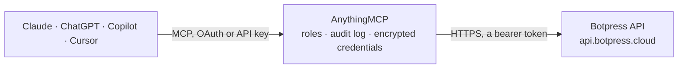

<!-- Generated by scripts/export-github-catalog.mjs in the anythingmcp-website repository. Do not edit by hand. -->

# Botpress MCP connector

Let your AI review your Botpress bots: workspaces and bots, conversations, messages, users and events, bot logs, analytics and issues, the bot's tables (query, add and update rows) and its … The AnythingMCP connector gives Claude, ChatGPT, Microsoft Copilot, Cursor and Gemini 21 MCP tools for Botpress: 18 read and 3 can change data.

**Category:** [Customer Support](../support.md) · **Tools:** 21 · **Setup guide:** [anythingmcp.com](https://anythingmcp.com/guides/botpress-to-mcp) · [Deutsch](https://anythingmcp.com/de/guides/botpress-to-mcp) · [Italiano](https://anythingmcp.com/it/guides/botpress-to-mcp) · [Español](https://anythingmcp.com/es/guides/botpress-to-mcp) · [日本語](https://anythingmcp.com/ja/guides/botpress-to-mcp) · [Русский](https://anythingmcp.com/ru/guides/botpress-to-mcp) · [中文](https://anythingmcp.com/zh/guides/botpress-to-mcp)

## Start without code

No installation and no terminal: AnythingMCP Cloud runs the Botpress connector for you, operated by helpcode.ai in Frankfurt, Germany.

1. **Click the button above** and create an account or sign in. The Botpress connector opens, ready to install.
2. **Paste the API key or token from your Botpress account.** Every click is in the [step-by-step guide](https://anythingmcp.com/guides/botpress-to-mcp).
3. **Click Install.** AnythingMCP shows the address of your MCP server.
4. **Add that address to your assistant:** [Claude](https://anythingmcp.com/guides/connect-botpress-to-claude) · [ChatGPT](https://anythingmcp.com/guides/connect-botpress-to-chatgpt) · [Microsoft Copilot](https://anythingmcp.com/guides/connect-botpress-to-copilot) · [Cursor](https://anythingmcp.com/guides/connect-botpress-to-cursor) · [Gemini CLI](https://anythingmcp.com/guides/connect-botpress-to-gemini) · [Meta Muse](https://anythingmcp.com/guides/connect-botpress-to-muse).
5. **Ask your first question**, for example: *Show the WhatsApp conversation id conv_wh_20260928_77 that had 8 messages on 2026-09-28*

Prefer help with the setup? [Talk to us](https://anythingmcp.com/contact).

## How it works

- **The AI client** speaks MCP (Streamable HTTP) to AnythingMCP and only sees tool names, descriptions and results. It never gets the Botpress credentials.
- **AnythingMCP** checks the client's role, builds the call from the tool definition, adds the credentials (a bearer token), calls Botpress, logs the call and returns the result.
- **Botpress** sees an ordinary API client with the rights of the account the credentials belong to.

## Tools

| Tool | What it does | Access |
|---|---|---|
| [`botpress_list_workspaces`](#botpress_list_workspaces) | List the Botpress workspaces the token's user belongs to, with id, name, plan, bot count, spending limit and whether the workspace is blocked. | read |
| [`botpress_list_bots`](#botpress_list_bots) | List the bots of a Botpress workspace (production bots, or dev bots with dev true) with id, name, type, tags and last deploy time. | read |
| [`botpress_get_bot`](#botpress_get_bot) | Get one bot's overview: name, description, status, deploy time, whether it is a dev bot, tags, and its installed integrations with version, enabled flag and… | read |
| [`botpress_get_bot_logs`](#botpress_get_bot_logs) | Read a bot's runtime logs (console output, errors and system messages) from timeStart on, filtered by level, conversation, user, workflow or text. | read |
| [`botpress_get_bot_analytics`](#botpress_get_bot_analytics) | Get a bot's usage analytics between two dates: per period new and returning users, sessions, user and bot messages, events, conversations created, and… | read |
| [`botpress_list_bot_issues`](#botpress_list_bot_issues) | List the issues Botpress recorded for a bot (errors in its code, hit limits, configuration problems) with code, title, description, category, events count,… | read |
| [`botpress_list_conversations`](#botpress_list_conversations) | List a bot's conversations from every channel, newest first, with id, integration and channel (e.g. webchat, whatsapp), message count, tags and dates. | read |
| [`botpress_get_conversation`](#botpress_get_conversation) | Get one conversation of a bot: integration, channel, message count, tags, shared properties and dates. | read |
| [`botpress_list_messages`](#botpress_list_messages) | List a bot's messages, newest first, usually of one conversation (conversationId). | read |
| [`botpress_list_users`](#botpress_list_users) | List the end users who talked to a bot (one per channel: the same person on Slack and WhatsApp is two users), with id, name, tags and dates. | read |
| [`botpress_get_user`](#botpress_get_user) | Get one end user of a bot: name, picture URL, tags, attributes and properties set by the bot or its integrations, and dates. | read |
| [`botpress_list_events`](#botpress_list_events) | List a bot's events (incoming messages, integration events, custom and scheduled events) with type, status (pending, processed, ignored, failed, scheduled)… | read |
| [`botpress_get_event`](#botpress_get_event) | Get one event of a bot with its full payload, status and failureReason. | read |
| [`botpress_list_tables`](#botpress_list_tables) | List a bot's tables with id, name, row factor, key column, whether it is frozen and the column schema. | read |
| [`botpress_get_table`](#botpress_get_table) | Get one table of a bot with its columns (names, types, descriptions, computed settings), key column, its row count (rows) and how many rows wait for… | read |
| [`botpress_find_table_rows`](#botpress_find_table_rows) | Query rows of a bot's table with a MongoDB-like filter, full-text search, column selection, ordering and offset paging; group adds aggregations (count, sum,… | read |
| [`botpress_create_table_rows`](#botpress_create_table_rows) | Add rows to a bot's table (1 to 1,000 per call), each an object of column values matching the table's schema (see botpress_get_table). | write |
| [`botpress_update_table_rows`](#botpress_update_table_rows) | Update rows of a bot's table by id (1 to 1,000 per call): each row is {"id": 12, "column": "new value"} and only the given columns change. | write |
| [`botpress_delete_table_rows`](#botpress_delete_table_rows) | Permanently delete rows of a bot's table by their ids (up to 1,000 per call). | write |
| [`botpress_list_files`](#botpress_list_files) | List a bot's files (knowledge-base documents and other uploads) with id, key, content type, size, tags, status (upload or indexing state) and dates. | read |
| [`botpress_search_files`](#botpress_search_files) | Semantic search over a bot's indexed files (its knowledge base): returns the passages that best match a natural-language query, with score, page number and… | read |

## Tool reference

Every parameter as the AI client sees it in `tools/list`. Source: [`packages/backend/src/adapters/intl/botpress.json`](../../../packages/backend/src/adapters/intl/botpress.json).

### `botpress_list_workspaces`

List the Botpress workspaces the token's user belongs to, with id, name, plan, bot count, spending limit and whether the workspace is blocked. Use it to find a wkspace_ id. Read-only. Paginate with nextToken = meta.nextToken until it is missing.

**Access:** read · **Call:** `GET /v1/admin/workspaces`

| Parameter | Type | Required | Description |
|---|---|---|---|
| `pageSize` | integer | no | Workspaces per page, 1 to 100. Default 20. |
| `nextToken` | string | no | meta.nextToken from the previous page. |

### `botpress_list_bots`

List the bots of a Botpress workspace (production bots, or dev bots with dev true) with id, name, type, tags and last deploy time. Uses BOTPRESS_WORKSPACE_ID unless workspace_id is given. Read-only. Paginate with nextToken = meta.nextToken until it is missing.

**Access:** read · **Call:** `GET /v1/admin/bots`

| Parameter | Type | Required | Description |
|---|---|---|---|
| `workspace_id` | string | no | wkspace_ id of another workspace (from botpress_list_workspaces). Leave out for the configured workspace. |
| `dev` | boolean | no | true lists only dev bots (Studio emulator bots); false or left out lists production bots. |
| `sortField` | `createdAt` \| `updatedAt` | no | Sort by createdAt or updatedAt. |
| `sortDirection` | `asc` \| `desc` | no | Sort direction. |
| `pageSize` | integer | no | Bots per page, 1 to 100. Default 20. |
| `nextToken` | string | no | meta.nextToken from the previous page. |

### `botpress_get_bot`

Get one bot's overview: name, description, status, deploy time, whether it is a dev bot, tags, and its installed integrations with version, enabled flag and registration status. Integration configurations and secrets are left out. Read-only.

**Access:** read · **Call:** `GET /v1/admin/bots/{bot_id}`

| Parameter | Type | Required | Description |
|---|---|---|---|
| `bot_id` | string | yes | The bot's id (a UUID, from botpress_list_bots or the dashboard URL). |

### `botpress_get_bot_logs`

Read a bot's runtime logs (console output, errors and system messages) from timeStart on, filtered by level, conversation, user, workflow or text. The quickest way to see why a bot misbehaved. Read-only. Paginate with nextToken (top-level in the answer) until it is missing.

**Access:** read · **Call:** `GET /v1/admin/bots/{bot_id}/logs`

| Parameter | Type | Required | Description |
|---|---|---|---|
| `bot_id` | string | yes | The bot's id (a UUID). |
| `timeStart` | string | yes | Start of the time range, ISO 8601 in UTC, e.g. 2026-10-14T08:00:00.000Z. |
| `timeEnd` | string | no | End of the time range, ISO 8601 in UTC. Defaults to now. |
| `level` | string | no | Only this log level, e.g. error, warn, info or debug. |
| `conversationId` | string | no | Only logs of this conversation. |
| `userId` | string | no | Only logs of this user. |
| `workflowId` | string | no | Only logs of this workflow. |
| `messageContains` | string | no | Only log lines whose message contains this text. |
| `nextToken` | string | no | nextToken from the previous page. |

### `botpress_get_bot_analytics`

Get a bot's usage analytics between two dates: per period new and returning users, sessions, user and bot messages, events, conversations created, and workflow counts (created, completed, failed, timed out). Read-only.

**Access:** read · **Call:** `GET /v1/admin/bots/{bot_id}/analytics`

| Parameter | Type | Required | Description |
|---|---|---|---|
| `bot_id` | string | yes | The bot's id (a UUID). |
| `startDate` | string | yes | Start of the range (inclusive), ISO 8601 in UTC, e.g. 2026-10-01T00:00:00.000Z. |
| `endDate` | string | yes | End of the range (inclusive), ISO 8601 in UTC. |

### `botpress_list_bot_issues`

List the issues Botpress recorded for a bot (errors in its code, hit limits, configuration problems) with code, title, description, category, events count, first and last seen time and a resolution link when Botpress has one. Read-only. Paginate with nextToken = meta.nextToken.

**Access:** read · **Call:** `GET /v1/admin/bots/{bot_id}/issues`

| Parameter | Type | Required | Description |
|---|---|---|---|
| `bot_id` | string | yes | The bot's id (a UUID). |
| `pageSize` | integer | no | Issues per page, 1 to 100. Default 20. |
| `nextToken` | string | no | meta.nextToken from the previous page. |

### `botpress_list_conversations`

List a bot's conversations from every channel, newest first, with id, integration and channel (e.g. webchat, whatsapp), message count, tags and dates. Filter by integration, channel, creation date or message count. Uses BOTPRESS_BOT_ID unless bot_id is given. Read-only. Paginate with nextToken = meta.nextToken.

**Access:** read · **Call:** `GET /v1/chat/conversations`

| Parameter | Type | Required | Description |
|---|---|---|---|
| `bot_id` | string | no | Another bot's id. Leave out for the configured bot. |
| `integrationName` | string | no | Only conversations of this integration, e.g. webchat, whatsapp, telegram, slack, chat. |
| `channel` | string | no | Only conversations on this integration channel, e.g. channel or dm. |
| `afterDate` | string | no | Only conversations created at or after this ISO 8601 UTC time. |
| `beforeDate` | string | no | Only conversations created at or before this ISO 8601 UTC time. |
| `minMessageCount` | integer | no | Only conversations with at least this many messages. |
| `maxMessageCount` | integer | no | Only conversations with at most this many messages. |
| `sortField` | `createdAt` \| `updatedAt` | no | Sort by createdAt or updatedAt. |
| `sortDirection` | `asc` \| `desc` | no | Sort direction. |
| `pageSize` | integer | no | Conversations per page, 1 to 100. Default 20. |
| `nextToken` | string | no | meta.nextToken from the previous page. |

### `botpress_get_conversation`

Get one conversation of a bot: integration, channel, message count, tags, shared properties and dates. Read the messages with botpress_list_messages. Read-only.

**Access:** read · **Call:** `GET /v1/chat/conversations/{id}`

| Parameter | Type | Required | Description |
|---|---|---|---|
| `id` | string | yes | The conversation id. |
| `bot_id` | string | no | Another bot's id. Leave out for the configured bot. |

### `botpress_list_messages`

List a bot's messages, newest first, usually of one conversation (conversationId). Each message has type (text, image, choice and so on), payload (the text is payload.text), direction (incoming from the user, outgoing from the bot), userId and createdAt. Read-only. Paginate with nextToken = meta.nextToken.

**Access:** read · **Call:** `GET /v1/chat/messages`

| Parameter | Type | Required | Description |
|---|---|---|---|
| `conversationId` | string | no | Only messages of this conversation. Recommended; without it the bot's messages from all conversations are mixed. |
| `afterDate` | string | no | Only messages created at or after this ISO 8601 UTC time. |
| `beforeDate` | string | no | Only messages created at or before this ISO 8601 UTC time. |
| `bot_id` | string | no | Another bot's id. Leave out for the configured bot. |
| `pageSize` | integer | no | Messages per page, 1 to 100. Default 50. |
| `nextToken` | string | no | meta.nextToken from the previous page. |

### `botpress_list_users`

List the end users who talked to a bot (one per channel: the same person on Slack and WhatsApp is two users), with id, name, tags and dates. Filter by conversation or by creation or update date. Read-only. Paginate with nextToken = meta.nextToken.

**Access:** read · **Call:** `GET /v1/chat/users`

| Parameter | Type | Required | Description |
|---|---|---|---|
| `conversationId` | string | no | Only users who took part in this conversation. |
| `afterDate` | string | no | Only users created (or updated, see rangeField) at or after this ISO 8601 UTC time. |
| `beforeDate` | string | no | Only users created (or updated) at or before this ISO 8601 UTC time. |
| `rangeField` | `createdAt` \| `updatedAt` | no | Which date afterDate and beforeDate apply to. Default createdAt. |
| `sortField` | `createdAt` \| `updatedAt` | no | Sort by createdAt or updatedAt. |
| `sortDirection` | `asc` \| `desc` | no | Sort direction. |
| `bot_id` | string | no | Another bot's id. Leave out for the configured bot. |
| `pageSize` | integer | no | Users per page, 1 to 100. Default 20. |
| `nextToken` | string | no | meta.nextToken from the previous page. |

### `botpress_get_user`

Get one end user of a bot: name, picture URL, tags, attributes and properties set by the bot or its integrations, and dates. These fields can hold personal data such as phone numbers or emails. Read-only.

**Access:** read · **Call:** `GET /v1/chat/users/{id}`

| Parameter | Type | Required | Description |
|---|---|---|---|
| `id` | string | yes | The user id. |
| `bot_id` | string | no | Another bot's id. Leave out for the configured bot. |

### `botpress_list_events`

List a bot's events (incoming messages, integration events, custom and scheduled events) with type, status (pending, processed, ignored, failed, scheduled) and the conversation, user and message they belong to. Use status failed to find events the bot could not handle; failureReason says why. Read-only. Paginate with nextToken = meta.nextToken.

**Access:** read · **Call:** `GET /v1/chat/events`

| Parameter | Type | Required | Description |
|---|---|---|---|
| `type` | string | no | Only events of this type, e.g. message_created or an integration event name. |
| `status` | `pending` \| `ignored` \| `processed` \| `failed` \| `scheduled` | no | Only events in this state. |
| `conversationId` | string | no | Only events of this conversation. |
| `userId` | string | no | Only events of this user. |
| `messageId` | string | no | Only events of this message. |
| `workflowId` | string | no | Only events of this workflow. |
| `bot_id` | string | no | Another bot's id. Leave out for the configured bot. |
| `pageSize` | integer | no | Events per page, 1 to 100. Default 20. |
| `nextToken` | string | no | meta.nextToken from the previous page. |

### `botpress_get_event`

Get one event of a bot with its full payload, status and failureReason. Read-only.

**Access:** read · **Call:** `GET /v1/chat/events/{id}`

| Parameter | Type | Required | Description |
|---|---|---|---|
| `id` | string | yes | The event id. |
| `bot_id` | string | no | Another bot's id. Leave out for the configured bot. |

### `botpress_list_tables`

List a bot's tables with id, name, row factor, key column, whether it is frozen and the column schema. Use the name or id with the row tools. Read-only.

**Access:** read · **Call:** `GET /v1/tables`

| Parameter | Type | Required | Description |
|---|---|---|---|
| `bot_id` | string | no | Another bot's id. Leave out for the configured bot. |

### `botpress_get_table`

Get one table of a bot with its columns (names, types, descriptions, computed settings), key column, its row count (rows) and how many rows wait for recomputation or indexing. Check the columns before querying or writing rows. Read-only.

**Access:** read · **Call:** `GET /v1/tables/{table}`

| Parameter | Type | Required | Description |
|---|---|---|---|
| `table` | string | yes | The table's name (e.g. CustomersTable) or id. |
| `bot_id` | string | no | Another bot's id. Leave out for the configured bot. |

### `botpress_find_table_rows`

Query rows of a bot's table with a MongoDB-like filter, full-text search, column selection, ordering and offset paging; group adds aggregations (count, sum, avg, min, max). Returns rows, hasMore, offset and limit. Read-only, although Botpress serves it as POST.

**Access:** read · **Call:** `POST /v1/tables/{table}/rows/find`

| Parameter | Type | Required | Description |
|---|---|---|---|
| `table` | string | yes | The table's name or id. |
| `filter` | object | no | MongoDB-like filter on columns, e.g. {"status": {"$eq": "open"}, "amount": {"$gt": 100}}. Operators include $eq, $ne, $gt, $gte, $lt, $lte, $in, $nin, $regex, $and, $or. |
| `search` | string | no | Full-text search over searchable columns (up to 1,024 characters). Results are ranked by similarity and may include partial matches. |
| `select` | string[] | no | Columns to return, e.g. ["name", "email"]; nested values with dot notation. All columns when left out. |
| `group` | object | no | Group and aggregate, e.g. {"status": "key", "amount": ["sum", "avg"]}. Allowed: key, avg, max, min, sum, count. |
| `orderBy` | string | no | Column to sort by. Default id; built-in columns are id, createdAt, updatedAt. |
| `orderDirection` | `asc` \| `desc` | no | Sort direction. Default asc. |
| `limit` | integer | no | Rows to return, 1 to 1,000. Default 50 here. |
| `offset` | integer | no | Rows to skip, for paging. Default 0. |
| `bot_id` | string | no | Another bot's id. Leave out for the configured bot. |

### `botpress_create_table_rows`

Add rows to a bot's table (1 to 1,000 per call), each an object of column values matching the table's schema (see botpress_get_table). Changes the bot's data: confirm the rows with the user first. Returns the created rows with their ids, plus warnings and errors for rows that could not be stored.

**Access:** write · **Call:** `POST /v1/tables/{table}/rows`

| Parameter | Type | Required | Description |
|---|---|---|---|
| `table` | string | yes | The table's name or id. |
| `rows` | object[] | yes | Rows to add, e.g. [{"name": "Ada", "email": "ada@example.com"}]. Leave out id, createdAt and updatedAt. |
| `waitComputed` | boolean | no | Wait until computed columns are filled before answering (only for small batches). |
| `bot_id` | string | no | Another bot's id. Leave out for the configured bot. |

### `botpress_update_table_rows`

Update rows of a bot's table by id (1 to 1,000 per call): each row is {"id": 12, "column": "new value"} and only the given columns change. Overwrites the bot's data: confirm the changes with the user first. Returns the updated rows plus warnings and errors.

**Access:** write · **Call:** `PUT /v1/tables/{table}/rows`

| Parameter | Type | Required | Description |
|---|---|---|---|
| `table` | string | yes | The table's name or id. |
| `rows` | object[] | yes | Rows to update, each with its numeric id and the columns to change. |
| `waitComputed` | boolean | no | Wait until computed columns are refreshed before answering (only for small batches). |
| `bot_id` | string | no | Another bot's id. Leave out for the configured bot. |

### `botpress_delete_table_rows`

Permanently delete rows of a bot's table by their ids (up to 1,000 per call). Cannot be undone. Installed switched off. Confirm with the user first, naming the table and the row ids. Returns deletedRows.

**Access:** write · **Call:** `POST /v1/tables/{table}/rows/delete`

| Parameter | Type | Required | Description |
|---|---|---|---|
| `table` | string | yes | The table's name or id. |
| `ids` | integer[] | yes | Numeric ids of the rows to delete. |
| `bot_id` | string | no | Another bot's id. Leave out for the configured bot. |

### `botpress_list_files`

List a bot's files (knowledge-base documents and other uploads) with id, key, content type, size, tags, status (upload or indexing state) and dates. Download links are left out. Read-only. Paginate with nextToken = meta.nextToken.

**Access:** read · **Call:** `GET /v1/files`

| Parameter | Type | Required | Description |
|---|---|---|---|
| `indexed` | boolean | no | true for files indexed for search only, false for files not indexed. |
| `sortField` | `key` \| `size` \| `createdAt` \| `updatedAt` \| `status` | no | Sort field. |
| `sortDirection` | `asc` \| `desc` | no | Sort direction. |
| `bot_id` | string | no | Another bot's id. Leave out for the configured bot. |
| `pageSize` | integer | no | Files per page, 1 to 100. Default 20. |
| `nextToken` | string | no | meta.nextToken from the previous page. |

### `botpress_search_files`

Semantic search over a bot's indexed files (its knowledge base): returns the passages that best match a natural-language query, with score, page number and the file they come from. Read-only.

**Access:** read · **Call:** `GET /v1/files/search`

| Parameter | Type | Required | Description |
|---|---|---|---|
| `query` | string | yes | The question or topic in natural language. |
| `limit` | integer | no | Passages to return. Default 5. |
| `contextDepth` | integer | no | Neighbouring passages to add around each hit, 0 to 10 (Botpress default 1). |
| `consolidate` | boolean | no | Merge the hits from the same file into one passage per file. |
| `includeBreadcrumb` | boolean | no | Prefix each passage with the titles it sits under. Ignored with consolidate. |
| `bot_id` | string | no | Another bot's id. Leave out for the configured bot. |

## Run it yourself

AnythingMCP is open source (AGPL-3.0). [Run it with Docker](../../../README.md#run-it-yourself), open **Connectors → Store**, pick **Botpress** and enter `BOTPRESS_TOKEN`, `BOTPRESS_WORKSPACE_ID`, `BOTPRESS_BOT_ID`, then add your MCP server URL to the AI client.

[← Customer Support connectors](../support.md) · [All categories](../README.md)
