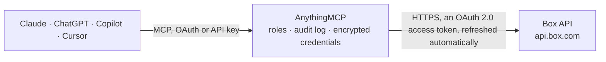

<!-- Generated by scripts/export-github-catalog.mjs in the anythingmcp-website repository. Do not edit by hand. -->

# Box MCP connector

Manage Box (enterprise content: files, folders, collaborations, comments, tasks, metadata) from any AI agent. 10 tools, OAuth2 token. The AnythingMCP connector gives Claude, ChatGPT, Microsoft Copilot, Cursor and Gemini 10 MCP tools for Box: 5 read and 5 can change data.

**Category:** [File Storage](../storage.md) · **Tools:** 10 · **Setup guide:** [anythingmcp.com](https://anythingmcp.com/guides/box-to-mcp) · [Deutsch](https://anythingmcp.com/de/guides/box-to-mcp) · [Italiano](https://anythingmcp.com/it/guides/box-to-mcp) · [Español](https://anythingmcp.com/es/guides/box-to-mcp) · [日本語](https://anythingmcp.com/ja/guides/box-to-mcp) · [Русский](https://anythingmcp.com/ru/guides/box-to-mcp) · [中文](https://anythingmcp.com/zh/guides/box-to-mcp)

## Start without code

No installation and no terminal: AnythingMCP Cloud runs the Box connector for you, operated by helpcode.ai in Frankfurt, Germany.

1. **Click the button above** and create an account or sign in. The Box connector opens, ready to install.
2. **Sign in with your Box account** when AnythingMCP asks. The first time, an admin creates a small app in the Box developer console. Every click is in the [step-by-step guide](https://anythingmcp.com/guides/box-to-mcp).
3. **Click Install.** AnythingMCP shows the address of your MCP server.
4. **Add that address to your assistant:** [Claude](https://anythingmcp.com/guides/connect-box-to-claude) · [ChatGPT](https://anythingmcp.com/guides/connect-box-to-chatgpt) · [Microsoft Copilot](https://anythingmcp.com/guides/connect-box-to-copilot) · [Cursor](https://anythingmcp.com/guides/connect-box-to-cursor) · [Gemini CLI](https://anythingmcp.com/guides/connect-box-to-gemini) · [Meta Muse](https://anythingmcp.com/guides/connect-box-to-muse).
5. **Ask your first question**, for example: *Find the file named invoice_2026-07-15.pdf for customer NordicSea AS in our Invoices folder*

Prefer help with the setup? [Talk to us](https://anythingmcp.com/contact).

## How it works

- **The AI client** speaks MCP (Streamable HTTP) to AnythingMCP and only sees tool names, descriptions and results. It never gets the Box credentials.
- **AnythingMCP** checks the client's role, builds the call from the tool definition, adds the credentials (an OAuth 2.0 access token, refreshed automatically), calls Box, logs the call and returns the result.
- **Box** sees an ordinary API client with the rights of the account the credentials belong to.

## Tools

| Tool | What it does | Access |
|---|---|---|
| [`box_get_current_user`](#box_get_current_user) | Return the authenticated user. | read |
| [`box_get_folder_items`](#box_get_folder_items) | List items in a folder (files + subfolders). | read |
| [`box_get_folder`](#box_get_folder) | Get folder metadata (name, created_by, modified_by, item_collection summary). | read |
| [`box_create_folder`](#box_create_folder) | Create a folder inside a parent. | write |
| [`box_get_file`](#box_get_file) | Get file metadata. | read |
| [`box_copy_file`](#box_copy_file) | Copy a file to a different folder. | write |
| [`box_move_or_rename_file`](#box_move_or_rename_file) | Move file to a different folder and/or rename. | write |
| [`box_delete_file`](#box_delete_file) | Delete a file (moves to trash; restore via /files/{id}/trash endpoint). | write |
| [`box_search`](#box_search) | Search across content. | read |
| [`box_create_shared_link`](#box_create_shared_link) | Create or update a shared link on a file. | write |

## Tool reference

Every parameter as the AI client sees it in `tools/list`. Source: [`packages/backend/src/adapters/intl/box.json`](../../../packages/backend/src/adapters/intl/box.json).

### `box_get_current_user`

Return the authenticated user.

**Access:** read · **Call:** `GET /users/me`

No parameters.

### `box_get_folder_items`

List items in a folder (files + subfolders). Use folder_id=0 for the root.

**Access:** read · **Call:** `GET /folders/{folder_id}/items`

| Parameter | Type | Required | Description |
|---|---|---|---|
| `folder_id` | string | yes | Folder ID (use '0' for root). |
| `fields` | string | no | Comma-separated fields to project, e.g. 'name,size,modified_at,modified_by'. |
| `limit` | integer | no | Max 1000. |
| `offset` | integer | no | 0-based offset. |

### `box_get_folder`

Get folder metadata (name, created_by, modified_by, item_collection summary).

**Access:** read · **Call:** `GET /folders/{folder_id}`

| Parameter | Type | Required | Description |
|---|---|---|---|
| `folder_id` | string | yes | Folder ID. |
| `fields` | string | no | Fields to project. |

### `box_create_folder`

Create a folder inside a parent.

**Access:** write · **Call:** `POST /folders`

| Parameter | Type | Required | Description |
|---|---|---|---|
| `parent_id` | string | yes | Parent folder ID. |
| `name` | string | yes | Folder name. |

### `box_get_file`

Get file metadata.

**Access:** read · **Call:** `GET /files/{file_id}`

| Parameter | Type | Required | Description |
|---|---|---|---|
| `file_id` | string | yes | File ID. |
| `fields` | string | no | Fields to project. |

### `box_copy_file`

Copy a file to a different folder.

**Access:** write · **Call:** `POST /files/{file_id}/copy`

| Parameter | Type | Required | Description |
|---|---|---|---|
| `file_id` | string | yes | Source file ID. |
| `parent_id` | string | yes | Destination folder ID. |
| `name` | string | no | Optional new name. |
| `version` | string | no | Copy a specific version. |

### `box_move_or_rename_file`

Move file to a different folder and/or rename. Update other fields too.

**Access:** write · **Call:** `PUT /files/{file_id}`

| Parameter | Type | Required | Description |
|---|---|---|---|
| `file_id` | string | yes | File ID. |
| `parent_id` | string | no | New parent folder. |
| `name` | string | no | New name. |
| `description` | string | no | New description. |

### `box_delete_file`

Delete a file (moves to trash; restore via /files/{id}/trash endpoint).

**Access:** write · **Call:** `DELETE /files/{file_id}`

| Parameter | Type | Required | Description |
|---|---|---|---|
| `file_id` | string | yes | File ID. |

### `box_search`

Search across content. Filter by type (file/folder/web_link), file extensions, content types, date range.

**Access:** read · **Call:** `GET /search`

| Parameter | Type | Required | Description |
|---|---|---|---|
| `query` | string | yes | Search query. |
| `type` | string | no | file, folder, web_link. |
| `file_extensions` | string | no | Comma-separated extensions. |
| `content_types` | string | no | Comma-separated: name, description, file_content, comments, tags. |
| `ancestor_folder_ids` | string | no | Comma-separated folder IDs to restrict search to. |
| `limit` | integer | no | Max 200. |
| `offset` | integer | no | 0-based. |

### `box_create_shared_link`

Create or update a shared link on a file. Returns the shared URL.

**Access:** write · **Call:** `PUT /files/{file_id}`

| Parameter | Type | Required | Description |
|---|---|---|---|
| `file_id` | string | yes | File ID. |
| `access` | string | no | open (public), company, collaborators. |
| `password` | string | no | Optional password. |
| `unshared_at` | string | no | Optional ISO 8601 expiry. |
| `can_download` | boolean | no | Allow downloads. |

## Run it yourself

AnythingMCP is open source (AGPL-3.0). [Run it with Docker](../../../README.md#run-it-yourself), open **Connectors → Store**, pick **Box** and enter `BOX_CLIENT_ID`, `BOX_CLIENT_SECRET`, then add your MCP server URL to the AI client.

[← File Storage connectors](../storage.md) · [All categories](../README.md)
