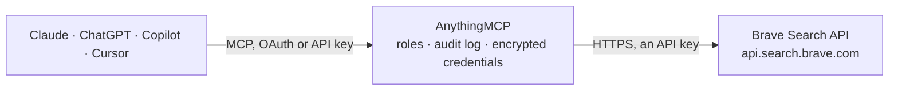

<!-- Generated by scripts/export-github-catalog.mjs in the anythingmcp-website repository. Do not edit by hand. -->

# Brave Search MCP connector

Give your AI live web search from Brave's independent index: page text ready for grounding (LLM Context), web, news, image and video search, places and points of interest, autosuggest, spellcheck and AI answers. The AnythingMCP connector gives Claude, ChatGPT, Microsoft Copilot, Cursor and Gemini 12 MCP tools for Brave Search, all read-only.

**Category:** [Public Data](../data.md) · **Tools:** 12 · **Setup guide:** [anythingmcp.com](https://anythingmcp.com/guides/brave-search-to-mcp) · [Deutsch](https://anythingmcp.com/de/guides/brave-search-to-mcp) · [Italiano](https://anythingmcp.com/it/guides/brave-search-to-mcp) · [Español](https://anythingmcp.com/es/guides/brave-search-to-mcp) · [日本語](https://anythingmcp.com/ja/guides/brave-search-to-mcp) · [Русский](https://anythingmcp.com/ru/guides/brave-search-to-mcp) · [中文](https://anythingmcp.com/zh/guides/brave-search-to-mcp)

## Start without code

No installation and no terminal: AnythingMCP Cloud runs the Brave Search connector for you, operated by helpcode.ai in Frankfurt, Germany.

1. **Click the button above** and create an account or sign in. The Brave Search connector opens, ready to install.
2. **Paste the API key or token from your Brave Search account.** Every click is in the [step-by-step guide](https://anythingmcp.com/guides/brave-search-to-mcp).
3. **Click Install.** AnythingMCP shows the address of your MCP server.
4. **Add that address to your assistant:** [Claude](https://anythingmcp.com/guides/connect-brave-search-to-claude) · [ChatGPT](https://anythingmcp.com/guides/connect-brave-search-to-chatgpt) · [Microsoft Copilot](https://anythingmcp.com/guides/connect-brave-search-to-copilot) · [Cursor](https://anythingmcp.com/guides/connect-brave-search-to-cursor) · [Gemini CLI](https://anythingmcp.com/guides/connect-brave-search-to-gemini) · [Meta Muse](https://anythingmcp.com/guides/connect-brave-search-to-muse).
5. **Ask your first question**, for example: *Find the public PDF for supplier Helios Components GmbH invoice INV-2026-042 on their site.*

Prefer help with the setup? [Talk to us](https://anythingmcp.com/contact).

## How it works

- **The AI client** speaks MCP (Streamable HTTP) to AnythingMCP and only sees tool names, descriptions and results. It never gets the Brave Search credentials.
- **AnythingMCP** checks the client's role, builds the call from the tool definition, adds the credentials (an API key), calls Brave Search, logs the call and returns the result.
- **Brave Search** sees an ordinary API client with the rights of the account the credentials belong to.

## Tools

| Tool | What it does | Access |
|---|---|---|
| [`brave_search_llm_context`](#brave_search_llm_context) | Search the web with Brave and get the relevant text of the top pages, already extracted for a model (snippets, tables, code) with the source URL and title… | read |
| [`brave_search_web`](#brave_search_web) | Brave web search: ranked results with title, URL, description and age, plus news, videos, discussions, FAQ, infobox and local places when relevant to the query. | read |
| [`brave_search_news`](#brave_search_news) | Brave news search: recent articles with title, URL, description, age and source site. | read |
| [`brave_search_images`](#brave_search_images) | Brave image search: images with title, the page they appear on, the image URL, a thumbnail and the size. | read |
| [`brave_search_videos`](#brave_search_videos) | Brave video search: videos with title, URL, description, age, duration, creator, publisher and views. | read |
| [`brave_search_suggest`](#brave_search_suggest) | Query autocompletion: Brave search suggestions for the start of a query, e.g. to see what people search around a topic or to complete a name. | read |
| [`brave_search_spellcheck`](#brave_search_spellcheck) | Spell-check a query or phrase with Brave and get the corrected version (results[].query), e.g. to fix a misspelt name before searching. | read |
| [`brave_search_places`](#brave_search_places) | Find places (businesses, landmarks, points of interest) in an area from Brave's index of over 200 million locations: name, address, coordinates, category,… | read |
| [`brave_search_get_pois`](#brave_search_get_pois) | Get full details of up to 20 places by their location ids from brave_search_web or brave_search_places: address, phone, opening hours, rating and reviews,… | read |
| [`brave_search_get_poi_descriptions`](#brave_search_get_poi_descriptions) | Get AI-written descriptions of up to 20 places by their location ids from brave_search_web or brave_search_places. | read |
| [`brave_search_get_rich_result`](#brave_search_get_rich_result) | Fetch a live rich result (weather, stock quote, currency conversion, sports score, calculator...) for a web search run with enable_rich_callback true, using… | read |
| [`brave_search_answer`](#brave_search_answer) | Ask Brave Answers a question: an AI-written answer grounded in a live web search. | read |

## Tool reference

Every parameter as the AI client sees it in `tools/list`. Source: [`packages/backend/src/adapters/intl/brave-search.json`](../../../packages/backend/src/adapters/intl/brave-search.json).

### `brave_search_llm_context`

Search the web with Brave and get the relevant text of the top pages, already extracted for a model (snippets, tables, code) with the source URL and title of each. The best tool to ground an answer in current facts, news or anything that may have changed recently. Tune the size with maximum_number_of_tokens and maximum_number_of_urls.

**Access:** read · **Call:** `GET /llm/context`

| Parameter | Type | Required | Description |
|---|---|---|---|
| `q` | string | yes | Search query, at most 600 characters and 75 words. Search operators work (site:, "exact phrase", -exclude, filetype:). |
| `country` | string | no | Two-letter country code the results come from, e.g. US, DE, FR, IT, GB; ALL for no country. Default US. |
| `search_lang` | string | no | Language of the results, e.g. en, de, fr, it, es, pt-br, zh-hans. Default en. |
| `freshness` | string | no | Only pages of a given age: pd last 24 hours, pw last 7 days, pm last 31 days, py last 365 days, or a range YYYY-MM-DDtoYYYY-MM-DD, e.g. 2026-01-01to2026-03-31. |
| `count` | integer | no | Search results to consider when picking the context, 1 to 50 (default 20). |
| `maximum_number_of_urls` | integer | no | Most different pages in the context, 1 to 50 (default 20). |
| `maximum_number_of_tokens` | integer | no | Approximate size of the context in tokens, 1024 to 32768 (default here 4096, Brave default 8192). Raise it for research questions. |
| `maximum_number_of_snippets` | integer | no | Most text chunks in total, 1 to 256 (default 50). |
| `maximum_number_of_tokens_per_url` | integer | no | Most tokens taken from one page, 512 to 8192 (default 4096). |
| `maximum_number_of_snippets_per_url` | integer | no | Most chunks taken from one page, 1 to 100 (default 50). |
| `context_threshold_mode` | `disabled` \| `strict` \| `lenient` \| `balanced` | no | How relevant a chunk must be to be included: strict keeps fewer and closer matches, lenient more. |
| `safesearch` | `off` \| `moderate` \| `strict` | no | Adult content filter: off, moderate or strict. |
| `goggles` | string | no | A Goggle (custom re-ranking rules) as the URL where it is hosted or its definition, e.g. to favour or exclude sites. |
| `enable_local` | boolean | no | true adds places and points of interest (grounding.poi and grounding.map) for local questions. |
| `enable_source_metadata` | boolean | no | true adds site name, favicon, thumbnail, description and fetch time for each source under sources. |

### `brave_search_web`

Brave web search: ranked results with title, URL, description and age, plus news, videos, discussions, FAQ, infobox and local places when relevant to the query. Up to 20 results per page and 10 pages (offset). For page text to answer from, prefer brave_search_llm_context.

**Access:** read · **Call:** `GET /web/search`

| Parameter | Type | Required | Description |
|---|---|---|---|
| `q` | string | yes | Search query, at most 400 characters and 50 words. Search operators work (site:, "exact phrase", -exclude, filetype:). |
| `country` | string | no | Two-letter country code the results come from, e.g. US, DE, FR, IT, GB; ALL for no country. Default US. |
| `search_lang` | string | no | Language of the results, e.g. en, de, fr, it, es, pt-br, zh-hans. Default en. |
| `ui_lang` | string | no | Language and region of the response strings, e.g. en-US, de-DE, fr-FR. Default en-US. |
| `count` | integer | no | Web results per page, 1 to 20 (default here 10). |
| `offset` | integer | no | Pages of count results to skip, 0 to 9. Page 2 is offset 1. |
| `freshness` | string | no | Only pages of a given age: pd last 24 hours, pw last 7 days, pm last 31 days, py last 365 days, or a range YYYY-MM-DDtoYYYY-MM-DD, e.g. 2026-01-01to2026-03-31. |
| `result_filter` | string | no | Comma-separated result types to return: web, news, videos, discussions, faq, infobox, locations, query. Default: all available. |
| `safesearch` | `off` \| `moderate` \| `strict` | no | Adult content filter: off, moderate or strict. |
| `spellcheck` | boolean | no | Correct the query spelling first (default true); the corrected query is in query.altered. |
| `extra_snippets` | boolean | no | true adds up to 5 more excerpts per result (extra_snippets). |
| `units` | `metric` \| `imperial` | no | Measurement units for distances and temperatures. |
| `goggles` | string | no | A Goggle (custom re-ranking rules) as the URL where it is hosted or its definition, e.g. to favour or exclude sites. |
| `text_decorations` | boolean | no | true keeps highlight markers in snippets (default here false). |
| `enable_rich_callback` | boolean | no | true returns a rich.hint.callback_key when Brave has a live rich result for the query (weather, stocks, sports, currency...); fetch it with brave_search_get_rich_result. |

### `brave_search_news`

Brave news search: recent articles with title, URL, description, age and source site. Use freshness pd or pw for breaking news; up to 50 results per page.

**Access:** read · **Call:** `GET /news/search`

| Parameter | Type | Required | Description |
|---|---|---|---|
| `q` | string | yes | Search query, at most 400 characters and 50 words. Search operators work (site:, "exact phrase", -exclude, filetype:). |
| `country` | string | no | Two-letter country code the results come from, e.g. US, DE, FR, IT, GB; ALL for no country. Default US. |
| `search_lang` | string | no | Language of the results, e.g. en, de, fr, it, es, pt-br, zh-hans. Default en. |
| `ui_lang` | string | no | Language and region of the response strings, e.g. en-US, de-DE, fr-FR. Default en-US. |
| `count` | integer | no | Articles per page, 1 to 50 (default 20). |
| `offset` | integer | no | Pages of count results to skip, 0 to 9. Page 2 is offset 1. |
| `freshness` | string | no | Only pages of a given age: pd last 24 hours, pw last 7 days, pm last 31 days, py last 365 days, or a range YYYY-MM-DDtoYYYY-MM-DD, e.g. 2026-01-01to2026-03-31. |
| `safesearch` | `off` \| `moderate` \| `strict` | no | Adult content filter: off, moderate or strict. |
| `spellcheck` | boolean | no | Correct the query spelling first (default true); the corrected query is in query.altered. |
| `extra_snippets` | boolean | no | true adds up to 5 more excerpts per result (extra_snippets). |
| `goggles` | string | no | A Goggle (custom re-ranking rules) as the URL where it is hosted or its definition, e.g. to favour or exclude sites. |

### `brave_search_images`

Brave image search: images with title, the page they appear on, the image URL, a thumbnail and the size. Up to 200 results, no paging.

**Access:** read · **Call:** `GET /images/search`

| Parameter | Type | Required | Description |
|---|---|---|---|
| `q` | string | yes | Search query, at most 400 characters and 50 words. Search operators work (site:, "exact phrase", -exclude, filetype:). |
| `country` | string | no | Two-letter country code the results come from, e.g. US, DE, FR, IT, GB; ALL for no country. Default US. |
| `search_lang` | string | no | Language of the results, e.g. en, de, fr, it, es, pt-br, zh-hans. Default en. |
| `count` | integer | no | Images to return, 1 to 200 (default here 20). |
| `safesearch` | `off` \| `strict` | no | Adult content filter: strict (default) or off. |
| `spellcheck` | boolean | no | Correct the query spelling first (default true); the corrected query is in query.altered. |

### `brave_search_videos`

Brave video search: videos with title, URL, description, age, duration, creator, publisher and views. Up to 50 results per page.

**Access:** read · **Call:** `GET /videos/search`

| Parameter | Type | Required | Description |
|---|---|---|---|
| `q` | string | yes | Search query, at most 400 characters and 50 words. Search operators work (site:, "exact phrase", -exclude, filetype:). |
| `country` | string | no | Two-letter country code the results come from, e.g. US, DE, FR, IT, GB; ALL for no country. Default US. |
| `search_lang` | string | no | Language of the results, e.g. en, de, fr, it, es, pt-br, zh-hans. Default en. |
| `ui_lang` | string | no | Language and region of the response strings, e.g. en-US, de-DE, fr-FR. Default en-US. |
| `count` | integer | no | Videos per page, 1 to 50 (default 20). |
| `offset` | integer | no | Pages of count results to skip, 0 to 9. Page 2 is offset 1. |
| `freshness` | string | no | Only pages of a given age: pd last 24 hours, pw last 7 days, pm last 31 days, py last 365 days, or a range YYYY-MM-DDtoYYYY-MM-DD, e.g. 2026-01-01to2026-03-31. |
| `safesearch` | `off` \| `moderate` \| `strict` | no | Adult content filter: off, moderate or strict. |
| `spellcheck` | boolean | no | Correct the query spelling first (default true); the corrected query is in query.altered. |

### `brave_search_suggest`

Query autocompletion: Brave search suggestions for the start of a query, e.g. to see what people search around a topic or to complete a name.

**Access:** read · **Call:** `GET /suggest/search`

| Parameter | Type | Required | Description |
|---|---|---|---|
| `q` | string | yes | The start of a query, at most 400 characters. |
| `country` | string | no | Two-letter country code the results come from, e.g. US, DE, FR, IT, GB; ALL for no country. Default US. |
| `lang` | string | no | Language hint, e.g. en, de, fr. |
| `count` | integer | no | Suggestions to return, 1 to 20 (default 5). |
| `rich` | boolean | no | true enriches suggestions with entity data (title, description, image). Needs a paid Autosuggest plan. |

### `brave_search_spellcheck`

Spell-check a query or phrase with Brave and get the corrected version (results[].query), e.g. to fix a misspelt name before searching.

**Access:** read · **Call:** `GET /spellcheck/search`

| Parameter | Type | Required | Description |
|---|---|---|---|
| `q` | string | yes | The phrase to check, at most 400 characters and 50 words. |
| `lang` | string | no | Language hint, e.g. en, de, fr. |
| `country` | string | no | Two-letter country code the results come from, e.g. US, DE, FR, IT, GB; ALL for no country. Default US. |

### `brave_search_places`

Find places (businesses, landmarks, points of interest) in an area from Brave's index of over 200 million locations: name, address, coordinates, category, rating, opening hours and contact. Give the area as location text or as latitude and longitude.

**Access:** read · **Call:** `GET /local/place_search`

| Parameter | Type | Required | Description |
|---|---|---|---|
| `q` | string | no | What to look for, e.g. "coffee", "pharmacy", "museum". Empty returns general points of interest in the area. |
| `location` | string | no | Area as text without commas: "<city> <state> <country name>" in the US (san francisco ca united states), "<city> <country name>" elsewhere (freiburg germany). Alternative to latitude and longitude. |
| `latitude` | string | no | Latitude of the area centre, -90 to 90. |
| `longitude` | string | no | Longitude of the area centre, -180 to 180. |
| `radius` | string | no | Bias towards results within this many metres of the coordinates (not a strict limit). |
| `geoloc` | string | no | The user's own position as <latitude>x<longitude>, to compute distances. |
| `count` | integer | no | Places to return, 1 to 100 (default 20). |
| `country` | string | no | Two-letter country code the results come from, e.g. US, DE, FR, IT, GB; ALL for no country. Default US. |
| `search_lang` | string | no | Language of the results, e.g. en, de, fr, it, es, pt-br, zh-hans. Default en. |
| `ui_lang` | string | no | Language and region of the response strings, e.g. en-US, de-DE, fr-FR. Default en-US. |
| `units` | `metric` \| `imperial` | no | Measurement units for distances and temperatures. |
| `safesearch` | `off` \| `moderate` \| `strict` | no | Adult content filter: off, moderate or strict. |
| `spellcheck` | boolean | no | Correct the query spelling first (default true); the corrected query is in query.altered. |

### `brave_search_get_pois`

Get full details of up to 20 places by their location ids from brave_search_web or brave_search_places: address, phone, opening hours, rating and reviews, price range, coordinates and links.

**Access:** read · **Call:** `GET /local/pois`

| Parameter | Type | Required | Description |
|---|---|---|---|
| `ids` | string[] | yes | Location ids from locations.results[].id of brave_search_web or results[].id of brave_search_places. Ids are valid for 8 hours. |
| `search_lang` | string | no | Language of the results, e.g. en, de, fr, it, es, pt-br, zh-hans. Default en. |
| `ui_lang` | string | no | Language and region of the response strings, e.g. en-US, de-DE, fr-FR. Default en-US. |
| `units` | `metric` \| `imperial` | no | Measurement units for distances and temperatures. |

### `brave_search_get_poi_descriptions`

Get AI-written descriptions of up to 20 places by their location ids from brave_search_web or brave_search_places.

**Access:** read · **Call:** `GET /local/descriptions`

| Parameter | Type | Required | Description |
|---|---|---|---|
| `ids` | string[] | yes | Location ids from locations.results[].id of brave_search_web or results[].id of brave_search_places. Ids are valid for 8 hours. |

### `brave_search_get_rich_result`

Fetch a live rich result (weather, stock quote, currency conversion, sports score, calculator...) for a web search run with enable_rich_callback true, using the callback key from rich.hint.callback_key.

**Access:** read · **Call:** `GET /web/rich`

| Parameter | Type | Required | Description |
|---|---|---|---|
| `callback_key` | string | yes | rich.hint.callback_key from a brave_search_web result. |

### `brave_search_answer`

Ask Brave Answers a question: an AI-written answer grounded in a live web search. Needs the Answers plan and is billed per search and per token; for raw sources to answer from yourself, use brave_search_llm_context instead.

**Access:** read · **Call:** `POST /chat/completions`

| Parameter | Type | Required | Description |
|---|---|---|---|
| `question` | string | yes | The question, e.g. "What is the second highest mountain?". |
| `model` | `brave-pro` \| `brave` | no | brave-pro (default) or brave. |
| `country` | string | no | Country of the search, lower-case two-letter code, e.g. us, de (default us). |
| `language` | string | no | Answer language, e.g. en, de (default en). |
| `safesearch` | `off` \| `moderate` \| `strict` | no | Adult content filter: off, moderate or strict. |
| `max_completion_tokens` | integer | no | Upper limit for the answer length in tokens. |

## Run it yourself

AnythingMCP is open source (AGPL-3.0). [Run it with Docker](../../../README.md#run-it-yourself), open **Connectors → Store**, pick **Brave Search** and enter `BRAVE_SEARCH_API_KEY`, then add your MCP server URL to the AI client.

[← Public Data connectors](../data.md) · [All categories](../README.md)
