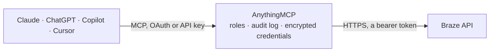

<!-- Generated by scripts/export-github-catalog.mjs in the anythingmcp-website repository. Do not edit by hand. -->

# Braze MCP connector

Let your AI work with Braze: review campaigns, Canvases and their results, check segments, daily active users and revenue, look up user profiles and subscriptions, record attributes and events, and … The AnythingMCP connector gives Claude, ChatGPT, Microsoft Copilot, Cursor and Gemini 23 MCP tools for Braze: 19 read and 4 can change data.

**Category:** [Marketing Automation](../marketing-automation.md) · **Tools:** 23 · **Setup guide:** [anythingmcp.com](https://anythingmcp.com/guides/braze-to-mcp) · [Deutsch](https://anythingmcp.com/de/guides/braze-to-mcp) · [Italiano](https://anythingmcp.com/it/guides/braze-to-mcp) · [Español](https://anythingmcp.com/es/guides/braze-to-mcp) · [日本語](https://anythingmcp.com/ja/guides/braze-to-mcp) · [Русский](https://anythingmcp.com/ru/guides/braze-to-mcp) · [中文](https://anythingmcp.com/zh/guides/braze-to-mcp)

## Start without code

No installation and no terminal: AnythingMCP Cloud runs the Braze connector for you, operated by helpcode.ai in Frankfurt, Germany.

1. **Click the button above** and create an account or sign in. The Braze connector opens, ready to install.
2. **Paste the API key or token from your Braze account.** Every click is in the [step-by-step guide](https://anythingmcp.com/guides/braze-to-mcp).
3. **Click Install.** AnythingMCP shows the address of your MCP server.
4. **Add that address to your assistant:** [Claude](https://anythingmcp.com/guides/connect-braze-to-claude) · [ChatGPT](https://anythingmcp.com/guides/connect-braze-to-chatgpt) · [Microsoft Copilot](https://anythingmcp.com/guides/connect-braze-to-copilot) · [Cursor](https://anythingmcp.com/guides/connect-braze-to-cursor) · [Gemini CLI](https://anythingmcp.com/guides/connect-braze-to-gemini) · [Meta Muse](https://anythingmcp.com/guides/connect-braze-to-muse).
5. **Ask your first question**, for example: *Show user profile for customer external_id CUST-2026-842: email, subscription groups and last purchase date*

Prefer help with the setup? [Talk to us](https://anythingmcp.com/contact).

## How it works

- **The AI client** speaks MCP (Streamable HTTP) to AnythingMCP and only sees tool names, descriptions and results. It never gets the Braze credentials.
- **AnythingMCP** checks the client's role, builds the call from the tool definition, adds the credentials (a bearer token), calls Braze, logs the call and returns the result.
- **Braze** sees an ordinary API client with the rights of the account the credentials belong to.

## Tools

| Tool | What it does | Access |
|---|---|---|
| [`braze_list_campaigns`](#braze_list_campaigns) | List the campaigns of the Braze workspace, 100 per page: id (campaign API identifier), name, whether it is an API campaign, tags and last edit time. | read |
| [`braze_get_campaign`](#braze_get_campaign) | Get the details of one Braze campaign: name, description, enabled, archived and draft flags, schedule type, channels, first and last sent, tags, teams,… | read |
| [`braze_get_campaign_data_series`](#braze_get_campaign_data_series) | Get a daily series of a Braze campaign's results: unique recipients, conversions, revenue and, per channel and variation, sends, deliveries, opens, clicks,… | read |
| [`braze_get_send_data_series`](#braze_get_send_data_series) | Get the daily results of one send of an API campaign (a send_id groups the messages of one trigger call): per channel and variation sends, deliveries,… | read |
| [`braze_list_canvases`](#braze_list_canvases) | List the Canvases (multi-step journeys) of the Braze workspace, 100 per page: id (Canvas API identifier), name, tags and last edit time. | read |
| [`braze_get_canvas`](#braze_get_canvas) | Get the details of one Braze Canvas: name, description, enabled, archived and draft flags, schedule type, first and last entry, channels, tags, teams,… | read |
| [`braze_get_canvas_data_summary`](#braze_get_canvas_data_summary) | Get the totals of a Braze Canvas for a period: entries, conversions, revenue and, on request, the same per variant and per step with message results by channel. | read |
| [`braze_list_segments`](#braze_list_segments) | List the segments of the Braze workspace, 100 per page: id (segment API identifier), name, whether analytics tracking is enabled, and tags. | read |
| [`braze_get_segment`](#braze_get_segment) | Get the details of one Braze segment: name, description of its filters, created and updated time, and tags. | read |
| [`braze_get_segment_size_series`](#braze_get_segment_size_series) | Get the estimated size of a Braze segment per day. | read |
| [`braze_get_kpi_series`](#braze_get_kpi_series) | Get a daily series of a Braze key metric for the workspace or one app: dau (daily active users), mau (monthly active users, rolling 30 days), new_users… | read |
| [`braze_list_custom_events`](#braze_list_custom_events) | List the names of the custom events recorded in the Braze workspace, 250 per page, in alphabetical order. | read |
| [`braze_get_custom_event_series`](#braze_get_custom_event_series) | Get how often a Braze custom event occurred per day or per hour, for the workspace, one app or one analytics-enabled segment. | read |
| [`braze_list_products`](#braze_list_products) | List the product ids of the purchases recorded in Braze, page by page. | read |
| [`braze_get_purchase_quantity_series`](#braze_get_purchase_quantity_series) | Get the number of items purchased per day or per hour in Braze, for all products or one, for the workspace or one app. | read |
| [`braze_get_revenue_series`](#braze_get_revenue_series) | Get the revenue per day or per hour recorded from purchases in Braze, for all products or one, for the workspace or one app. | read |
| [`braze_get_subscription_group_status`](#braze_get_subscription_group_status) | Get whether a user is subscribed to one Braze subscription group (SMS, WhatsApp or email), identified by external_id, email or phone. | read |
| [`braze_list_user_subscription_groups`](#braze_list_user_subscription_groups) | List the subscription groups a Braze user belongs to and their state, identified by external_id, email or phone. | read |
| [`braze_export_users_by_ids`](#braze_export_users_by_ids) | Read Braze user profiles by identifier: external_ids (up to 50), user aliases, braze_id, email_address or phone. | read |
| [`braze_track_users`](#braze_track_users) | Write to Braze user profiles: set or change attributes (standard and custom), record custom events and record purchases, up to 75 objects per call… | write |
| [`braze_send_campaign`](#braze_send_campaign) | Send an API-triggered Braze campaign now: to listed recipients, to a connected audience, or with broadcast true to the campaign's whole target segment. | write |
| [`braze_send_canvas`](#braze_send_canvas) | Start an API-triggered Braze Canvas now: for listed recipients, a connected audience, or with broadcast true for the Canvas's whole target segment. | write |
| [`braze_delete_users`](#braze_delete_users) | Permanently delete Braze user profiles, up to 50 per call, by external_ids, user_aliases, braze_ids, email_addresses or phone_numbers, only one of these… | write |

## Tool reference

Every parameter as the AI client sees it in `tools/list`. Source: [`packages/backend/src/adapters/intl/braze.json`](../../../packages/backend/src/adapters/intl/braze.json).

### `braze_list_campaigns`

List the campaigns of the Braze workspace, 100 per page: id (campaign API identifier), name, whether it is an API campaign, tags and last edit time. Use the id with braze_get_campaign and braze_get_campaign_data_series. Read-only.

**Access:** read · **Call:** `GET /campaigns/list`

| Parameter | Type | Required | Description |
|---|---|---|---|
| `page` | integer | no | Page to return, starting at 0 (up to 100 items per page). Call again with page + 1 while the list is full. |
| `include_archived` | boolean | no | Also list archived campaigns. Default false. |
| `sort_direction` | `asc` \| `desc` | no | Sort by creation time: desc for newest first, asc (Braze default) for oldest first. |
| `last_edited_after` | string | no | Only campaigns edited after this time, ISO 8601 such as 2026-09-01T00:00:00Z. |

### `braze_get_campaign`

Get the details of one Braze campaign: name, description, enabled, archived and draft flags, schedule type, channels, first and last sent, tags, teams, conversion behaviors and its messages (variations by channel). Large message bodies are capped. Read-only.

**Access:** read · **Call:** `GET /campaigns/details`

| Parameter | Type | Required | Description |
|---|---|---|---|
| `campaign_id` | string | yes | Campaign API identifier from braze_list_campaigns or the campaign's details page. |
| `post_launch_draft_version` | boolean | no | For a campaign with a post-launch draft, show the draft changes. Default false. |

### `braze_get_campaign_data_series`

Get a daily series of a Braze campaign's results: unique recipients, conversions, revenue and, per channel and variation, sends, deliveries, opens, clicks, bounces, unsubscribes and errors. Read-only.

**Access:** read · **Call:** `GET /campaigns/data_series`

| Parameter | Type | Required | Description |
|---|---|---|---|
| `campaign_id` | string | yes | Campaign API identifier from braze_list_campaigns. |
| `length` | integer | no | How many days before ending_at the series covers, 1 to 100. Default 30. |
| `ending_at` | string | no | Last day of the series, ISO 8601 (e.g. 2026-10-14T23:59:59Z). Default: now. |

### `braze_get_send_data_series`

Get the daily results of one send of an API campaign (a send_id groups the messages of one trigger call): per channel and variation sends, deliveries, opens, clicks, bounces, conversions and revenue. Braze keeps send results for 14 days after the send. Read-only.

**Access:** read · **Call:** `GET /sends/data_series`

| Parameter | Type | Required | Description |
|---|---|---|---|
| `campaign_id` | string | yes | Campaign API identifier of the API campaign. |
| `send_id` | string | yes | Send identifier used when the campaign was triggered. |
| `length` | integer | no | How many days before ending_at the series covers, 1 to 100. Default 30. |
| `ending_at` | string | no | Last day of the series, ISO 8601 (e.g. 2026-10-14T23:59:59Z). Default: now. |

### `braze_list_canvases`

List the Canvases (multi-step journeys) of the Braze workspace, 100 per page: id (Canvas API identifier), name, tags and last edit time. Stopped Canvases are included, archived ones only on request. Read-only.

**Access:** read · **Call:** `GET /canvas/list`

| Parameter | Type | Required | Description |
|---|---|---|---|
| `page` | integer | no | Page to return, starting at 0 (up to 100 items per page). Call again with page + 1 while the list is full. |
| `include_archived` | boolean | no | Also list archived Canvases. Default false. |
| `sort_direction` | `asc` \| `desc` | no | Sort by creation time: desc for newest first, asc (Braze default) for oldest first. |
| `last_edited_after` | string | no | Only Canvases edited after this time, ISO 8601 such as 2026-09-01T00:00:00Z. |

### `braze_get_canvas`

Get the details of one Braze Canvas: name, description, enabled, archived and draft flags, schedule type, first and last entry, channels, tags, teams, variants and steps with their messages. Large message bodies are capped. Read-only.

**Access:** read · **Call:** `GET /canvas/details`

| Parameter | Type | Required | Description |
|---|---|---|---|
| `canvas_id` | string | yes | Canvas API identifier from braze_list_canvases. |
| `post_launch_draft_version` | boolean | no | For a Canvas with a post-launch draft, show the draft changes. Default false. |

### `braze_get_canvas_data_summary`

Get the totals of a Braze Canvas for a period: entries, conversions, revenue and, on request, the same per variant and per step with message results by channel. Give ending_at and either length (1 to 14 days) or starting_at. Read-only.

**Access:** read · **Call:** `GET /canvas/data_summary`

| Parameter | Type | Required | Description |
|---|---|---|---|
| `canvas_id` | string | yes | Canvas API identifier from braze_list_canvases. |
| `ending_at` | string | yes | End of the period, ISO 8601 (e.g. 2026-10-14T23:59:59Z). Use the current time for 'until now'. |
| `starting_at` | string | no | Start of the period, ISO 8601. Give this or length. |
| `length` | integer | no | Days before ending_at to include, 1 to 14. Give this or starting_at. |
| `include_variant_breakdown` | boolean | no | Add the totals per variant. Default false. |
| `include_step_breakdown` | boolean | no | Add the totals per step, with message results by channel. Default false. |
| `include_deleted_step_data` | boolean | no | Include steps that were deleted. Default false. |

### `braze_list_segments`

List the segments of the Braze workspace, 100 per page: id (segment API identifier), name, whether analytics tracking is enabled, and tags. Read-only.

**Access:** read · **Call:** `GET /segments/list`

| Parameter | Type | Required | Description |
|---|---|---|---|
| `page` | integer | no | Page to return, starting at 0 (up to 100 items per page). Call again with page + 1 while the list is full. |
| `sort_direction` | `asc` \| `desc` | no | Sort by creation time: desc for newest first, asc (Braze default) for oldest first. |

### `braze_get_segment`

Get the details of one Braze segment: name, description of its filters, created and updated time, and tags. Read-only.

**Access:** read · **Call:** `GET /segments/details`

| Parameter | Type | Required | Description |
|---|---|---|---|
| `segment_id` | string | yes | Segment API identifier from braze_list_segments. |

### `braze_get_segment_size_series`

Get the estimated size of a Braze segment per day. Only works for segments with analytics tracking enabled (see braze_list_segments). Read-only.

**Access:** read · **Call:** `GET /segments/data_series`

| Parameter | Type | Required | Description |
|---|---|---|---|
| `segment_id` | string | yes | Segment API identifier from braze_list_segments. |
| `length` | integer | no | How many days before ending_at the series covers, 1 to 100. Default 30. |
| `ending_at` | string | no | Last day of the series, ISO 8601 (e.g. 2026-10-14T23:59:59Z). Default: now. |

### `braze_get_kpi_series`

Get a daily series of a Braze key metric for the workspace or one app: dau (daily active users), mau (monthly active users, rolling 30 days), new_users (daily new users) or uninstalls (daily uninstalls). Read-only.

**Access:** read · **Call:** `GET /kpi/{metric}/data_series`

| Parameter | Type | Required | Description |
|---|---|---|---|
| `metric` | `dau` \| `mau` \| `new_users` \| `uninstalls` | yes | Which metric: dau, mau, new_users or uninstalls. |
| `length` | integer | no | How many days before ending_at the series covers, 1 to 100. Default 30. |
| `ending_at` | string | no | Last day of the series, ISO 8601 (e.g. 2026-10-14T23:59:59Z). Default: now. |
| `app_id` | string | no | Optional app identifier (Settings, APIs and Identifiers) to limit the series to one app. Leave out for every app of the workspace. |

### `braze_list_custom_events`

List the names of the custom events recorded in the Braze workspace, 250 per page, in alphabetical order. Use a name with braze_get_custom_event_series. Read-only.

**Access:** read · **Call:** `GET /events/list`

| Parameter | Type | Required | Description |
|---|---|---|---|
| `page` | integer | no | Page to return, starting at 0 (up to 250 names per page). |

### `braze_get_custom_event_series`

Get how often a Braze custom event occurred per day or per hour, for the workspace, one app or one analytics-enabled segment. Read-only.

**Access:** read · **Call:** `GET /events/data_series`

| Parameter | Type | Required | Description |
|---|---|---|---|
| `event` | string | yes | Custom event name, as listed by braze_list_custom_events. |
| `length` | integer | no | How many units (days or hours) before ending_at, 1 to 100. Default 30. |
| `unit` | `day` \| `hour` | no | Interval between data points: day (default) or hour. |
| `ending_at` | string | no | Last day of the series, ISO 8601 (e.g. 2026-10-14T23:59:59Z). Default: now. |
| `app_id` | string | no | Optional app identifier (Settings, APIs and Identifiers) to limit the series to one app. Leave out for every app of the workspace. |
| `segment_id` | string | no | Optional segment API identifier of an analytics-enabled segment, to count only its users. |

### `braze_list_products`

List the product ids of the purchases recorded in Braze, page by page. Use a product id to filter braze_get_purchase_quantity_series and braze_get_revenue_series. Read-only.

**Access:** read · **Call:** `GET /purchases/product_list`

| Parameter | Type | Required | Description |
|---|---|---|---|
| `page` | integer | no | Page of the product list to return. Leave out for the first page; ask for higher page numbers until the list comes back empty. |

### `braze_get_purchase_quantity_series`

Get the number of items purchased per day or per hour in Braze, for all products or one, for the workspace or one app. Read-only.

**Access:** read · **Call:** `GET /purchases/quantity_series`

| Parameter | Type | Required | Description |
|---|---|---|---|
| `length` | integer | no | How many days before ending_at the series covers, 1 to 100. Default 30. |
| `unit` | `day` \| `hour` | no | Interval between data points: day (default) or hour. |
| `ending_at` | string | no | Last day of the series, ISO 8601 (e.g. 2026-10-14T23:59:59Z). Default: now. |
| `app_id` | string | no | Optional app identifier (Settings, APIs and Identifiers) to limit the series to one app. Leave out for every app of the workspace. |
| `product` | string | no | Optional product id from braze_list_products. |

### `braze_get_revenue_series`

Get the revenue per day or per hour recorded from purchases in Braze, for all products or one, for the workspace or one app. Read-only.

**Access:** read · **Call:** `GET /purchases/revenue_series`

| Parameter | Type | Required | Description |
|---|---|---|---|
| `length` | integer | no | How many days before ending_at the series covers, 1 to 100. Default 30. |
| `unit` | `day` \| `hour` | no | Interval between data points: day (default) or hour. |
| `ending_at` | string | no | Last day of the series, ISO 8601 (e.g. 2026-10-14T23:59:59Z). Default: now. |
| `app_id` | string | no | Optional app identifier (Settings, APIs and Identifiers) to limit the series to one app. Leave out for every app of the workspace. |
| `product` | string | no | Optional product id from braze_list_products. |

### `braze_get_subscription_group_status`

Get whether a user is subscribed to one Braze subscription group (SMS, WhatsApp or email), identified by external_id, email or phone. Read-only.

**Access:** read · **Call:** `GET /subscription/status/get`

| Parameter | Type | Required | Description |
|---|---|---|---|
| `subscription_group_id` | string | yes | Subscription group id (Audience, Subscriptions in the dashboard). |
| `external_id` | string | no | The user's external_id. When given, email and phone are ignored. |
| `email` | string | no | The user's email address. |
| `phone` | string | no | The user's phone number in E.164 format, e.g. +4915112345678. Do not send it together with email. |

### `braze_list_user_subscription_groups`

List the subscription groups a Braze user belongs to and their state, identified by external_id, email or phone. Read-only.

**Access:** read · **Call:** `GET /subscription/user/status`

| Parameter | Type | Required | Description |
|---|---|---|---|
| `external_id` | string | no | The user's external_id. |
| `email` | string | no | The user's email address. |
| `phone` | string | no | The user's phone number in E.164 format. Do not send it together with email. |
| `limit` | integer | no | Maximum results, up to 100 (default). |
| `offset` | integer | no | Results to skip, for the next page. |

### `braze_export_users_by_ids`

Read Braze user profiles by identifier: external_ids (up to 50), user aliases, braze_id, email_address or phone. Returns the fields asked for in fields_to_export (a compact default set: identifiers, name, contact, locale, subscription states, custom attributes, total revenue, apps). Sent as a POST but only reads. Read-only.

**Access:** read · **Call:** `POST /users/export/ids`

| Parameter | Type | Required | Description |
|---|---|---|---|
| `external_ids` | string[] | no | External user ids to read, up to 50. |
| `user_aliases` | object[] | no | User aliases to read: [{"alias_name": "...", "alias_label": "..."}]. |
| `braze_id` | string | no | Braze identifier of one user. |
| `email_address` | string | no | Email address of the user (returns every profile with that address). |
| `phone` | string | no | Phone number of the user in E.164 format. |
| `device_id` | string | no | Device identifier as returned by the Braze SDK. |
| `fields_to_export` | string[] | no | Profile fields to return. Others: dob, gender, home_city, last_coordinates, custom_events, purchases, devices, push_tokens, attributed_campaign, attributed_source, random_bucket, uninstalled_at, user_aliases. |

### `braze_track_users`

Write to Braze user profiles: set or change attributes (standard and custom), record custom events and record purchases, up to 75 objects per call (attributes, events and purchases combined). Profiles that do not exist yet are created. Each object needs one identifier: external_id, user_alias or braze_id (or email / phone). Changing data can put users into or out of segments and start Canvases, so show the user what will be written and confirm before calling.

**Access:** write · **Call:** `POST /users/track`

| Parameter | Type | Required | Description |
|---|---|---|---|
| `attributes` | object[] | no | Attribute objects: [{"external_id": "u1", "first_name": "Ada", "email_subscribe": "opted_in", "my_custom_attribute": "value"}]. |
| `events` | object[] | no | Event objects: [{"external_id": "u1", "name": "trial_started", "time": "2026-10-14T10:00:00Z", "properties": {"plan": "pro"}}]. |
| `purchases` | object[] | no | Purchase objects: [{"external_id": "u1", "product_id": "sku-1", "currency": "EUR", "price": 19.9, "quantity": 1, "time": "2026-10-14T10:00:00Z"}]. |

### `braze_send_campaign`

Send an API-triggered Braze campaign now: to listed recipients, to a connected audience, or with broadcast true to the campaign's whole target segment. This sends real messages (email, push, SMS and other channels) to real people. Before calling, show the user the campaign, the channel and exactly who will receive it, and call only after the user confirms. For broadcast or any audience of more than one person the user must answer with an explicit "yes, send". Returns a dispatch_id.

**Access:** write · **Call:** `POST /campaigns/trigger/send`

| Parameter | Type | Required | Description |
|---|---|---|---|
| `campaign_id` | string | yes | Campaign API identifier of an API-triggered campaign. |
| `send_id` | string | no | Optional send identifier to group the results of this send (see braze_get_send_data_series). |
| `trigger_properties` | object | no | Personalization key-value pairs for every recipient, used as {{api_trigger_properties.${key}}}. |
| `broadcast` | boolean | no | true sends to the campaign's entire target segment set in the dashboard and must not be combined with recipients. Needs the explicit "yes, send" from the user. |
| `audience` | object | no | Connected audience filter object, to send only to users matching custom attribute or subscription filters. |
| `recipients` | object[] | no | Recipients, up to 50: [{"external_user_id": "u1", "trigger_properties": {...}}] or with "user_alias" or "email" (email needs "prioritization"). |

### `braze_send_canvas`

Start an API-triggered Braze Canvas now: for listed recipients, a connected audience, or with broadcast true for the Canvas's whole target segment. The Canvas then sends its messages to real people. Before calling, show the user the Canvas and exactly who will enter it, and call only after the user confirms. For broadcast or any audience of more than one person the user must answer with an explicit "yes, send". Returns a dispatch_id.

**Access:** write · **Call:** `POST /canvas/trigger/send`

| Parameter | Type | Required | Description |
|---|---|---|---|
| `canvas_id` | string | yes | Canvas API identifier of an API-triggered Canvas. |
| `context` | object | no | Canvas context properties for every recipient, used as {{context.${key}}}. For workspaces with Canvas Context (the personalization menu shows Context Variables). |
| `canvas_entry_properties` | object | no | Canvas entry properties for every recipient, used as {{canvas_entry_properties.${key}}}. For workspaces without Canvas Context (the personalization menu shows Canvas Entry Properties); send this instead of context. |
| `broadcast` | boolean | no | true starts the Canvas for its entire target segment and must not be combined with recipients. Needs the explicit "yes, send" from the user. |
| `audience` | object | no | Connected audience filter object, to start the Canvas only for users matching it. |
| `recipients` | object[] | no | Recipients, up to 50: [{"external_user_id": "u1", "context": {...}}] (or "canvas_entry_properties" on workspaces without Canvas Context) or with "user_alias" or "email" (email needs "prioritization"). |

### `braze_delete_users`

Permanently delete Braze user profiles, up to 50 per call, by external_ids, user_aliases, braze_ids, email_addresses or phone_numbers, only one of these kinds per call. Cannot be undone. Installed switched off: an administrator turns it on deliberately. Read the profiles with braze_export_users_by_ids first, show the user what will be deleted, and only call this after the user confirms the exact identifiers.

**Access:** write · **Call:** `POST /users/delete`

| Parameter | Type | Required | Description |
|---|---|---|---|
| `external_ids` | string[] | no | External ids of the users to delete. |
| `user_aliases` | object[] | no | User aliases to delete: [{"alias_name": "...", "alias_label": "..."}]. |
| `braze_ids` | string[] | no | Braze identifiers of the users to delete. |
| `email_addresses` | object[] | no | Email addresses whose profiles to delete, each with a prioritization that picks the profile when several share the address: [{"email": "ada@example.com", "prioritization": ["unidentified", "most_recently_updated"]}]. Allowed values: identified or unidentified (not both), most_recently_updated. |
| `phone_numbers` | object[] | no | Phone numbers (E.164) whose profiles to delete, each with a prioritization as for email_addresses: [{"phone": "+4915112345678", "prioritization": ["identified", "most_recently_updated"]}]. |

## Run it yourself

AnythingMCP is open source (AGPL-3.0). [Run it with Docker](../../../README.md#run-it-yourself), open **Connectors → Store**, pick **Braze** and enter `BRAZE_REST_ENDPOINT`, `BRAZE_REST_API_KEY`, then add your MCP server URL to the AI client.

[← Marketing Automation connectors](../marketing-automation.md) · [All categories](../README.md)
