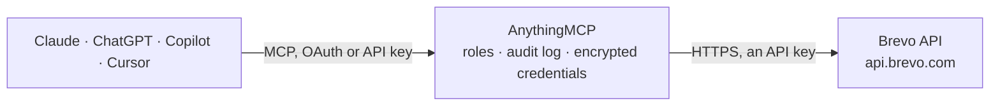

<!-- Generated by scripts/export-github-catalog.mjs in the anythingmcp-website repository. Do not edit by hand. -->

# Brevo MCP connector

Drive Brevo (formerly Sendinblue) — transactional email/SMS, marketing campaigns, contacts and lists — from any AI agent. 14 tools, api-key header auth, EU-based deliverability. The AnythingMCP connector gives Claude, ChatGPT, Microsoft Copilot, Cursor and Gemini 14 MCP tools for Brevo: 7 read and 7 can change data.

**Category:** [Email](../email.md) · **Tools:** 14 · **Setup guide:** [anythingmcp.com](https://anythingmcp.com/guides/brevo-to-mcp) · [Deutsch](https://anythingmcp.com/de/guides/brevo-to-mcp) · [Italiano](https://anythingmcp.com/it/guides/brevo-to-mcp) · [Español](https://anythingmcp.com/es/guides/brevo-to-mcp) · [日本語](https://anythingmcp.com/ja/guides/brevo-to-mcp) · [Русский](https://anythingmcp.com/ru/guides/brevo-to-mcp) · [中文](https://anythingmcp.com/zh/guides/brevo-to-mcp)

## Start without code

No installation and no terminal: AnythingMCP Cloud runs the Brevo connector for you, operated by helpcode.ai in Frankfurt, Germany.

1. **Click the button above** and create an account or sign in. The Brevo connector opens, ready to install.
2. **Paste the API key or token from your Brevo account.** Every click is in the [step-by-step guide](https://anythingmcp.com/guides/brevo-to-mcp).
3. **Click Install.** AnythingMCP shows the address of your MCP server.
4. **Add that address to your assistant:** [Claude](https://anythingmcp.com/guides/connect-brevo-to-claude) · [ChatGPT](https://anythingmcp.com/guides/connect-brevo-to-chatgpt) · [Microsoft Copilot](https://anythingmcp.com/guides/connect-brevo-to-copilot) · [Cursor](https://anythingmcp.com/guides/connect-brevo-to-cursor) · [Gemini CLI](https://anythingmcp.com/guides/connect-brevo-to-gemini) · [Meta Muse](https://anythingmcp.com/guides/connect-brevo-to-muse).
5. **Ask your first question**, for example: *Do we have a Brevo contact for purchasing lead at Nova-Energiek GmbH: lena.kreutz@nova-energiek.de?*

Prefer help with the setup? [Talk to us](https://anythingmcp.com/contact).

## How it works

- **The AI client** speaks MCP (Streamable HTTP) to AnythingMCP and only sees tool names, descriptions and results. It never gets the Brevo credentials.
- **AnythingMCP** checks the client's role, builds the call from the tool definition, adds the credentials (an API key), calls Brevo, logs the call and returns the result.
- **Brevo** sees an ordinary API client with the rights of the account the credentials belong to.

## Tools

| Tool | What it does | Access |
|---|---|---|
| [`brevo_get_account`](#brevo_get_account) | Return account info: companyName, email, firstName, lastName, address, plan (credits, type, creditsType), relay servers. | read |
| [`brevo_send_transactional_email`](#brevo_send_transactional_email) | Send a transactional email. | write |
| [`brevo_send_transactional_sms`](#brevo_send_transactional_sms) | Send a transactional SMS. | write |
| [`brevo_list_contacts`](#brevo_list_contacts) | List contacts (paginated). | read |
| [`brevo_get_contact`](#brevo_get_contact) | Fetch a contact by email or ID. | read |
| [`brevo_create_contact`](#brevo_create_contact) | Create or update a contact (upsert by email). | write |
| [`brevo_update_contact`](#brevo_update_contact) | Partial update of an existing contact. | write |
| [`brevo_list_contact_lists`](#brevo_list_contact_lists) | List contact lists. | read |
| [`brevo_create_contact_list`](#brevo_create_contact_list) | Create a new list. | write |
| [`brevo_list_folders`](#brevo_list_folders) | List folders (organize contact lists). | read |
| [`brevo_list_email_campaigns`](#brevo_list_email_campaigns) | List email campaigns (newsletters). | read |
| [`brevo_create_email_campaign`](#brevo_create_email_campaign) | Create an email campaign (does NOT send — see brevo_send_email_campaign_now to fire). | write |
| [`brevo_send_email_campaign_now`](#brevo_send_email_campaign_now) | Send a previously-created email campaign immediately (overrides any scheduledAt). | write |
| [`brevo_get_transactional_email_report`](#brevo_get_transactional_email_report) | Get aggregated transactional email stats for a date range: total requests, delivered, hardBounces, softBounces, opened, clicked, spam. | read |

## Tool reference

Every parameter as the AI client sees it in `tools/list`. Source: [`packages/backend/src/adapters/intl/brevo.json`](../../../packages/backend/src/adapters/intl/brevo.json).

### `brevo_get_account`

Return account info: companyName, email, firstName, lastName, address, plan (credits, type, creditsType), relay servers. Health check + plan visibility.

**Access:** read · **Call:** `GET /account`

No parameters.

### `brevo_send_transactional_email`

Send a transactional email. Required: sender + to + (subject AND htmlContent/textContent) OR templateId+params. For templates, design + variables come from Brevo's UI templates.

**Access:** write · **Call:** `POST /smtp/email`

| Parameter | Type | Required | Description |
|---|---|---|---|
| `sender` | object | yes | {email, name?}. email MUST be a verified sender. |
| `to` | any[] | yes | Recipients: [{email, name?}]. Up to 50 per call (more = use bulk endpoint). |
| `cc` | any[] | no | Optional CCs: [{email, name?}]. |
| `bcc` | any[] | no | Optional BCCs. |
| `replyTo` | object | no | {email, name?}. |
| `subject` | string | no | Email subject (required unless using templateId). |
| `htmlContent` | string | no | HTML body. |
| `textContent` | string | no | Plain-text body. Recommended alongside htmlContent for deliverability. |
| `templateId` | integer | no | Brevo template ID. Omit subject/htmlContent if using. |
| `params` | object | no | Template variables (referenced as {{params.X}} in the template). |
| `attachment` | any[] | no | Up to 100 attachments: [{name, content (base64)}] or [{name, url}]. |
| `tags` | any[] | no | Up to 5 tag strings for stats grouping. |
| `headers` | object | no | Custom headers (e.g. {'X-My-Tag':'abc'}). |
| `scheduledAt` | string | no | ISO 8601 datetime to schedule the send (up to 72h ahead). |

### `brevo_send_transactional_sms`

Send a transactional SMS. Required: sender (≤11 alphanumeric chars, must be pre-approved), recipient (international format with +), content (≤160 chars per part).

**Access:** write · **Call:** `POST /transactionalSMS/sms`

| Parameter | Type | Required | Description |
|---|---|---|---|
| `sender` | string | yes | Alphanumeric sender name ≤11 chars, must be pre-registered in Brevo. |
| `recipient` | string | yes | Phone in international format with leading +, e.g. '+33612345678'. |
| `content` | string | yes | SMS body. Per SMSC encoding (GSM-7 = 160 chars/part, UCS-2 = 70 chars/part). |
| `type` | string | no | transactional or marketing. Default transactional. |
| `tag` | string | no | Stats tag. |
| `webUrl` | string | no | Optional URL for click-tracking. |
| `unicodeEnabled` | boolean | no | true = allow non-GSM chars (emoji, é, ç) — encoding flips to UCS-2. |

### `brevo_list_contacts`

List contacts (paginated). Each contact has id, email, attributes object, createdAt, modifiedAt, listIds[].

**Access:** read · **Call:** `GET /contacts`

| Parameter | Type | Required | Description |
|---|---|---|---|
| `limit` | integer | no | Max per page (default 50, max 1000). |
| `offset` | integer | no | Pagination offset. |
| `modifiedSince` | string | no | ISO 8601 — only contacts modified after this time. |
| `createdSince` | string | no | ISO 8601. |
| `sort` | string | no | asc or desc by id. |

### `brevo_get_contact`

Fetch a contact by email or ID.

**Access:** read · **Call:** `GET /contacts/{identifier}`

| Parameter | Type | Required | Description |
|---|---|---|---|
| `identifier` | string | yes | URL-encoded email address OR numeric contact ID. |

### `brevo_create_contact`

Create or update a contact (upsert by email). Set `listIds` to add to existing lists. `updateEnabled:true` to update if email already exists (default false → 409 on duplicate).

**Access:** write · **Call:** `POST /contacts`

| Parameter | Type | Required | Description |
|---|---|---|---|
| `email` | string | yes | Contact email (required unless using ext_id). |
| `ext_id` | string | no | External ID if you maintain a separate identifier system. |
| `attributes` | object | no | {FIRSTNAME, LASTNAME, SMS:'+33...', LANGUAGE:'fr', custom...}. Reserved attrs are uppercase. |
| `emailBlacklisted` | boolean | no | true = mark as unsubscribed from emails. |
| `smsBlacklisted` | boolean | no | true = mark as unsubscribed from SMS. |
| `listIds` | any[] | no | Array of list IDs to add to. |
| `updateEnabled` | boolean | no | true = update existing if email already exists. Default false. |
| `smtpBlacklistSender` | any[] | no | List of senders to block. |

### `brevo_update_contact`

Partial update of an existing contact.

**Access:** write · **Call:** `PUT /contacts/{identifier}`

| Parameter | Type | Required | Description |
|---|---|---|---|
| `identifier` | string | yes | URL-encoded email or numeric ID. |
| `attributes` | object | no | Attributes to update. |
| `emailBlacklisted` | boolean | no | Mark unsubscribed. |
| `smsBlacklisted` | boolean | no | Mark SMS unsubscribed. |
| `listIds` | any[] | no | Lists to ADD to (use unlinkListIds to remove). |
| `unlinkListIds` | any[] | no | Lists to remove from. |

### `brevo_list_contact_lists`

List contact lists. Each list has id, name, folderId, totalSubscribers, totalBlacklisted, createdAt.

**Access:** read · **Call:** `GET /contacts/lists`

| Parameter | Type | Required | Description |
|---|---|---|---|
| `limit` | integer | no | Max per page (default 10, max 50). |
| `offset` | integer | no | Pagination offset. |
| `sort` | string | no | asc or desc by id. |

### `brevo_create_contact_list`

Create a new list. Each list belongs to a folder (use brevo_list_folders to discover folderId).

**Access:** write · **Call:** `POST /contacts/lists`

| Parameter | Type | Required | Description |
|---|---|---|---|
| `name` | string | yes | List name (unique within folder). |
| `folderId` | integer | yes | Parent folder ID. |

### `brevo_list_folders`

List folders (organize contact lists).

**Access:** read · **Call:** `GET /contacts/folders`

| Parameter | Type | Required | Description |
|---|---|---|---|
| `limit` | integer | no | Per page. |
| `offset` | integer | no | Offset. |
| `sort` | string | no | asc or desc. |

### `brevo_list_email_campaigns`

List email campaigns (newsletters). Filter by type (classic/trigger) and status (suspended/archive/sent/queued/draft/inProcess).

**Access:** read · **Call:** `GET /emailCampaigns`

| Parameter | Type | Required | Description |
|---|---|---|---|
| `type` | string | no | classic or trigger. |
| `status` | string | no | suspended, archive, sent, queued, draft, inProcess. |
| `startDate` | string | no | ISO 8601 — only campaigns starting after. |
| `endDate` | string | no | ISO 8601. |
| `limit` | integer | no | Max per page (default 500, max 1000). |
| `offset` | integer | no | Pagination offset. |

### `brevo_create_email_campaign`

Create an email campaign (does NOT send — see brevo_send_email_campaign_now to fire). Required: name, subject, sender (verified), htmlContent OR templateId.

**Access:** write · **Call:** `POST /emailCampaigns`

| Parameter | Type | Required | Description |
|---|---|---|---|
| `name` | string | yes | Internal campaign name. |
| `subject` | string | yes | Email subject line. |
| `sender` | object | yes | {name?, email\|id}. email must be verified, OR id of a sender object. |
| `htmlContent` | string | no | HTML body OR omit if using templateId. |
| `textContent` | string | no | Plain-text body. |
| `templateId` | integer | no | Use a saved template. |
| `params` | object | no | Template vars. |
| `recipients` | object | yes | {listIds:[N], excludedListIds?:[M], segmentIds?:[K]}. |
| `scheduledAt` | string | no | ISO 8601 — schedule. Omit to leave as draft. |
| `replyTo` | string | no | Reply-To email. |
| `toField` | string | no | Personalized To-field, e.g. '{{FIRSTNAME}} {{LASTNAME}}'. |
| `tag` | string | no | Stats tag. |

### `brevo_send_email_campaign_now`

Send a previously-created email campaign immediately (overrides any scheduledAt). The campaign must pass Brevo's content/sender checks first.

**Access:** write · **Call:** `POST /emailCampaigns/{campaignId}/sendNow`

| Parameter | Type | Required | Description |
|---|---|---|---|
| `campaignId` | integer | yes | Campaign ID to send now. |

### `brevo_get_transactional_email_report`

Get aggregated transactional email stats for a date range: total requests, delivered, hardBounces, softBounces, opened, clicked, spam.

**Access:** read · **Call:** `GET /smtp/statistics/aggregatedReport`

| Parameter | Type | Required | Description |
|---|---|---|---|
| `days` | integer | no | Last N days (1, 7, 30, 90, 365). |
| `startDate` | string | no | YYYY-MM-DD (mutually exclusive with days). |
| `endDate` | string | no | YYYY-MM-DD. |
| `tag` | string | no | Filter by tag. |

## Run it yourself

AnythingMCP is open source (AGPL-3.0). [Run it with Docker](../../../README.md#run-it-yourself), open **Connectors → Store**, pick **Brevo** and enter `BREVO_API_KEY`, then add your MCP server URL to the AI client.

[← Email connectors](../email.md) · [All categories](../README.md)
