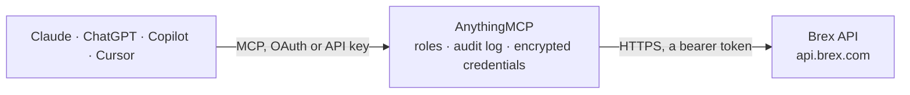

<!-- Generated by scripts/export-github-catalog.mjs in the anythingmcp-website repository. Do not edit by hand. -->

# Brex MCP connector

Let your AI read your Brex account: cards, card and business account transactions, statements, expenses, budgets, spend limits, vendors, users and trips. The AnythingMCP connector gives Claude, ChatGPT, Microsoft Copilot, Cursor and Gemini 28 MCP tools for Brex: 25 read and 3 can change data.

**Category:** [Banking](../banking.md) · **Tools:** 28 · **Setup guide:** [anythingmcp.com](https://anythingmcp.com/guides/brex-to-mcp) · [Deutsch](https://anythingmcp.com/de/guides/brex-to-mcp) · [Italiano](https://anythingmcp.com/it/guides/brex-to-mcp) · [Español](https://anythingmcp.com/es/guides/brex-to-mcp) · [日本語](https://anythingmcp.com/ja/guides/brex-to-mcp) · [Русский](https://anythingmcp.com/ru/guides/brex-to-mcp) · [中文](https://anythingmcp.com/zh/guides/brex-to-mcp)

## Start without code

No installation and no terminal: AnythingMCP Cloud runs the Brex connector for you, operated by helpcode.ai in Frankfurt, Germany.

1. **Click the button above** and create an account or sign in. The Brex connector opens, ready to install.
2. **Paste the API key or token from your Brex account.** Every click is in the [step-by-step guide](https://anythingmcp.com/guides/brex-to-mcp).
3. **Click Install.** AnythingMCP shows the address of your MCP server.
4. **Add that address to your assistant:** [Claude](https://anythingmcp.com/guides/connect-brex-to-claude) · [ChatGPT](https://anythingmcp.com/guides/connect-brex-to-chatgpt) · [Microsoft Copilot](https://anythingmcp.com/guides/connect-brex-to-copilot) · [Cursor](https://anythingmcp.com/guides/connect-brex-to-cursor) · [Gemini CLI](https://anythingmcp.com/guides/connect-brex-to-gemini) · [Meta Muse](https://anythingmcp.com/guides/connect-brex-to-muse).
5. **Ask your first question**, for example: *Show card transactions posted 2026-09-10 to 2026-09-30 for user Elena Marin*

Prefer help with the setup? [Talk to us](https://anythingmcp.com/contact).

## How it works

- **The AI client** speaks MCP (Streamable HTTP) to AnythingMCP and only sees tool names, descriptions and results. It never gets the Brex credentials.
- **AnythingMCP** checks the client's role, builds the call from the tool definition, adds the credentials (a bearer token), calls Brex, logs the call and returns the result.
- **Brex** sees an ordinary API client with the rights of the account the credentials belong to.

## Tools

| Tool | What it does | Access |
|---|---|---|
| [`brex_get_company`](#brex_get_company) | Read the Brex company this token belongs to: id, legal name, account type and mailing address. | read |
| [`brex_get_current_user`](#brex_get_current_user) | Read the Brex user who created the token: id, name, email, status, manager, department and location ids. | read |
| [`brex_list_users`](#brex_list_users) | List Brex users (employees and admins) with id, name, email, status, manager, department, location, title, cost center and legal entity ids. | read |
| [`brex_get_user`](#brex_get_user) | Read one Brex user by id: name, email, status, manager, department, location, title, cost center and legal entity ids. | read |
| [`brex_list_departments`](#brex_list_departments) | List the departments set up in Brex (id, name, description). | read |
| [`brex_list_locations`](#brex_list_locations) | List the office locations set up in Brex (id, name, description). | read |
| [`brex_list_cards`](#brex_list_cards) | List Brex cards with id, name, status (ACTIVE, SHIPPED, LOCKED, TERMINATED), virtual or physical, last four digits, owner user id, budget id and spend… | read |
| [`brex_get_card`](#brex_get_card) | Read one Brex card by id: name, status, type, last four digits, owner, budget and spend controls. | read |
| [`brex_lock_card`](#brex_lock_card) | Lock a Brex card so it cannot be used, for example when it is lost or suspected of fraud. | write |
| [`brex_unlock_card`](#brex_unlock_card) | Unlock a locked Brex card so it can be used again. | write |
| [`brex_list_card_accounts`](#brex_list_card_accounts) | List the Brex card accounts with status, current balance, available balance, account limit and the current statement period. | read |
| [`brex_list_card_transactions`](#brex_list_card_transactions) | List settled card transactions for all Brex card accounts: description, amount, initiated and posted dates, type (PURCHASE, REFUND, CHARGEBACK,… | read |
| [`brex_list_card_statements`](#brex_list_card_statements) | List finalized statements of the primary Brex card account: statement id, period (start and end date) and start and end balance. | read |
| [`brex_list_cash_accounts`](#brex_list_cash_accounts) | List Brex business (cash) accounts with id, name, status, whether it is the primary account, current and available balance. | read |
| [`brex_get_cash_account`](#brex_get_cash_account) | Read one Brex business (cash) account by id: name, status, primary flag, current and available balance. | read |
| [`brex_list_cash_transactions`](#brex_list_cash_transactions) | List transactions of one Brex business (cash) account: description, amount, type (PAYMENT, DIVIDEND, FEE, INTEREST, CARD_COLLECTION and others), initiated… | read |
| [`brex_list_cash_statements`](#brex_list_cash_statements) | List finalized statements of one Brex business (cash) account: statement id, period and start and end balance. | read |
| [`brex_list_expenses`](#brex_list_expenses) | List Brex expenses (card, bill pay and reimbursement) with memo, status, payment status, category, purchase date, amounts, merchant, user, budget,… | read |
| [`brex_get_expense`](#brex_get_expense) | Read one Brex expense by id with memo, status, amounts, merchant, user, budget, receipts, policy and compliance status. | read |
| [`brex_update_expense_memo`](#brex_update_expense_memo) | Set the memo of a Brex card expense, for example the business purpose. | write |
| [`brex_list_budgets`](#brex_list_budgets) | List Brex budgets with name, description, parent budget, owners, period (WEEKLY, MONTHLY, QUARTERLY, YEARLY, ONE_TIME), start and end date, amount, status… | read |
| [`brex_get_budget`](#brex_get_budget) | Read one Brex budget by id: name, parent, owners, period, dates, amount, status and limit type. | read |
| [`brex_list_spend_limits`](#brex_list_spend_limits) | List Brex spend limits with name, status, period, dates, authorization settings (base limit and limit with increases), per-transaction limit, the current… | read |
| [`brex_get_spend_limit`](#brex_get_spend_limit) | Read one Brex spend limit by id: limits, current period balance, owners, members and settings. | read |
| [`brex_list_vendors`](#brex_list_vendors) | List the vendors saved in Brex with id, company name, email, phone and the payment methods on file (ACH, DOMESTIC_WIRE, CHEQUE, INTERNATIONAL_WIRE). | read |
| [`brex_get_vendor`](#brex_get_vendor) | Read one Brex vendor by id: company name, email, phone and the payment methods on file. | read |
| [`brex_list_trips`](#brex_list_trips) | List Brex Travel trips with name, status, traveler, booker, start and end time and reference. | read |
| [`brex_get_trip`](#brex_get_trip) | Read one Brex Travel trip by id: name, status, traveler, booker, dates and reference. | read |

## Tool reference

Every parameter as the AI client sees it in `tools/list`. Source: [`packages/backend/src/adapters/intl/brex.json`](../../../packages/backend/src/adapters/intl/brex.json).

### `brex_get_company`

Read the Brex company this token belongs to: id, legal name, account type and mailing address. Cheap; use it first to check that the token works. Needs the companies.readonly scope.

**Access:** read · **Call:** `GET /v2/company`

No parameters.

### `brex_get_current_user`

Read the Brex user who created the token: id, name, email, status, manager, department and location ids. Needs users.readonly.

**Access:** read · **Call:** `GET /v2/users/me`

No parameters.

### `brex_list_users`

List Brex users (employees and admins) with id, name, email, status, manager, department, location, title, cost center and legal entity ids. Deleted and archived users are left out unless you filter by status. Filter by name (fuzzy), email, status, department or location. Paged with cursor. Personal data: show only what the user asked for. Needs users.readonly.

**Access:** read · **Call:** `GET /v2/users`

| Parameter | Type | Required | Description |
|---|---|---|---|
| `name` | string | no | Fuzzy, case-insensitive match on first name, last name and email. |
| `email` | string | no | Exact email address of one user. |
| `status` | `INVITED` \| `ACTIVE` \| `DISABLED` \| `PENDING_ACTIVATION` \| `INACTIVE` \| `ARCHIVED`[] | no | Only users with one of these statuses. |
| `department_id` | string[] | no | Only users in one of these departments (ids from brex_list_departments). |
| `location_id` | string[] | no | Only users at one of these locations (ids from brex_list_locations). |
| `cursor` | string | no | Cursor for the next page: the next_cursor of the previous answer. Leave it out for the first page. next_cursor is null on the last page. |
| `limit` | integer | no | Items per page, 1 to 1000 (Brex default 100). |

### `brex_get_user`

Read one Brex user by id: name, email, status, manager, department, location, title, cost center and legal entity ids. Needs users.readonly.

**Access:** read · **Call:** `GET /v2/users/{user_id}`

| Parameter | Type | Required | Description |
|---|---|---|---|
| `user_id` | string | yes | User id from brex_list_users, a card owner or an expense. |

### `brex_list_departments`

List the departments set up in Brex (id, name, description). Filter by name. Paged with cursor. Needs departments.readonly.

**Access:** read · **Call:** `GET /v2/departments`

| Parameter | Type | Required | Description |
|---|---|---|---|
| `name` | string | no | Only departments with this name. |
| `cursor` | string | no | Cursor for the next page: the next_cursor of the previous answer. Leave it out for the first page. next_cursor is null on the last page. |
| `limit` | integer | no | Items per page, 1 to 1000 (Brex default 100). |

### `brex_list_locations`

List the office locations set up in Brex (id, name, description). Filter by name. Paged with cursor. Needs locations.readonly.

**Access:** read · **Call:** `GET /v2/locations`

| Parameter | Type | Required | Description |
|---|---|---|---|
| `name` | string | no | Only locations with this name. |
| `cursor` | string | no | Cursor for the next page: the next_cursor of the previous answer. Leave it out for the first page. next_cursor is null on the last page. |
| `limit` | integer | no | Items per page, 1 to 1000 (Brex default 100). |

### `brex_list_cards`

List Brex cards with id, name, status (ACTIVE, SHIPPED, LOCKED, TERMINATED), virtual or physical, last four digits, owner user id, budget id and spend controls (limit, available amount, refresh period). Never returns the card number or CVC. Filter by owner. Paged with cursor. Needs cards.readonly.

**Access:** read · **Call:** `GET /v2/cards`

| Parameter | Type | Required | Description |
|---|---|---|---|
| `user_id` | string | no | Only cards owned by this user (id from brex_list_users). |
| `cursor` | string | no | Cursor for the next page: the next_cursor of the previous answer. Leave it out for the first page. next_cursor is null on the last page. |
| `limit` | integer | no | Items per page, 1 to 1000 (Brex default 100). |

### `brex_get_card`

Read one Brex card by id: name, status, type, last four digits, owner, budget and spend controls. Never returns the card number, CVC or addresses. Needs cards.readonly.

**Access:** read · **Call:** `GET /v2/cards/{card_id}`

| Parameter | Type | Required | Description |
|---|---|---|---|
| `card_id` | string | yes | Card id from brex_list_cards or a card transaction. |

### `brex_lock_card`

Lock a Brex card so it cannot be used, for example when it is lost or suspected of fraud. The card owner is notified. Reversible with brex_unlock_card. Confirm the card (name and last four digits) and the reason with the user before calling. Installed switched off; needs a token with the cards scope.

**Access:** write · **Call:** `POST /v2/cards/{card_id}/lock`

| Parameter | Type | Required | Description |
|---|---|---|---|
| `card_id` | string | yes | Card id from brex_list_cards. |
| `reason` | `CARD_DAMAGED` \| `CARD_LOST` \| `CARD_NOT_RECEIVED` \| `DO_NOT_NEED_PHYSICAL_CARD` \| `DO_NOT_NEED_VIRTUAL_CARD` \| `FRAUD` \| `OTHER` | yes | Why the card is locked. |
| `description` | string | no | Optional free-text note about the lock. |

### `brex_unlock_card`

Unlock a locked Brex card so it can be used again. Only do this when the user explicitly asks; confirm the card (name and last four digits) with the user before calling. Installed switched off; needs a token with the cards scope.

**Access:** write · **Call:** `POST /v2/cards/{card_id}/unlock`

| Parameter | Type | Required | Description |
|---|---|---|---|
| `card_id` | string | yes | Card id from brex_list_cards. |

### `brex_list_card_accounts`

List the Brex card accounts with status, current balance, available balance, account limit and the current statement period. Amounts are objects {amount, currency} in the smallest currency unit (cents for USD). Needs accounts.card.readonly.

**Access:** read · **Call:** `GET /v2/accounts/card`

No parameters.

### `brex_list_card_transactions`

List settled card transactions for all Brex card accounts: description, amount, initiated and posted dates, type (PURCHASE, REFUND, CHARGEBACK, REWARDS_CREDIT, COLLECTION, BNPL_FEE), merchant (descriptor, MCC, country), card id and expense id. Filter by posted date and user. Pending authorizations are not included. Brex may post late: keep a lookback of a few days when looking for recent spend. Amounts are objects {amount, currency} in the smallest currency unit (cents for USD). Paged with cursor. Financial data: share only what the user asked for. Needs transactions.card.readonly.

**Access:** read · **Call:** `GET /v2/transactions/card/primary`

| Parameter | Type | Required | Description |
|---|---|---|---|
| `posted_at_start` | string | no | Only transactions posted on or after this date-time (RFC 3339, e.g. 2026-09-01T00:00:00Z). |
| `user_ids` | string[] | no | Only transactions of these users (ids from brex_list_users). |
| `expand` | `expense_id`[] | no | Pass ["expense_id"] to fill in the expense id of each transaction. |
| `cursor` | string | no | Cursor for the next page: the next_cursor of the previous answer. Leave it out for the first page. next_cursor is null on the last page. |
| `limit` | integer | no | Items per page, 1 to 1000 (default 50). |

### `brex_list_card_statements`

List finalized statements of the primary Brex card account: statement id, period (start and end date) and start and end balance. Amounts are objects {amount, currency} in the smallest currency unit (cents for USD). Paged with cursor. Needs statements.card.readonly.

**Access:** read · **Call:** `GET /v2/accounts/card/primary/statements`

| Parameter | Type | Required | Description |
|---|---|---|---|
| `cursor` | string | no | Cursor for the next page: the next_cursor of the previous answer. Leave it out for the first page. next_cursor is null on the last page. |
| `limit` | integer | no | Items per page, 1 to 1000 (Brex default 100). |

### `brex_list_cash_accounts`

List Brex business (cash) accounts with id, name, status, whether it is the primary account, current and available balance. Account and routing numbers are removed on purpose; read them in the Brex dashboard. Amounts are objects {amount, currency} in the smallest currency unit (cents for USD). Needs accounts.cash.readonly.

**Access:** read · **Call:** `GET /v2/accounts/cash`

No parameters.

### `brex_get_cash_account`

Read one Brex business (cash) account by id: name, status, primary flag, current and available balance. Account and routing numbers are removed on purpose. Amounts are objects {amount, currency} in the smallest currency unit (cents for USD). Needs accounts.cash.readonly.

**Access:** read · **Call:** `GET /v2/accounts/cash/{account_id}`

| Parameter | Type | Required | Description |
|---|---|---|---|
| `account_id` | string | yes | Cash account id from brex_list_cash_accounts. |

### `brex_list_cash_transactions`

List transactions of one Brex business (cash) account: description, amount, type (PAYMENT, DIVIDEND, FEE, INTEREST, CARD_COLLECTION and others), initiated and posted dates and transfer id. Filter by posted date. Amounts are objects {amount, currency} in the smallest currency unit (cents for USD). Paged with cursor. Financial data: share only what the user asked for. Needs transactions.cash.readonly.

**Access:** read · **Call:** `GET /v2/transactions/cash/{account_id}`

| Parameter | Type | Required | Description |
|---|---|---|---|
| `account_id` | string | yes | Cash account id from brex_list_cash_accounts. |
| `posted_at_start` | string | no | Only transactions posted on or after this date-time (RFC 3339, e.g. 2026-09-01T00:00:00Z). |
| `cursor` | string | no | Cursor for the next page: the next_cursor of the previous answer. Leave it out for the first page. next_cursor is null on the last page. |
| `limit` | integer | no | Items per page, 1 to 1000 (default 50). |

### `brex_list_cash_statements`

List finalized statements of one Brex business (cash) account: statement id, period and start and end balance. Amounts are objects {amount, currency} in the smallest currency unit (cents for USD). Paged with cursor. Needs statements.cash.readonly.

**Access:** read · **Call:** `GET /v2/accounts/cash/{account_id}/statements`

| Parameter | Type | Required | Description |
|---|---|---|---|
| `account_id` | string | yes | Cash account id from brex_list_cash_accounts. |
| `cursor` | string | no | Cursor for the next page: the next_cursor of the previous answer. Leave it out for the first page. next_cursor is null on the last page. |
| `limit` | integer | no | Items per page, 1 to 1000 (Brex default 100). |

### `brex_list_expenses`

List Brex expenses (card, bill pay and reimbursement) with memo, status, payment status, category, purchase date, amounts, merchant, user, budget, department, receipts and compliance status. Filter by user, type, status, payment status, receipt or memo compliance (DUE and OVERDUE find expenses still missing documentation) and purchase or update dates. Pass expand to fill in merchant, user, budget, receipts.download_uris (links valid 15 minutes) and more. Amounts are objects {amount, currency} in the smallest currency unit (cents for USD). Paged with cursor, at most 100 per page. Needs expenses.card.readonly.

**Access:** read · **Call:** `GET /v1/expenses`

| Parameter | Type | Required | Description |
|---|---|---|---|
| `user_id` | string[] | no | Only expenses of these users (ids from brex_list_users). |
| `expense_type` | `CARD` \| `BILLPAY` \| `REIMBURSEMENT` \| `CLAWBACK` \| `UNSET`[] | no | Only these expense types. |
| `status` | `DRAFT` \| `SUBMITTED` \| `APPROVED` \| `OUT_OF_POLICY` \| `VOID` \| `CANCELED` \| `SPLIT` \| `SETTLED`[] | no | Only expenses in these statuses. |
| `payment_status` | `NOT_STARTED` \| `PROCESSING` \| `CANCELED` \| `DECLINED` \| `CLEARED` \| `REFUNDING` \| `REFUNDED` \| `CASH_ADVANCE` \| `CREDITED` \| `AWAITING_PAYMENT` \| `SCHEDULED`[] | no | Only expenses with these payment statuses. |
| `compliance_status` | `DUE` \| `OVERDUE` \| `COMPLETED`[] | no | Documentation compliance (receipts, memos). DUE and OVERDUE list expenses that still miss something. |
| `budget_id` | string[] | no | Only expenses charged to these budgets or spend limits. |
| `purchased_at_start` | string | no | Only expenses purchased at or after this date-time (RFC 3339). |
| `purchased_at_end` | string | no | Only expenses purchased at or before this date-time (RFC 3339). |
| `updated_at_start` | string | no | Only expenses updated at or after this date-time (RFC 3339). |
| `updated_at_end` | string | no | Only expenses updated at or before this date-time (RFC 3339). |
| `expand` | `location` \| `department` \| `cost_center` \| `merchant` \| `receipts.download_uris` \| `user` \| `budget` \| `payment` \| `spending_entity` \| `policy`[] | no | Extra details to fill in. |
| `load_custom_fields` | boolean | no | Also return the custom field values. |
| `cursor` | string | no | Cursor for the next page: the next_cursor of the previous answer. Leave it out for the first page. next_cursor is null on the last page. |
| `limit` | integer | no | Items per page, 1 to 100 (default 50). |

### `brex_get_expense`

Read one Brex expense by id with memo, status, amounts, merchant, user, budget, receipts, policy and compliance status. Pass expand for more detail, e.g. ["merchant", "receipts.download_uris"]. Amounts are objects {amount, currency} in the smallest currency unit (cents for USD). Needs expenses.card.readonly.

**Access:** read · **Call:** `GET /v1/expenses/{expense_id}`

| Parameter | Type | Required | Description |
|---|---|---|---|
| `expense_id` | string | yes | Expense id from brex_list_expenses or a card transaction's expense_id. |
| `expand` | `location` \| `department` \| `cost_center` \| `merchant` \| `receipts.download_uris` \| `user` \| `budget` \| `payment` \| `spending_entity` \| `policy`[] | no | Extra details to fill in. |
| `load_custom_fields` | boolean | no | Also return the custom field values. |

### `brex_update_expense_memo`

Set the memo of a Brex card expense, for example the business purpose. Overwrites the existing memo. Show the user the expense and the new memo and confirm before calling. Installed switched off; needs a token with the expenses.card scope.

**Access:** write · **Call:** `PUT /v1/expenses/card/{expense_id}`

| Parameter | Type | Required | Description |
|---|---|---|---|
| `expense_id` | string | yes | Card expense id from brex_list_expenses. |
| `memo` | string | yes | The new memo text. |

### `brex_list_budgets`

List Brex budgets with name, description, parent budget, owners, period (WEEKLY, MONTHLY, QUARTERLY, YEARLY, ONE_TIME), start and end date, amount, status and limit type. Amounts are objects {amount, currency} in the smallest currency unit (cents for USD). Paged with cursor. Needs budgets.readonly.

**Access:** read · **Call:** `GET /v2/budgets`

| Parameter | Type | Required | Description |
|---|---|---|---|
| `cursor` | string | no | Cursor for the next page: the next_cursor of the previous answer. Leave it out for the first page. next_cursor is null on the last page. |
| `limit` | integer | no | Items per page, 1 to 1000 (Brex default 100). |

### `brex_get_budget`

Read one Brex budget by id: name, parent, owners, period, dates, amount, status and limit type. Needs budgets.readonly.

**Access:** read · **Call:** `GET /v2/budgets/{budget_id}`

| Parameter | Type | Required | Description |
|---|---|---|---|
| `budget_id` | string | yes | Budget id from brex_list_budgets. |

### `brex_list_spend_limits`

List Brex spend limits with name, status, period, dates, authorization settings (base limit and limit with increases), per-transaction limit, the current period balance (amount spent), owners and members. Filter by member. Amounts are objects {amount, currency} in the smallest currency unit (cents for USD). Paged with cursor. Needs budgets.readonly.

**Access:** read · **Call:** `GET /v2/spend_limits`

| Parameter | Type | Required | Description |
|---|---|---|---|
| `member_user_id` | string[] | no | Only spend limits these users are members of. |
| `cursor` | string | no | Cursor for the next page: the next_cursor of the previous answer. Leave it out for the first page. next_cursor is null on the last page. |
| `limit` | integer | no | Items per page, 1 to 1000 (Brex default 100). |

### `brex_get_spend_limit`

Read one Brex spend limit by id: limits, current period balance, owners, members and settings. Needs budgets.readonly.

**Access:** read · **Call:** `GET /v2/spend_limits/{spend_limit_id}`

| Parameter | Type | Required | Description |
|---|---|---|---|
| `spend_limit_id` | string | yes | Spend limit id from brex_list_spend_limits or an expense's budget_id. |

### `brex_list_vendors`

List the vendors saved in Brex with id, company name, email, phone and the payment methods on file (ACH, DOMESTIC_WIRE, CHEQUE, INTERNATIONAL_WIRE). Bank details are removed on purpose. Filter by name. Paged with cursor. Needs vendors.readonly.

**Access:** read · **Call:** `GET /v1/vendors`

| Parameter | Type | Required | Description |
|---|---|---|---|
| `name` | string | no | Only vendors with this name. |
| `cursor` | string | no | Cursor for the next page: the next_cursor of the previous answer. Leave it out for the first page. next_cursor is null on the last page. |
| `limit` | integer | no | Items per page, 1 to 1000 (Brex default 100). |

### `brex_get_vendor`

Read one Brex vendor by id: company name, email, phone and the payment methods on file. Bank details are removed on purpose. Needs vendors.readonly.

**Access:** read · **Call:** `GET /v1/vendors/{vendor_id}`

| Parameter | Type | Required | Description |
|---|---|---|---|
| `vendor_id` | string | yes | Vendor id from brex_list_vendors. |

### `brex_list_trips`

List Brex Travel trips with name, status, traveler, booker, start and end time and reference. Filter by last update. Paged with cursor. Needs travel.trips.readonly and Brex Travel.

**Access:** read · **Call:** `GET /v1/trips`

| Parameter | Type | Required | Description |
|---|---|---|---|
| `last_updated_after` | string | no | Only trips updated after this date-time (RFC 3339). |
| `cursor` | string | no | Cursor for the next page: the next_cursor of the previous answer. Leave it out for the first page. next_cursor is null on the last page. |
| `limit` | integer | no | Items per page, 1 to 1000 (Brex default 100). |

### `brex_get_trip`

Read one Brex Travel trip by id: name, status, traveler, booker, dates and reference. Needs travel.trips.readonly.

**Access:** read · **Call:** `GET /v1/trips/{trip_id}`

| Parameter | Type | Required | Description |
|---|---|---|---|
| `trip_id` | string | yes | Trip id from brex_list_trips or an expense's trip_id. |

## Run it yourself

AnythingMCP is open source (AGPL-3.0). [Run it with Docker](../../../README.md#run-it-yourself), open **Connectors → Store**, pick **Brex** and enter `BREX_API_TOKEN`, then add your MCP server URL to the AI client.

[← Banking connectors](../banking.md) · [All categories](../README.md)
