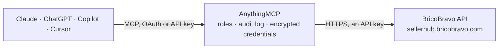

<!-- Generated by scripts/export-github-catalog.mjs in the anythingmcp-website repository. Do not edit by hand. -->

# BricoBravo MCP connector

Sell on BricoBravo, the Italian DIY and home marketplace, from an AI agent: orders with items, totals, customer and shipping address, filtered by date. The AnythingMCP connector gives Claude, ChatGPT, Microsoft Copilot, Cursor and Gemini 3 MCP tools for BricoBravo: 2 read and 1 can change data.

**Category:** [E-commerce](../e-commerce.md) · **Tools:** 3 · **Setup guide:** [anythingmcp.com](https://anythingmcp.com/guides/bricobravo-to-mcp) · [Deutsch](https://anythingmcp.com/de/guides/bricobravo-to-mcp) · [Italiano](https://anythingmcp.com/it/guides/bricobravo-to-mcp) · [Español](https://anythingmcp.com/es/guides/bricobravo-to-mcp) · [日本語](https://anythingmcp.com/ja/guides/bricobravo-to-mcp) · [Русский](https://anythingmcp.com/ru/guides/bricobravo-to-mcp) · [中文](https://anythingmcp.com/zh/guides/bricobravo-to-mcp)

## Start without code

No installation and no terminal: AnythingMCP Cloud runs the BricoBravo connector for you, operated by helpcode.ai in Frankfurt, Germany.

1. **Click the button above** and create an account or sign in. The BricoBravo connector opens, ready to install.
2. **Paste the API key or token from your BricoBravo account.** Every click is in the [step-by-step guide](https://anythingmcp.com/guides/bricobravo-to-mcp).
3. **Click Install.** AnythingMCP shows the address of your MCP server.
4. **Add that address to your assistant:** [Claude](https://anythingmcp.com/guides/connect-bricobravo-to-claude) · [ChatGPT](https://anythingmcp.com/guides/connect-bricobravo-to-chatgpt) · [Microsoft Copilot](https://anythingmcp.com/guides/connect-bricobravo-to-copilot) · [Cursor](https://anythingmcp.com/guides/connect-bricobravo-to-cursor) · [Gemini CLI](https://anythingmcp.com/guides/connect-bricobravo-to-gemini) · [Meta Muse](https://anythingmcp.com/guides/connect-bricobravo-to-muse).
5. **Ask your first question**, for example: *Show order details for seller order id 98765 from March 18 2026*

Prefer help with the setup? [Talk to us](https://anythingmcp.com/contact).

## How it works

- **The AI client** speaks MCP (Streamable HTTP) to AnythingMCP and only sees tool names, descriptions and results. It never gets the BricoBravo credentials.
- **AnythingMCP** checks the client's role, builds the call from the tool definition, adds the credentials (an API key), calls BricoBravo, logs the call and returns the result.
- **BricoBravo** sees an ordinary API client with the rights of the account the credentials belong to.

## Tools

| Tool | What it does | Access |
|---|---|---|
| [`bricobravo_search_orders`](#bricobravo_search_orders) | List BricoBravo orders: id_order, marketplace order number (vtex_id_order), status (0 paid, 1 completed, 2 to refund, 3 refunded), total, creation date,… | read |
| [`bricobravo_get_order_details`](#bricobravo_get_order_details) | Get one BricoBravo order by its id_order number: status, total, creation date, acquired flag, items, invoice info and shipping info. | read |
| [`bricobravo_mark_shipped`](#bricobravo_mark_shipped) | Confirm the shipment of a BricoBravo order with courier code, tracking number and tracking URL; on a shipped order it replaces the tracking data. | write |

## Tool reference

Every parameter as the AI client sees it in `tools/list`. Source: [`packages/backend/src/adapters/it/bricobravo.json`](../../../packages/backend/src/adapters/it/bricobravo.json).

### `bricobravo_search_orders`

List BricoBravo orders: id_order, marketplace order number (vtex_id_order), status (0 paid, 1 completed, 2 to refund, 3 refunded), total, creation date, acquired flag, items with EAN, name, price and quantity, invoice info and shipping info with customer and address. Filter by creation time (YYYYMMDDHHMMSS); pages of per_page orders.

**Access:** read · **Call:** `GET /orders`

| Parameter | Type | Required | Description |
|---|---|---|---|
| `all` | boolean | no | true (default) lists every order, also those already acquired by an order management system; false only the ones not yet acquired. |
| `start_datetime` | string | no | Orders created from this time, YYYYMMDDHHMMSS, e.g. 20261001000000. |
| `end_datetime` | string | no | Orders created up to this time, YYYYMMDDHHMMSS. |
| `page` | integer | no | Page, from 1. |
| `per_page` | integer | no | Orders per page, 100 by default. |

### `bricobravo_get_order_details`

Get one BricoBravo order by its id_order number: status, total, creation date, acquired flag, items, invoice info and shipping info. Pass id_order, not the marketplace number vtex_id_order (that answers an errors list).

**Access:** read · **Call:** `GET /orders/{order_id}`

| Parameter | Type | Required | Description |
|---|---|---|---|
| `order_id` | integer | yes | id_order from bricobravo_search_orders. |

### `bricobravo_mark_shipped`

Confirm the shipment of a BricoBravo order with courier code, tracking number and tracking URL; on a shipped order it replaces the tracking data. Courier codes: dhl, gls-italy, italy-sda, tnt-it, brt-it, ups, fedex, poste-italiane, dpd, liccardi-express, kuehne-nagel, fercam, dachser, raben-group, dbschenker-se, other. Installed switched off; acts on a real customer order: show the user the order and tracking and get a yes first.

**Access:** write · **Call:** `PATCH /orders/{order_id}/shipped`

| Parameter | Type | Required | Description |
|---|---|---|---|
| `order_id` | integer | yes | id_order of the order. |
| `courier` | `dhl` \| `gls-italy` \| `italy-sda` \| `tnt-it` \| `brt-it` \| `ups` \| `fedex` \| `poste-italiane` \| `dpd` \| `liccardi-express` \| `kuehne-nagel` \| `fercam` \| `dachser` \| `raben-group` \| `dbschenker-se` \| `other` | yes | BricoBravo courier code. |
| `tracking_number` | string | yes | Tracking number; several separated by commas for a split shipment. |
| `tracking_url` | string | yes | Tracking URL; several separated by commas, in the same order. |

## Run it yourself

AnythingMCP is open source (AGPL-3.0). [Run it with Docker](../../../README.md#run-it-yourself), open **Connectors → Store**, pick **BricoBravo** and enter `BRICOBRAVO_API_TOKEN`, then add your MCP server URL to the AI client.

[← E-commerce connectors](../e-commerce.md) · [All categories](../README.md)
