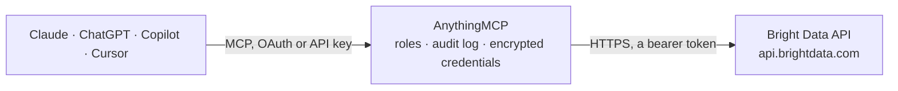

<!-- Generated by scripts/export-github-catalog.mjs in the anythingmcp-website repository. Do not edit by hand. -->

# Bright Data MCP connector

Fetch blocked web pages through Bright Data Web Unlocker, run search engine queries through the SERP API, start Web Scraper API collections and download their results, and check zones, balance and costs from your AI. The AnythingMCP connector gives Claude, ChatGPT, Microsoft Copilot, Cursor and Gemini 19 MCP tools for Bright Data: 15 read and 4 can change data.

**Category:** [Public Data](../data.md) · **Tools:** 19 · **Setup guide:** [anythingmcp.com](https://anythingmcp.com/guides/bright-data-to-mcp) · [Deutsch](https://anythingmcp.com/de/guides/bright-data-to-mcp) · [Italiano](https://anythingmcp.com/it/guides/bright-data-to-mcp) · [Español](https://anythingmcp.com/es/guides/bright-data-to-mcp) · [日本語](https://anythingmcp.com/ja/guides/bright-data-to-mcp) · [Русский](https://anythingmcp.com/ru/guides/bright-data-to-mcp) · [中文](https://anythingmcp.com/zh/guides/bright-data-to-mcp)

## Start without code

No installation and no terminal: AnythingMCP Cloud runs the Bright Data connector for you, operated by helpcode.ai in Frankfurt, Germany.

1. **Click the button above** and create an account or sign in. The Bright Data connector opens, ready to install.
2. **Paste the API key or token from your Bright Data account.** Every click is in the [step-by-step guide](https://anythingmcp.com/guides/bright-data-to-mcp).
3. **Click Install.** AnythingMCP shows the address of your MCP server.
4. **Add that address to your assistant:** [Claude](https://anythingmcp.com/guides/connect-bright-data-to-claude) · [ChatGPT](https://anythingmcp.com/guides/connect-bright-data-to-chatgpt) · [Microsoft Copilot](https://anythingmcp.com/guides/connect-bright-data-to-copilot) · [Cursor](https://anythingmcp.com/guides/connect-bright-data-to-cursor) · [Gemini CLI](https://anythingmcp.com/guides/connect-bright-data-to-gemini) · [Meta Muse](https://anythingmcp.com/guides/connect-bright-data-to-muse).
5. **Ask your first question**, for example: *Show current Bright Data account balance and any pending usage costs for billing review*

Prefer help with the setup? [Talk to us](https://anythingmcp.com/contact).

## How it works

- **The AI client** speaks MCP (Streamable HTTP) to AnythingMCP and only sees tool names, descriptions and results. It never gets the Bright Data credentials.
- **AnythingMCP** checks the client's role, builds the call from the tool definition, adds the credentials (a bearer token), calls Bright Data, logs the call and returns the result.
- **Bright Data** sees an ordinary API client with the rights of the account the credentials belong to.

## Tools

| Tool | What it does | Access |
|---|---|---|
| [`bright_data_get_account_status`](#bright_data_get_account_status) | Check the Bright Data account behind the API key: account status, customer id and whether it can make requests (with the reason when it cannot). | read |
| [`bright_data_get_balance`](#bright_data_get_balance) | Read the account balance in USD: available balance, free credit, prepayment and pending usage costs that will appear on the next invoice. | read |
| [`bright_data_list_active_zones`](#bright_data_list_active_zones) | List the active zones of the account with their name and type (unblocker, serp, browser_api, res_rotating, ...). | read |
| [`bright_data_list_all_zones`](#bright_data_list_all_zones) | List every zone of the account, including disabled and deleted ones, with name, type and status. | read |
| [`bright_data_get_zone`](#bright_data_get_zone) | Read one zone's settings: plan (product, type, bandwidth, IP type), permissions and allowed IPs. | read |
| [`bright_data_get_zone_status`](#bright_data_get_zone_status) | Read whether one zone is active or disabled, e.g. before sending requests through it. | read |
| [`bright_data_get_zone_cost`](#bright_data_get_zone_cost) | Read the billed cost (USD) and bandwidth (bytes) of one zone over a date range, matching the control panel and the invoice. | read |
| [`bright_data_get_network_status`](#bright_data_get_network_status) | Check whether Bright Data's proxy network is up: all networks, residential, datacenter or mobile. | read |
| [`bright_data_fetch_page`](#bright_data_fetch_page) | PAID: fetch one web page through a Web Unlocker zone, which handles bot protection, CAPTCHAs and proxies. | read |
| [`bright_data_search`](#bright_data_search) | PAID: run a search engine query through a SERP API zone. | read |
| [`bright_data_list_scrapers`](#bright_data_list_scrapers) | List the ready-made Web Scraper API scrapers the account can run, with their id (the dataset_id, gd_...), domain, collection methods and the input_schema of… | read |
| [`bright_data_scrape_sync`](#bright_data_scrape_sync) | PAID: run a Web Scraper API scraper and wait for the records (up to about one minute). | write |
| [`bright_data_trigger_collection`](#bright_data_trigger_collection) | PAID: start a Web Scraper API collection in the background and get its snapshot_id. | write |
| [`bright_data_get_snapshot_progress`](#bright_data_get_snapshot_progress) | Check a Web Scraper API collection: status starting, running, ready, failed (with error_message) or canceled. | read |
| [`bright_data_download_snapshot`](#bright_data_download_snapshot) | Download the records of a finished collection (status ready). | read |
| [`bright_data_list_snapshots`](#bright_data_list_snapshots) | List the collections (snapshots) of one scraper with id, creation time, status and record count, newest data first. | read |
| [`bright_data_get_snapshot_input`](#bright_data_get_snapshot_input) | Show the inputs a collection was started with, to repeat or explain it. | read |
| [`bright_data_cancel_snapshot`](#bright_data_cancel_snapshot) | Stop a running collection. | write |
| [`bright_data_set_zone_disabled`](#bright_data_set_zone_disabled) | Turn a zone off (disable 1) or back on (disable 0). | write |

## Tool reference

Every parameter as the AI client sees it in `tools/list`. Source: [`packages/backend/src/adapters/intl/bright-data.json`](../../../packages/backend/src/adapters/intl/bright-data.json).

### `bright_data_get_account_status`

Check the Bright Data account behind the API key: account status, customer id and whether it can make requests (with the reason when it cannot). Free. Use it first when calls are refused.

**Access:** read · **Call:** `GET /status`

No parameters.

### `bright_data_get_balance`

Read the account balance in USD: available balance, free credit, prepayment and pending usage costs that will appear on the next invoice. Free.

**Access:** read · **Call:** `GET /customer/balance`

No parameters.

### `bright_data_list_active_zones`

List the active zones of the account with their name and type (unblocker, serp, browser_api, res_rotating, ...). Use a zone name as `zone` in bright_data_fetch_page and bright_data_search. Free.

**Access:** read · **Call:** `GET /zone/get_active_zones`

No parameters.

### `bright_data_list_all_zones`

List every zone of the account, including disabled and deleted ones, with name, type and status. Free.

**Access:** read · **Call:** `GET /zone/get_all_zones`

No parameters.

### `bright_data_get_zone`

Read one zone's settings: plan (product, type, bandwidth, IP type), permissions and allowed IPs. Zone passwords are removed from the answer. Free.

**Access:** read · **Call:** `GET /zone`

| Parameter | Type | Required | Description |
|---|---|---|---|
| `zone` | string | yes | Zone name, e.g. 'web_unlocker1', from bright_data_list_active_zones. |

### `bright_data_get_zone_status`

Read whether one zone is active or disabled, e.g. before sending requests through it. Free.

**Access:** read · **Call:** `GET /zone/status`

| Parameter | Type | Required | Description |
|---|---|---|---|
| `zone` | string | yes | Zone name, e.g. 'serp_api1'. |

### `bright_data_get_zone_cost`

Read the billed cost (USD) and bandwidth (bytes) of one zone over a date range, matching the control panel and the invoice. `to` is exclusive: from=2026-04-01 and to=2026-05-01 is all of April. Free.

**Access:** read · **Call:** `GET /zone/cost`

| Parameter | Type | Required | Description |
|---|---|---|---|
| `zone` | string | yes | Zone name. |
| `from` | string | no | Start date YYYY-MM-DD (inclusive). |
| `to` | string | no | End date YYYY-MM-DD (exclusive). |

### `bright_data_get_network_status`

Check whether Bright Data's proxy network is up: all networks, residential, datacenter or mobile. Free.

**Access:** read · **Call:** `GET /network_status/{network_type}`

| Parameter | Type | Required | Description |
|---|---|---|---|
| `network_type` | `all` \| `res` \| `dc` \| `mobile` | yes | all, res (residential), dc (datacenter) or mobile. |

### `bright_data_fetch_page`

PAID: fetch one web page through a Web Unlocker zone, which handles bot protection, CAPTCHAs and proxies. Returns the page as HTML, as markdown (data_format markdown, best for reading) or as a PNG screenshot; format json wraps the target's status code, headers and body. Billed per successful request; ask the user before fetching many pages. Content is capped at about 100 KB here.

**Access:** read · **Call:** `POST /request`

| Parameter | Type | Required | Description |
|---|---|---|---|
| `url` | string | yes | Full page URL with http or https, e.g. 'https://example.com/pricing'. |
| `zone` | string | no | Web Unlocker zone name (default web_unlocker1); see bright_data_list_active_zones. |
| `format` | `raw` \| `json` | no | raw (default) returns the content itself; json wraps status_code, headers and body. |
| `data_format` | `markdown` \| `screenshot` | no | markdown converts the page to markdown; screenshot returns a PNG of the rendered page. Omit for HTML. |
| `country` | string | no | Two-letter country code of the exit IP in lower case, e.g. 'us', 'de'. |
| `render` | `true` \| `false` | no | 'true' forces a real browser for pages that need JavaScript (slower). Omit otherwise. |
| `method` | string | no | HTTP method used towards the target page. Default GET. |

### `bright_data_search`

PAID: run a search engine query through a SERP API zone. Pass the full search URL, e.g. 'https://www.google.com/search?q=coffee&hl=en&gl=us'; append '&brd_json=1' to a Google URL for parsed JSON (organic results, ads, knowledge panel), or set data_format markdown. Bing, DuckDuckGo and Yandex URLs work too. Billed per successful request; ask the user before many searches. Capped at about 100 KB.

**Access:** read · **Call:** `POST /request`

| Parameter | Type | Required | Description |
|---|---|---|---|
| `url` | string | yes | Search engine results URL with the query URL-encoded, e.g. 'https://www.google.com/search?q=best+espresso&brd_json=1'. |
| `zone` | string | no | SERP API zone name (default serp_api1); see bright_data_list_active_zones. |
| `format` | `raw` \| `json` | no | raw (default) returns the result itself; json wraps status_code, headers and body. |
| `data_format` | `markdown` \| `screenshot` \| `parsed_light` | no | markdown converts the result page; screenshot returns a PNG; parsed_light (Google only, with brd_json=1) returns only the top organic results. Omit for HTML or brd_json output. |
| `country` | string | no | Two-letter country code of the exit IP in lower case, e.g. 'us'. |

### `bright_data_list_scrapers`

List the ready-made Web Scraper API scrapers the account can run, with their id (the dataset_id, gd_...), domain, collection methods and the input_schema of each method. Filter by domain (e.g. 'amazon.com') or dataset_id: the full list is several megabytes. Output field lists and samples are removed here. Free.

**Access:** read · **Call:** `GET /datasets/v3/scrapers`

| Parameter | Type | Required | Description |
|---|---|---|---|
| `domain` | string | no | Only scrapers for this site, e.g. 'linkedin.com'. |
| `dataset_id` | string | no | Only this scraper, e.g. 'gd_l7q7dkf244hwjntr0'. |

### `bright_data_scrape_sync`

PAID: run a Web Scraper API scraper and wait for the records (up to about one minute). If the job takes longer the answer holds a snapshot_id instead; follow it with bright_data_get_snapshot_progress and bright_data_download_snapshot. Billed per collected record; ask the user before large inputs or discovery runs, and set limit_per_input for discovery. Capped at about 100 KB.

**Access:** write · **Call:** `POST /datasets/v3/scrape`

| Parameter | Type | Required | Description |
|---|---|---|---|
| `dataset_id` | string | yes | Scraper id (gd_...) from bright_data_list_scrapers. |
| `input` | object[] | yes | Input objects following the scraper's input_schema, e.g. [{"url": "https://www.amazon.com/dp/B0CHX1W1XY"}]. |
| `type` | `discover_new` | no | Set discover_new for a discovery method (search by keyword, category URL, ...). |
| `discover_by` | string | no | The discovery method name without 'discover_by_', e.g. 'keyword' or 'category_url'. Only with type discover_new. |
| `limit_per_input` | integer | no | Maximum records per input (discovery runs are otherwise open-ended). |
| `custom_output_fields` | string | no | Only these output fields, separated by '\|', e.g. 'url\|title\|final_price'. |
| `format` | `json` \| `ndjson` \| `csv` | no | Answer format, default json (an array of records). |
| `include_errors` | boolean | no | Include an error report for inputs that failed. |

### `bright_data_trigger_collection`

PAID: start a Web Scraper API collection in the background and get its snapshot_id. Use it for more inputs than bright_data_scrape_sync handles in a minute. Then poll bright_data_get_snapshot_progress and read the records with bright_data_download_snapshot. Billed per collected record; confirm the input size with the user and set limit_per_input for discovery runs.

**Access:** write · **Call:** `POST /datasets/v3/trigger`

| Parameter | Type | Required | Description |
|---|---|---|---|
| `dataset_id` | string | yes | Scraper id (gd_...) from bright_data_list_scrapers. |
| `input` | object[] | yes | Input objects following the scraper's input_schema, e.g. [{"keyword": "espresso machine"}]. |
| `type` | `discover_new` | no | Set discover_new for a discovery method. |
| `discover_by` | string | no | The discovery method name, e.g. 'keyword', 'category_url', 'best_sellers_url', 'location'. Only with type discover_new. |
| `limit_per_input` | integer | no | Maximum records per input. |
| `limit_multiple_results` | integer | no | Maximum records for the whole collection. |
| `custom_output_fields` | string | no | Only these output fields, separated by '\|'. |
| `include_errors` | boolean | no | Include an error report for inputs that failed. |

### `bright_data_get_snapshot_progress`

Check a Web Scraper API collection: status starting, running, ready, failed (with error_message) or canceled. Poll every few seconds until ready, then call bright_data_download_snapshot. Free.

**Access:** read · **Call:** `GET /datasets/v3/progress/{snapshot_id}`

| Parameter | Type | Required | Description |
|---|---|---|---|
| `snapshot_id` | string | yes | Snapshot id returned by bright_data_trigger_collection or bright_data_scrape_sync, e.g. 's_m4x7enmven8djfqak'. |

### `bright_data_download_snapshot`

Download the records of a finished collection (status ready). While it is still running the answer says so; wait and retry. For big snapshots pass batch_size and part to read it piece by piece. Free once collected. Capped at about 100 KB.

**Access:** read · **Call:** `GET /datasets/v3/snapshot/{snapshot_id}`

| Parameter | Type | Required | Description |
|---|---|---|---|
| `snapshot_id` | string | yes | Snapshot id, e.g. 's_m4x7enmven8djfqak'. |
| `format` | `json` \| `ndjson` \| `jsonl` \| `csv` | no | Answer format, default json. |
| `batch_size` | integer | no | Split the snapshot into parts of this many records (at least 1000). |
| `part` | integer | no | Which part to download when batch_size is set, starting at 1. |

### `bright_data_list_snapshots`

List the collections (snapshots) of one scraper with id, creation time, status and record count, newest data first. Filter by status and date. Free.

**Access:** read · **Call:** `GET /datasets/v3/snapshots`

| Parameter | Type | Required | Description |
|---|---|---|---|
| `dataset_id` | string | yes | Scraper id (gd_...). |
| `status` | `starting` \| `running` \| `ready` \| `failed` \| `canceled` | no | Only snapshots in this status. |
| `from_date` | string | no | Only snapshots created after this date, YYYY-MM-DD. |
| `to_date` | string | no | Only snapshots created before this date, YYYY-MM-DD. |
| `skip` | integer | no | Skip this many snapshots (paging). |
| `limit` | integer | no | Snapshots per page (default 50, up to 5000). |

### `bright_data_get_snapshot_input`

Show the inputs a collection was started with, to repeat or explain it. Free.

**Access:** read · **Call:** `GET /datasets/v3/snapshot/{snapshot_id}/input`

| Parameter | Type | Required | Description |
|---|---|---|---|
| `snapshot_id` | string | yes | Snapshot id. |

### `bright_data_cancel_snapshot`

Stop a running collection. It cannot be resumed afterwards; records already collected may still be billed. Confirm with the user first. Installed switched off.

**Access:** write · **Call:** `POST /datasets/v3/snapshot/{snapshot_id}/cancel`

| Parameter | Type | Required | Description |
|---|---|---|---|
| `snapshot_id` | string | yes | Snapshot id of a running collection. |

### `bright_data_set_zone_disabled`

Turn a zone off (disable 1) or back on (disable 0). Turning a zone off stops every scraper and client that uses it, so confirm with the user first.

**Access:** write · **Call:** `POST /zone/change_disable`

| Parameter | Type | Required | Description |
|---|---|---|---|
| `zone` | string | yes | Zone name. |
| `disable` | `0` \| `1` | yes | 1 turns the zone off, 0 turns it back on. |

## Run it yourself

AnythingMCP is open source (AGPL-3.0). [Run it with Docker](../../../README.md#run-it-yourself), open **Connectors → Store**, pick **Bright Data** and enter `BRIGHT_DATA_API_KEY`, then add your MCP server URL to the AI client.

[← Public Data connectors](../data.md) · [All categories](../README.md)
