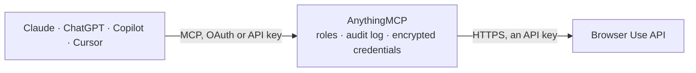

<!-- Generated by scripts/export-github-catalog.mjs in the anythingmcp-website repository. Do not edit by hand. -->

# Browser Use MCP connector

Run Browser Use AI agents from your AI: give a task in plain language, follow it step by step, read the result and its cost, continue the conversation, and manage cloud browsers, saved browser … The AnythingMCP connector gives Claude, ChatGPT, Microsoft Copilot, Cursor and Gemini 41 MCP tools for Browser Use: 22 read and 19 can change data.

**Category:** [Infrastructure](../infrastructure.md) · **Tools:** 41 · **Setup guide:** [anythingmcp.com](https://anythingmcp.com/guides/browser-use-to-mcp) · [Deutsch](https://anythingmcp.com/de/guides/browser-use-to-mcp) · [Italiano](https://anythingmcp.com/it/guides/browser-use-to-mcp) · [Español](https://anythingmcp.com/es/guides/browser-use-to-mcp) · [日本語](https://anythingmcp.com/ja/guides/browser-use-to-mcp) · [Русский](https://anythingmcp.com/ru/guides/browser-use-to-mcp) · [中文](https://anythingmcp.com/zh/guides/browser-use-to-mcp)

## Start without code

No installation and no terminal: AnythingMCP Cloud runs the Browser Use connector for you, operated by helpcode.ai in Frankfurt, Germany.

1. **Click the button above** and create an account or sign in. The Browser Use connector opens, ready to install.
2. **Paste the API key or token from your Browser Use account.** Every click is in the [step-by-step guide](https://anythingmcp.com/guides/browser-use-to-mcp).
3. **Click Install.** AnythingMCP shows the address of your MCP server.
4. **Add that address to your assistant:** [Claude](https://anythingmcp.com/guides/connect-browser-use-to-claude) · [ChatGPT](https://anythingmcp.com/guides/connect-browser-use-to-chatgpt) · [Microsoft Copilot](https://anythingmcp.com/guides/connect-browser-use-to-copilot) · [Cursor](https://anythingmcp.com/guides/connect-browser-use-to-cursor) · [Gemini CLI](https://anythingmcp.com/guides/connect-browser-use-to-gemini) · [Meta Muse](https://anythingmcp.com/guides/connect-browser-use-to-muse).
5. **Ask your first question**, for example: *Find the browser profile for portal login solaradmin@nordicsolar.de and show its last use*

Prefer help with the setup? [Talk to us](https://anythingmcp.com/contact).

## How it works

- **The AI client** speaks MCP (Streamable HTTP) to AnythingMCP and only sees tool names, descriptions and results. It never gets the Browser Use credentials.
- **AnythingMCP** checks the client's role, builds the call from the tool definition, adds the credentials (an API key), calls Browser Use, logs the call and returns the result.
- **Browser Use** sees an ordinary API client with the rights of the account the credentials belong to.

## Tools

| Tool | What it does | Access |
|---|---|---|
| [`browser_use_create_run`](#browser_use_create_run) | Start an AI browser agent on a task written in plain language (e.g. "Find the cheapest train from Berlin to Munich on 3 March and return price and time"). | write |
| [`browser_use_list_runs`](#browser_use_list_runs) | List agent runs, newest first, optionally of one session: id, task, title, model, status, result, error, token counts, LLM cost and dates. | read |
| [`browser_use_get_run_status`](#browser_use_get_run_status) | Lightweight poll of a run: its status only (queued, dispatching, running, completed, failed, cancelled). | read |
| [`browser_use_get_run`](#browser_use_get_run) | Read one run in full: task, model, status, result text, structured output, error, judge verdict, input and output tokens, LLM cost in USD and its session… | read |
| [`browser_use_get_run_events`](#browser_use_get_run_events) | Read the step-by-step event log of a run (navigation, actions, agent messages, output), oldest first. | read |
| [`browser_use_list_run_attachments`](#browser_use_list_run_attachments) | List the files attached to a run (name, type, size and whether the upload finished). | read |
| [`browser_use_cancel_run`](#browser_use_cancel_run) | Cancel a run that is still working, so it stops spending. | write |
| [`browser_use_list_sessions`](#browser_use_list_sessions) | List agent sessions (conversations), newest first, one row per session with its latest run: session id, workspace id, latest run id, task, title, status and… | read |
| [`browser_use_get_session`](#browser_use_get_session) | Read one session: its latest run id, task, title, status (busy while a run is queued or running) and workspace id. | read |
| [`browser_use_get_session_cost`](#browser_use_get_session_cost) | Everything a session has cost so far in USD, split into LLM, web search, browser time and proxy traffic, with the number of runs and proxy megabytes. | read |
| [`browser_use_get_session_cost_cap`](#browser_use_get_session_cost_cap) | Read the spending cap of a session: maxCostUsd (null when there is none) and spentUsd so far. | read |
| [`browser_use_update_session_cost_cap`](#browser_use_update_session_cost_cap) | Set a new spending cap in USD on a session without starting a run, e.g. to let a run that hit its cap continue. | write |
| [`browser_use_send_session_message`](#browser_use_send_session_message) | Send a follow-up message to a session. | write |
| [`browser_use_list_session_queue`](#browser_use_list_session_queue) | List the queued messages of a session: those still waiting and the recently delivered ones, with id, status (pending, dispatching, consumed, cancelled,… | read |
| [`browser_use_get_session_queue_message`](#browser_use_get_session_queue_message) | Read one queued message of a session: text, mode, status and the run it started. | read |
| [`browser_use_cancel_session_queue_message`](#browser_use_cancel_session_queue_message) | Remove a message that is still waiting in a session queue. | write |
| [`browser_use_rename_session`](#browser_use_rename_session) | Give a session a title (up to 255 characters) to find it again in the lists. | write |
| [`browser_use_get_session_share`](#browser_use_get_session_share) | Read the public share link of a session: shareUrl, whether it is active and its view count. | read |
| [`browser_use_create_session_share`](#browser_use_create_session_share) | Turn on a public link to a session, so anyone with the link can watch its runs without an account. | write |
| [`browser_use_update_session_share`](#browser_use_update_session_share) | Switch the public link of a session on or off; switched off, the link stops working until it is switched on again. | write |
| [`browser_use_delete_session`](#browser_use_delete_session) | Delete a session: it disappears from the lists and cannot be continued; a run still working is cancelled first. | write |
| [`browser_use_create_workspace`](#browser_use_create_workspace) | Create an empty workspace (file storage shared by the runs of a session), so input files can be uploaded before the first run; pass its id as workspace_id… | write |
| [`browser_use_get_workspace`](#browser_use_get_workspace) | Read one workspace: name, archived flag and dates. | read |
| [`browser_use_get_workspace_size`](#browser_use_get_workspace_size) | Show how much storage a workspace uses (usedBytes) and the plan limit (maxBytes). | read |
| [`browser_use_list_workspace_files`](#browser_use_list_workspace_files) | List the files in a workspace: the files the agent produced (reports, CSVs, screenshots) and uploaded inputs, with path, size and date; include_urls adds… | read |
| [`browser_use_create_workspace_upload_urls`](#browser_use_create_workspace_upload_urls) | Get presigned upload URLs (valid 5 minutes) for input files of a workspace; the agent picks them up at the start of every run. | write |
| [`browser_use_rename_workspace`](#browser_use_rename_workspace) | Rename a workspace so it is easier to recognise later. | write |
| [`browser_use_delete_workspace_file`](#browser_use_delete_workspace_file) | Delete one file from a workspace by its exact path. | write |
| [`browser_use_delete_workspace`](#browser_use_delete_workspace) | Archive a workspace and its files. | write |
| [`browser_use_list_browsers`](#browser_use_list_browsers) | List cloud browsers (standalone ones driven by a script over CDP, and the browsers of agent sessions), optionally only active or stopped ones, by metadata… | read |
| [`browser_use_create_browser`](#browser_use_create_browser) | Start a standalone cloud browser for the user's own Playwright, Puppeteer or browser-use script: returns cdpUrl (connect the script there) and liveUrl… | write |
| [`browser_use_get_browser`](#browser_use_get_browser) | Read one browser: status, live URL, CDP URL, when it times out, browser and proxy cost, recording link once stopped, metadata and extensions. | read |
| [`browser_use_stop_browser`](#browser_use_stop_browser) | Stop a browser so it stops costing; unused time is refunded. | write |
| [`browser_use_list_browser_downloads`](#browser_use_list_browser_downloads) | List the files a browser downloaded (path, size, date and, with include_urls, download links valid 15 minutes). | read |
| [`browser_use_list_profiles`](#browser_use_list_profiles) | List browser profiles (saved cookies and logins reused across sessions), optionally searched by name or userId. | read |
| [`browser_use_get_profile`](#browser_use_get_profile) | Read one browser profile: name, userId label, the domains it holds cookies for and when it was last used. | read |
| [`browser_use_create_profile`](#browser_use_create_profile) | Create an empty browser profile. | write |
| [`browser_use_update_profile`](#browser_use_update_profile) | Rename a browser profile or change its userId label. | write |
| [`browser_use_delete_profile`](#browser_use_delete_profile) | Permanently delete a browser profile and its saved cookies and logins. | write |
| [`browser_use_list_extensions`](#browser_use_list_extensions) | List the Chrome extensions uploaded to the project (id, name, version), for extension_ids of a browser or browser_settings of a run. | read |
| [`browser_use_get_extension`](#browser_use_get_extension) | Read one uploaded Chrome extension: name, version and upload date. | read |

## Tool reference

Every parameter as the AI client sees it in `tools/list`. Source: [`packages/backend/src/adapters/intl/browser-use.json`](../../../packages/backend/src/adapters/intl/browser-use.json).

### `browser_use_create_run`

Start an AI browser agent on a task written in plain language (e.g. "Find the cheapest train from Berlin to Munich on 3 March and return price and time"). Without session_id a new session (conversation) is opened; pass session_id to continue an earlier session with its history and browser. Returns the run id, session id and workspace id at once; the agent works in the background, so poll browser_use_get_run_status until the status is completed, failed or cancelled, then read browser_use_get_run. Set max_cost_usd to cap the spend. COSTS MONEY: it uses Browser Use credits. Confirm with the user first.

**Access:** write · **Call:** `POST /runs`

| Parameter | Type | Required | Description |
|---|---|---|---|
| `task` | string | yes | What the agent should do, in plain language. Be specific about the result you want back. |
| `model` | string | no | Model that drives the agent, e.g. gpt-6-luna (default), gpt-6.1-sol, claude-sonnet-5, gemini-3.5-flash, bu-fast. The EU host offers OpenAI models only. |
| `model_params` | object | no | Provider-native model options passed through unchanged, e.g. {"reasoning": {"effort": "high"}} for OpenAI models. |
| `output_schema` | object | no | A JSON Schema the final output must match; the run then returns it as structured output. |
| `session_id` | string | no | Session to continue id (a UUID) from browser_use_list_sessions. |
| `workspace_id` | string | no | Workspace with input files id (a UUID) from browser_use_create_workspace. |
| `browser_settings` | object | no | Browser of a new session: {"profileId": "...", "proxyCountryCode": "de", "screenWidth": 1280, "screenHeight": 800, "record": true}. proxyCountryCode defaults to us (EU host: an EU country, default de). |
| `keep_alive` | integer | no | Seconds the browser stays open after the run for follow-ups, 120 to 14400 (default 120). Idle time is billed as browser time. |
| `max_cost_usd` | number | no | Spending cap for the session in USD, e.g. 0.5. The run stops when it is reached. |
| `attached_file_ids` | string[] | no | Upload ids from browser_use_create_workspace_upload_urls to attach to this run. |
| `agentmail` | boolean | no | Give the agent a temporary e-mail inbox it can send and receive with (default false; not on the EU host). |

### `browser_use_list_runs`

List agent runs, newest first, optionally of one session: id, task, title, model, status, result, error, token counts, LLM cost and dates. Page on with cursor = nextCursor while hasMore is true. Read-only.

**Access:** read · **Call:** `GET /runs`

| Parameter | Type | Required | Description |
|---|---|---|---|
| `limit` | integer | no | Runs per page (default 50). |
| `cursor` | string | no | nextCursor from the previous answer, while hasMore is true. |
| `session_id` | string | no | Session id (a UUID) from browser_use_list_sessions. |

### `browser_use_get_run_status`

Lightweight poll of a run: its status only (queued, dispatching, running, completed, failed, cancelled). Call it every few seconds while a run works, then browser_use_get_run once it is done. Read-only.

**Access:** read · **Call:** `GET /runs/{run_id}/status`

| Parameter | Type | Required | Description |
|---|---|---|---|
| `run_id` | string | yes | Run id (a UUID) from browser_use_create_run or browser_use_list_runs. |

### `browser_use_get_run`

Read one run in full: task, model, status, result text, structured output, error, judge verdict, input and output tokens, LLM cost in USD and its session and workspace ids. Read-only.

**Access:** read · **Call:** `GET /runs/{run_id}`

| Parameter | Type | Required | Description |
|---|---|---|---|
| `run_id` | string | yes | Run id (a UUID) from browser_use_create_run or browser_use_list_runs. |

### `browser_use_get_run_events`

Read the step-by-step event log of a run (navigation, actions, agent messages, output), oldest first. To follow a live run, pass after = nextAfter of the previous answer to get only new events. Read-only.

**Access:** read · **Call:** `GET /runs/{run_id}/events`

| Parameter | Type | Required | Description |
|---|---|---|---|
| `run_id` | string | yes | Run id (a UUID) from browser_use_create_run or browser_use_list_runs. |
| `after` | integer | no | Only events with an id above this one (default 0, from the start). |
| `limit` | integer | no | Events per page (default 200). |
| `include_output` | boolean | no | Include tool output in the events (default true); false keeps the answer short. |

### `browser_use_list_run_attachments`

List the files attached to a run (name, type, size and whether the upload finished). Read-only.

**Access:** read · **Call:** `GET /runs/{run_id}/attachments`

| Parameter | Type | Required | Description |
|---|---|---|---|
| `run_id` | string | yes | Run id (a UUID) from browser_use_create_run or browser_use_list_runs. |

### `browser_use_cancel_run`

Cancel a run that is still working, so it stops spending. A run that already ended is returned as it is. Confirm with the user first.

**Access:** write · **Call:** `POST /runs/{run_id}/cancel`

| Parameter | Type | Required | Description |
|---|---|---|---|
| `run_id` | string | yes | Run id (a UUID) from browser_use_create_run or browser_use_list_runs. |

### `browser_use_list_sessions`

List agent sessions (conversations), newest first, one row per session with its latest run: session id, workspace id, latest run id, task, title, status and dates. Works on the US and EU host. Read-only.

**Access:** read · **Call:** `GET /sessions`

| Parameter | Type | Required | Description |
|---|---|---|---|
| `limit` | integer | no | Sessions per page, 1 to 100 (default 20). |
| `cursor` | string | no | nextCursor from the previous answer, while hasMore is true. |

### `browser_use_get_session`

Read one session: its latest run id, task, title, status (busy while a run is queued or running) and workspace id. Read-only.

**Access:** read · **Call:** `GET /sessions/{session_id}`

| Parameter | Type | Required | Description |
|---|---|---|---|
| `session_id` | string | yes | Agent session id (a UUID) from browser_use_list_sessions or the sessionId of a run. |

### `browser_use_get_session_cost`

Everything a session has cost so far in USD, split into LLM, web search, browser time and proxy traffic, with the number of runs and proxy megabytes. Use it for the real cost of a conversation; a run only shows its LLM cost. Read-only.

**Access:** read · **Call:** `GET /sessions/{session_id}/cost`

| Parameter | Type | Required | Description |
|---|---|---|---|
| `session_id` | string | yes | Agent session id (a UUID) from browser_use_list_sessions or the sessionId of a run. |

### `browser_use_get_session_cost_cap`

Read the spending cap of a session: maxCostUsd (null when there is none) and spentUsd so far. Read-only.

**Access:** read · **Call:** `GET /sessions/{session_id}/cost-cap`

| Parameter | Type | Required | Description |
|---|---|---|---|
| `session_id` | string | yes | Agent session id (a UUID) from browser_use_list_sessions or the sessionId of a run. |

### `browser_use_update_session_cost_cap`

Set a new spending cap in USD on a session without starting a run, e.g. to let a run that hit its cap continue. Confirm with the user first.

**Access:** write · **Call:** `PATCH /sessions/{session_id}/cost-cap`

| Parameter | Type | Required | Description |
|---|---|---|---|
| `session_id` | string | yes | Agent session id (a UUID) from browser_use_list_sessions or the sessionId of a run. |
| `max_cost_usd` | number | yes | New cap in USD, e.g. 2. |

### `browser_use_send_session_message`

Send a follow-up message to a session. If a run is going it waits in the queue and becomes the next turn; if the session is idle it starts a new run at once. interrupt true cancels the current run so the message takes effect now. COSTS MONEY: it uses Browser Use credits. Confirm with the user first.

**Access:** write · **Call:** `POST /sessions/{session_id}/queue`

| Parameter | Type | Required | Description |
|---|---|---|---|
| `session_id` | string | yes | Agent session id (a UUID) from browser_use_list_sessions or the sessionId of a run. |
| `text` | string | yes | The message or follow-up task. |
| `interrupt` | boolean | no | Cancel the run in progress and handle this message now (default false). |
| `attached_file_ids` | string[] | no | Upload ids to attach to the message. |

### `browser_use_list_session_queue`

List the queued messages of a session: those still waiting and the recently delivered ones, with id, status (pending, dispatching, consumed, cancelled, superseded, failed) and the run they started. Read-only.

**Access:** read · **Call:** `GET /sessions/{session_id}/queue`

| Parameter | Type | Required | Description |
|---|---|---|---|
| `session_id` | string | yes | Agent session id (a UUID) from browser_use_list_sessions or the sessionId of a run. |

### `browser_use_get_session_queue_message`

Read one queued message of a session: text, mode, status and the run it started. Read-only.

**Access:** read · **Call:** `GET /sessions/{session_id}/queue/{message_id}`

| Parameter | Type | Required | Description |
|---|---|---|---|
| `session_id` | string | yes | Agent session id (a UUID) from browser_use_list_sessions or the sessionId of a run. |
| `message_id` | integer | yes | Message id (a number) from browser_use_list_session_queue. |

### `browser_use_cancel_session_queue_message`

Remove a message that is still waiting in a session queue. Fails with 409 once it has been picked up. Confirm with the user first.

**Access:** write · **Call:** `DELETE /sessions/{session_id}/queue/{message_id}`

| Parameter | Type | Required | Description |
|---|---|---|---|
| `session_id` | string | yes | Agent session id (a UUID) from browser_use_list_sessions or the sessionId of a run. |
| `message_id` | integer | yes | Message id from browser_use_list_session_queue. |

### `browser_use_rename_session`

Give a session a title (up to 255 characters) to find it again in the lists. Confirm with the user first.

**Access:** write · **Call:** `PATCH /sessions/{session_id}`

| Parameter | Type | Required | Description |
|---|---|---|---|
| `session_id` | string | yes | Agent session id (a UUID) from browser_use_list_sessions or the sessionId of a run. |
| `title` | string | yes | New session title. |

### `browser_use_get_session_share`

Read the public share link of a session: shareUrl, whether it is active and its view count. null means the session was never shared. Read-only.

**Access:** read · **Call:** `GET /sessions/{session_id}/share`

| Parameter | Type | Required | Description |
|---|---|---|---|
| `session_id` | string | yes | Agent session id (a UUID) from browser_use_list_sessions or the sessionId of a run. |

### `browser_use_create_session_share`

Turn on a public link to a session, so anyone with the link can watch its runs without an account. Re-enabling keeps the same link. Confirm with the user first.

**Access:** write · **Call:** `POST /sessions/{session_id}/share`

| Parameter | Type | Required | Description |
|---|---|---|---|
| `session_id` | string | yes | Agent session id (a UUID) from browser_use_list_sessions or the sessionId of a run. |

### `browser_use_update_session_share`

Switch the public link of a session on or off; switched off, the link stops working until it is switched on again. Confirm with the user first.

**Access:** write · **Call:** `PUT /sessions/{session_id}/share`

| Parameter | Type | Required | Description |
|---|---|---|---|
| `session_id` | string | yes | Agent session id (a UUID) from browser_use_list_sessions or the sessionId of a run. |
| `is_active` | boolean | yes | true to enable the link, false to disable it. |

### `browser_use_delete_session`

Delete a session: it disappears from the lists and cannot be continued; a run still working is cancelled first. Confirm with the user first. Installed switched off.

**Access:** write · **Call:** `DELETE /sessions/{session_id}`

| Parameter | Type | Required | Description |
|---|---|---|---|
| `session_id` | string | yes | Agent session id (a UUID) from browser_use_list_sessions or the sessionId of a run. |

### `browser_use_create_workspace`

Create an empty workspace (file storage shared by the runs of a session), so input files can be uploaded before the first run; pass its id as workspace_id to browser_use_create_run. Confirm with the user first.

**Access:** write · **Call:** `POST /workspaces`

| Parameter | Type | Required | Description |
|---|---|---|---|
| `name` | string | no | Name of the workspace (up to 100 characters). |

### `browser_use_get_workspace`

Read one workspace: name, archived flag and dates. Read-only.

**Access:** read · **Call:** `GET /workspaces/{workspace_id}`

| Parameter | Type | Required | Description |
|---|---|---|---|
| `workspace_id` | string | yes | Workspace id (a UUID) from browser_use_create_workspace or the workspaceId of a run. |

### `browser_use_get_workspace_size`

Show how much storage a workspace uses (usedBytes) and the plan limit (maxBytes). Read-only.

**Access:** read · **Call:** `GET /workspaces/{workspace_id}/size`

| Parameter | Type | Required | Description |
|---|---|---|---|
| `workspace_id` | string | yes | Workspace id (a UUID) from browser_use_create_workspace or the workspaceId of a run. |

### `browser_use_list_workspace_files`

List the files in a workspace: the files the agent produced (reports, CSVs, screenshots) and uploaded inputs, with path, size and date; include_urls adds download links valid for 60 seconds. Read-only.

**Access:** read · **Call:** `GET /workspaces/{workspace_id}/files`

| Parameter | Type | Required | Description |
|---|---|---|---|
| `workspace_id` | string | yes | Workspace id (a UUID) from browser_use_create_workspace or the workspaceId of a run. |
| `prefix` | string | no | Only paths starting with this, e.g. uploads/. |
| `limit` | integer | no | Files per page, 1 to 100 (default 50). |
| `cursor` | string | no | nextCursor from the previous answer, while hasMore is true. |
| `include_urls` | boolean | no | Add a short-lived download URL to every file (default false). |

### `browser_use_create_workspace_upload_urls`

Get presigned upload URLs (valid 5 minutes) for input files of a workspace; the agent picks them up at the start of every run. The user or their script uploads the bytes with a PUT to uploadUrl (this connector cannot send file contents). Each answer item has an id to pass in attached_file_ids. Confirm with the user first.

**Access:** write · **Call:** `POST /workspaces/{workspace_id}/files/upload`

| Parameter | Type | Required | Description |
|---|---|---|---|
| `workspace_id` | string | yes | Workspace id (a UUID) from browser_use_create_workspace or the workspaceId of a run. |
| `files` | object[] | yes | Files to upload: [{"name": "data.csv", "contentType": "text/csv", "size": 1234}]; size is the exact byte count, up to 50 MB. |
| `allow_overrides` | boolean | no | Allow replacing files of the same name (default true). |

### `browser_use_rename_workspace`

Rename a workspace so it is easier to recognise later. Confirm with the user first.

**Access:** write · **Call:** `PATCH /workspaces/{workspace_id}`

| Parameter | Type | Required | Description |
|---|---|---|---|
| `workspace_id` | string | yes | Workspace id (a UUID) from browser_use_create_workspace or the workspaceId of a run. |
| `name` | string | yes | New name (up to 100 characters). |

### `browser_use_delete_workspace_file`

Delete one file from a workspace by its exact path. Cannot be undone. Confirm with the user first. Installed switched off.

**Access:** write · **Call:** `DELETE /workspaces/{workspace_id}/files`

| Parameter | Type | Required | Description |
|---|---|---|---|
| `workspace_id` | string | yes | Workspace id (a UUID) from browser_use_create_workspace or the workspaceId of a run. |
| `path` | string | yes | Exact file path from browser_use_list_workspace_files, e.g. uploads/data.csv. |

### `browser_use_delete_workspace`

Archive a workspace and its files. Confirm with the user first. Installed switched off.

**Access:** write · **Call:** `DELETE /workspaces/{workspace_id}`

| Parameter | Type | Required | Description |
|---|---|---|---|
| `workspace_id` | string | yes | Workspace id (a UUID) from browser_use_create_workspace or the workspaceId of a run. |

### `browser_use_list_browsers`

List cloud browsers (standalone ones driven by a script over CDP, and the browsers of agent sessions), optionally only active or stopped ones, by metadata label or by agent session. Returns id, status, live URL, timeout, costs and metadata. Use status active to find browsers still costing money. Read-only.

**Access:** read · **Call:** `GET /browsers`

| Parameter | Type | Required | Description |
|---|---|---|---|
| `page_size` | integer | no | Items per page, 1 to 100 (default 10). |
| `page_number` | integer | no | Page number, starting at 1 (default 1). |
| `filter_by` | `active` \| `stopped` | no | Only active or only stopped browsers. |
| `metadata` | string[] | no | Only browsers with every one of these labels: "key" matches any value, "key=value" an exact value. |
| `agent_session_id` | string | no | Agent session id (a UUID) from browser_use_list_sessions or the sessionId of a run. |

### `browser_use_create_browser`

Start a standalone cloud browser for the user's own Playwright, Puppeteer or browser-use script: returns cdpUrl (connect the script there) and liveUrl (watch it). It runs until timeout minutes pass or browser_use_stop_browser; unused time is refunded on stop. COSTS MONEY: it uses Browser Use credits. Billed per browser hour plus proxy traffic. Confirm with the user first.

**Access:** write · **Call:** `POST /browsers`

| Parameter | Type | Required | Description |
|---|---|---|---|
| `profile_id` | string | no | Profile id (a UUID) from browser_use_list_profiles. |
| `proxy_country_code` | string | no | Two-letter country code of the managed proxy, e.g. us, de, fr (default us; on the EU host EU countries only, default de). |
| `metadata` | object | no | Up to 10 string key-value labels, e.g. {"project": "pricing"}. |
| `timeout` | integer | no | Minutes until the browser stops on its own, 1 to 240 (default 60). |
| `browser_screen_width` | integer | no | Browser screen width in pixels. |
| `browser_screen_height` | integer | no | Browser screen height in pixels. |
| `allow_resizing` | boolean | no | Allow resizing during the session (default false; less stealthy). |
| `solve_captchas` | boolean | no | Solve CAPTCHAs automatically (default true; not on the EU host). |
| `pdf_renderer_enabled` | boolean | no | Render PDFs in a tab (default true); the file is downloaded either way. |
| `enable_recording` | boolean | no | Record the session as a video (default false). |
| `extension_ids` | string[] | no | Up to 3 extension ids from browser_use_list_extensions to install. |

### `browser_use_get_browser`

Read one browser: status, live URL, CDP URL, when it times out, browser and proxy cost, recording link once stopped, metadata and extensions. Read-only.

**Access:** read · **Call:** `GET /browsers/{browser_id}`

| Parameter | Type | Required | Description |
|---|---|---|---|
| `browser_id` | string | yes | Browser id (a UUID) from browser_use_list_browsers. |

### `browser_use_stop_browser`

Stop a browser so it stops costing; unused time is refunded. Closing a script's CDP connection does not stop it; this does. Confirm with the user first.

**Access:** write · **Call:** `PATCH /browsers/{browser_id}`

| Parameter | Type | Required | Description |
|---|---|---|---|
| `browser_id` | string | yes | Browser id (a UUID) from browser_use_list_browsers. |

### `browser_use_list_browser_downloads`

List the files a browser downloaded (path, size, date and, with include_urls, download links valid 15 minutes). Page on with cursor = nextCursor while hasMore is true. Read-only.

**Access:** read · **Call:** `GET /browsers/{browser_id}/downloads`

| Parameter | Type | Required | Description |
|---|---|---|---|
| `browser_id` | string | yes | Browser id (a UUID) from browser_use_list_browsers. |
| `limit` | integer | no | Files per page, 1 to 100 (default 50). |
| `cursor` | string | no | nextCursor from the previous answer, while hasMore is true. |
| `include_urls` | boolean | no | Add a download URL to every file (default false). |

### `browser_use_list_profiles`

List browser profiles (saved cookies and logins reused across sessions), optionally searched by name or userId. Returns id, name, userId, cookie domains and last use. Read-only.

**Access:** read · **Call:** `GET /profiles`

| Parameter | Type | Required | Description |
|---|---|---|---|
| `page_size` | integer | no | Items per page, 1 to 100 (default 10). |
| `page_number` | integer | no | Page number, starting at 1 (default 1). |
| `query` | string | no | Search text for the profile name or userId. |

### `browser_use_get_profile`

Read one browser profile: name, userId label, the domains it holds cookies for and when it was last used. Read-only.

**Access:** read · **Call:** `GET /profiles/{profile_id}`

| Parameter | Type | Required | Description |
|---|---|---|---|
| `profile_id` | string | yes | Profile id (a UUID) from browser_use_list_profiles. |

### `browser_use_create_profile`

Create an empty browser profile. Pass its id as profileId in browser_settings of a run (or profile_id of a browser); logins made there are saved for later runs. Confirm with the user first.

**Access:** write · **Call:** `POST /profiles`

| Parameter | Type | Required | Description |
|---|---|---|---|
| `name` | string | no | Name of the profile, e.g. "Shop admin". |
| `user_id` | string | no | Your own label to tie the profile to a user of your system. |

### `browser_use_update_profile`

Rename a browser profile or change its userId label. Confirm with the user first.

**Access:** write · **Call:** `PATCH /profiles/{profile_id}`

| Parameter | Type | Required | Description |
|---|---|---|---|
| `profile_id` | string | yes | Profile id (a UUID) from browser_use_list_profiles. |
| `name` | string | no | New name. |
| `user_id` | string | no | New userId label. |

### `browser_use_delete_profile`

Permanently delete a browser profile and its saved cookies and logins. Confirm with the user first. Installed switched off.

**Access:** write · **Call:** `DELETE /profiles/{profile_id}`

| Parameter | Type | Required | Description |
|---|---|---|---|
| `profile_id` | string | yes | Profile id (a UUID) from browser_use_list_profiles. |

### `browser_use_list_extensions`

List the Chrome extensions uploaded to the project (id, name, version), for extension_ids of a browser or browser_settings of a run. Read-only.

**Access:** read · **Call:** `GET /extensions`

| Parameter | Type | Required | Description |
|---|---|---|---|
| `page_size` | integer | no | Items per page, 1 to 100 (default 10). |
| `page_number` | integer | no | Page number, starting at 1 (default 1). |

### `browser_use_get_extension`

Read one uploaded Chrome extension: name, version and upload date. Read-only.

**Access:** read · **Call:** `GET /extensions/{extension_id}`

| Parameter | Type | Required | Description |
|---|---|---|---|
| `extension_id` | string | yes | Extension id (a UUID) from browser_use_list_extensions. |

## Run it yourself

AnythingMCP is open source (AGPL-3.0). [Run it with Docker](../../../README.md#run-it-yourself), open **Connectors → Store**, pick **Browser Use** and enter `BROWSER_USE_API_HOST`, `BROWSER_USE_API_KEY`, then add your MCP server URL to the AI client.

[← Infrastructure connectors](../infrastructure.md) · [All categories](../README.md)
