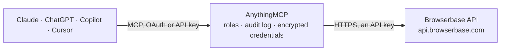

<!-- Generated by scripts/export-github-catalog.mjs in the anythingmcp-website repository. Do not edit by hand. -->

# Browserbase MCP connector

Manage your Browserbase cloud browsers from your AI: start and end sessions, get live view links for debugging, read session logs and replays, check browser minutes used, and fetch pages or search … The AnythingMCP connector gives Claude, ChatGPT, Microsoft Copilot, Cursor and Gemini 18 MCP tools for Browserbase: 13 read and 5 can change data.

**Category:** [Infrastructure](../infrastructure.md) · **Tools:** 18 · **Setup guide:** [anythingmcp.com](https://anythingmcp.com/guides/browserbase-to-mcp) · [Deutsch](https://anythingmcp.com/de/guides/browserbase-to-mcp) · [Italiano](https://anythingmcp.com/it/guides/browserbase-to-mcp) · [Español](https://anythingmcp.com/es/guides/browserbase-to-mcp) · [日本語](https://anythingmcp.com/ja/guides/browserbase-to-mcp) · [Русский](https://anythingmcp.com/ru/guides/browserbase-to-mcp) · [中文](https://anythingmcp.com/zh/guides/browserbase-to-mcp)

## Start without code

No installation and no terminal: AnythingMCP Cloud runs the Browserbase connector for you, operated by helpcode.ai in Frankfurt, Germany.

1. **Click the button above** and create an account or sign in. The Browserbase connector opens, ready to install.
2. **Paste the API key or token from your Browserbase account.** Every click is in the [step-by-step guide](https://anythingmcp.com/guides/browserbase-to-mcp).
3. **Click Install.** AnythingMCP shows the address of your MCP server.
4. **Add that address to your assistant:** [Claude](https://anythingmcp.com/guides/connect-browserbase-to-claude) · [ChatGPT](https://anythingmcp.com/guides/connect-browserbase-to-chatgpt) · [Microsoft Copilot](https://anythingmcp.com/guides/connect-browserbase-to-copilot) · [Cursor](https://anythingmcp.com/guides/connect-browserbase-to-cursor) · [Gemini CLI](https://anythingmcp.com/guides/connect-browserbase-to-gemini) · [Meta Muse](https://anythingmcp.com/guides/connect-browserbase-to-muse).
5. **Ask your first question**, for example: *Show me session sb-sess-84 for customer NordicPrint Oy — I need status, start, end and proxy bytes used.*

Prefer help with the setup? [Talk to us](https://anythingmcp.com/contact).

## How it works

- **The AI client** speaks MCP (Streamable HTTP) to AnythingMCP and only sees tool names, descriptions and results. It never gets the Browserbase credentials.
- **AnythingMCP** checks the client's role, builds the call from the tool definition, adds the credentials (an API key), calls Browserbase, logs the call and returns the result.
- **Browserbase** sees an ordinary API client with the rights of the account the credentials belong to.

## Tools

| Tool | What it does | Access |
|---|---|---|
| [`browserbase_list_projects`](#browserbase_list_projects) | List the Browserbase projects this API key can use, with id, name, how many sessions can run at once (concurrency) and the default session timeout in seconds. | read |
| [`browserbase_get_project`](#browserbase_get_project) | Read one Browserbase project: name, concurrency limit, default session timeout in seconds and creation date. | read |
| [`browserbase_get_project_usage`](#browserbase_get_project_usage) | Show a Browserbase project's usage in the current billing period: browser minutes and proxy bytes used. | read |
| [`browserbase_list_sessions`](#browserbase_list_sessions) | List Browserbase browser sessions of the project, optionally only those with a status (RUNNING, PENDING, COMPLETED, ERROR, TIMED_OUT) or matching a user… | read |
| [`browserbase_get_session`](#browserbase_get_session) | Read one Browserbase session: status, region, start, end and expiry times, keep-alive, proxy bytes used, linked context and user metadata. | read |
| [`browserbase_create_session`](#browserbase_create_session) | Start a new Browserbase cloud browser session. | write |
| [`browserbase_release_session`](#browserbase_release_session) | End a running Browserbase session now, so it stops using browser minutes. | write |
| [`browserbase_get_live_urls`](#browserbase_get_live_urls) | Get the live view links of a running Browserbase session: a debugger link to watch and control the whole browser, one per open tab with its page title and URL. | read |
| [`browserbase_get_session_logs`](#browserbase_get_session_logs) | Read the browser event log of a Browserbase session (Chrome DevTools events such as page navigations, network requests and responses, console messages), to… | read |
| [`browserbase_get_session_replay`](#browserbase_get_session_replay) | Get the replay of a Browserbase session: how many pages (tabs) were recorded and, per page, start and end time in milliseconds and the link to its video… | read |
| [`browserbase_request_recording_downloads`](#browserbase_request_recording_downloads) | Ask Browserbase to build one MP4 video per recorded page of a finished session. | write |
| [`browserbase_list_recording_downloads`](#browserbase_list_recording_downloads) | Show the MP4 recording status of each page of a Browserbase session (NOT_REQUESTED, PENDING, COMPLETED, FAILED) and, when COMPLETED, a short-lived download… | read |
| [`browserbase_create_context`](#browserbase_create_context) | Create a Browserbase context: a saved browser profile (cookies, local storage, logins) that sessions can reuse, so a script logs in once. | write |
| [`browserbase_get_context`](#browserbase_get_context) | Read a Browserbase context (saved browser profile): its name, project and when it was created and last updated. | read |
| [`browserbase_delete_context`](#browserbase_delete_context) | Delete a Browserbase context (saved browser profile) for good, with its cookies and logins. | write |
| [`browserbase_get_extension`](#browserbase_get_extension) | Read an uploaded Chrome extension in Browserbase by id: file name, project and dates. | read |
| [`browserbase_fetch_page`](#browserbase_fetch_page) | Fetch one web page through Browserbase without starting a browser: returns the HTTP status, content type and the content (raw, as markdown, or as JSON… | read |
| [`browserbase_search_web`](#browserbase_search_web) | Search the web through Browserbase and get up to 25 results with title, URL, author and publication date when known. | read |

## Tool reference

Every parameter as the AI client sees it in `tools/list`. Source: [`packages/backend/src/adapters/intl/browserbase.json`](../../../packages/backend/src/adapters/intl/browserbase.json).

### `browserbase_list_projects`

List the Browserbase projects this API key can use, with id, name, how many sessions can run at once (concurrency) and the default session timeout in seconds. Free. Read-only.

**Access:** read · **Call:** `GET /projects`

No parameters.

### `browserbase_get_project`

Read one Browserbase project: name, concurrency limit, default session timeout in seconds and creation date. Get the id from browserbase_list_projects. Free. Read-only.

**Access:** read · **Call:** `GET /projects/{project_id}`

| Parameter | Type | Required | Description |
|---|---|---|---|
| `project_id` | string | yes | Project id (a UUID) from browserbase_list_projects. |

### `browserbase_get_project_usage`

Show a Browserbase project's usage in the current billing period: browser minutes and proxy bytes used. Compare with the plan's allowance to tell the user how much is left. Free. Read-only.

**Access:** read · **Call:** `GET /projects/{project_id}/usage`

| Parameter | Type | Required | Description |
|---|---|---|---|
| `project_id` | string | yes | Project id (a UUID) from browserbase_list_projects. |

### `browserbase_list_sessions`

List Browserbase browser sessions of the project, optionally only those with a status (RUNNING, PENDING, COMPLETED, ERROR, TIMED_OUT) or matching a user metadata query. Returns id, status, region, start and end times, proxy bytes and metadata. Use status RUNNING to find sessions still costing minutes. Free. Read-only.

**Access:** read · **Call:** `GET /sessions`

| Parameter | Type | Required | Description |
|---|---|---|---|
| `status` | `RUNNING` \| `PENDING` \| `COMPLETED` \| `ERROR` \| `TIMED_OUT` | no | Only sessions with this status. |
| `q` | string | no | User metadata query, e.g. user_metadata['customer']:'acme'. |

### `browserbase_get_session`

Read one Browserbase session: status, region, start, end and expiry times, keep-alive, proxy bytes used, linked context and user metadata. Free. Read-only.

**Access:** read · **Call:** `GET /sessions/{session_id}`

| Parameter | Type | Required | Description |
|---|---|---|---|
| `session_id` | string | yes | Session id from browserbase_list_sessions or browserbase_create_session. |

### `browserbase_create_session`

Start a new Browserbase cloud browser session. COSTS MONEY: uses browser minutes (one-minute minimum, more with proxies) until it times out or is released. Confirm with the user before calling, and release it with browserbase_release_session when done. Returns the session id, its expiry and connectUrl, the link a Playwright, Puppeteer or Stagehand script connects to (it contains a signing key: hand it only to the user's script).

**Access:** write · **Call:** `POST /sessions`

| Parameter | Type | Required | Description |
|---|---|---|---|
| `timeout` | integer | no | Seconds until the session ends by itself, 60 to 21600. Defaults to the project's default timeout. Keep it short to limit cost. |
| `keep_alive` | boolean | no | Keep the session running when the script disconnects (paid plans). It then runs until released or timed out. |
| `region` | `us-west-2` \| `us-east-1` \| `eu-central-1` \| `ap-southeast-1` | no | Where the browser runs. Default us-west-2. |
| `proxies` | boolean | no | Route traffic through Browserbase's residential proxies (billed per MB). |
| `browser_settings` | object | no | Optional browser settings, e.g. {"context": {"id": "<context id>", "persist": true}, "blockAds": true, "solveCaptchas": true, "recordSession": true, "logSession": true, "viewport": {"width": 1280, "height": 800}, "os": "windows", "allowedDomains": ["example.com"]}. |
| `extension_id` | string | no | Id of an uploaded Chrome extension to load. |
| `user_metadata` | object | no | Your own labels for the session, e.g. {"customer": "acme"}, searchable with browserbase_list_sessions. |
| `project_id` | string | no | Project id. Leave out to use the API key's project. |

### `browserbase_release_session`

End a running Browserbase session now, so it stops using browser minutes. The browser closes and any script connected to it is cut off. Confirm with the user before ending a session they may still be using.

**Access:** write · **Call:** `POST /sessions/{session_id}`

| Parameter | Type | Required | Description |
|---|---|---|---|
| `session_id` | string | yes | Id of the session to end. |
| `project_id` | string | no | Project id. Leave out to use the API key's project. |

### `browserbase_get_live_urls`

Get the live view links of a running Browserbase session: a debugger link to watch and control the whole browser, one per open tab with its page title and URL. Open a link in a normal browser; anyone with it can control the session. Optionally make the links expire sooner. Free. Read-only.

**Access:** read · **Call:** `GET /sessions/{session_id}/debug`

| Parameter | Type | Required | Description |
|---|---|---|---|
| `session_id` | string | yes | Id of a RUNNING session. |
| `expires_in` | integer | no | Seconds the links stay valid, up to 21600. Default: until the session ends. |

### `browserbase_get_session_logs`

Read the browser event log of a Browserbase session (Chrome DevTools events such as page navigations, network requests and responses, console messages), to find out what a script did and where it failed. Request and response bodies are left out; at most about 60 KB. Free. Read-only.

**Access:** read · **Call:** `GET /sessions/{session_id}/logs`

| Parameter | Type | Required | Description |
|---|---|---|---|
| `session_id` | string | yes | Session id. |

### `browserbase_get_session_replay`

Get the replay of a Browserbase session: how many pages (tabs) were recorded and, per page, start and end time in milliseconds and the link to its video playlist (HLS). For MP4 files use browserbase_request_recording_downloads. Free. Read-only.

**Access:** read · **Call:** `GET /sessions/{session_id}/replays`

| Parameter | Type | Required | Description |
|---|---|---|---|
| `session_id` | string | yes | Session id. |

### `browserbase_request_recording_downloads`

Ask Browserbase to build one MP4 video per recorded page of a finished session. It runs in the background and every page starts as PENDING; check with browserbase_list_recording_downloads. Calling again retries failed pages. Confirm with the user before calling.

**Access:** write · **Call:** `POST /sessions/{session_id}/recording/downloads`

| Parameter | Type | Required | Description |
|---|---|---|---|
| `session_id` | string | yes | Session id. |

### `browserbase_list_recording_downloads`

Show the MP4 recording status of each page of a Browserbase session (NOT_REQUESTED, PENDING, COMPLETED, FAILED) and, when COMPLETED, a short-lived download link. Give the link to the user right away; it expires. Free. Read-only.

**Access:** read · **Call:** `GET /sessions/{session_id}/recording/downloads`

| Parameter | Type | Required | Description |
|---|---|---|---|
| `session_id` | string | yes | Session id. |

### `browserbase_create_context`

Create a Browserbase context: a saved browser profile (cookies, local storage, logins) that sessions can reuse, so a script logs in once. Pass its id to browserbase_create_session in browser_settings.context with persist true to save changes. Confirm with the user before calling.

**Access:** write · **Call:** `POST /contexts`

| Parameter | Type | Required | Description |
|---|---|---|---|
| `name` | string | no | Optional name, unique within the project, e.g. 'shop-admin-login'. |
| `project_id` | string | no | Project id. Leave out to use the API key's project. |

### `browserbase_get_context`

Read a Browserbase context (saved browser profile): its name, project and when it was created and last updated. Free. Read-only.

**Access:** read · **Call:** `GET /contexts/{context_id}`

| Parameter | Type | Required | Description |
|---|---|---|---|
| `context_id` | string | yes | Context id. |

### `browserbase_delete_context`

Delete a Browserbase context (saved browser profile) for good, with its cookies and logins. Sessions that used it can no longer log in with it. Cannot be undone: confirm with the user first. Installed switched off.

**Access:** write · **Call:** `DELETE /contexts/{context_id}`

| Parameter | Type | Required | Description |
|---|---|---|---|
| `context_id` | string | yes | Id of the context to delete. |

### `browserbase_get_extension`

Read an uploaded Chrome extension in Browserbase by id: file name, project and dates. The API has no list of extensions, so the id must come from the user or from a session's settings. Free. Read-only.

**Access:** read · **Call:** `GET /extensions/{extension_id}`

| Parameter | Type | Required | Description |
|---|---|---|---|
| `extension_id` | string | yes | Extension id. |

### `browserbase_fetch_page`

Fetch one web page through Browserbase without starting a browser: returns the HTTP status, content type and the content (raw, as markdown, or as JSON shaped by a JSON Schema). No JavaScript runs and pages over 5 MB fail; for those use a browser session. Uses one Fetch call of the plan (markdown, JSON and proxies cost more); ask the user before fetching many pages. Content is capped at about 80 KB here.

**Access:** read · **Call:** `POST /fetch`

| Parameter | Type | Required | Description |
|---|---|---|---|
| `url` | string | yes | The page to fetch, e.g. 'https://example.com/pricing'. |
| `format` | `raw` \| `markdown` \| `json` | no | raw (default, cheapest) returns the body as is; markdown converts the page; json extracts data following schema. |
| `schema` | object | no | JSON Schema of the data to extract, only with format json, e.g. {"type": "object", "properties": {"price": {"type": "string"}}}. |
| `allow_redirects` | boolean | no | Follow HTTP redirects. Default false. |
| `proxies` | boolean | no | Go through Browserbase proxies (costs more). Default false. |
| `allow_insecure_ssl` | boolean | no | Accept expired or self-signed certificates. Default false. |

### `browserbase_search_web`

Search the web through Browserbase and get up to 25 results with title, URL, author and publication date when known. Uses one Search call of the plan (1,000 a month included on every plan, then per call); ask the user before many searches in a row. Optional provider and mode choose speed versus depth.

**Access:** read · **Call:** `POST /search`

| Parameter | Type | Required | Description |
|---|---|---|---|
| `query` | string | yes | What to search for. |
| `num_results` | integer | no | Number of results, 1 to 25. Default 10. |
| `provider` | `parallel` \| `exa` | no | Search provider. Leave out for the project's default. |
| `mode` | `fast` \| `advanced` | no | Only with provider parallel: fast (cheaper) or advanced (default). |

## Run it yourself

AnythingMCP is open source (AGPL-3.0). [Run it with Docker](../../../README.md#run-it-yourself), open **Connectors → Store**, pick **Browserbase** and enter `BROWSERBASE_API_KEY`, then add your MCP server URL to the AI client.

[← Infrastructure connectors](../infrastructure.md) · [All categories](../README.md)
