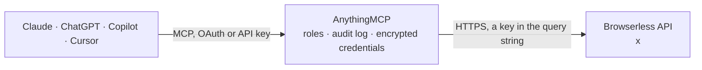

<!-- Generated by scripts/export-github-catalog.mjs in the anythingmcp-website repository. Do not edit by hand. -->

# Browserless MCP connector

Use Browserless cloud browsers from your AI: rendered HTML, markdown and links with smart scrape, CSS selector scraping, screenshots, PDFs, Lighthouse audits, site maps and bot-protected pages through the unblock API. The AnythingMCP connector gives Claude, ChatGPT, Microsoft Copilot, Cursor and Gemini 10 MCP tools for Browserless: 9 read and 1 can change data.

**Category:** [Infrastructure](../infrastructure.md) · **Tools:** 10 · **Setup guide:** [anythingmcp.com](https://anythingmcp.com/guides/browserless-to-mcp) · [Deutsch](https://anythingmcp.com/de/guides/browserless-to-mcp) · [Italiano](https://anythingmcp.com/it/guides/browserless-to-mcp) · [Español](https://anythingmcp.com/es/guides/browserless-to-mcp) · [日本語](https://anythingmcp.com/ja/guides/browserless-to-mcp) · [Русский](https://anythingmcp.com/ru/guides/browserless-to-mcp) · [中文](https://anythingmcp.com/zh/guides/browserless-to-mcp)

## Start without code

No installation and no terminal: AnythingMCP Cloud runs the Browserless connector for you, operated by helpcode.ai in Frankfurt, Germany.

1. **Click the button above** and create an account or sign in. The Browserless connector opens, ready to install.
2. **Paste the API key or token from your Browserless account.** Every click is in the [step-by-step guide](https://anythingmcp.com/guides/browserless-to-mcp).
3. **Click Install.** AnythingMCP shows the address of your MCP server.
4. **Add that address to your assistant:** [Claude](https://anythingmcp.com/guides/connect-browserless-to-claude) · [ChatGPT](https://anythingmcp.com/guides/connect-browserless-to-chatgpt) · [Microsoft Copilot](https://anythingmcp.com/guides/connect-browserless-to-copilot) · [Cursor](https://anythingmcp.com/guides/connect-browserless-to-cursor) · [Gemini CLI](https://anythingmcp.com/guides/connect-browserless-to-gemini) · [Meta Muse](https://anythingmcp.com/guides/connect-browserless-to-muse).
5. **Ask your first question**, for example: *Find the invoice page for Bergen Marina AS invoice INV-2026-045 and give the PDF download link.*

Prefer help with the setup? [Talk to us](https://anythingmcp.com/contact).

## How it works

- **The AI client** speaks MCP (Streamable HTTP) to AnythingMCP and only sees tool names, descriptions and results. It never gets the Browserless credentials.
- **AnythingMCP** checks the client's role, builds the call from the tool definition, adds the credentials (a key in the query string), calls Browserless, logs the call and returns the result.
- **Browserless** sees an ordinary API client with the rights of the account the credentials belong to.

## Tools

| Tool | What it does | Access |
|---|---|---|
| [`browserless_get_meta`](#browserless_get_meta) | Read the versions of the Browserless service on the configured host (core API and browsers). | read |
| [`browserless_smart_scrape`](#browserless_smart_scrape) | PAID: scrape one URL the cheapest way that works (plain fetch, then proxy, then a real browser) and return the formats you ask for: markdown, html, rawText,… | read |
| [`browserless_get_content`](#browserless_get_content) | PAID: load a URL (or HTML you pass) in a real Chrome and return the fully rendered HTML, including content built by JavaScript. | read |
| [`browserless_scrape`](#browserless_scrape) | PAID: load a URL in a real Chrome and return every element matching your CSS selectors with its text, HTML and attributes. | read |
| [`browserless_screenshot`](#browserless_screenshot) | PAID: take a screenshot of a URL (or HTML you pass) in a real Chrome: viewport, full page or one element, as PNG, JPEG or WebP. | read |
| [`browserless_pdf`](#browserless_pdf) | PAID: print a URL (or HTML you pass, e.g. a generated report) to PDF in a real Chrome. | read |
| [`browserless_map`](#browserless_map) | PAID: list the URLs of a website from its sitemap and links, with titles and descriptions, optionally ordered by relevance to a search term. | read |
| [`browserless_performance`](#browserless_performance) | PAID: run a Google Lighthouse audit of a URL and return scores (0 to 1) and audits for performance, accessibility, best practices, SEO and PWA. | read |
| [`browserless_unblock`](#browserless_unblock) | PAID: open a bot-protected URL past detection systems (Datadome, passive CAPTCHAs) and return its HTML, its cookies and optionally a full-page screenshot. | read |
| [`browserless_function`](#browserless_function) | PAID: run your own Puppeteer function in a Browserless Chrome for multi-step flows (click, type, paginate) and return what it returns. | write |

## Tool reference

Every parameter as the AI client sees it in `tools/list`. Source: [`packages/backend/src/adapters/intl/browserless.json`](../../../packages/backend/src/adapters/intl/browserless.json).

### `browserless_get_meta`

Read the versions of the Browserless service on the configured host (core API and browsers). Free; used as the install check.

**Access:** read · **Call:** `GET /meta`

No parameters.

### `browserless_smart_scrape`

PAID: scrape one URL the cheapest way that works (plain fetch, then proxy, then a real browser) and return the formats you ask for: markdown, html, rawText, links, screenshot, pdf, json (AI extraction with a schema or prompt) or summary. The answer says which strategy served it. 0.5 to 1 unit per 30 seconds plus proxy traffic (residential by default); json and summary add AI units. Capped at about 100 KB.

**Access:** read · **Call:** `POST /smart-scrape`

| Parameter | Type | Required | Description |
|---|---|---|---|
| `url` | string | yes | Page URL with http or https, e.g. 'https://example.com/pricing'. |
| `formats` | `html` \| `markdown` \| `rawText` \| `screenshot` \| `pdf` \| `links` \| `json` \| `summary`[] | no | Outputs to return. Default here ['markdown']. |
| `json_options` | object | no | For the json format: {"schema": <JSON Schema>} and/or {"prompt": "what to extract"}, e.g. {"prompt": "product name and price"}. |
| `only_main_content` | boolean | no | Remove navigation, footer, aside, scripts and styles. |
| `include_tags` | string[] | no | Keep only content matching these CSS selectors (not with exclude_tags or only_main_content). |
| `exclude_tags` | string[] | no | Remove content matching these CSS selectors. |
| `wait_for` | integer | no | Milliseconds to wait after loading (forces a browser). |
| `proxy` | `residential` \| `datacenter` | no | Proxy network: residential (default, 6 units/MB) or datacenter (2 units/MB). |
| `timeout` | integer | no | Overall timeout in milliseconds. |

### `browserless_get_content`

PAID: load a URL (or HTML you pass) in a real Chrome and return the fully rendered HTML, including content built by JavaScript. 1 unit per 30 seconds of browser time, plus proxy traffic when a proxy is set. Capped at about 100 KB; prefer browserless_smart_scrape with markdown for reading.

**Access:** read · **Call:** `POST /content`

| Parameter | Type | Required | Description |
|---|---|---|---|
| `url` | string | no | Page URL. Pass url or html. |
| `html` | string | no | HTML to render instead of a URL. |
| `wait_for_selector` | object | no | Wait for an element, e.g. {"selector": "#results", "timeout": 10000, "visible": true}. |
| `wait_for_timeout` | integer | no | Milliseconds to wait before reading the page. |
| `goto_options` | object | no | Navigation options, e.g. {"waitUntil": "networkidle2", "timeout": 30000}. |
| `best_attempt` | boolean | no | Continue with what loaded when a wait fails or times out. |
| `reject_resource_types` | string[] | no | Resource types not to load, e.g. ["image", "font", "media", "stylesheet"]. |
| `set_extra_http_headers` | object | no | Extra request headers, e.g. {"Accept-Language": "de-DE"}. |
| `cookies` | object[] | no | Cookies to set first, e.g. [{"name": "consent", "value": "yes", "domain": ".example.com"}]. |
| `stealth` | boolean | no | Use stealth mode against bot detection (no extra cost). |
| `block_ads` | boolean | no | Load an ad blocker. |
| `proxy` | `residential` \| `datacenter` | no | Route through Browserless proxies (6 or 2 units per MB). |
| `proxy_country` | string | no | Two-letter proxy country, e.g. 'us'. Only with proxy. |
| `timeout` | integer | no | Overall timeout in milliseconds. |

### `browserless_scrape`

PAID: load a URL in a real Chrome and return every element matching your CSS selectors with its text, HTML and attributes. 1 unit per 30 seconds of browser time, plus proxy traffic. Capped at about 100 KB.

**Access:** read · **Call:** `POST /scrape`

| Parameter | Type | Required | Description |
|---|---|---|---|
| `url` | string | yes | Page URL. |
| `elements` | object[] | yes | Selectors to read, e.g. [{"selector": "h1"}, {"selector": ".price", "timeout": 5000}]. |
| `wait_for_selector` | object | no | Wait for an element first, e.g. {"selector": ".results", "timeout": 10000}. |
| `wait_for_timeout` | integer | no | Milliseconds to wait before scraping. |
| `goto_options` | object | no | Navigation options, e.g. {"waitUntil": "networkidle2"}. |
| `best_attempt` | boolean | no | Continue with what loaded when a wait fails. |
| `reject_resource_types` | string[] | no | Resource types not to load, e.g. ["image", "font"]. |
| `stealth` | boolean | no | Use stealth mode against bot detection. |
| `block_ads` | boolean | no | Load an ad blocker. |
| `proxy` | `residential` \| `datacenter` | no | Route through Browserless proxies (6 or 2 units per MB). |
| `proxy_country` | string | no | Two-letter proxy country. Only with proxy. |
| `timeout` | integer | no | Overall timeout in milliseconds. |

### `browserless_screenshot`

PAID: take a screenshot of a URL (or HTML you pass) in a real Chrome: viewport, full page or one element, as PNG, JPEG or WebP. 1 unit per 30 seconds of browser time, plus proxy traffic.

**Access:** read · **Call:** `POST /screenshot`

| Parameter | Type | Required | Description |
|---|---|---|---|
| `url` | string | no | Page URL. Pass url or html. |
| `html` | string | no | HTML to render instead of a URL. |
| `options` | object | no | Screenshot options, e.g. {"fullPage": true, "type": "jpeg", "quality": 70}; type png (default), jpeg or webp. |
| `selector` | string | no | CSS selector of the one element to capture. |
| `viewport` | object | no | Viewport, e.g. {"width": 1280, "height": 800, "deviceScaleFactor": 1}. |
| `scroll_page` | boolean | no | Scroll through the page first so lazy content loads. |
| `wait_for_selector` | object | no | Wait for an element first, e.g. {"selector": "#chart"}. |
| `wait_for_timeout` | integer | no | Milliseconds to wait before the screenshot. |
| `goto_options` | object | no | Navigation options, e.g. {"waitUntil": "networkidle2"}. |
| `best_attempt` | boolean | no | Take the screenshot even when a wait fails. |
| `stealth` | boolean | no | Use stealth mode against bot detection. |
| `block_ads` | boolean | no | Load an ad blocker. |
| `block_consent_modals` | boolean | no | Hide cookie consent banners. |
| `proxy` | `residential` \| `datacenter` | no | Route through Browserless proxies (6 or 2 units per MB). |
| `proxy_country` | string | no | Two-letter proxy country. Only with proxy. |
| `timeout` | integer | no | Overall timeout in milliseconds. |

### `browserless_pdf`

PAID: print a URL (or HTML you pass, e.g. a generated report) to PDF in a real Chrome. Returns the PDF file. 1 unit per 30 seconds of browser time, plus proxy traffic.

**Access:** read · **Call:** `POST /pdf`

| Parameter | Type | Required | Description |
|---|---|---|---|
| `url` | string | no | Page URL. Pass url or html. |
| `html` | string | no | HTML to print instead of a URL. |
| `options` | object | no | PDF options, e.g. {"format": "A4", "landscape": false, "printBackground": true, "margin": {"top": "1cm", "bottom": "1cm"}}. |
| `emulate_media_type` | `screen` \| `print` | no | CSS media type to render with. Default print. |
| `wait_for_selector` | object | no | Wait for an element first. |
| `wait_for_timeout` | integer | no | Milliseconds to wait before printing. |
| `goto_options` | object | no | Navigation options, e.g. {"waitUntil": "networkidle0"}. |
| `best_attempt` | boolean | no | Print even when a wait fails. |
| `block_ads` | boolean | no | Load an ad blocker. |
| `block_consent_modals` | boolean | no | Hide cookie consent banners. |
| `timeout` | integer | no | Overall timeout in milliseconds. |

### `browserless_map`

PAID: list the URLs of a website from its sitemap and links, with titles and descriptions, optionally ordered by relevance to a search term. Units for the fetches it makes, plus proxy traffic (residential by default). Capped at about 100 KB.

**Access:** read · **Call:** `POST /map`

| Parameter | Type | Required | Description |
|---|---|---|---|
| `url` | string | yes | Base URL of the site, e.g. 'https://example.com'. |
| `search` | string | no | Order results by relevance to this text, e.g. 'pricing'. |
| `limit` | integer | no | Maximum URLs (default here 200, up to 5000). |
| `sitemap` | `include` \| `only` \| `skip` | no | Use the sitemap too (include, default), only, or not at all (skip). |
| `include_subdomains` | boolean | no | Include subdomains (default true). |
| `ignore_query_parameters` | boolean | no | Leave out URLs with query strings (default true). |
| `proxy` | `residential` \| `datacenter` | no | Proxy network (residential default). |
| `timeout` | integer | no | Timeout in milliseconds. |

### `browserless_performance`

PAID: run a Google Lighthouse audit of a URL and return scores (0 to 1) and audits for performance, accessibility, best practices, SEO and PWA. A full audit takes up to minutes and is very large; pass config to audit one category. 1 unit per 30 seconds. Capped at about 100 KB.

**Access:** read · **Call:** `POST /performance`

| Parameter | Type | Required | Description |
|---|---|---|---|
| `url` | string | yes | Page URL to audit. |
| `config` | object | no | Lighthouse config, e.g. {"extends": "lighthouse:default", "settings": {"onlyCategories": ["performance"]}} or {"extends": "lighthouse:default", "settings": {"onlyAudits": ["first-contentful-paint"]}}. |
| `budgets` | object[] | no | Lighthouse performance budgets, e.g. [{"resourceSizes": [{"resourceType": "script", "budget": 300}]}]. |
| `timeout` | integer | no | Overall timeout in milliseconds. |

### `browserless_unblock`

PAID: open a bot-protected URL past detection systems (Datadome, passive CAPTCHAs) and return its HTML, its cookies and optionally a full-page screenshot. Works best with proxy residential (6 units per MB) on top of browser time. Ask the user first; capped at about 100 KB.

**Access:** read · **Call:** `POST /unblock`

| Parameter | Type | Required | Description |
|---|---|---|---|
| `url` | string | yes | Page URL. |
| `content` | boolean | no | Return the page HTML (default true). |
| `cookies` | boolean | no | Return the cookies the site set (default false). |
| `screenshot` | boolean | no | Return a full-page JPEG screenshot (default false). |
| `wait_for_selector` | object | no | Wait for an element first, e.g. {"selector": "main"}. |
| `wait_for_timeout` | integer | no | Milliseconds to wait before reading. |
| `goto_options` | object | no | Navigation options, e.g. {"waitUntil": "networkidle2"}. |
| `best_attempt` | boolean | no | Continue with what loaded when a wait fails. |
| `proxy` | `residential` \| `datacenter` | no | Proxy network; residential is recommended for unblocking. |
| `proxy_country` | string | no | Two-letter proxy country, e.g. 'us'. |
| `timeout` | integer | no | Overall timeout in milliseconds. |

### `browserless_function`

PAID: run your own Puppeteer function in a Browserless Chrome for multi-step flows (click, type, paginate) and return what it returns. The code is an ES module: export default async ({ page, context }) => { ...; return { data, type: 'application/json' }; }. It can submit forms or buy on websites, so show the code to the user and confirm first. Installed switched off.

**Access:** write · **Call:** `POST /function`

| Parameter | Type | Required | Description |
|---|---|---|---|
| `code` | string | yes | ES module source, e.g. "export default async ({ page }) => { await page.goto('https://example.com'); return { data: { title: await page.title() }, type: 'application/json' }; }". |
| `context` | object | no | Values handed to the function as context, e.g. {"pageNumber": 2}. |
| `stealth` | boolean | no | Use stealth mode against bot detection. |
| `proxy` | `residential` \| `datacenter` | no | Route through Browserless proxies (6 or 2 units per MB). |
| `timeout` | integer | no | Overall timeout in milliseconds. |

## Run it yourself

AnythingMCP is open source (AGPL-3.0). [Run it with Docker](../../../README.md#run-it-yourself), open **Connectors → Store**, pick **Browserless** and enter `BROWSERLESS_API_TOKEN`, `BROWSERLESS_HOST`, then add your MCP server URL to the AI client.

[← Infrastructure connectors](../infrastructure.md) · [All categories](../README.md)
