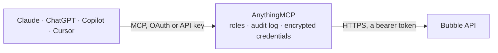

<!-- Generated by scripts/export-github-catalog.mjs in the anythingmcp-website repository. Do not edit by hand. -->

# Bubble MCP connector

Let your AI work with your Bubble app's data: see which data types and backend workflows it exposes, search and read things; with your confirmation create or change things and run backend workflows. The AnythingMCP connector gives Claude, ChatGPT, Microsoft Copilot, Cursor and Gemini 8 MCP tools for Bubble: 4 read and 4 can change data.

**Category:** [Databases](../database.md) · **Tools:** 8 · **Setup guide:** [anythingmcp.com](https://anythingmcp.com/guides/bubble-to-mcp) · [Deutsch](https://anythingmcp.com/de/guides/bubble-to-mcp) · [Italiano](https://anythingmcp.com/it/guides/bubble-to-mcp) · [Español](https://anythingmcp.com/es/guides/bubble-to-mcp) · [日本語](https://anythingmcp.com/ja/guides/bubble-to-mcp) · [Русский](https://anythingmcp.com/ru/guides/bubble-to-mcp) · [中文](https://anythingmcp.com/zh/guides/bubble-to-mcp)

## Start without code

No installation and no terminal: AnythingMCP Cloud runs the Bubble connector for you, operated by helpcode.ai in Frankfurt, Germany.

1. **Click the button above** and create an account or sign in. The Bubble connector opens, ready to install.
2. **Paste the API key or token from your Bubble account.** Every click is in the [step-by-step guide](https://anythingmcp.com/guides/bubble-to-mcp).
3. **Click Install.** AnythingMCP shows the address of your MCP server.
4. **Add that address to your assistant:** [Claude](https://anythingmcp.com/guides/connect-bubble-to-claude) · [ChatGPT](https://anythingmcp.com/guides/connect-bubble-to-chatgpt) · [Microsoft Copilot](https://anythingmcp.com/guides/connect-bubble-to-copilot) · [Cursor](https://anythingmcp.com/guides/connect-bubble-to-cursor) · [Gemini CLI](https://anythingmcp.com/guides/connect-bubble-to-gemini) · [Meta Muse](https://anythingmcp.com/guides/connect-bubble-to-muse).
5. **Ask your first question**, for example: *Show invoice INV-2026-0412: total, status, due date, and which customer it's billed to.*

Prefer help with the setup? [Talk to us](https://anythingmcp.com/contact).

## How it works

- **The AI client** speaks MCP (Streamable HTTP) to AnythingMCP and only sees tool names, descriptions and results. It never gets the Bubble credentials.
- **AnythingMCP** checks the client's role, builds the call from the tool definition, adds the credentials (a bearer token), calls Bubble, logs the call and returns the result.
- **Bubble** sees an ordinary API client with the rights of the account the credentials belong to.

## Tools

| Tool | What it does | Access |
|---|---|---|
| [`bubble_get_meta`](#bubble_get_meta) | Read what the Bubble app exposes through its API: the data types the Data API can reach (dataTypes), and the backend workflows the Workflow API can run… | read |
| [`bubble_get_data_types`](#bubble_get_data_types) | Read the data types of the Bubble app with their fields: for each type its display name and fields with id (the key to use in constraints and writes),… | read |
| [`bubble_list_things`](#bubble_list_things) | List or search the things (records) of one data type, up to 100 per call. | read |
| [`bubble_get_thing`](#bubble_get_thing) | Read one thing of a data type by its unique id: all fields the token may see, plus _id, Created Date, Modified Date and Created By. | read |
| [`bubble_create_thing`](#bubble_create_thing) | Create a new thing of a data type. | write |
| [`bubble_update_thing`](#bubble_update_thing) | Change fields of an existing thing; fields left out keep their value. | write |
| [`bubble_run_workflow`](#bubble_run_workflow) | Run a backend workflow exposed through the app's Workflow API. | write |
| [`bubble_delete_thing`](#bubble_delete_thing) | Delete one thing for good. | write |

## Tool reference

Every parameter as the AI client sees it in `tools/list`. Source: [`packages/backend/src/adapters/intl/bubble.json`](../../../packages/backend/src/adapters/intl/bubble.json).

### `bubble_get_meta`

Read what the Bubble app exposes through its API: the data types the Data API can reach (dataTypes), and the backend workflows the Workflow API can run (workflows) with their parameters, method and whether they need authentication. Call this first; then bubble_get_data_types for the fields of each type. Read-only.

**Access:** read · **Call:** `GET /meta`

No parameters.

### `bubble_get_data_types`

Read the data types of the Bubble app with their fields: for each type its display name and fields with id (the key to use in constraints and writes), display name and type (text, number, date, boolean, user, image, file, geographic_address, list.x, option.x or another type). Only types listed in dataTypes of bubble_get_meta are reachable. Very large apps are cut at about 100 KB.

**Access:** read · **Call:** `GET /meta`

No parameters.

### `bubble_list_things`

List or search the things (records) of one data type, up to 100 per call. Filter with constraints, sort, and page with cursor. Returns results, count (in this page) and remaining (still to fetch). Privacy rules of the app apply unless the token is an admin token. Records can hold personal data: show only what the user needs.

**Access:** read · **Call:** `GET /obj/{type}`

| Parameter | Type | Required | Description |
|---|---|---|---|
| `type` | string | yes | Data type name as the Data API uses it: the type's name in lowercase without spaces, e.g. user, order or rentalunit for "Rental Unit". bubble_get_meta lists the exposed types under dataTypes. |
| `constraints` | string | no | Optional filter as JSON text: a list of {"key", "constraint_type", "value"}. key is the field id as in bubble_get_data_types (or _id, Created Date, Modified Date). constraint_type: equals, not equal, is_empty, is_not_empty, text contains, not text contains, greater than, less than, in, not in, contains, not contains, empty, not empty, geographic_search. Example: [{"key":"status","constraint_type":"equals","value":"open"},{"key":"Created Date","constraint_type":"greater than","value":"2026-01-01T00:00:00Z"}]. |
| `cursor` | integer | no | Position to start from: 0 for the first page, then cursor + count of the previous answer while remaining is above 0. |
| `limit` | integer | no | Things per page (default 25 here, at most 100). |
| `sort_field` | string | no | Field to sort by, e.g. Created Date. |
| `descending` | boolean | no | true sorts from highest or newest to lowest or oldest. |
| `additional_sort_fields` | string | no | Optional further sort keys as JSON text: [{"sort_field":"name","descending":false}]. |

### `bubble_get_thing`

Read one thing of a data type by its unique id: all fields the token may see, plus _id, Created Date, Modified Date and Created By.

**Access:** read · **Call:** `GET /obj/{type}/{id}`

| Parameter | Type | Required | Description |
|---|---|---|---|
| `type` | string | yes | Data type name as the Data API uses it: the type's name in lowercase without spaces, e.g. user, order or rentalunit for "Rental Unit". bubble_get_meta lists the exposed types under dataTypes. |
| `id` | string | yes | Unique id of the thing (_id), e.g. 1700000000000x123456789012345678. |

### `bubble_create_thing`

Create a new thing of a data type. Confirm with the user first: show the type and every field value, and wait for their yes. The type must allow creating via API in its privacy rules. Workflows of the app that react to new data may run. Returns the new id.

**Access:** write · **Call:** `POST /obj/{type}`

| Parameter | Type | Required | Description |
|---|---|---|---|
| `type` | string | yes | Data type name as the Data API uses it: the type's name in lowercase without spaces, e.g. user, order or rentalunit for "Rental Unit". bubble_get_meta lists the exposed types under dataTypes. |
| `fields` | object | yes | Field values keyed by field id as in bubble_get_data_types, e.g. {"name": "Acme", "status": "open", "amount": 120}. A reference to another thing takes its _id; a list takes an array. For the user type, email is required and password optional. |

### `bubble_update_thing`

Change fields of an existing thing; fields left out keep their value. Confirm with the user first: show the thing and the exact changes, and wait for their yes. Bubble answers with no content (204) on success; read the thing again with bubble_get_thing to check.

**Access:** write · **Call:** `PATCH /obj/{type}/{id}`

| Parameter | Type | Required | Description |
|---|---|---|---|
| `type` | string | yes | Data type name as the Data API uses it: the type's name in lowercase without spaces, e.g. user, order or rentalunit for "Rental Unit". bubble_get_meta lists the exposed types under dataTypes. |
| `id` | string | yes | Unique id of the thing (_id), e.g. 1700000000000x123456789012345678. |
| `fields` | object | yes | Fields to change, keyed by field id, e.g. {"status": "closed"}. An unknown field name is refused with 400. |

### `bubble_run_workflow`

Run a backend workflow exposed through the app's Workflow API. Confirm with the user first: name the workflow and its parameters, explain what it does if known, and wait for their yes; a workflow can change data, send emails or charge payments. bubble_get_meta lists the workflows with their parameters. Returns what the workflow returns, if anything.

**Access:** write · **Call:** `POST /wf/{workflow}`

| Parameter | Type | Required | Description |
|---|---|---|---|
| `workflow` | string | yes | Workflow name as in bubble_get_meta workflows[].endpoint, e.g. send-reminder. |
| `parameters` | object | no | Workflow parameters keyed by name, e.g. {"order_id": "1700000000000x123", "notify": true}. |

### `bubble_delete_thing`

Delete one thing for good. Installed switched off. Only when the user asks to delete that exact thing: show it, confirm with the user first, and wait for their yes. The type must allow deleting via API.

**Access:** write · **Call:** `DELETE /obj/{type}/{id}`

| Parameter | Type | Required | Description |
|---|---|---|---|
| `type` | string | yes | Data type name as the Data API uses it: the type's name in lowercase without spaces, e.g. user, order or rentalunit for "Rental Unit". bubble_get_meta lists the exposed types under dataTypes. |
| `id` | string | yes | Unique id of the thing (_id), e.g. 1700000000000x123456789012345678. |

## Run it yourself

AnythingMCP is open source (AGPL-3.0). [Run it with Docker](../../../README.md#run-it-yourself), open **Connectors → Store**, pick **Bubble** and enter `BUBBLE_APP_URL`, `BUBBLE_API_TOKEN`, then add your MCP server URL to the AI client.

[← Databases connectors](../database.md) · [All categories](../README.md)
