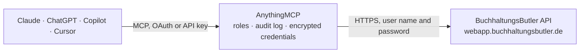

<!-- Generated by scripts/export-github-catalog.mjs in the anythingmcp-website repository. Do not edit by hand. -->

# BuchhaltungsButler MCP connector

BuchhaltungsButler, German automated bookkeeping: postings, receipts, bank transactions, debtors, creditors, posting accounts and cost centres; books receipts and bank transactions. The AnythingMCP connector gives Claude, ChatGPT, Microsoft Copilot, Cursor and Gemini 19 MCP tools for BuchhaltungsButler: 9 read and 10 can change data.

**Category:** [Accounting](../accounting.md) · **Tools:** 19 · **Setup guide:** [anythingmcp.com](https://anythingmcp.com/guides/buchhaltungsbutler-to-mcp) · [Deutsch](https://anythingmcp.com/de/guides/buchhaltungsbutler-to-mcp) · [Italiano](https://anythingmcp.com/it/guides/buchhaltungsbutler-to-mcp) · [Español](https://anythingmcp.com/es/guides/buchhaltungsbutler-to-mcp) · [日本語](https://anythingmcp.com/ja/guides/buchhaltungsbutler-to-mcp) · [Русский](https://anythingmcp.com/ru/guides/buchhaltungsbutler-to-mcp) · [中文](https://anythingmcp.com/zh/guides/buchhaltungsbutler-to-mcp)

## Start without code

No installation and no terminal: AnythingMCP Cloud runs the BuchhaltungsButler connector for you, operated by helpcode.ai in Frankfurt, Germany.

1. **Click the button above** and create an account or sign in. The BuchhaltungsButler connector opens, ready to install.
2. **Paste the API key or token from your BuchhaltungsButler account.** Every click is in the [step-by-step guide](https://anythingmcp.com/guides/buchhaltungsbutler-to-mcp).
3. **Click Install.** AnythingMCP shows the address of your MCP server.
4. **Add that address to your assistant:** [Claude](https://anythingmcp.com/guides/connect-buchhaltungsbutler-to-claude) · [ChatGPT](https://anythingmcp.com/guides/connect-buchhaltungsbutler-to-chatgpt) · [Microsoft Copilot](https://anythingmcp.com/guides/connect-buchhaltungsbutler-to-copilot) · [Cursor](https://anythingmcp.com/guides/connect-buchhaltungsbutler-to-cursor) · [Gemini CLI](https://anythingmcp.com/guides/connect-buchhaltungsbutler-to-gemini) · [Meta Muse](https://anythingmcp.com/guides/connect-buchhaltungsbutler-to-muse).
5. **Ask your first question**, for example: *Find inbound receipt with invoice number INV-2026-089 from Nordwerk GmbH, show status and amount.*

Prefer help with the setup? [Talk to us](https://anythingmcp.com/contact).

## How it works

- **The AI client** speaks MCP (Streamable HTTP) to AnythingMCP and only sees tool names, descriptions and results. It never gets the BuchhaltungsButler credentials.
- **AnythingMCP** checks the client's role, builds the call from the tool definition, adds the credentials (user name and password), calls BuchhaltungsButler, logs the call and returns the result.
- **BuchhaltungsButler** sees an ordinary API client with the rights of the account the credentials belong to.

## Tools

| Tool | What it does | Access |
|---|---|---|
| [`buchhaltungsbutler_list_postings`](#buchhaltungsbutler_list_postings) | List postings (Buchungen) booked between two dates, optionally narrowed to accounts, posting accounts or status. | read |
| [`buchhaltungsbutler_list_receipts`](#buchhaltungsbutler_list_receipts) | List receipts (Belege): inbound supplier invoices or outbound own invoices, with payment status, counterparty and amounts. | read |
| [`buchhaltungsbutler_list_transactions`](#buchhaltungsbutler_list_transactions) | List bank and payment transactions (Umsätze) of the connected accounts. | read |
| [`buchhaltungsbutler_list_customers`](#buchhaltungsbutler_list_customers) | List customers, i.e. debtors (Debitoren), with their posting account number and address. | read |
| [`buchhaltungsbutler_list_suppliers`](#buchhaltungsbutler_list_suppliers) | List suppliers, i.e. creditors (Kreditoren), with their posting account number, address and IBAN. | read |
| [`buchhaltungsbutler_list_accounts`](#buchhaltungsbutler_list_accounts) | List the base accounts (bank accounts, cash, payment providers) set up in BuchhaltungsButler. | read |
| [`buchhaltungsbutler_list_posting_accounts`](#buchhaltungsbutler_list_posting_accounts) | List the chart of accounts (Sachkonten), optionally without debtors, creditors or base accounts. | read |
| [`buchhaltungsbutler_list_cost_locations`](#buchhaltungsbutler_list_cost_locations) | List cost centres (Kostenstellen), or look one up by its code. | read |
| [`buchhaltungsbutler_get_receipt`](#buchhaltungsbutler_get_receipt) | Get one receipt (Beleg) by its id_by_customer with every field, including the foreign-currency amount, currency and exchange rate that the list does not… | read |
| [`buchhaltungsbutler_book_receipt`](#buchhaltungsbutler_book_receipt) | Book a receipt (Beleg): creates postings (Buchungen) in the accounting of the client for an inbound or outbound invoice, one line per posting account with… | write |
| [`buchhaltungsbutler_book_transaction`](#buchhaltungsbutler_book_transaction) | Book a bank transaction: creates postings (Buchungen) for a payment on a financial account, one line per posting account with amount, tax key and text,… | write |
| [`buchhaltungsbutler_remove_receipt_booking`](#buchhaltungsbutler_remove_receipt_booking) | Remove the postings of a receipt by unconfirming them, so the receipt is open for booking again (for example to correct an account or tax key). | write |
| [`buchhaltungsbutler_remove_transaction_booking`](#buchhaltungsbutler_remove_transaction_booking) | Remove the postings of a bank transaction by unconfirming them, so it can be booked again. | write |
| [`buchhaltungsbutler_link_receipt_to_transaction`](#buchhaltungsbutler_link_receipt_to_transaction) | Assign a receipt to a bank transaction (the invoice this payment settles), as the matching in the BuchhaltungsButler web app does. | write |
| [`buchhaltungsbutler_add_customer`](#buchhaltungsbutler_add_customer) | Create a customer as a debtor account (Debitor) in BuchhaltungsButler, with address, VAT id and bank details; BuchhaltungsButler takes the next free debtor… | write |
| [`buchhaltungsbutler_add_supplier`](#buchhaltungsbutler_add_supplier) | Create a supplier as a creditor account (Kreditor) in BuchhaltungsButler, with address, VAT id, bank details and payment term; BuchhaltungsButler takes the… | write |
| [`buchhaltungsbutler_trash_receipt`](#buchhaltungsbutler_trash_receipt) | Mark a receipt as deleted (it moves to the deleted receipts and can be brought back with buchhaltungsbutler_recover_receipt). | write |
| [`buchhaltungsbutler_recover_receipt`](#buchhaltungsbutler_recover_receipt) | Restore a receipt that was marked as deleted, so it is back among the active receipts. | write |
| [`buchhaltungsbutler_reverse_posting`](#buchhaltungsbutler_reverse_posting) | Cancel one posting: an unfixed posting is deleted, a fixed (festgeschrieben) posting is reversed with a counter-posting (Stornobuchung) that stays in the books. | write |

## Tool reference

Every parameter as the AI client sees it in `tools/list`. Source: [`packages/backend/src/adapters/de/buchhaltungsbutler.json`](../../../packages/backend/src/adapters/de/buchhaltungsbutler.json).

### `buchhaltungsbutler_list_postings`

List postings (Buchungen) booked between two dates, optionally narrowed to accounts, posting accounts or status.

**Access:** read · **Call:** `POST /postings/get`

| Parameter | Type | Required | Description |
|---|---|---|---|
| `date_from` | string | yes | Earliest booking date, YYYY-MM-DD. Required. |
| `date_to` | string | yes | Latest booking date, YYYY-MM-DD. Required. |
| `account` | string | no | Comma separated accounts: 'all' (default), 'all financial accounts', 'free booking' or account numbers. |
| `postingaccount` | string | no | Comma separated posting accounts: 'all' (default), 'all postingaccounts', 'all debtors', 'all creditors' or numbers. |
| `posting_status` | string | no | 'all' (default), 'fixed' or 'unfixed'. |
| `order` | string | no | 'date ASC', 'date DESC', 'date_last_action ASC', 'date_last_action DESC', 'id_by_customer ASC' or 'id_by_customer DESC'. |
| `limit` | number | no | Maximum rows to return (up to 1000). |
| `offset` | number | no | Rows to skip, for paging. |

### `buchhaltungsbutler_list_receipts`

List receipts (Belege): inbound supplier invoices or outbound own invoices, with payment status, counterparty and amounts.

**Access:** read · **Call:** `POST /receipts/get`

| Parameter | Type | Required | Description |
|---|---|---|---|
| `list_direction` | `inbound` \| `outbound` | yes | 'inbound' = Eingangsbelege (supplier invoices), 'outbound' = Ausgangsbelege (your invoices). Required. |
| `payment_status` | `paid` \| `unpaid` | no | Only paid or only unpaid receipts. |
| `counterparty` | string | no | Invoicing party (inbound) or recipient (outbound), e.g. 'Peter Maier'. |
| `invoicenumber` | string | no | Only receipts with this invoice number. |
| `date_from` | string | no | Earliest issuing date, YYYY-MM-DD. |
| `date_to` | string | no | Latest issuing date, YYYY-MM-DD. |
| `limit` | number | no | Maximum rows to return (default and maximum 500). |
| `offset` | number | no | Rows to skip, for paging. |
| `deleted` | boolean | no | true returns only receipts marked as deleted (to find one for buchhaltungsbutler_recover_receipt). |

### `buchhaltungsbutler_list_transactions`

List bank and payment transactions (Umsätze) of the connected accounts.

**Access:** read · **Call:** `POST /transactions/get`

| Parameter | Type | Required | Description |
|---|---|---|---|
| `date_from` | string | no | Earliest booking date, YYYY-MM-DD. |
| `date_to` | string | no | Latest booking date, YYYY-MM-DD. |
| `account` | number | no | Only transactions of this account number (see buchhaltungsbutler_list_accounts). |
| `to_from` | string | no | Payer or payee. |
| `limit` | number | no | Maximum rows to return (default and maximum 500). |
| `offset` | number | no | Rows to skip, for paging. |

### `buchhaltungsbutler_list_customers`

List customers, i.e. debtors (Debitoren), with their posting account number and address.

**Access:** read · **Call:** `POST /settings/get/debtors`

| Parameter | Type | Required | Description |
|---|---|---|---|
| `limit` | number | no | Maximum rows to return (default 25). |
| `offset` | number | no | Rows to skip, for paging. |

### `buchhaltungsbutler_list_suppliers`

List suppliers, i.e. creditors (Kreditoren), with their posting account number, address and IBAN.

**Access:** read · **Call:** `POST /settings/get/creditors`

| Parameter | Type | Required | Description |
|---|---|---|---|
| `limit` | number | no | Maximum rows to return (default 25). |
| `offset` | number | no | Rows to skip, for paging. |

### `buchhaltungsbutler_list_accounts`

List the base accounts (bank accounts, cash, payment providers) set up in BuchhaltungsButler.

**Access:** read · **Call:** `POST /accounts/get`

No parameters.

### `buchhaltungsbutler_list_posting_accounts`

List the chart of accounts (Sachkonten), optionally without debtors, creditors or base accounts.

**Access:** read · **Call:** `POST /settings/get/postingaccounts`

| Parameter | Type | Required | Description |
|---|---|---|---|
| `order` | string | no | 'postingaccount_number ASC\|DESC', 'name ASC\|DESC' or 'type ASC\|DESC'. |
| `exclude_debtors` | boolean | no | Leave out debtor accounts. |
| `exclude_creditors` | boolean | no | Leave out creditor accounts. |
| `exclude_accounts` | boolean | no | Leave out base accounts such as bank accounts. |
| `limit` | number | no | Maximum rows to return (default 1000). |
| `offset` | number | no | Rows to skip, for paging. |

### `buchhaltungsbutler_list_cost_locations`

List cost centres (Kostenstellen), or look one up by its code.

**Access:** read · **Call:** `POST /cost-locations/get`

| Parameter | Type | Required | Description |
|---|---|---|---|
| `code` | string | no | Code of one cost centre. |
| `limit` | number | no | Maximum rows to return (up to 1000). |
| `offset` | number | no | Rows to skip, for paging. |

### `buchhaltungsbutler_get_receipt`

Get one receipt (Beleg) by its id_by_customer with every field, including the foreign-currency amount, currency and exchange rate that the list does not return, and optionally the file as base64. Read it before booking a foreign-currency receipt. Read-only, although the API takes it as a POST.

**Access:** read · **Call:** `POST /receipts/get/{id_by_customer}`

| Parameter | Type | Required | Description |
|---|---|---|---|
| `id_by_customer` | string | yes | The receipt's id_by_customer from buchhaltungsbutler_list_receipts. |
| `get_file` | boolean | no | true adds the receipt file as a base64 string (PDF, ZUGFeRD PDF or XRechnung XML). Leave it out unless the file is needed: it is large. |

### `buchhaltungsbutler_book_receipt`

Book a receipt (Beleg): creates postings (Buchungen) in the accounting of the client for an inbound or outbound invoice, one line per posting account with amount, tax key and text. This writes real bookkeeping entries that flow into the VAT return and the DATEV export; they stay changeable until they are fixed (festgeschrieben) and can be removed with buchhaltungsbutler_remove_receipt_booking while unfixed. Works only when creditor or debtor posting is active for the client. For a foreign-currency receipt read it first with buchhaltungsbutler_get_receipt and book the converted amount. Show the user the lines (accounts, amounts, tax keys) and wait for a yes before calling.

**Access:** write · **Call:** `POST /postings/add/receipt`

| Parameter | Type | Required | Description |
|---|---|---|---|
| `receipt_id_by_customer` | integer | yes | The receipt's id_by_customer from buchhaltungsbutler_list_receipts. |
| `postingaccounts` | string[] | yes | Posting account (Gegenkonto) per posting line, e.g. ["4930", "4980"]. One entry per line; buchhaltungsbutler_list_posting_accounts lists the numbers. |
| `amounts` | string[] | yes | Gross amount per line in the format 0000.00, e.g. ["119.00", "23.80"], same order as postingaccounts. The lines must add up to the open amount of the document. |
| `vats` | string[] | yes | Tax key per posting line, same order as postingaccounts. Common keys: 0_none (no VAT), 19_vat / 7_vat (19% / 7% output VAT, Umsatzsteuer), 19_pre / 7_pre (19% / 7% input VAT, Vorsteuer), 19_both_1 (reverse charge §13b 19% USt./VSt.), 19_both_506 (§13b EU), 19_both_511 (§13b third country), 19_both_2 / 7_both (intra-EU acquisition 19% / 7%), 19_pre_app / 7_pre_app (apportioned input VAT). Other documented keys: 19_both_6506, 19_both_6511, 19_both_6501, 19_both_1_no_pre, 19_both_2_no_pre, 7_both_no_pre, 19_both_app_1, 19_both_app_506, 19_both_app_511, 19_both_app_2, 7_both_app. |
| `postingtexts` | string[] | yes | Booking text per line, e.g. ["Büromaterial März"], same order as postingaccounts. |
| `cost_locations` | string[] | no | Cost centre (Kostenstelle 1) per line, same order; from buchhaltungsbutler_list_cost_locations. |
| `cost_locations_two` | string[] | no | Second cost centre (Kostenstelle 2) per line, same order. |
| `creditor` | integer | no | Creditor number (supplier posting account). Needed for an inbound invoice when creditor posting is active; buchhaltungsbutler_list_suppliers lists them. |
| `debtor` | integer | no | Debtor number (customer posting account). Needed for an outbound invoice when debtor posting is active; buchhaltungsbutler_list_customers lists them. |

### `buchhaltungsbutler_book_transaction`

Book a bank transaction: creates postings (Buchungen) for a payment on a financial account, one line per posting account with amount, tax key and text, optionally clearing open-item receipts per line. This writes real bookkeeping entries; they can be removed with buchhaltungsbutler_remove_transaction_booking while unfixed. Use it for payments without a receipt (fees, transfers, salaries) or to split a payment; to settle an invoice by its receipt, buchhaltungsbutler_link_receipt_to_transaction is usually enough. Show the user the lines and wait for a yes before calling.

**Access:** write · **Call:** `POST /postings/add/transaction`

| Parameter | Type | Required | Description |
|---|---|---|---|
| `transaction_id_by_customer` | integer | yes | The transaction's id_by_customer from buchhaltungsbutler_list_transactions. |
| `postingaccounts` | string[] | yes | Posting account (Gegenkonto) per posting line, e.g. ["4930", "4980"]. One entry per line; buchhaltungsbutler_list_posting_accounts lists the numbers. |
| `amounts` | string[] | yes | Gross amount per line in the format 0000.00, e.g. ["119.00", "23.80"], same order as postingaccounts. The lines must add up to the open amount of the document. |
| `vats` | string[] | yes | Tax key per posting line, same order as postingaccounts. Common keys: 0_none (no VAT), 19_vat / 7_vat (19% / 7% output VAT, Umsatzsteuer), 19_pre / 7_pre (19% / 7% input VAT, Vorsteuer), 19_both_1 (reverse charge §13b 19% USt./VSt.), 19_both_506 (§13b EU), 19_both_511 (§13b third country), 19_both_2 / 7_both (intra-EU acquisition 19% / 7%), 19_pre_app / 7_pre_app (apportioned input VAT). Other documented keys: 19_both_6506, 19_both_6511, 19_both_6501, 19_both_1_no_pre, 19_both_2_no_pre, 7_both_no_pre, 19_both_app_1, 19_both_app_506, 19_both_app_511, 19_both_app_2, 7_both_app. |
| `postingtexts` | string[] | yes | Booking text per line, e.g. ["Büromaterial März"], same order as postingaccounts. |
| `cost_locations` | string[] | no | Cost centre (Kostenstelle 1) per line, same order; from buchhaltungsbutler_list_cost_locations. |
| `cost_locations_two` | string[] | no | Second cost centre (Kostenstelle 2) per line, same order. |
| `oi_receipts_ids_by_customer` | string,null[] | no | Only when open-item (OP) posting is active for the client: the receipt id_by_customer each line settles, same order as postingaccounts, null for a line without a receipt, e.g. ["7", null]. |

### `buchhaltungsbutler_remove_receipt_booking`

Remove the postings of a receipt by unconfirming them, so the receipt is open for booking again (for example to correct an account or tax key). Works only while the postings are not fixed (festgeschrieben); fixed postings need a reversal with buchhaltungsbutler_reverse_posting. Confirm with the user first.

**Access:** write · **Call:** `POST /postings/unconfirm/receipt`

| Parameter | Type | Required | Description |
|---|---|---|---|
| `receipt_id_by_customer` | integer | yes | The receipt's id_by_customer. |

### `buchhaltungsbutler_remove_transaction_booking`

Remove the postings of a bank transaction by unconfirming them, so it can be booked again. Works only while the postings are not fixed. Confirm with the user first.

**Access:** write · **Call:** `POST /postings/unconfirm/transaction`

| Parameter | Type | Required | Description |
|---|---|---|---|
| `transaction_id_by_customer` | integer | yes | The transaction's id_by_customer. |

### `buchhaltungsbutler_link_receipt_to_transaction`

Assign a receipt to a bank transaction (the invoice this payment settles), as the matching in the BuchhaltungsButler web app does. Check that amount and counterparty match, and confirm with the user first.

**Access:** write · **Call:** `POST /transactions/assign/receipt`

| Parameter | Type | Required | Description |
|---|---|---|---|
| `transaction_id_by_customer` | integer | yes | The transaction's id_by_customer from buchhaltungsbutler_list_transactions. |
| `receipt_id_by_customer` | integer | yes | The receipt's id_by_customer from buchhaltungsbutler_list_receipts. |

### `buchhaltungsbutler_add_customer`

Create a customer as a debtor account (Debitor) in BuchhaltungsButler, with address, VAT id and bank details; BuchhaltungsButler takes the next free debtor number unless you pass one. Returns the new debtor. Check with buchhaltungsbutler_list_customers that it does not exist yet, and confirm with the user.

**Access:** write · **Call:** `POST /settings/add/debtor`

| Parameter | Type | Required | Description |
|---|---|---|---|
| `name` | string | yes | Name of the customer (debtor). |
| `postingaccount_number` | string | no | Posting account number for the customer (debtor); leave it out to take the next free number. |
| `contact_person_name` | string | no | Contact person. |
| `street` | string | no | Street and house number. |
| `additional_address_line` | string | no | Additional address line. |
| `zip` | string | no | Postal code. |
| `city` | string | no | City. |
| `country` | string | no | Two-letter ISO code (DK) or the German country name (Dänemark). |
| `sales_tax_id` | string | no | VAT identification number (USt-IdNr.). |
| `email` | string | no | E-mail address. |
| `iban` | string | no | IBAN. |
| `bic` | string | no | BIC. |
| `customer_number` | string | no | Your customer number for the debtor. |

### `buchhaltungsbutler_add_supplier`

Create a supplier as a creditor account (Kreditor) in BuchhaltungsButler, with address, VAT id, bank details and payment term; BuchhaltungsButler takes the next free creditor number unless you pass one. Returns the new creditor. Check with buchhaltungsbutler_list_suppliers that it does not exist yet, and confirm with the user.

**Access:** write · **Call:** `POST /settings/add/creditor`

| Parameter | Type | Required | Description |
|---|---|---|---|
| `name` | string | yes | Name of the supplier (creditor). |
| `postingaccount_number` | string | no | Posting account number for the supplier (creditor); leave it out to take the next free number. |
| `contact_person_name` | string | no | Contact person. |
| `street` | string | no | Street and house number. |
| `additional_address_line` | string | no | Additional address line. |
| `zip` | string | no | Postal code. |
| `city` | string | no | City. |
| `country` | string | no | Two-letter ISO code (DK) or the German country name (Dänemark). |
| `sales_tax_id` | string | no | VAT identification number (USt-IdNr.). |
| `email` | string | no | E-mail address. |
| `iban` | string | no | IBAN. |
| `bic` | string | no | BIC. |
| `due_in_days` | integer | no | Payment term in days. |

### `buchhaltungsbutler_trash_receipt`

Mark a receipt as deleted (it moves to the deleted receipts and can be brought back with buchhaltungsbutler_recover_receipt). Name the receipt (number, counterparty, amount) and get a yes first. Installed switched off.

**Access:** write · **Call:** `POST /receipts/delete/{id_by_customer}`

| Parameter | Type | Required | Description |
|---|---|---|---|
| `id_by_customer` | string | yes | The receipt's id_by_customer from buchhaltungsbutler_list_receipts. |

### `buchhaltungsbutler_recover_receipt`

Restore a receipt that was marked as deleted, so it is back among the active receipts. buchhaltungsbutler_list_receipts with deleted=true finds its id_by_customer.

**Access:** write · **Call:** `POST /receipts/restore/{id_by_customer}`

| Parameter | Type | Required | Description |
|---|---|---|---|
| `id_by_customer` | string | yes | The deleted receipt's id_by_customer. |

### `buchhaltungsbutler_reverse_posting`

Cancel one posting: an unfixed posting is deleted, a fixed (festgeschrieben) posting is reversed with a counter-posting (Stornobuchung) that stays in the books. Cannot be undone. Name the posting and get a yes first. Installed switched off.

**Access:** write · **Call:** `POST /postings/cancel`

| Parameter | Type | Required | Description |
|---|---|---|---|
| `posting_id_by_customer` | integer | yes | The posting's id_by_customer from buchhaltungsbutler_list_postings. |

## Run it yourself

AnythingMCP is open source (AGPL-3.0). [Run it with Docker](../../../README.md#run-it-yourself), open **Connectors → Store**, pick **BuchhaltungsButler** and enter `BUCHHALTUNGSBUTLER_CLIENT_ID`, `BUCHHALTUNGSBUTLER_CLIENT_SECRET`, `BUCHHALTUNGSBUTLER_API_KEY`, then add your MCP server URL to the AI client.

[← Accounting connectors](../accounting.md) · [All categories](../README.md)
