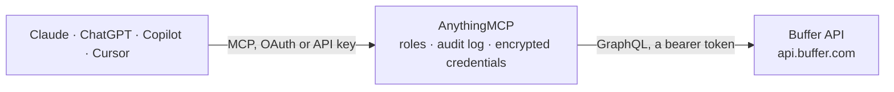

<!-- Generated by scripts/export-github-catalog.mjs in the anythingmcp-website repository. Do not edit by hand. -->

# Buffer MCP connector

Manage Buffer (social media scheduling: organizations, channels, posts, ideas) from any AI agent via Buffer's GraphQL API. 9 tools, API key. The AnythingMCP connector gives Claude, ChatGPT, Microsoft Copilot, Cursor and Gemini 9 MCP tools for Buffer: 4 read and 5 can change data.

**Category:** [Social Media](../social.md) · **Tools:** 9 · **Setup guide:** [anythingmcp.com](https://anythingmcp.com/guides/buffer-to-mcp) · [Deutsch](https://anythingmcp.com/de/guides/buffer-to-mcp) · [Italiano](https://anythingmcp.com/it/guides/buffer-to-mcp) · [Español](https://anythingmcp.com/es/guides/buffer-to-mcp) · [日本語](https://anythingmcp.com/ja/guides/buffer-to-mcp) · [Русский](https://anythingmcp.com/ru/guides/buffer-to-mcp) · [中文](https://anythingmcp.com/zh/guides/buffer-to-mcp)

## Start without code

No installation and no terminal: AnythingMCP Cloud runs the Buffer connector for you, operated by helpcode.ai in Frankfurt, Germany.

1. **Click the button above** and create an account or sign in. The Buffer connector opens, ready to install.
2. **Paste the API key or token from your Buffer account.** Every click is in the [step-by-step guide](https://anythingmcp.com/guides/buffer-to-mcp).
3. **Click Install.** AnythingMCP shows the address of your MCP server.
4. **Add that address to your assistant:** [Claude](https://anythingmcp.com/guides/connect-buffer-to-claude) · [ChatGPT](https://anythingmcp.com/guides/connect-buffer-to-chatgpt) · [Microsoft Copilot](https://anythingmcp.com/guides/connect-buffer-to-copilot) · [Cursor](https://anythingmcp.com/guides/connect-buffer-to-cursor) · [Gemini CLI](https://anythingmcp.com/guides/connect-buffer-to-gemini) · [Meta Muse](https://anythingmcp.com/guides/connect-buffer-to-muse).
5. **Ask your first question**, for example: *Show the LinkedIn post for campaign 'Q4-hire' scheduled 2026-11-05 and its current status.*

Prefer help with the setup? [Talk to us](https://anythingmcp.com/contact).

## How it works

- **The AI client** speaks MCP (Streamable HTTP) to AnythingMCP and only sees tool names, descriptions and results. It never gets the Buffer credentials.
- **AnythingMCP** checks the client's role, builds the call from the tool definition, adds the credentials (a bearer token), calls Buffer, logs the call and returns the result.
- **Buffer** sees an ordinary API client with the rights of the account the credentials belong to.

## Tools

| Tool | What it does | Access |
|---|---|---|
| [`buffer_current_user`](#buffer_current_user) | Return the authenticated Buffer account (id, email, name, timezone) with the organizations it belongs to. | read |
| [`buffer_list_channels`](#buffer_list_channels) | List the connected social channels (X/Twitter, LinkedIn, Instagram, Facebook, Mastodon, Bluesky, Threads, TikTok, Pinterest, YouTube, …) of an organization,… | read |
| [`buffer_list_posts`](#buffer_list_posts) | List posts of an organization, newest page first, optionally filtered by channel IDs and status. | read |
| [`buffer_create_post`](#buffer_create_post) | Create a post on ONE channel: add it to the queue, schedule it for a time, publish it now, or save it as a draft. | write |
| [`buffer_update_post`](#buffer_update_post) | Edit a post that has not been sent yet: text, schedule, media or tags. | write |
| [`buffer_delete_post`](#buffer_delete_post) | Delete a post by ID. | write |
| [`buffer_send_now`](#buffer_send_now) | Publish a queued or scheduled post immediately instead of at its slot. | write |
| [`buffer_list_ideas`](#buffer_list_ideas) | List the ideas (content not yet assigned to a channel) of an organization. | read |
| [`buffer_create_idea`](#buffer_create_idea) | Save an idea in an organization: content you want to publish later, not yet tied to a channel or a time. | write |

## Tool reference

Every parameter as the AI client sees it in `tools/list`. Source: [`packages/backend/src/adapters/intl/buffer.json`](../../../packages/backend/src/adapters/intl/buffer.json).

### `buffer_current_user`

Return the authenticated Buffer account (id, email, name, timezone) with the organizations it belongs to. Start here: every other tool needs an organization ID from this result.

**Access:** read · **Call:** `query query Account { account { id email name timezone organizations { id name channelCount } } }`

No parameters.

### `buffer_list_channels`

List the connected social channels (X/Twitter, LinkedIn, Instagram, Facebook, Mastodon, Bluesky, Threads, TikTok, Pinterest, YouTube, …) of an organization, with their IDs, network, timezone and whether the queue is paused or the channel disconnected.

**Access:** read · **Call:** `query query Channels($organizationId: OrganizationId!) { channels(input: { organizationId: $organizationId }) { id name displayName service descriptor timezone isQueuePaused isDisconnected isLocked } }`

| Parameter | Type | Required | Description |
|---|---|---|---|
| `organization_id` | string | yes | Organization ID, from buffer_current_user (account.organizations[].id). |

### `buffer_list_posts`

List posts of an organization, newest page first, optionally filtered by channel IDs and status. Cursor-paginated: pass pageInfo.endCursor back as after.

**Access:** read · **Call:** `query query Posts($organizationId: OrganizationId!, $channelIds: [ChannelId!], $status: [PostStatus!], $first: Int = 20, $after: String) { posts(first: $first, after: $after, input: { organizationId: $organizationId, filter: { channelIds: $channelIds, status: $status } }) { edges { node { id status text dueAt sentAt createdAt channelId channelService shareMode externalLink error { message } } } pageInfo { endCursor hasNextPage } } }`

| Parameter | Type | Required | Description |
|---|---|---|---|
| `organization_id` | string | yes | Organization ID, from buffer_current_user (account.organizations[].id). |
| `channel_ids` | string[] | no | Only posts on these channel IDs. Omit for every channel. |
| `status` | `draft` \| `needs_approval` \| `scheduled` \| `sending` \| `sent` \| `error`[] | no | Only posts in these statuses, e.g. ["scheduled"]. Omit for all. |
| `first` | integer | no | Page size (default 20). |
| `after` | string | no | Cursor from the previous page (pageInfo.endCursor). |

### `buffer_create_post`

Create a post on ONE channel: add it to the queue, schedule it for a time, publish it now, or save it as a draft. To post the same content to several channels, call once per channel. Returns the post, or a message explaining why Buffer refused it.

**Access:** write · **Call:** `mutation mutation CreatePost($channelId: ChannelId!, $text: String, $mode: ShareMode! = addToQueue, $schedulingType: SchedulingType! = automatic, $dueAt: DateTime, $saveToDraft: Boolean, $assets: [AssetInput!], $tagIds: [TagId!], $metadata: PostInputMetaData) { createPost(input: { channelId: $channelId, text: $text, mode: $mode, schedulingType: $schedulingType, dueAt: $dueAt, saveToDraft: $saveToDraft, assets: $assets, tagIds: $tagIds, metadata: $metadata }) { ... on PostActionSuccess { post { id status dueAt channelId text } } ... on MutationError { message } } }`

| Parameter | Type | Required | Description |
|---|---|---|---|
| `channel_id` | string | yes | Channel ID, from buffer_list_channels. |
| `text` | string | yes | Post text. |
| `mode` | `addToQueue` \| `shareNext` \| `shareNow` \| `customScheduled` | no | How to schedule: addToQueue (next free queue slot), shareNext (top of the queue), shareNow (publish immediately) or customScheduled (at due_at). Default addToQueue. |
| `scheduling_type` | `automatic` \| `notification` | no | automatic (Buffer publishes it, default) or notification (Buffer reminds you to publish it by hand, for networks or formats it cannot post directly). |
| `due_at` | string | no | ISO 8601 UTC time, required with mode customScheduled (e.g. 2026-10-01T09:00:00Z). |
| `save_to_draft` | boolean | no | true saves a draft instead of scheduling it. |
| `assets` | object[] | no | Media to attach, in order. Each entry holds exactly one of image, video or document, e.g. [{"image": {"url": "https://example.com/photo.jpg"}}]. URLs must be publicly reachable. |
| `tag_ids` | string[] | no | Tag IDs to apply. |
| `metadata` | object | no | Network-specific options keyed by network, e.g. {"instagram": {"type": "post", "shouldShareToFeed": true}}. See PostInputMetaData in the Buffer reference. |

### `buffer_update_post`

Edit a post that has not been sent yet: text, schedule, media or tags. Only the fields you pass change; everything omitted is kept as it is.

**Access:** write · **Call:** `mutation mutation EditPost($id: PostId!, $text: String, $mode: ShareMode, $dueAt: DateTime, $saveToDraft: Boolean, $assets: [AssetInput!], $tagIds: [TagId!]) { editPost(input: { id: $id, text: $text, mode: $mode, dueAt: $dueAt, saveToDraft: $saveToDraft, assets: $assets, tagIds: $tagIds }) { ... on PostActionSuccess { post { id status dueAt text } } ... on MutationError { message } } }`

| Parameter | Type | Required | Description |
|---|---|---|---|
| `post_id` | string | yes | Post ID, from buffer_list_posts or buffer_create_post. |
| `text` | string | no | New text. |
| `mode` | `addToQueue` \| `shareNext` \| `shareNow` \| `customScheduled` | no | New scheduling: addToQueue (next free queue slot), shareNext (top of the queue), shareNow (publish immediately) or customScheduled (at due_at). Omit to keep the current schedule. |
| `due_at` | string | no | New ISO 8601 UTC time (with mode customScheduled). |
| `save_to_draft` | boolean | no | true turns the post back into a draft. |
| `assets` | object[] | no | Replaces the whole media list (same shape as in buffer_create_post); [] removes all media. Omit to keep it. |
| `tag_ids` | string[] | no | Replaces the tag list. |

### `buffer_delete_post`

Delete a post by ID. Posts that are publishing or already published may not be deletable; the result then carries a message instead of the deleted ID.

**Access:** write · **Call:** `mutation mutation DeletePost($id: PostId!) { deletePost(input: { id: $id }) { ... on DeletePostSuccess { id } ... on MutationError { message } } }`

| Parameter | Type | Required | Description |
|---|---|---|---|
| `post_id` | string | yes | Post ID to delete. |

### `buffer_send_now`

Publish a queued or scheduled post immediately instead of at its slot. Buffer has no separate send-now call: this edits the post with mode shareNow and leaves everything else unchanged.

**Access:** write · **Call:** `mutation mutation SendNow($id: PostId!) { editPost(input: { id: $id, mode: shareNow }) { ... on PostActionSuccess { post { id status dueAt sentAt } } ... on MutationError { message } } }`

| Parameter | Type | Required | Description |
|---|---|---|---|
| `post_id` | string | yes | Post ID to publish now. |

### `buffer_list_ideas`

List the ideas (content not yet assigned to a channel) of an organization. Cursor-paginated: pass pageInfo.endCursor back as after.

**Access:** read · **Call:** `query query Ideas($organizationId: OrganizationId!, $first: Int = 20, $after: String) { ideas(first: $first, after: $after, input: { organizationId: $organizationId }) { edges { node { id content { title text services date } groupId createdAt updatedAt } } pageInfo { endCursor hasNextPage } } }`

| Parameter | Type | Required | Description |
|---|---|---|---|
| `organization_id` | string | yes | Organization ID, from buffer_current_user (account.organizations[].id). |
| `first` | integer | no | Page size (default 20). |
| `after` | string | no | Cursor from the previous page (pageInfo.endCursor). |

### `buffer_create_idea`

Save an idea in an organization: content you want to publish later, not yet tied to a channel or a time. Turn it into a post later with buffer_create_post.

**Access:** write · **Call:** `mutation mutation CreateIdea($organizationId: ID!, $title: String, $text: String) { createIdea(input: { organizationId: $organizationId, content: { title: $title, text: $text } }) { ... on Idea { id content { title text } } ... on IdeaResponse { idea { id content { title text } } } ... on MutationError { message } } }`

| Parameter | Type | Required | Description |
|---|---|---|---|
| `organization_id` | string | yes | Organization ID, from buffer_current_user (account.organizations[].id). |
| `title` | string | no | Short heading (optional). |
| `text` | string | yes | Body of the idea. |

## Run it yourself

AnythingMCP is open source (AGPL-3.0). [Run it with Docker](../../../README.md#run-it-yourself), open **Connectors → Store**, pick **Buffer** and enter `BUFFER_ACCESS_TOKEN`, then add your MCP server URL to the AI client.

[← Social Media connectors](../social.md) · [All categories](../README.md)
