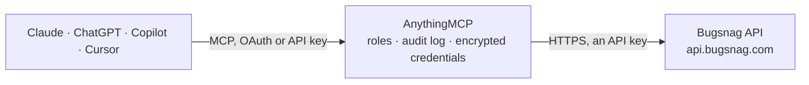

<!-- Generated by scripts/export-github-catalog.mjs in the anythingmcp-website repository. Do not edit by hand. -->

# Bugsnag MCP connector

Read & triage Bugsnag (now SmartBear Insight Hub) errors, projects, organizations, releases, pivots from any AI agent. 9 tools, token auth. The AnythingMCP connector gives Claude, ChatGPT, Microsoft Copilot, Cursor and Gemini 9 MCP tools for Bugsnag: 8 read and 1 can change data.

**Category:** [Monitoring](../monitoring.md) · **Tools:** 9 · **Setup guide:** [anythingmcp.com](https://anythingmcp.com/guides/bugsnag-to-mcp) · [Deutsch](https://anythingmcp.com/de/guides/bugsnag-to-mcp) · [Italiano](https://anythingmcp.com/it/guides/bugsnag-to-mcp) · [Español](https://anythingmcp.com/es/guides/bugsnag-to-mcp) · [日本語](https://anythingmcp.com/ja/guides/bugsnag-to-mcp) · [Русский](https://anythingmcp.com/ru/guides/bugsnag-to-mcp) · [中文](https://anythingmcp.com/zh/guides/bugsnag-to-mcp)

## Start without code

No installation and no terminal: AnythingMCP Cloud runs the Bugsnag connector for you, operated by helpcode.ai in Frankfurt, Germany.

1. **Click the button above** and create an account or sign in. The Bugsnag connector opens, ready to install.
2. **Paste the API key or token from your Bugsnag account.** Every click is in the [step-by-step guide](https://anythingmcp.com/guides/bugsnag-to-mcp).
3. **Click Install.** AnythingMCP shows the address of your MCP server.
4. **Add that address to your assistant:** [Claude](https://anythingmcp.com/guides/connect-bugsnag-to-claude) · [ChatGPT](https://anythingmcp.com/guides/connect-bugsnag-to-chatgpt) · [Microsoft Copilot](https://anythingmcp.com/guides/connect-bugsnag-to-copilot) · [Cursor](https://anythingmcp.com/guides/connect-bugsnag-to-cursor) · [Gemini CLI](https://anythingmcp.com/guides/connect-bugsnag-to-gemini) · [Meta Muse](https://anythingmcp.com/guides/connect-bugsnag-to-muse).
5. **Ask your first question**, for example: *Show status, last_seen and events count for error ERR-4821 in our billing-api project*

Prefer help with the setup? [Talk to us](https://anythingmcp.com/contact).

## How it works

- **The AI client** speaks MCP (Streamable HTTP) to AnythingMCP and only sees tool names, descriptions and results. It never gets the Bugsnag credentials.
- **AnythingMCP** checks the client's role, builds the call from the tool definition, adds the credentials (an API key), calls Bugsnag, logs the call and returns the result.
- **Bugsnag** sees an ordinary API client with the rights of the account the credentials belong to.

## Tools

| Tool | What it does | Access |
|---|---|---|
| [`bugsnag_current_user`](#bugsnag_current_user) | Return the user account the token belongs to: id, name, email, created_at. | read |
| [`bugsnag_list_organizations`](#bugsnag_list_organizations) | List orgs the user belongs to. | read |
| [`bugsnag_list_projects`](#bugsnag_list_projects) | List projects inside an org. | read |
| [`bugsnag_list_errors`](#bugsnag_list_errors) | List errors in a project. | read |
| [`bugsnag_get_error`](#bugsnag_get_error) | Get a single error by ID with its full metadata, severity, status, top stack frame. | read |
| [`bugsnag_list_events`](#bugsnag_list_events) | List events (individual occurrences) for an error. | read |
| [`bugsnag_get_event`](#bugsnag_get_event) | Get a single event by ID — full stack trace, breadcrumbs, user, app, device, request, custom metadata. | read |
| [`bugsnag_update_error`](#bugsnag_update_error) | Update the status/severity of an error: fix, ignore, snooze, reopen, change severity. | write |
| [`bugsnag_list_releases`](#bugsnag_list_releases) | List releases for a project. | read |

## Tool reference

Every parameter as the AI client sees it in `tools/list`. Source: [`packages/backend/src/adapters/intl/bugsnag.json`](../../../packages/backend/src/adapters/intl/bugsnag.json).

### `bugsnag_current_user`

Return the user account the token belongs to: id, name, email, created_at.

**Access:** read · **Call:** `GET /user`

No parameters.

### `bugsnag_list_organizations`

List orgs the user belongs to. Each has id, name, slug, billing/plan info, creator. Most users have exactly one.

**Access:** read · **Call:** `GET /user/organizations`

No parameters.

### `bugsnag_list_projects`

List projects inside an org. Returns id, slug, name, api_key, type (e.g. js, node, ruby), open_error_count, urls.

**Access:** read · **Call:** `GET /organizations/{organization_id}/projects`

| Parameter | Type | Required | Description |
|---|---|---|---|
| `organization_id` | string | yes | Org ID from bugsnag_list_organizations. |
| `per_page` | integer | no | Per page (max 100). |
| `q` | string | no | Optional name filter. |

### `bugsnag_list_errors`

List errors in a project. Errors are deduplicated stack-trace groups. Each has id, error_class, message, context, status (open/fixed/snoozed/ignored), severity, events count, users count, first_seen, last_seen.

**Access:** read · **Call:** `GET /projects/{project_id}/errors`

| Parameter | Type | Required | Description |
|---|---|---|---|
| `project_id` | string | yes | Project ID. |
| `sort` | string | no | first_seen, last_seen, users, events, unsorted. |
| `direction` | string | no | asc / desc. |
| `per_page` | integer | no | Per page (max 30). |
| `filters_status` | string | no | Shortcut filter by status: open, fixed, snoozed, ignored. Internally adds filters[error.status]. |
| `filters_since` | string | no | Shortcut filter by time window, e.g. '7d', '24h', '1m'. Internally adds filters[event.since]. |

### `bugsnag_get_error`

Get a single error by ID with its full metadata, severity, status, top stack frame.

**Access:** read · **Call:** `GET /errors/{error_id}`

| Parameter | Type | Required | Description |
|---|---|---|---|
| `error_id` | string | yes | Error ID. |

### `bugsnag_list_events`

List events (individual occurrences) for an error. Each event has the full stack, breadcrumbs, user context, device info.

**Access:** read · **Call:** `GET /errors/{error_id}/events`

| Parameter | Type | Required | Description |
|---|---|---|---|
| `error_id` | string | yes | Error ID. |
| `per_page` | integer | no | Per page (max 30). |
| `full_reports` | boolean | no | If true, include full stack + breadcrumbs in each event (slower). |

### `bugsnag_get_event`

Get a single event by ID — full stack trace, breadcrumbs, user, app, device, request, custom metadata. This is the most useful tool for debugging.

**Access:** read · **Call:** `GET /projects/{project_id}/events/{event_id}`

| Parameter | Type | Required | Description |
|---|---|---|---|
| `project_id` | string | yes | Project ID. |
| `event_id` | string | yes | Event ID. |

### `bugsnag_update_error`

Update the status/severity of an error: fix, ignore, snooze, reopen, change severity.

**Access:** write · **Call:** `PATCH /errors/{error_id}`

| Parameter | Type | Required | Description |
|---|---|---|---|
| `error_id` | string | yes | Error ID. |
| `operation` | string | yes | fix, snooze, ignore, open, override_severity. |
| `severity` | string | no | If operation=override_severity: error, warning, info. |

### `bugsnag_list_releases`

List releases for a project. Useful for cross-referencing an error spike with a deploy.

**Access:** read · **Call:** `GET /projects/{project_id}/releases`

| Parameter | Type | Required | Description |
|---|---|---|---|
| `project_id` | string | yes | Project ID. |
| `per_page` | integer | no | Per page (max 100). |

## Run it yourself

AnythingMCP is open source (AGPL-3.0). [Run it with Docker](../../../README.md#run-it-yourself), open **Connectors → Store**, pick **Bugsnag** and enter `BUGSNAG_AUTH_TOKEN`, then add your MCP server URL to the AI client.

[← Monitoring connectors](../monitoring.md) · [All categories](../README.md)
