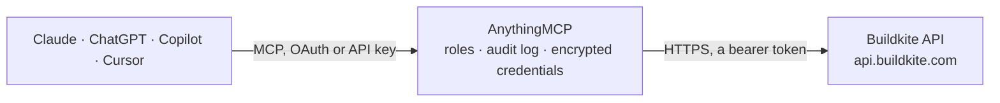

<!-- Generated by scripts/export-github-catalog.mjs in the anythingmcp-website repository. Do not edit by hand. -->

# Buildkite MCP connector

Let your AI check Buildkite: pipelines, builds and jobs, job logs, artifacts and annotations, agents, clusters and queues, and Test Engine flaky and slow tests, and start, rebuild and retry builds or … The AnythingMCP connector gives Claude, ChatGPT, Microsoft Copilot, Cursor and Gemini 34 MCP tools for Buildkite: 27 read and 7 can change data.

**Category:** [Infrastructure](../infrastructure.md) · **Tools:** 34 · **Setup guide:** [anythingmcp.com](https://anythingmcp.com/guides/buildkite-to-mcp) · [Deutsch](https://anythingmcp.com/de/guides/buildkite-to-mcp) · [Italiano](https://anythingmcp.com/it/guides/buildkite-to-mcp) · [Español](https://anythingmcp.com/es/guides/buildkite-to-mcp) · [日本語](https://anythingmcp.com/ja/guides/buildkite-to-mcp) · [Русский](https://anythingmcp.com/ru/guides/buildkite-to-mcp) · [中文](https://anythingmcp.com/zh/guides/buildkite-to-mcp)

## Start without code

No installation and no terminal: AnythingMCP Cloud runs the Buildkite connector for you, operated by helpcode.ai in Frankfurt, Germany.

1. **Click the button above** and create an account or sign in. The Buildkite connector opens, ready to install.
2. **Paste the API key or token from your Buildkite account.** Every click is in the [step-by-step guide](https://anythingmcp.com/guides/buildkite-to-mcp).
3. **Click Install.** AnythingMCP shows the address of your MCP server.
4. **Add that address to your assistant:** [Claude](https://anythingmcp.com/guides/connect-buildkite-to-claude) · [ChatGPT](https://anythingmcp.com/guides/connect-buildkite-to-chatgpt) · [Microsoft Copilot](https://anythingmcp.com/guides/connect-buildkite-to-copilot) · [Cursor](https://anythingmcp.com/guides/connect-buildkite-to-cursor) · [Gemini CLI](https://anythingmcp.com/guides/connect-buildkite-to-gemini) · [Meta Muse](https://anythingmcp.com/guides/connect-buildkite-to-muse).
5. **Ask your first question**, for example: *What's the status and which jobs failed in org 'soluna', pipeline 'deploy-web' build #78?*

Prefer help with the setup? [Talk to us](https://anythingmcp.com/contact).

## How it works

- **The AI client** speaks MCP (Streamable HTTP) to AnythingMCP and only sees tool names, descriptions and results. It never gets the Buildkite credentials.
- **AnythingMCP** checks the client's role, builds the call from the tool definition, adds the credentials (a bearer token), calls Buildkite, logs the call and returns the result.
- **Buildkite** sees an ordinary API client with the rights of the account the credentials belong to.

## Tools

| Tool | What it does | Access |
|---|---|---|
| [`buildkite_get_access_token`](#buildkite_get_access_token) | Read the API access token in use: its scopes, description, expiry and owner. | read |
| [`buildkite_get_current_user`](#buildkite_get_current_user) | Read the Buildkite user the token belongs to: id, name, email and avatar. | read |
| [`buildkite_list_organizations`](#buildkite_list_organizations) | List the organizations the token can reach, with their slug, name and web URL. | read |
| [`buildkite_get_organization`](#buildkite_get_organization) | Read one organization: name, slug, web URL and links to its pipelines and agents. | read |
| [`buildkite_list_pipelines`](#buildkite_list_pipelines) | List the pipelines of an organization: slug, name, repository, default branch, cluster and running and scheduled build counts. | read |
| [`buildkite_get_pipeline`](#buildkite_get_pipeline) | Read one pipeline: repository, default branch, branch filters, cluster, provider settings and its YAML steps configuration. | read |
| [`buildkite_list_builds`](#buildkite_list_builds) | List the builds of a whole organization, newest first: number, state, branch, commit, message, creator, pipeline and times. | read |
| [`buildkite_list_pipeline_builds`](#buildkite_list_pipeline_builds) | List the builds of one pipeline, newest first, with the same filters as buildkite_list_builds. | read |
| [`buildkite_get_build`](#buildkite_get_build) | Read one build by its number: state, branch, commit, message, creator, times, job_state_counts and its jobs with state, exit status, step key, agent and web… | read |
| [`buildkite_list_jobs`](#buildkite_list_jobs) | List the jobs of a build, optionally only some states or one step or group key: id, name, step key, state, exit status, agent and times. | read |
| [`buildkite_get_job`](#buildkite_get_job) | Read one job by id: name, command, state, exit status, signal, agent, retry information, times and web URL. | read |
| [`buildkite_get_job_log`](#buildkite_get_job_log) | Read the end of a job's log as plain text, by default the last 100,000 bytes, where the error usually is. | read |
| [`buildkite_list_build_artifacts`](#buildkite_list_build_artifacts) | List the artifacts uploaded by all jobs of a build: id, job id, path, file size, mime type, state and sha1. | read |
| [`buildkite_list_job_artifacts`](#buildkite_list_job_artifacts) | List the artifacts of one job, with the same fields and filters as buildkite_list_build_artifacts. | read |
| [`buildkite_get_artifact`](#buildkite_get_artifact) | Read one artifact's metadata: path, size, mime type, state, sha1 and its download URL (the file itself opens in the Buildkite app). | read |
| [`buildkite_list_annotations`](#buildkite_list_annotations) | List the annotations of a build: context, style (success, info, warning, error), priority and the rendered HTML body, often a test or coverage summary. | read |
| [`buildkite_list_agents`](#buildkite_list_agents) | List the connected agents of an organization: id, name, hostname, version, queue, tags (meta_data), connection state and the job they run. | read |
| [`buildkite_get_agent`](#buildkite_get_agent) | Read one agent by id, also a disconnected one: connection state, hostname, version, queue, tags, current job and times. | read |
| [`buildkite_list_clusters`](#buildkite_list_clusters) | List the clusters of an organization: id, name, description, default queue and maintainers. | read |
| [`buildkite_get_cluster`](#buildkite_get_cluster) | Read one cluster: name, description, default queue and maintainers. | read |
| [`buildkite_list_cluster_queues`](#buildkite_list_cluster_queues) | List the queues of a cluster: id, key, description, hosted agent settings and whether dispatch is paused. | read |
| [`buildkite_list_test_suites`](#buildkite_list_test_suites) | List the Test Engine suites of an organization: slug, name, default branch and web URL. | read |
| [`buildkite_list_tests`](#buildkite_list_tests) | List the tests of a Test Engine suite with metrics over a time window: reliability, average and total duration, execution counts, labels (such as flaky),… | read |
| [`buildkite_get_test`](#buildkite_get_test) | Read one test of a suite with its duration, reliability and execution metrics and its flakiness scores over a time window. | read |
| [`buildkite_list_test_runs`](#buildkite_list_test_runs) | List the test runs of a suite, newest first: id, branch, commit, result, execution counts by result and the build they belong to. | read |
| [`buildkite_get_test_run`](#buildkite_get_test_run) | Read one test run: state, result, branch, commit, execution counts and times. | read |
| [`buildkite_list_failed_executions`](#buildkite_list_failed_executions) | List the failed test executions of a run: test name and location, failure reason and, with include_failure_expanded, the expanded failure details and backtrace. | read |
| [`buildkite_create_build`](#buildkite_create_build) | Start a new build of a pipeline for a commit and branch. | write |
| [`buildkite_rebuild_build`](#buildkite_rebuild_build) | Run a finished build again as a new build with the same commit, branch and settings, including any deploy steps. | write |
| [`buildkite_retry_failed_jobs`](#buildkite_retry_failed_jobs) | Retry the failed jobs of a build in place, optionally only some failure kinds. | write |
| [`buildkite_retry_job`](#buildkite_retry_job) | Retry one failed, timed out or canceled job; the retry runs as a new job in the same build. | write |
| [`buildkite_unblock_job`](#buildkite_unblock_job) | Unblock a block step (a manual approval, often before a deploy) so the build continues, optionally with values for the step's fields. | write |
| [`buildkite_create_annotation`](#buildkite_create_annotation) | Add an annotation (a Markdown or HTML note shown on the build page) to a build, or append to the one with the same context. | write |
| [`buildkite_cancel_build`](#buildkite_cancel_build) | Cancel a scheduled, running or failing build; its running jobs stop and the rest never run, which can leave a deployment half done. | write |

## Tool reference

Every parameter as the AI client sees it in `tools/list`. Source: [`packages/backend/src/adapters/intl/buildkite.json`](../../../packages/backend/src/adapters/intl/buildkite.json).

### `buildkite_get_access_token`

Read the API access token in use: its scopes, description, expiry and owner. A quick check that the token works and which actions it allows. Read-only.

**Access:** read · **Call:** `GET /v2/access-token`

No parameters.

### `buildkite_get_current_user`

Read the Buildkite user the token belongs to: id, name, email and avatar. Read-only.

**Access:** read · **Call:** `GET /v2/user`

No parameters.

### `buildkite_list_organizations`

List the organizations the token can reach, with their slug, name and web URL. The slug is what every other tool takes as org. Read-only.

**Access:** read · **Call:** `GET /v2/organizations`

| Parameter | Type | Required | Description |
|---|---|---|---|
| `page` | integer | no | Page number, starting at 1. |
| `per_page` | integer | no | Results per page, up to 100. |

### `buildkite_get_organization`

Read one organization: name, slug, web URL and links to its pipelines and agents. Read-only.

**Access:** read · **Call:** `GET /v2/organizations/{org}`

| Parameter | Type | Required | Description |
|---|---|---|---|
| `org` | string | yes | Organization slug from buildkite_list_organizations, as in buildkite.com/<org>, e.g. acme-inc. |

### `buildkite_list_pipelines`

List the pipelines of an organization: slug, name, repository, default branch, cluster and running and scheduled build counts. Filter by part of the name or repository URL. Read-only.

**Access:** read · **Call:** `GET /v2/organizations/{org}/pipelines`

| Parameter | Type | Required | Description |
|---|---|---|---|
| `org` | string | yes | Organization slug from buildkite_list_organizations, as in buildkite.com/<org>, e.g. acme-inc. |
| `name` | string | no | Only pipelines whose name contains this text (case-insensitive). |
| `repository` | string | no | Only pipelines whose repository URL contains this text. |
| `page` | integer | no | Page number, starting at 1. |
| `per_page` | integer | no | Results per page, up to 100. |

### `buildkite_get_pipeline`

Read one pipeline: repository, default branch, branch filters, cluster, provider settings and its YAML steps configuration. Read-only.

**Access:** read · **Call:** `GET /v2/organizations/{org}/pipelines/{pipeline}`

| Parameter | Type | Required | Description |
|---|---|---|---|
| `org` | string | yes | Organization slug from buildkite_list_organizations, as in buildkite.com/<org>, e.g. acme-inc. |
| `pipeline` | string | yes | Pipeline slug from buildkite_list_pipelines, as in buildkite.com/<org>/<pipeline>, e.g. web-app. |

### `buildkite_list_builds`

List the builds of a whole organization, newest first: number, state, branch, commit, message, creator, pipeline and times. Filter by branch, state, commit, creator or dates. Read-only.

**Access:** read · **Call:** `GET /v2/organizations/{org}/builds`

| Parameter | Type | Required | Description |
|---|---|---|---|
| `org` | string | yes | Organization slug from buildkite_list_organizations, as in buildkite.com/<org>, e.g. acme-inc. |
| `branch` | string | no | Only builds on this branch; * works as a wildcard, e.g. main or release/*. |
| `state` | `running` \| `scheduled` \| `passed` \| `failing` \| `failed` \| `blocked` \| `canceling` \| `canceled` \| `skipped` \| `not_run` \| `finished` | no | Only builds in this state: running, scheduled, passed, failing, failed, blocked, canceling, canceled, skipped, not_run, or finished (all completed states). |
| `commit` | string | no | Only builds of this full commit SHA. |
| `creator` | string | no | Only builds created by this user id (UUID). |
| `created_from` | string | no | Only builds created at or after this time, ISO 8601, e.g. 2026-10-01T00:00:00Z. |
| `created_to` | string | no | Only builds created before this time, ISO 8601. |
| `finished_from` | string | no | Only builds finished at or after this time, ISO 8601. |
| `exclude_jobs` | boolean | no | Leave the job list out of each build; default true to keep answers short. Use buildkite_get_build or buildkite_list_jobs for jobs. |
| `exclude_pipeline` | boolean | no | Leave the expanded pipeline out of each build; default true. |
| `page` | integer | no | Page number, starting at 1. |
| `per_page` | integer | no | Results per page, up to 100. |

### `buildkite_list_pipeline_builds`

List the builds of one pipeline, newest first, with the same filters as buildkite_list_builds. Read-only.

**Access:** read · **Call:** `GET /v2/organizations/{org}/pipelines/{pipeline}/builds`

| Parameter | Type | Required | Description |
|---|---|---|---|
| `org` | string | yes | Organization slug from buildkite_list_organizations, as in buildkite.com/<org>, e.g. acme-inc. |
| `pipeline` | string | yes | Pipeline slug from buildkite_list_pipelines, as in buildkite.com/<org>/<pipeline>, e.g. web-app. |
| `branch` | string | no | Only builds on this branch; * works as a wildcard, e.g. main or release/*. |
| `state` | `running` \| `scheduled` \| `passed` \| `failing` \| `failed` \| `blocked` \| `canceling` \| `canceled` \| `skipped` \| `not_run` \| `finished` | no | Only builds in this state: running, scheduled, passed, failing, failed, blocked, canceling, canceled, skipped, not_run, or finished (all completed states). |
| `commit` | string | no | Only builds of this full commit SHA. |
| `creator` | string | no | Only builds created by this user id (UUID). |
| `created_from` | string | no | Only builds created at or after this time, ISO 8601, e.g. 2026-10-01T00:00:00Z. |
| `created_to` | string | no | Only builds created before this time, ISO 8601. |
| `finished_from` | string | no | Only builds finished at or after this time, ISO 8601. |
| `exclude_jobs` | boolean | no | Leave the job list out of each build; default true to keep answers short. Use buildkite_get_build or buildkite_list_jobs for jobs. |
| `exclude_pipeline` | boolean | no | Leave the expanded pipeline out of each build; default true. |
| `page` | integer | no | Page number, starting at 1. |
| `per_page` | integer | no | Results per page, up to 100. |

### `buildkite_get_build`

Read one build by its number: state, branch, commit, message, creator, times, job_state_counts and its jobs with state, exit status, step key, agent and web URL. Read-only.

**Access:** read · **Call:** `GET /v2/organizations/{org}/pipelines/{pipeline}/builds/{number}`

| Parameter | Type | Required | Description |
|---|---|---|---|
| `org` | string | yes | Organization slug from buildkite_list_organizations, as in buildkite.com/<org>, e.g. acme-inc. |
| `pipeline` | string | yes | Pipeline slug from buildkite_list_pipelines, as in buildkite.com/<org>/<pipeline>, e.g. web-app. |
| `number` | integer | yes | Build number as shown in the app (#123), not the build UUID. |
| `include_retried_jobs` | boolean | no | Also list earlier attempts of retried jobs. |
| `exclude_pipeline` | boolean | no | Leave the expanded pipeline out; default true. |

### `buildkite_list_jobs`

List the jobs of a build, optionally only some states or one step or group key: id, name, step key, state, exit status, agent and times. Use it to find the failed job of a big build. Read-only.

**Access:** read · **Call:** `GET /v2/organizations/{org}/pipelines/{pipeline}/builds/{number}/jobs`

| Parameter | Type | Required | Description |
|---|---|---|---|
| `org` | string | yes | Organization slug from buildkite_list_organizations, as in buildkite.com/<org>, e.g. acme-inc. |
| `pipeline` | string | yes | Pipeline slug from buildkite_list_pipelines, as in buildkite.com/<org>/<pipeline>, e.g. web-app. |
| `number` | integer | yes | Build number as shown in the app (#123), not the build UUID. |
| `state` | string | no | Only jobs in this state, e.g. failed, running, blocked, passed, canceled, timed_out. Sent as state[]. |
| `step_key` | string | no | Only jobs of the step with this key. |
| `group_key` | string | no | Only jobs of the group step with this key. |
| `include_retried_jobs` | boolean | no | false to show only the latest attempt of each step. Default true. |
| `per_page` | integer | no | Results per page, up to 100. |
| `after` | string | no | Cursor for the next page, from the next link in _pagination. |

### `buildkite_get_job`

Read one job by id: name, command, state, exit status, signal, agent, retry information, times and web URL. Read-only.

**Access:** read · **Call:** `GET /v2/organizations/{org}/jobs/{job_id}`

| Parameter | Type | Required | Description |
|---|---|---|---|
| `org` | string | yes | Organization slug from buildkite_list_organizations, as in buildkite.com/<org>, e.g. acme-inc. |
| `job_id` | string | yes | Job id (a UUID) from buildkite_get_build or buildkite_list_jobs. |

### `buildkite_get_job_log`

Read the end of a job's log as plain text, by default the last 100,000 bytes, where the error usually is. Raise tail_bytes for more. Log lines can contain ANSI colour codes. Read-only.

**Access:** read · **Call:** `GET /v2/organizations/{org}/jobs/{job_id}/log`

| Parameter | Type | Required | Description |
|---|---|---|---|
| `org` | string | yes | Organization slug from buildkite_list_organizations, as in buildkite.com/<org>, e.g. acme-inc. |
| `job_id` | string | yes | Job id (a UUID) from buildkite_get_build or buildkite_list_jobs. |
| `tail_bytes` | integer | no | How many bytes from the end of the log to return. |

### `buildkite_list_build_artifacts`

List the artifacts uploaded by all jobs of a build: id, job id, path, file size, mime type, state and sha1. Filter by state or path glob. Read-only.

**Access:** read · **Call:** `GET /v2/organizations/{org}/pipelines/{pipeline}/builds/{number}/artifacts`

| Parameter | Type | Required | Description |
|---|---|---|---|
| `org` | string | yes | Organization slug from buildkite_list_organizations, as in buildkite.com/<org>, e.g. acme-inc. |
| `pipeline` | string | yes | Pipeline slug from buildkite_list_pipelines, as in buildkite.com/<org>/<pipeline>, e.g. web-app. |
| `number` | integer | yes | Build number as shown in the app (#123), not the build UUID. |
| `state` | `new` \| `error` \| `finished` \| `deleted` \| `expired` | no | Only artifacts in this state. |
| `path` | string | no | Only artifacts at this path; * works as a wildcard, e.g. coverage/*. |
| `page` | integer | no | Page number, starting at 1. |
| `per_page` | integer | no | Results per page, up to 100. |

### `buildkite_list_job_artifacts`

List the artifacts of one job, with the same fields and filters as buildkite_list_build_artifacts. Read-only.

**Access:** read · **Call:** `GET /v2/organizations/{org}/jobs/{job_id}/artifacts`

| Parameter | Type | Required | Description |
|---|---|---|---|
| `org` | string | yes | Organization slug from buildkite_list_organizations, as in buildkite.com/<org>, e.g. acme-inc. |
| `job_id` | string | yes | Job id (a UUID) from buildkite_get_build or buildkite_list_jobs. |
| `state` | `new` \| `error` \| `finished` \| `deleted` \| `expired` | no | Only artifacts in this state. |
| `path` | string | no | Only artifacts at this path; * works as a wildcard. |
| `page` | integer | no | Page number, starting at 1. |
| `per_page` | integer | no | Results per page, up to 100. |

### `buildkite_get_artifact`

Read one artifact's metadata: path, size, mime type, state, sha1 and its download URL (the file itself opens in the Buildkite app). Read-only.

**Access:** read · **Call:** `GET /v2/organizations/{org}/jobs/{job_id}/artifacts/{artifact_id}`

| Parameter | Type | Required | Description |
|---|---|---|---|
| `org` | string | yes | Organization slug from buildkite_list_organizations, as in buildkite.com/<org>, e.g. acme-inc. |
| `job_id` | string | yes | Job id (a UUID) from buildkite_get_build or buildkite_list_jobs. |
| `artifact_id` | string | yes | Artifact id from buildkite_list_job_artifacts or buildkite_list_build_artifacts. |

### `buildkite_list_annotations`

List the annotations of a build: context, style (success, info, warning, error), priority and the rendered HTML body, often a test or coverage summary. Read-only.

**Access:** read · **Call:** `GET /v2/organizations/{org}/pipelines/{pipeline}/builds/{number}/annotations`

| Parameter | Type | Required | Description |
|---|---|---|---|
| `org` | string | yes | Organization slug from buildkite_list_organizations, as in buildkite.com/<org>, e.g. acme-inc. |
| `pipeline` | string | yes | Pipeline slug from buildkite_list_pipelines, as in buildkite.com/<org>/<pipeline>, e.g. web-app. |
| `number` | integer | yes | Build number as shown in the app (#123), not the build UUID. |
| `scope` | `build` \| `job` \| `all` | no | build (default), job, or all. |
| `omit_body` | boolean | no | true to leave the HTML bodies out. |
| `page` | integer | no | Page number, starting at 1. |
| `per_page` | integer | no | Results per page, up to 100. |

### `buildkite_list_agents`

List the connected agents of an organization: id, name, hostname, version, queue, tags (meta_data), connection state and the job they run. Read-only.

**Access:** read · **Call:** `GET /v2/organizations/{org}/agents`

| Parameter | Type | Required | Description |
|---|---|---|---|
| `org` | string | yes | Organization slug from buildkite_list_organizations, as in buildkite.com/<org>, e.g. acme-inc. |
| `name` | string | no | Only agents with this name. |
| `hostname` | string | no | Only agents on this hostname. |
| `version` | string | no | Only agents of this exact version, e.g. 3.80.0. |
| `cluster_queue_id` | string | no | Only agents of this cluster queue (UUID). |
| `page` | integer | no | Page number, starting at 1. |
| `per_page` | integer | no | Results per page, up to 100. |

### `buildkite_get_agent`

Read one agent by id, also a disconnected one: connection state, hostname, version, queue, tags, current job and times. Read-only.

**Access:** read · **Call:** `GET /v2/organizations/{org}/agents/{agent_id}`

| Parameter | Type | Required | Description |
|---|---|---|---|
| `org` | string | yes | Organization slug from buildkite_list_organizations, as in buildkite.com/<org>, e.g. acme-inc. |
| `agent_id` | string | yes | Agent id (UUID) from buildkite_list_agents. |

### `buildkite_list_clusters`

List the clusters of an organization: id, name, description, default queue and maintainers. Read-only.

**Access:** read · **Call:** `GET /v2/organizations/{org}/clusters`

| Parameter | Type | Required | Description |
|---|---|---|---|
| `org` | string | yes | Organization slug from buildkite_list_organizations, as in buildkite.com/<org>, e.g. acme-inc. |
| `page` | integer | no | Page number, starting at 1. |
| `per_page` | integer | no | Results per page, up to 100. |

### `buildkite_get_cluster`

Read one cluster: name, description, default queue and maintainers. Read-only.

**Access:** read · **Call:** `GET /v2/organizations/{org}/clusters/{cluster_id}`

| Parameter | Type | Required | Description |
|---|---|---|---|
| `org` | string | yes | Organization slug from buildkite_list_organizations, as in buildkite.com/<org>, e.g. acme-inc. |
| `cluster_id` | string | yes | Cluster id (UUID) from buildkite_list_clusters. |

### `buildkite_list_cluster_queues`

List the queues of a cluster: id, key, description, hosted agent settings and whether dispatch is paused. Read-only.

**Access:** read · **Call:** `GET /v2/organizations/{org}/clusters/{cluster_id}/queues`

| Parameter | Type | Required | Description |
|---|---|---|---|
| `org` | string | yes | Organization slug from buildkite_list_organizations, as in buildkite.com/<org>, e.g. acme-inc. |
| `cluster_id` | string | yes | Cluster id (UUID) from buildkite_list_clusters. |
| `page` | integer | no | Page number, starting at 1. |
| `per_page` | integer | no | Results per page, up to 100. |

### `buildkite_list_test_suites`

List the Test Engine suites of an organization: slug, name, default branch and web URL. Read-only.

**Access:** read · **Call:** `GET /v2/analytics/organizations/{org}/suites`

| Parameter | Type | Required | Description |
|---|---|---|---|
| `org` | string | yes | Organization slug from buildkite_list_organizations, as in buildkite.com/<org>, e.g. acme-inc. |

### `buildkite_list_tests`

List the tests of a Test Engine suite with metrics over a time window: reliability, average and total duration, execution counts, labels (such as flaky), state and owners. Sort by reliability ascending to find flaky tests. Read-only.

**Access:** read · **Call:** `GET /v2/analytics/organizations/{org}/suites/{suite}/tests`

| Parameter | Type | Required | Description |
|---|---|---|---|
| `org` | string | yes | Organization slug from buildkite_list_organizations, as in buildkite.com/<org>, e.g. acme-inc. |
| `suite` | string | yes | Test suite slug from buildkite_list_test_suites. |
| `period` | string | no | Window such as 7days or 28days. Do not combine with min_timestamp or max_timestamp. |
| `min_timestamp` | string | no | Window start, RFC 3339, e.g. 2026-10-01T00:00:00Z. |
| `max_timestamp` | string | no | Window end, RFC 3339; defaults to now. |
| `branch` | string | no | Only executions on this branch; !main excludes it, feature* matches a prefix. |
| `labels` | string | no | Comma-separated labels; ! excludes one, e.g. flaky,!slow. |
| `state` | `enabled` \| `muted` \| `skipped` | no | Only tests in this state. |
| `sort_by` | `duration_avg` \| `duration_sum` \| `duration_min` \| `duration_max` \| `reliability` | no | Metric to sort by; default duration_avg. |
| `order` | `asc` \| `desc` | no | asc or desc (default). |
| `min_executions` | integer | no | Only tests with at least this many executions in the window. |
| `page` | integer | no | Page number, starting at 1. |
| `per_page` | integer | no | Results per page, up to 100. |

### `buildkite_get_test`

Read one test of a suite with its duration, reliability and execution metrics and its flakiness scores over a time window. Read-only.

**Access:** read · **Call:** `GET /v2/analytics/organizations/{org}/suites/{suite}/tests/{test_id}`

| Parameter | Type | Required | Description |
|---|---|---|---|
| `org` | string | yes | Organization slug from buildkite_list_organizations, as in buildkite.com/<org>, e.g. acme-inc. |
| `suite` | string | yes | Test suite slug from buildkite_list_test_suites. |
| `test_id` | string | yes | Test id from buildkite_list_tests. |
| `period` | string | no | Window such as 7days or 28days. |
| `min_timestamp` | string | no | Window start, RFC 3339. |
| `max_timestamp` | string | no | Window end, RFC 3339. |

### `buildkite_list_test_runs`

List the test runs of a suite, newest first: id, branch, commit, result, execution counts by result and the build they belong to. Filter by build UUID. Read-only.

**Access:** read · **Call:** `GET /v2/analytics/organizations/{org}/suites/{suite}/runs`

| Parameter | Type | Required | Description |
|---|---|---|---|
| `org` | string | yes | Organization slug from buildkite_list_organizations, as in buildkite.com/<org>, e.g. acme-inc. |
| `suite` | string | yes | Test suite slug from buildkite_list_test_suites. |
| `build_id` | string | no | Only runs of this build (the build UUID id field, not the number). |
| `page` | integer | no | Page number, starting at 1. |
| `per_page` | integer | no | Results per page, up to 100. |

### `buildkite_get_test_run`

Read one test run: state, result, branch, commit, execution counts and times. Read-only.

**Access:** read · **Call:** `GET /v2/analytics/organizations/{org}/suites/{suite}/runs/{run_id}`

| Parameter | Type | Required | Description |
|---|---|---|---|
| `org` | string | yes | Organization slug from buildkite_list_organizations, as in buildkite.com/<org>, e.g. acme-inc. |
| `suite` | string | yes | Test suite slug from buildkite_list_test_suites. |
| `run_id` | string | yes | Run id from buildkite_list_test_runs. |

### `buildkite_list_failed_executions`

List the failed test executions of a run: test name and location, failure reason and, with include_failure_expanded, the expanded failure details and backtrace. Read-only.

**Access:** read · **Call:** `GET /v2/analytics/organizations/{org}/suites/{suite}/runs/{run_id}/failed_executions`

| Parameter | Type | Required | Description |
|---|---|---|---|
| `org` | string | yes | Organization slug from buildkite_list_organizations, as in buildkite.com/<org>, e.g. acme-inc. |
| `suite` | string | yes | Test suite slug from buildkite_list_test_suites. |
| `run_id` | string | yes | Run id from buildkite_list_test_runs. |
| `include_failure_expanded` | boolean | no | true to include the expanded failure output. |
| `page` | integer | no | Page number, starting at 1. |
| `per_page` | integer | no | Results per page, up to 100. |

### `buildkite_create_build`

Start a new build of a pipeline for a commit and branch. It runs the pipeline's steps, including any deploy steps, on your agents. Tell the user the pipeline, branch, commit and environment and call after the user agrees. Returns the new build with its number and web URL.

**Access:** write · **Call:** `POST /v2/organizations/{org}/pipelines/{pipeline}/builds`

| Parameter | Type | Required | Description |
|---|---|---|---|
| `org` | string | yes | Organization slug from buildkite_list_organizations, as in buildkite.com/<org>, e.g. acme-inc. |
| `pipeline` | string | yes | Pipeline slug from buildkite_list_pipelines, as in buildkite.com/<org>/<pipeline>, e.g. web-app. |
| `commit` | string | yes | Ref, SHA or tag to build, e.g. HEAD. |
| `branch` | string | yes | Branch the commit belongs to, e.g. main. Branch filters of the pipeline and its steps apply to it. |
| `message` | string | no | Build message shown in Buildkite. |
| `env` | object | no | Environment variables for the build, e.g. {"DEPLOY": "false"}. |
| `meta_data` | object | no | Build meta-data, e.g. {"release": "2026.10"}. |
| `clean_checkout` | boolean | no | true to force a fresh checkout on the agent. |
| `ignore_pipeline_branch_filters` | boolean | no | true to build even if the pipeline's branch filter would skip this branch (step filters still apply). |
| `author` | object | no | Who the build is shown as created by, {"name": "...", "email": "..."}; default the token's user. |
| `pull_request_id` | integer | no | For a pull request build: the pull request number. |
| `pull_request_base_branch` | string | no | For a pull request build: its base branch. |
| `pull_request_repository` | string | no | For a pull request build from a fork: the fork's git repository URL. |

### `buildkite_rebuild_build`

Run a finished build again as a new build with the same commit, branch and settings, including any deploy steps. Tell the user which build and call after the user agrees. Returns the new build.

**Access:** write · **Call:** `PUT /v2/organizations/{org}/pipelines/{pipeline}/builds/{number}/rebuild`

| Parameter | Type | Required | Description |
|---|---|---|---|
| `org` | string | yes | Organization slug from buildkite_list_organizations, as in buildkite.com/<org>, e.g. acme-inc. |
| `pipeline` | string | yes | Pipeline slug from buildkite_list_pipelines, as in buildkite.com/<org>/<pipeline>, e.g. web-app. |
| `number` | integer | yes | Build number as shown in the app (#123), not the build UUID. |

### `buildkite_retry_failed_jobs`

Retry the failed jobs of a build in place, optionally only some failure kinds. Tell the user which build and call after the user agrees.

**Access:** write · **Call:** `PUT /v2/organizations/{org}/pipelines/{pipeline}/builds/{number}/retry_failed_jobs`

| Parameter | Type | Required | Description |
|---|---|---|---|
| `org` | string | yes | Organization slug from buildkite_list_organizations, as in buildkite.com/<org>, e.g. acme-inc. |
| `pipeline` | string | yes | Pipeline slug from buildkite_list_pipelines, as in buildkite.com/<org>/<pipeline>, e.g. web-app. |
| `number` | integer | yes | Build number as shown in the app (#123), not the build UUID. |
| `states` | string | no | Comma-separated failure kinds to retry: canceled, expired, failed, soft_failed, timed_out. Empty retries every retryable failure. |

### `buildkite_retry_job`

Retry one failed, timed out or canceled job; the retry runs as a new job in the same build. Tell the user which job and call after the user agrees.

**Access:** write · **Call:** `PUT /v2/organizations/{org}/jobs/{job_id}/retry`

| Parameter | Type | Required | Description |
|---|---|---|---|
| `org` | string | yes | Organization slug from buildkite_list_organizations, as in buildkite.com/<org>, e.g. acme-inc. |
| `job_id` | string | yes | Job id (a UUID) from buildkite_get_build or buildkite_list_jobs. |

### `buildkite_unblock_job`

Unblock a block step (a manual approval, often before a deploy) so the build continues, optionally with values for the step's fields. This approves whatever comes next. Tell the user which build and step and call only after the user explicitly agrees.

**Access:** write · **Call:** `PUT /v2/organizations/{org}/jobs/{job_id}/unblock`

| Parameter | Type | Required | Description |
|---|---|---|---|
| `org` | string | yes | Organization slug from buildkite_list_organizations, as in buildkite.com/<org>, e.g. acme-inc. |
| `job_id` | string | yes | Job id of the blocked step (type manual, state blocked) from buildkite_list_jobs. |
| `fields` | object | no | Values for the block step's fields, keyed by field key, e.g. {"release-name": "2026.10"}. |

### `buildkite_create_annotation`

Add an annotation (a Markdown or HTML note shown on the build page) to a build, or append to the one with the same context. Call after the user agrees.

**Access:** write · **Call:** `POST /v2/organizations/{org}/pipelines/{pipeline}/builds/{number}/annotations`

| Parameter | Type | Required | Description |
|---|---|---|---|
| `org` | string | yes | Organization slug from buildkite_list_organizations, as in buildkite.com/<org>, e.g. acme-inc. |
| `pipeline` | string | yes | Pipeline slug from buildkite_list_pipelines, as in buildkite.com/<org>/<pipeline>, e.g. web-app. |
| `number` | integer | yes | Build number as shown in the app (#123), not the build UUID. |
| `body` | string | yes | Annotation text in Markdown or HTML. |
| `style` | `success` \| `info` \| `warning` \| `error` | no | Box style; default default. |
| `context` | string | no | Name that identifies the annotation on this build, e.g. ai-summary. One annotation per context. |
| `append` | boolean | no | true to append body to the annotation with the same context instead of replacing it. |
| `priority` | integer | no | 1 to 10; higher shows first. Default 3. |

### `buildkite_cancel_build`

Cancel a scheduled, running or failing build; its running jobs stop and the rest never run, which can leave a deployment half done. It cannot be resumed, only rebuilt. Tell the user which build and call after the user agrees.

**Access:** write · **Call:** `PUT /v2/organizations/{org}/pipelines/{pipeline}/builds/{number}/cancel`

| Parameter | Type | Required | Description |
|---|---|---|---|
| `org` | string | yes | Organization slug from buildkite_list_organizations, as in buildkite.com/<org>, e.g. acme-inc. |
| `pipeline` | string | yes | Pipeline slug from buildkite_list_pipelines, as in buildkite.com/<org>/<pipeline>, e.g. web-app. |
| `number` | integer | yes | Build number as shown in the app (#123), not the build UUID. |

## Run it yourself

AnythingMCP is open source (AGPL-3.0). [Run it with Docker](../../../README.md#run-it-yourself), open **Connectors → Store**, pick **Buildkite** and enter `BUILDKITE_API_TOKEN`, then add your MCP server URL to the AI client.

[← Infrastructure connectors](../infrastructure.md) · [All categories](../README.md)
