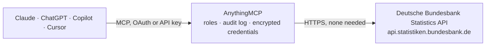

<!-- Generated by scripts/export-github-catalog.mjs in the anythingmcp-website repository. Do not edit by hand. -->

# Deutsche Bundesbank Statistics MCP connector

Access macroeconomic data, exchange rates, interest rates, and financial statistics from the Deutsche Bundesbank via the SDMX REST API. The AnythingMCP connector gives Claude, ChatGPT, Microsoft Copilot, Cursor and Gemini 3 MCP tools for Deutsche Bundesbank Statistics, all read-only.

**Category:** [Finance](../finance.md) · **Tools:** 3 · **Setup guide:** [anythingmcp.com](https://anythingmcp.com/guides/bundesbank-to-mcp) · [Deutsch](https://anythingmcp.com/de/guides/bundesbank-to-mcp) · [Italiano](https://anythingmcp.com/it/guides/bundesbank-to-mcp) · [Español](https://anythingmcp.com/es/guides/bundesbank-to-mcp) · [日本語](https://anythingmcp.com/ja/guides/bundesbank-to-mcp) · [Русский](https://anythingmcp.com/ru/guides/bundesbank-to-mcp) · [中文](https://anythingmcp.com/zh/guides/bundesbank-to-mcp)

## Start without code

No installation and no terminal: AnythingMCP Cloud runs the Deutsche Bundesbank Statistics connector for you, operated by helpcode.ai in Frankfurt, Germany.

1. **Click the button above** and create an account or sign in. The Deutsche Bundesbank Statistics connector opens, ready to install.
2. **Nothing to enter:** this connector needs no credentials. Every click is in the [step-by-step guide](https://anythingmcp.com/guides/bundesbank-to-mcp).
3. **Click Install.** AnythingMCP shows the address of your MCP server.
4. **Add that address to your assistant:** [Claude](https://anythingmcp.com/guides/connect-bundesbank-to-claude) · [ChatGPT](https://anythingmcp.com/guides/connect-bundesbank-to-chatgpt) · [Microsoft Copilot](https://anythingmcp.com/guides/connect-bundesbank-to-copilot) · [Cursor](https://anythingmcp.com/guides/connect-bundesbank-to-cursor) · [Gemini CLI](https://anythingmcp.com/guides/connect-bundesbank-to-gemini) · [Meta Muse](https://anythingmcp.com/guides/connect-bundesbank-to-muse).
5. **Ask your first question**, for example: *Give me EUR per USD on 2026-10-15 for invoice conversion (we need EUR amount).*

Prefer help with the setup? [Talk to us](https://anythingmcp.com/contact).

## How it works

- **The AI client** speaks MCP (Streamable HTTP) to AnythingMCP and only sees tool names, descriptions and results. It never gets the Deutsche Bundesbank Statistics credentials.
- **AnythingMCP** checks the client's role, builds the call from the tool definition, adds the credentials (none needed), calls Deutsche Bundesbank Statistics, logs the call and returns the result.
- **Deutsche Bundesbank Statistics** sees an ordinary API client with the rights of the account the credentials belong to.

## Tools

| Tool | What it does | Access |
|---|---|---|
| [`bundesbank_get_exchange_rates`](#bundesbank_get_exchange_rates) | Daily euro foreign exchange reference rates (ECB/Bundesbank) for one currency against EUR. | read |
| [`bundesbank_get_bund_yields`](#bundesbank_get_bund_yields) | Daily yield of German federal securities (Bunds) for a given residual maturity, from the Bundesbank term-structure statistics (BBSIS). | read |
| [`bundesbank_get_timeseries`](#bundesbank_get_timeseries) | Fetch any Bundesbank time series by SDMX dataflow and series key. | read |

## Tool reference

Every parameter as the AI client sees it in `tools/list`. Source: [`packages/backend/src/adapters/de/bundesbank.json`](../../../packages/backend/src/adapters/de/bundesbank.json).

### `bundesbank_get_exchange_rates`

Daily euro foreign exchange reference rates (ECB/Bundesbank) for one currency against EUR. Pass startPeriod to limit the range — the full history is very large.

**Access:** read · **Call:** `GET /data/BBEX3/D.{currency}.EUR.BB.AC.000`

| Parameter | Type | Required | Description |
|---|---|---|---|
| `currency` | string | yes | ISO 4217 currency code (e.g. 'USD', 'GBP', 'CHF', 'JPY'). Use 'USD' for EUR/USD rate. |
| `startPeriod` | string | no | Start date in YYYY-MM-DD format (e.g. '2024-01-01') |
| `endPeriod` | string | no | End date in YYYY-MM-DD format (e.g. '2024-12-31') |

### `bundesbank_get_bund_yields`

Daily yield of German federal securities (Bunds) for a given residual maturity, from the Bundesbank term-structure statistics (BBSIS). Use as the risk-free EUR rate. Returns SDMX-JSON.

**Access:** read · **Call:** `GET /data/BBSIS/D.I.ZAR.ZI.EUR.S1311.B.A604.R{maturityYears}XX.R.A.A._Z._Z.A`

| Parameter | Type | Required | Description |
|---|---|---|---|
| `maturityYears` | `01` \| `02` \| `05` \| `10` \| `30` | yes | Residual maturity in years, two digits: 01, 02, 05, 10 or 30. |
| `startPeriod` | string | no | First day, YYYY-MM-DD (e.g. 2026-01-01). The series is daily, so 2026-01 returns HTTP 400. Omit for the full history, which is large. |
| `endPeriod` | string | no | Last day, YYYY-MM-DD. |

### `bundesbank_get_timeseries`

Fetch any Bundesbank time series by SDMX dataflow and series key. Examples: flow BBEX3 + key D.USD.EUR.BB.AC.000 (EUR/USD reference rate, daily); flow BBSIS + key D.I.ZAR.ZI.EUR.S1311.B.A604.R10XX.R.A.A._Z._Z.A (10-year Bund yield, daily). Returns SDMX-JSON; observations are under data.dataSets[0].series.

**Access:** read · **Call:** `GET /data/{flow}/{key}`

| Parameter | Type | Required | Description |
|---|---|---|---|
| `flow` | string | yes | Dataflow id, e.g. BBEX3, BBSIS, BBAF3, BBFI1. |
| `key` | string | yes | Dot-separated series key within the flow, e.g. D.USD.EUR.BB.AC.000. |
| `startPeriod` | string | no | First period, e.g. 2026-01-01 (daily) or 2026-01 (monthly). Omit for the full history — can be large. |
| `endPeriod` | string | no | Last period, same format as startPeriod. |

## Run it yourself

AnythingMCP is open source (AGPL-3.0). [Run it with Docker](../../../README.md#run-it-yourself), open **Connectors → Store**, pick **Deutsche Bundesbank Statistics**, then add your MCP server URL to the AI client.

[← Finance connectors](../finance.md) · [All categories](../README.md)
