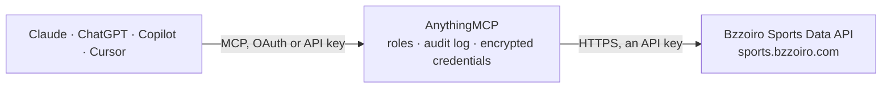

<!-- Generated by scripts/export-github-catalog.mjs in the anythingmcp-website repository. Do not edit by hand. -->

# Bzzoiro Sports Data MCP connector

Football data from Bzzoiro Sports Data: leagues, standings and leaderboards, fixtures and live scores, lineups, goals and match statistics, teams, squads and form, players and their match stats, … The AnythingMCP connector gives Claude, ChatGPT, Microsoft Copilot, Cursor and Gemini 25 MCP tools for Bzzoiro Sports Data, all read-only.

**Category:** [Sports](../sports.md) · **Tools:** 25 · **Setup guide:** [anythingmcp.com](https://anythingmcp.com/guides/bzzoiro-to-mcp) · [Deutsch](https://anythingmcp.com/de/guides/bzzoiro-to-mcp) · [Italiano](https://anythingmcp.com/it/guides/bzzoiro-to-mcp) · [Español](https://anythingmcp.com/es/guides/bzzoiro-to-mcp) · [日本語](https://anythingmcp.com/ja/guides/bzzoiro-to-mcp) · [Русский](https://anythingmcp.com/ru/guides/bzzoiro-to-mcp) · [中文](https://anythingmcp.com/zh/guides/bzzoiro-to-mcp)

## Start without code

No installation and no terminal: AnythingMCP Cloud runs the Bzzoiro Sports Data connector for you, operated by helpcode.ai in Frankfurt, Germany.

1. **Click the button above** and create an account or sign in. The Bzzoiro Sports Data connector opens, ready to install.
2. **Paste the API key or token from your Bzzoiro Sports Data account.** Every click is in the [step-by-step guide](https://anythingmcp.com/guides/bzzoiro-to-mcp).
3. **Click Install.** AnythingMCP shows the address of your MCP server.
4. **Add that address to your assistant:** [Claude](https://anythingmcp.com/guides/connect-bzzoiro-to-claude) · [ChatGPT](https://anythingmcp.com/guides/connect-bzzoiro-to-chatgpt) · [Microsoft Copilot](https://anythingmcp.com/guides/connect-bzzoiro-to-copilot) · [Cursor](https://anythingmcp.com/guides/connect-bzzoiro-to-cursor) · [Gemini CLI](https://anythingmcp.com/guides/connect-bzzoiro-to-gemini) · [Meta Muse](https://anythingmcp.com/guides/connect-bzzoiro-to-muse).
5. **Ask your first question.**

Prefer help with the setup? [Talk to us](https://anythingmcp.com/contact).

## How it works

- **The AI client** speaks MCP (Streamable HTTP) to AnythingMCP and only sees tool names, descriptions and results. It never gets the Bzzoiro Sports Data credentials.
- **AnythingMCP** checks the client's role, builds the call from the tool definition, adds the credentials (an API key), calls Bzzoiro Sports Data, logs the call and returns the result.
- **Bzzoiro Sports Data** sees an ordinary API client with the rights of the account the credentials belong to.

## Tools

| Tool | What it does | Access |
|---|---|---|
| [`bzzoiro_list_leagues`](#bzzoiro_list_leagues) | List the football leagues and cups Bzzoiro covers: id, name, country, whether it is a women's competition and the current season. | read |
| [`bzzoiro_get_league`](#bzzoiro_get_league) | Get one league or cup: name, country, women's or men's, whether it is active, and its current season. | read |
| [`bzzoiro_list_league_seasons`](#bzzoiro_list_league_seasons) | List the seasons of a league that carry data, newest first, with their ids and stages (group-stage, league-phase, regular-season, knockout rounds). | read |
| [`bzzoiro_get_standings`](#bzzoiro_get_standings) | Get the league table for a season (current season by default): position, played, won, drawn, lost, goals and points per team. | read |
| [`bzzoiro_get_league_leaders`](#bzzoiro_get_league_leaders) | Rank the players of a league season by one statistic: top scorers, assists, yellow cards, red cards or fouls (current season by default). | read |
| [`bzzoiro_list_matches`](#bzzoiro_list_matches) | Search football matches (fixtures and results) by league, season, team, status or kick-off window: teams, kick-off time (UTC), status, score, round and stage. | read |
| [`bzzoiro_list_live_matches`](#bzzoiro_list_live_matches) | List the matches being played right now (from five minutes before kick-off until shortly after the final whistle) with score, minute and status. | read |
| [`bzzoiro_get_match`](#bzzoiro_get_match) | Get one match: teams, coaches, referee and venue ids, kick-off (UTC), status, minute, score with half-time, extra-time and penalties, round, stage,… | read |
| [`bzzoiro_get_match_lineups`](#bzzoiro_get_match_lineups) | Get the lineups of a match: formation, starting XI and substitutes per team. | read |
| [`bzzoiro_get_match_incidents`](#bzzoiro_get_match_incidents) | Get every incident of a match in order: goals with scorer and assist, cards, substitutions, VAR decisions, with minute and side (is_home). | read |
| [`bzzoiro_get_match_stats`](#bzzoiro_get_match_stats) | Get the team statistics of a match: possession, shots, expected goals (xG), passes, corners, fouls and more, plus shot map, momentum and average positions. | read |
| [`bzzoiro_get_match_player_stats`](#bzzoiro_get_match_player_stats) | Get per-player statistics for the whole matchday squad of a match: minutes, rating, goals, assists, shots, passes, tackles and more. | read |
| [`bzzoiro_get_head_to_head`](#bzzoiro_get_head_to_head) | Get the head-to-head record of the two teams of a match, oriented so that home is this match's home team: wins, draws, goals and their recent meetings. | read |
| [`bzzoiro_get_match_outlook`](#bzzoiro_get_match_outlook) | Get Bzzoiro's statistical outlook for a match from its machine-learning model: home, draw and away probabilities (0-100) with the most likely result,… | read |
| [`bzzoiro_list_teams`](#bzzoiro_list_teams) | Search teams by name, country, league or season: id, name, short name, country and venue id. | read |
| [`bzzoiro_get_team`](#bzzoiro_get_team) | Get one team: name, short name, country and venue id. | read |
| [`bzzoiro_list_team_fixtures`](#bzzoiro_list_team_fixtures) | List a team's matches. | read |
| [`bzzoiro_get_team_squad`](#bzzoiro_get_team_squad) | Get a team's current squad ordered by position and shirt number, with each player's availability, injury type and expected return. | read |
| [`bzzoiro_get_team_form`](#bzzoiro_get_team_form) | Get a team's form over its last N finished matches, already averaged: results, goals, points per match and the mean of every statistic, split by home and away. | read |
| [`bzzoiro_list_players`](#bzzoiro_list_players) | Search players by name (accent-insensitive), club, national team, nationality or position: id, name, position, club, nationality, date of birth. | read |
| [`bzzoiro_get_player`](#bzzoiro_get_player) | Get one player's profile: name, position, shirt number, date of birth, height, preferred foot, nationality, club and national team, contract end, estimated… | read |
| [`bzzoiro_list_player_match_stats`](#bzzoiro_list_player_match_stats) | List a player's statistics match by match (minutes, rating, goals, assists, shots, passes, duels), filtered by season, league, team or date range. | read |
| [`bzzoiro_list_managers`](#bzzoiro_list_managers) | Search football managers (head coaches) by name, club, league or nationality, with their match record and tactical profile. | read |
| [`bzzoiro_get_manager`](#bzzoiro_get_manager) | Get one manager: country, current club id, tactical profile, preferred formation, matches, wins, draws, losses, win rate, average goals scored and conceded,… | read |
| [`bzzoiro_list_broadcasts`](#bzzoiro_list_broadcasts) | List which TV channels show which matches, ordered by kick-off, by country, team, league or match. | read |

## Tool reference

Every parameter as the AI client sees it in `tools/list`. Source: [`packages/backend/src/adapters/intl/bzzoiro.json`](../../../packages/backend/src/adapters/intl/bzzoiro.json).

### `bzzoiro_list_leagues`

List the football leagues and cups Bzzoiro covers: id, name, country, whether it is a women's competition and the current season. Only active competitions unless include_inactive is true. Start here to find a league id. Unknown filters are refused with 400.

**Access:** read · **Call:** `GET /leagues/`

| Parameter | Type | Required | Description |
|---|---|---|---|
| `country` | string | no | Country name, case-insensitive exact match (e.g. England, Spain, Portugal). |
| `is_women` | boolean | no | true for women's competitions, false for men's. |
| `include_inactive` | boolean | no | true to also list competitions that are no longer active. |
| `limit` | integer | no | Page size (default 50, max 200). |
| `offset` | integer | no | Items to skip. Page with offset while `next` in the answer is not null. |

### `bzzoiro_get_league`

Get one league or cup: name, country, women's or men's, whether it is active, and its current season.

**Access:** read · **Call:** `GET /leagues/{league_id}/`

| Parameter | Type | Required | Description |
|---|---|---|---|
| `league_id` | integer | yes | League id from bzzoiro_list_leagues. |

### `bzzoiro_list_league_seasons`

List the seasons of a league that carry data, newest first, with their ids and stages (group-stage, league-phase, regular-season, knockout rounds). Use a season id to read past standings, matches or leaders.

**Access:** read · **Call:** `GET /leagues/{league_id}/seasons/`

| Parameter | Type | Required | Description |
|---|---|---|---|
| `league_id` | integer | yes | League id from bzzoiro_list_leagues. |

### `bzzoiro_get_standings`

Get the league table for a season (current season by default): position, played, won, drawn, lost, goals and points per team. Cups answer with a `groups` map, leagues with a flat `standings` list.

**Access:** read · **Call:** `GET /leagues/{league_id}/standings/`

| Parameter | Type | Required | Description |
|---|---|---|---|
| `league_id` | integer | yes | League id from bzzoiro_list_leagues. |
| `season_id` | integer | no | Season id; defaults to the current season. |

### `bzzoiro_get_league_leaders`

Rank the players of a league season by one statistic: top scorers, assists, yellow cards, red cards or fouls (current season by default). With team_id the ranking covers one squad only.

**Access:** read · **Call:** `GET /leagues/{league_id}/top/{stat}/`

| Parameter | Type | Required | Description |
|---|---|---|---|
| `league_id` | integer | yes | League id from bzzoiro_list_leagues. |
| `stat` | `scorers` \| `assists` \| `yellowcards` \| `redcards` \| `fouls` | yes | Which leaderboard: scorers (goals), assists, yellowcards, redcards or fouls. |
| `season_id` | integer | no | Season id; defaults to the current season. |
| `team_id` | integer | no | Rank only this team's players. |
| `limit` | integer | no | Players to return (default 20, max 50). |

### `bzzoiro_list_matches`

Search football matches (fixtures and results) by league, season, team, status or kick-off window: teams, kick-off time (UTC), status, score, round and stage. Without filters it lists every match, so narrow with league_id plus a date range or a season. Lineups and statistics are separate calls.

**Access:** read · **Call:** `GET /events/`

| Parameter | Type | Required | Description |
|---|---|---|---|
| `league_id` | integer | no | League id from bzzoiro_list_leagues. |
| `season_id` | integer | no | Season id from bzzoiro_list_league_seasons. |
| `team_id` | integer | no | Matches where this team played home or away. |
| `team_name` | string | no | Partial, case-insensitive match on the home or away team name. |
| `status` | `notstarted` \| `inprogress` \| `1st_half` \| `halftime` \| `2nd_half` \| `extratime` \| `penalties` \| `finished` \| `aet` \| `postponed` \| `delayed` \| `cancelled` \| `unresolved` | no | Only matches with this status. |
| `date_from` | string | no | Kick-off on or after this moment: ISO 8601 UTC (2026-04-30T00:00:00Z) or a date (2026-04-30). |
| `date_to` | string | no | Kick-off on or before this moment: ISO 8601 UTC (2026-04-30T23:59:59Z) or a date (2026-04-30). |
| `stage` | string | no | Competition stage slug, e.g. regular-season, group-stage, league-phase, round-of-16, final (see the stages in bzzoiro_list_league_seasons). |
| `round` | integer | no | Matchday within `stage`; needs stage. |
| `limit` | integer | no | Page size (default 50, max 200). |
| `offset` | integer | no | Items to skip. Page with offset while `next` in the answer is not null. |

### `bzzoiro_list_live_matches`

List the matches being played right now (from five minutes before kick-off until shortly after the final whistle) with score, minute and status. Refreshed about every 30 seconds; do not poll more often than every 10 seconds.

**Access:** read · **Call:** `GET /events/live/`

| Parameter | Type | Required | Description |
|---|---|---|---|
| `league_id` | integer | no | League id from bzzoiro_list_leagues. |
| `season_id` | integer | no | Season id from bzzoiro_list_league_seasons. |
| `team_id` | integer | no | Team id from bzzoiro_list_teams or any match. |
| `limit` | integer | no | Page size (default 50, max 200). |
| `offset` | integer | no | Items to skip. Page with offset while `next` in the answer is not null. |

### `bzzoiro_get_match`

Get one match: teams, coaches, referee and venue ids, kick-off (UTC), status, minute, score with half-time, extra-time and penalties, round, stage, attendance, weather and a short head-to-head summary.

**Access:** read · **Call:** `GET /events/{match_id}/`

| Parameter | Type | Required | Description |
|---|---|---|---|
| `match_id` | integer | yes | Match (event) id from bzzoiro_list_matches, bzzoiro_list_live_matches or bzzoiro_list_team_fixtures. |

### `bzzoiro_get_match_lineups`

Get the lineups of a match: formation, starting XI and substitutes per team. `lineup_status` says whether they are confirmed (about an hour before kick-off) or projected by Bzzoiro's model before that.

**Access:** read · **Call:** `GET /events/{match_id}/lineups/`

| Parameter | Type | Required | Description |
|---|---|---|---|
| `match_id` | integer | yes | Match (event) id from bzzoiro_list_matches, bzzoiro_list_live_matches or bzzoiro_list_team_fixtures. |

### `bzzoiro_get_match_incidents`

Get every incident of a match in order: goals with scorer and assist, cards, substitutions, VAR decisions, with minute and side (is_home). This is where the goalscorers are.

**Access:** read · **Call:** `GET /events/{match_id}/incidents/`

| Parameter | Type | Required | Description |
|---|---|---|---|
| `match_id` | integer | yes | Match (event) id from bzzoiro_list_matches, bzzoiro_list_live_matches or bzzoiro_list_team_fixtures. |

### `bzzoiro_get_match_stats`

Get the team statistics of a match: possession, shots, expected goals (xG), passes, corners, fouls and more, plus shot map, momentum and average positions. Flags say which xG values are estimated.

**Access:** read · **Call:** `GET /events/{match_id}/stats/`

| Parameter | Type | Required | Description |
|---|---|---|---|
| `match_id` | integer | yes | Match (event) id from bzzoiro_list_matches, bzzoiro_list_live_matches or bzzoiro_list_team_fixtures. |

### `bzzoiro_get_match_player_stats`

Get per-player statistics for the whole matchday squad of a match: minutes, rating, goals, assists, shots, passes, tackles and more. Unused substitutes come back with 0 minutes.

**Access:** read · **Call:** `GET /events/{match_id}/player-stats/`

| Parameter | Type | Required | Description |
|---|---|---|---|
| `match_id` | integer | yes | Match (event) id from bzzoiro_list_matches, bzzoiro_list_live_matches or bzzoiro_list_team_fixtures. |

### `bzzoiro_get_head_to_head`

Get the head-to-head record of the two teams of a match, oriented so that home is this match's home team: wins, draws, goals and their recent meetings.

**Access:** read · **Call:** `GET /events/{match_id}/h2h/`

| Parameter | Type | Required | Description |
|---|---|---|---|
| `match_id` | integer | yes | Match (event) id from bzzoiro_list_matches, bzzoiro_list_live_matches or bzzoiro_list_team_fixtures. |

### `bzzoiro_get_match_outlook`

Get Bzzoiro's statistical outlook for a match from its machine-learning model: home, draw and away probabilities (0-100) with the most likely result, expected goals per team, the most likely scoreline and the model's confidence. A model estimate, not a certainty.

**Access:** read · **Call:** `GET /events/{match_id}/prediction/`

| Parameter | Type | Required | Description |
|---|---|---|---|
| `match_id` | integer | yes | Match (event) id from bzzoiro_list_matches, bzzoiro_list_live_matches or bzzoiro_list_team_fixtures. |

### `bzzoiro_list_teams`

Search teams by name, country, league or season: id, name, short name, country and venue id. Use it to find a team id.

**Access:** read · **Call:** `GET /teams/`

| Parameter | Type | Required | Description |
|---|---|---|---|
| `name` | string | no | Partial, case-insensitive match on the team name. |
| `country_code` | string | no | ISO 3166-1 alpha-2 country code, e.g. PT, ES, BR. |
| `league_id` | integer | no | Teams with at least one match in this league. |
| `season_id` | integer | no | Teams that played in this season. |
| `in_competition` | boolean | no | true for teams with upcoming matches in the league; needs league_id. |
| `is_women` | boolean | no | Women's or men's teams; needs league_id or season_id. |
| `limit` | integer | no | Page size (default 50, max 200). |
| `offset` | integer | no | Items to skip. Page with offset while `next` in the answer is not null. |

### `bzzoiro_get_team`

Get one team: name, short name, country and venue id. Use bzzoiro_get_team_squad for players and bzzoiro_list_managers with team_id for the coach.

**Access:** read · **Call:** `GET /teams/{team_id}/`

| Parameter | Type | Required | Description |
|---|---|---|---|
| `team_id` | integer | yes | Team id from bzzoiro_list_teams or any match. |

### `bzzoiro_list_team_fixtures`

List a team's matches. Without dates it returns the window from three hours ago to seven days ahead (recent and next fixtures); pass date_from and date_to for other periods.

**Access:** read · **Call:** `GET /teams/{team_id}/fixtures/`

| Parameter | Type | Required | Description |
|---|---|---|---|
| `team_id` | integer | yes | Team id from bzzoiro_list_teams or any match. |
| `date_from` | string | no | Kick-off on or after this moment: ISO 8601 UTC (2026-04-30T00:00:00Z) or a date (2026-04-30). |
| `date_to` | string | no | Kick-off on or before this moment: ISO 8601 UTC (2026-04-30T23:59:59Z) or a date (2026-04-30). |
| `league_id` | integer | no | Only matches in this league. |
| `status` | `notstarted` \| `inprogress` \| `1st_half` \| `halftime` \| `2nd_half` \| `extratime` \| `penalties` \| `finished` \| `aet` \| `postponed` \| `delayed` \| `cancelled` \| `unresolved` | no | Only matches with this status. |
| `limit` | integer | no | Page size (default 50, max 200). |
| `offset` | integer | no | Items to skip. Page with offset while `next` in the answer is not null. |

### `bzzoiro_get_team_squad`

Get a team's current squad ordered by position and shirt number, with each player's availability, injury type and expected return.

**Access:** read · **Call:** `GET /teams/{team_id}/squad/`

| Parameter | Type | Required | Description |
|---|---|---|---|
| `team_id` | integer | yes | Team id from bzzoiro_list_teams or any match. |

### `bzzoiro_get_team_form`

Get a team's form over its last N finished matches, already averaged: results, goals, points per match and the mean of every statistic, split by home and away. Each statistic carries its own `matches` count.

**Access:** read · **Call:** `GET /teams/{team_id}/form/`

| Parameter | Type | Required | Description |
|---|---|---|---|
| `team_id` | integer | yes | Team id from bzzoiro_list_teams or any match. |
| `last` | integer | no | Window size, 1-40 matches (default 10). |
| `league_id` | integer | no | Only matches of this competition (recommended for league form). |
| `venue` | `all` \| `home` \| `away` | no | Only home or away matches in the window (default all). |

### `bzzoiro_list_players`

Search players by name (accent-insensitive), club, national team, nationality or position: id, name, position, club, nationality, date of birth.

**Access:** read · **Call:** `GET /players/`

| Parameter | Type | Required | Description |
|---|---|---|---|
| `name` | string | no | Partial match on name or short name; accents optional (gyokeres finds Gyökeres). |
| `team_id` | integer | no | Current club id. |
| `national_team_id` | integer | no | National team id. |
| `nationality_code` | string | no | ISO 3166-1 alpha-2 nationality code, e.g. PT. |
| `position` | `G` \| `D` \| `M` \| `F` \| `GK` \| `CB` \| `LB` \| `RB` \| `LWB` \| `RWB` \| `DM` \| `CM` \| `AM` \| `LM` \| `RM` \| `LW` \| `RW` \| `SS` \| `ST` | no | Generic (G, D, M, F) or specific position code. |
| `limit` | integer | no | Page size (default 50, max 200). |
| `offset` | integer | no | Items to skip. Page with offset while `next` in the answer is not null. |

### `bzzoiro_get_player`

Get one player's profile: name, position, shirt number, date of birth, height, preferred foot, nationality, club and national team, contract end, estimated market value, availability and injury, plus attribute ratings, strengths and weaknesses.

**Access:** read · **Call:** `GET /players/{player_id}/`

| Parameter | Type | Required | Description |
|---|---|---|---|
| `player_id` | integer | yes | Player id from bzzoiro_list_players or a squad. |

### `bzzoiro_list_player_match_stats`

List a player's statistics match by match (minutes, rating, goals, assists, shots, passes, duels), filtered by season, league, team or date range.

**Access:** read · **Call:** `GET /players/{player_id}/stats/`

| Parameter | Type | Required | Description |
|---|---|---|---|
| `player_id` | integer | yes | Player id. |
| `season_id` | integer | no | Season id from bzzoiro_list_league_seasons. |
| `league_id` | integer | no | League id from bzzoiro_list_leagues. |
| `team_id` | integer | no | Only matches played for this team. |
| `date_from` | string | no | Kick-off on or after this moment: ISO 8601 UTC (2026-04-30T00:00:00Z) or a date (2026-04-30). |
| `date_to` | string | no | Kick-off on or before this moment: ISO 8601 UTC (2026-04-30T23:59:59Z) or a date (2026-04-30). |
| `limit` | integer | no | Page size (default 50, max 200). |
| `offset` | integer | no | Items to skip. Page with offset while `next` in the answer is not null. |

### `bzzoiro_list_managers`

Search football managers (head coaches) by name, club, league or nationality, with their match record and tactical profile.

**Access:** read · **Call:** `GET /managers/`

| Parameter | Type | Required | Description |
|---|---|---|---|
| `name` | string | no | Partial, case-insensitive match on the name. |
| `team_id` | integer | no | Manager currently at this club. |
| `league_id` | integer | no | Managers who coached at least one match in this league. |
| `nationality_code` | string | no | ISO 3166-1 alpha-2 code. |
| `limit` | integer | no | Page size (default 50, max 200). |
| `offset` | integer | no | Items to skip. Page with offset while `next` in the answer is not null. |

### `bzzoiro_get_manager`

Get one manager: country, current club id, tactical profile, preferred formation, matches, wins, draws, losses, win rate, average goals scored and conceded, possession and clean-sheet rate.

**Access:** read · **Call:** `GET /managers/{manager_id}/`

| Parameter | Type | Required | Description |
|---|---|---|---|
| `manager_id` | integer | yes | Manager id from bzzoiro_list_managers or a match. |

### `bzzoiro_list_broadcasts`

List which TV channels show which matches, ordered by kick-off, by country, team, league or match. Without dates it covers three hours ago to seven days ahead.

**Access:** read · **Call:** `GET /broadcasts/`

| Parameter | Type | Required | Description |
|---|---|---|---|
| `match_id` | integer | no | Only this match. |
| `team_id` | integer | no | Matches of this team. |
| `league_id` | integer | no | League id from bzzoiro_list_leagues. |
| `country_code` | string | no | ISO 3166-1 alpha-2 country of the channel, e.g. GB, PT. |
| `date_from` | string | no | Kick-off on or after this moment: ISO 8601 UTC (2026-04-30T00:00:00Z) or a date (2026-04-30). |
| `date_to` | string | no | Kick-off on or before this moment: ISO 8601 UTC (2026-04-30T23:59:59Z) or a date (2026-04-30). |
| `limit` | integer | no | Page size (default 50, max 200). |
| `offset` | integer | no | Items to skip. Page with offset while `next` in the answer is not null. |

## Run it yourself

AnythingMCP is open source (AGPL-3.0). [Run it with Docker](../../../README.md#run-it-yourself), open **Connectors → Store**, pick **Bzzoiro Sports Data** and enter `BZZOIRO_API_KEY`, then add your MCP server URL to the AI client.

[← Sports connectors](../sports.md) · [All categories](../README.md)
