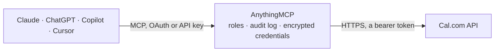

<!-- Generated by scripts/export-github-catalog.mjs in the anythingmcp-website repository. Do not edit by hand. -->

# Cal.com MCP connector

Read a Cal.com scheduling account from Claude, ChatGPT or Copilot: event types, bookings with attendees, Cal Video recordings and transcripts, free time slots, availability schedules and connected calendars. The AnythingMCP connector gives Claude, ChatGPT, Microsoft Copilot, Cursor and Gemini 15 MCP tools for Cal.com: 12 read and 3 can change data.

**Category:** [Scheduling](../scheduling.md) · **Tools:** 15 · **Setup guide:** [anythingmcp.com](https://anythingmcp.com/guides/calcom-to-mcp) · [Deutsch](https://anythingmcp.com/de/guides/calcom-to-mcp) · [Italiano](https://anythingmcp.com/it/guides/calcom-to-mcp) · [Español](https://anythingmcp.com/es/guides/calcom-to-mcp) · [日本語](https://anythingmcp.com/ja/guides/calcom-to-mcp) · [Русский](https://anythingmcp.com/ru/guides/calcom-to-mcp) · [中文](https://anythingmcp.com/zh/guides/calcom-to-mcp)

## Start without code

No installation and no terminal: AnythingMCP Cloud runs the Cal.com connector for you, operated by helpcode.ai in Frankfurt, Germany.

1. **Click the button above** and create an account or sign in. The Cal.com connector opens, ready to install.
2. **Paste the API key or token from your Cal.com account.** Every click is in the [step-by-step guide](https://anythingmcp.com/guides/calcom-to-mcp).
3. **Click Install.** AnythingMCP shows the address of your MCP server.
4. **Add that address to your assistant:** [Claude](https://anythingmcp.com/guides/connect-calcom-to-claude) · [ChatGPT](https://anythingmcp.com/guides/connect-calcom-to-chatgpt) · [Microsoft Copilot](https://anythingmcp.com/guides/connect-calcom-to-copilot) · [Cursor](https://anythingmcp.com/guides/connect-calcom-to-cursor) · [Gemini CLI](https://anythingmcp.com/guides/connect-calcom-to-gemini) · [Meta Muse](https://anythingmcp.com/guides/connect-calcom-to-muse).
5. **Ask your first question**, for example: *Find booking details for attendee emma.lopez@novara.ltd this month, I need the meeting URL and host.*

Prefer help with the setup? [Talk to us](https://anythingmcp.com/contact).

## How it works

- **The AI client** speaks MCP (Streamable HTTP) to AnythingMCP and only sees tool names, descriptions and results. It never gets the Cal.com credentials.
- **AnythingMCP** checks the client's role, builds the call from the tool definition, adds the credentials (a bearer token), calls Cal.com, logs the call and returns the result.
- **Cal.com** sees an ordinary API client with the rights of the account the credentials belong to.

## Tools

| Tool | What it does | Access |
|---|---|---|
| [`calcom_get_me`](#calcom_get_me) | Read the Cal.com user the API key belongs to: id, username, email, name, time zone, week start, time format and default schedule id. | read |
| [`calcom_list_event_types`](#calcom_list_event_types) | List event types (the bookable meeting templates): id, title, slug, lengthInMinutes, description, locations, booking fields, buffers, minimum notice,… | read |
| [`calcom_get_event_type`](#calcom_get_event_type) | Get one event type by its numeric id with all settings: length and allowed durations, locations, booking fields, buffers, booking window, limits, seats,… | read |
| [`calcom_list_bookings`](#calcom_list_bookings) | List bookings the key owner can see (as organizer, host or team admin), with uid, title, status, start and end, duration, event type, location or meeting… | read |
| [`calcom_get_booking`](#calcom_get_booking) | Get one booking by uid: status, start and end, event type, location or meeting URL, hosts, attendees, guests, booking field answers, cancellation or… | read |
| [`calcom_get_booking_recordings`](#calcom_get_booking_recordings) | List the Cal Video recordings of a booking with their download links. | read |
| [`calcom_get_booking_transcripts`](#calcom_get_booking_transcripts) | Get download links for the Cal Video transcripts of a booking (made when someone clicked Transcribe during the call). | read |
| [`calcom_get_available_slots`](#calcom_get_available_slots) | Get the free time slots of an event type between two dates, after calendars, buffers, minimum notice and limits are applied. | read |
| [`calcom_list_schedules`](#calcom_list_schedules) | List the key owner's availability schedules: id, name, time zone, whether it is the default, weekly availability (days with start and end times) and date… | read |
| [`calcom_get_default_schedule`](#calcom_get_default_schedule) | Get the key owner's default availability schedule: time zone, weekly working hours and date overrides. | read |
| [`calcom_get_schedule`](#calcom_get_schedule) | Get one availability schedule by id: name, time zone, weekly availability and date overrides. | read |
| [`calcom_list_calendars`](#calcom_list_calendars) | List the calendars connected to the key owner's Cal.com account (Google, Outlook, Apple, CalDAV) with the ones checked for conflicts and the destination… | read |
| [`calcom_create_booking`](#calcom_create_booking) | Book a meeting on an event type for an attendee. | write |
| [`calcom_reschedule_booking`](#calcom_reschedule_booking) | Move a booking to a new start time. | write |
| [`calcom_cancel_booking`](#calcom_cancel_booking) | Cancel a booking. | write |

## Tool reference

Every parameter as the AI client sees it in `tools/list`. Source: [`packages/backend/src/adapters/intl/calcom.json`](../../../packages/backend/src/adapters/intl/calcom.json).

### `calcom_get_me`

Read the Cal.com user the API key belongs to: id, username, email, name, time zone, week start, time format and default schedule id. The quickest check that the key and CALCOM_API_HOST belong together.

**Access:** read · **Call:** `GET /v2/me`

No parameters.

### `calcom_list_event_types`

List event types (the bookable meeting templates): id, title, slug, lengthInMinutes, description, locations, booking fields, buffers, minimum notice, scheduleId, hidden flag and bookingUrl. Without username it lists the key owner's own event types, hidden ones included. With username it lists that user's public event types; add eventSlug for one of them.

**Access:** read · **Call:** `GET /v2/event-types`

| Parameter | Type | Required | Description |
|---|---|---|---|
| `username` | string | no | Cal.com username whose event types to list (the part after cal.com/ in the booking link). Leave empty for your own. |
| `eventSlug` | string | no | Slug of one event type (e.g. 30min). Needs username. |
| `orgSlug` | string | no | Organization slug, only when the user belongs to a Cal.com organization. |
| `sortCreatedAt` | `asc` \| `desc` | no | Order by creation date (oldest or newest first). Default: no explicit order. |

### `calcom_get_event_type`

Get one event type by its numeric id with all settings: length and allowed durations, locations, booking fields, buffers, booking window, limits, seats, confirmation policy, hosts and the schedule it uses.

**Access:** read · **Call:** `GET /v2/event-types/{eventTypeId}`

| Parameter | Type | Required | Description |
|---|---|---|---|
| `eventTypeId` | string | yes | Numeric event type id from calcom_list_event_types (e.g. 4403769). |

### `calcom_list_bookings`

List bookings the key owner can see (as organizer, host or team admin), with uid, title, status, start and end, duration, event type, location or meeting URL, hosts, attendees with email and time zone, guests and booking field answers. Filter by status, attendee, event type, team or date ranges; page with take and skip (pagination.totalItems and hasNextPage in the answer).

**Access:** read · **Call:** `GET /v2/bookings`

| Parameter | Type | Required | Description |
|---|---|---|---|
| `status` | string | no | Comma-separated statuses: upcoming, recurring, past, cancelled, unconfirmed. |
| `attendeeEmail` | string | no | Only bookings with this attendee email. |
| `attendeeName` | string | no | Only bookings with this attendee name. |
| `eventTypeIds` | string | no | Comma-separated event type ids. |
| `teamIds` | string | no | Comma-separated team ids the key owner belongs to. |
| `afterStart` | string | no | Bookings starting after this date or time, ISO 8601 (e.g. 2026-10-01 or 2026-10-01T00:00:00Z). |
| `beforeEnd` | string | no | Bookings ending before this date or time, ISO 8601. |
| `afterCreatedAt` | string | no | Bookings created after this date or time, ISO 8601. |
| `beforeCreatedAt` | string | no | Bookings created before this date or time, ISO 8601. |
| `afterUpdatedAt` | string | no | Bookings changed after this date or time, ISO 8601. Good for polling changes. |
| `sortStart` | `asc` \| `desc` | no | Sort by start time. |
| `sortCreated` | `asc` \| `desc` | no | Sort by booking creation time. |
| `take` | integer | no | Bookings per page (Cal.com default 100). |
| `skip` | integer | no | Number of bookings to skip, for paging. |

### `calcom_get_booking`

Get one booking by uid: status, start and end, event type, location or meeting URL, hosts, attendees, guests, booking field answers, cancellation or rescheduling reason and metadata. The uid of a recurring booking returns all its occurrences.

**Access:** read · **Call:** `GET /v2/bookings/{bookingUid}`

| Parameter | Type | Required | Description |
|---|---|---|---|
| `bookingUid` | string | yes | Booking uid from calcom_list_bookings (a string like 3vxuDTrPz8ZtVTeEc1sMrk), not the numeric id. |

### `calcom_get_booking_recordings`

List the Cal Video recordings of a booking with their download links. Only the organizer, a team admin or an organization admin can read them; meetings held on Zoom, Google Meet or Teams have no recordings here.

**Access:** read · **Call:** `GET /v2/bookings/{bookingUid}/recordings`

| Parameter | Type | Required | Description |
|---|---|---|---|
| `bookingUid` | string | yes | Booking uid from calcom_list_bookings. |

### `calcom_get_booking_transcripts`

Get download links for the Cal Video transcripts of a booking (made when someone clicked Transcribe during the call). The links work for one hour; call again for fresh ones.

**Access:** read · **Call:** `GET /v2/bookings/{bookingUid}/transcripts`

| Parameter | Type | Required | Description |
|---|---|---|---|
| `bookingUid` | string | yes | Booking uid from calcom_list_bookings. |

### `calcom_get_available_slots`

Get the free time slots of an event type between two dates, after calendars, buffers, minimum notice and limits are applied. Identify the event type by eventTypeId, or by eventTypeSlug plus username (or teamSlug). The answer maps each date to a list of slots; format range adds end times. Use it before proposing times to someone.

**Access:** read · **Call:** `GET /v2/slots`

| Parameter | Type | Required | Description |
|---|---|---|---|
| `start` | string | yes | First day or time to check, ISO 8601 in UTC (e.g. 2026-10-27 or 2026-10-27T08:00:00Z). |
| `end` | string | yes | Last day or time to check, ISO 8601 in UTC (e.g. 2026-10-31). A date alone means the end of that day. |
| `eventTypeId` | integer | no | Numeric event type id from calcom_list_event_types. |
| `eventTypeSlug` | string | no | Event type slug (e.g. 30min), with username or teamSlug instead of eventTypeId. |
| `username` | string | no | Owner's username, with eventTypeSlug. |
| `teamSlug` | string | no | Owning team's slug, with eventTypeSlug, for team event types. |
| `organizationSlug` | string | no | Organization slug, when the user or team is in a Cal.com organization. |
| `timeZone` | string | no | IANA time zone for the returned slot times (e.g. Europe/Berlin). Default UTC. |
| `duration` | integer | no | Length in minutes, for event types that offer several durations. |
| `format` | `time` \| `range` | no | time (default): start times only; range: start and end. |
| `bookingUidToReschedule` | string | no | When looking for a new time for an existing booking: its uid, so its current slot counts as free. |

### `calcom_list_schedules`

List the key owner's availability schedules: id, name, time zone, whether it is the default, weekly availability (days with start and end times) and date overrides.

**Access:** read · **Call:** `GET /v2/schedules`

No parameters.

### `calcom_get_default_schedule`

Get the key owner's default availability schedule: time zone, weekly working hours and date overrides. Event types without their own schedule use this one.

**Access:** read · **Call:** `GET /v2/schedules/default`

No parameters.

### `calcom_get_schedule`

Get one availability schedule by id: name, time zone, weekly availability and date overrides.

**Access:** read · **Call:** `GET /v2/schedules/{scheduleId}`

| Parameter | Type | Required | Description |
|---|---|---|---|
| `scheduleId` | integer | yes | Schedule id from calcom_list_schedules or an event type's scheduleId. |

### `calcom_list_calendars`

List the calendars connected to the key owner's Cal.com account (Google, Outlook, Apple, CalDAV) with the ones checked for conflicts and the destination calendar where new bookings are written.

**Access:** read · **Call:** `GET /v2/calendars`

No parameters.

### `calcom_create_booking`

Book a meeting on an event type for an attendee. The attendee and the host get confirmation emails and calendar invitations, and paid event types may ask the attendee to pay. Check the time with calcom_get_available_slots first, show the user the event type, time, attendee and guests, and wait for a yes. Installed switched off.

**Access:** write · **Call:** `POST /v2/bookings`

| Parameter | Type | Required | Description |
|---|---|---|---|
| `start` | string | yes | Start time in UTC, ISO 8601 (e.g. 2026-10-27T09:00:00Z), taken from calcom_get_available_slots. |
| `eventTypeId` | integer | no | Numeric event type id. Or give eventTypeSlug with username or teamSlug. |
| `eventTypeSlug` | string | no | Event type slug, with username or teamSlug. |
| `username` | string | no | Owner's username, with eventTypeSlug. |
| `teamSlug` | string | no | Owning team's slug, with eventTypeSlug. |
| `attendeeName` | string | yes | Attendee's full name. |
| `attendeeEmail` | string | yes | Attendee's email; the confirmation goes there. |
| `attendeeTimeZone` | string | yes | Attendee's IANA time zone (e.g. Europe/Berlin). |
| `attendeePhoneNumber` | string | no | Attendee's phone in international format, when the event type asks for it. |
| `attendeeLanguage` | string | no | Language of the emails to the attendee, e.g. en, de, it. |
| `guests` | string[] | no | Extra guest emails. |
| `lengthInMinutes` | integer | no | Length, for event types with several durations. |
| `bookingFieldsResponses` | object | no | Answers to the event type's custom booking fields, keyed by field slug. |
| `metadata` | object | no | Your own key-value data stored on the booking (at most 50 keys). |

### `calcom_reschedule_booking`

Move a booking to a new start time. Cal.com cancels the old booking, creates a new one with a new uid and emails the attendees. Check the new time with calcom_get_available_slots (pass bookingUidToReschedule), confirm with the user and wait for a yes. Installed switched off.

**Access:** write · **Call:** `POST /v2/bookings/{bookingUid}/reschedule`

| Parameter | Type | Required | Description |
|---|---|---|---|
| `bookingUid` | string | yes | Uid of the booking to move. |
| `start` | string | yes | New start time in UTC, ISO 8601. |
| `reschedulingReason` | string | no | Reason shown to the attendees. |
| `rescheduledBy` | string | no | Email of who reschedules; only for bookings that need confirmation (the owner's email skips it). |

### `calcom_cancel_booking`

Cancel a booking. Attendees get a cancellation email and the calendar event is removed; it cannot be undone. A recurring booking's uid cancels every occurrence. Show the user which booking it is and wait for a yes. Installed switched off.

**Access:** write · **Call:** `POST /v2/bookings/{bookingUid}/cancel`

| Parameter | Type | Required | Description |
|---|---|---|---|
| `bookingUid` | string | yes | Uid of the booking to cancel. |
| `cancellationReason` | string | no | Reason shown in the cancellation email. |
| `cancelSubsequentBookings` | boolean | no | Recurring bookings only: true cancels this occurrence and all later ones. |

## Run it yourself

AnythingMCP is open source (AGPL-3.0). [Run it with Docker](../../../README.md#run-it-yourself), open **Connectors → Store**, pick **Cal.com** and enter `CALCOM_API_HOST`, `CALCOM_API_KEY`, then add your MCP server URL to the AI client.

[← Scheduling connectors](../scheduling.md) · [All categories](../README.md)
