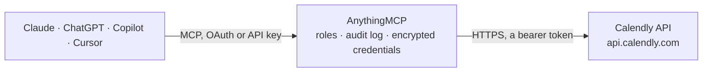

<!-- Generated by scripts/export-github-catalog.mjs in the anythingmcp-website repository. Do not edit by hand. -->

# Calendly MCP connector

Drive Calendly scheduling from any AI agent: list booked events, fetch invitees, query event types, check availability windows, generate single-use scheduling links and cancel meetings. 12 tools, Bearer-token auth. The AnythingMCP connector gives Claude, ChatGPT, Microsoft Copilot, Cursor and Gemini 12 MCP tools for Calendly: 10 read and 2 can change data.

**Category:** [Scheduling](../scheduling.md) · **Tools:** 12 · **Setup guide:** [anythingmcp.com](https://anythingmcp.com/guides/calendly-to-mcp) · [Deutsch](https://anythingmcp.com/de/guides/calendly-to-mcp) · [Italiano](https://anythingmcp.com/it/guides/calendly-to-mcp) · [Español](https://anythingmcp.com/es/guides/calendly-to-mcp) · [日本語](https://anythingmcp.com/ja/guides/calendly-to-mcp) · [Русский](https://anythingmcp.com/ru/guides/calendly-to-mcp) · [中文](https://anythingmcp.com/zh/guides/calendly-to-mcp)

## Start without code

No installation and no terminal: AnythingMCP Cloud runs the Calendly connector for you, operated by helpcode.ai in Frankfurt, Germany.

1. **Click the button above** and create an account or sign in. The Calendly connector opens, ready to install.
2. **Paste the API key or token from your Calendly account.** Every click is in the [step-by-step guide](https://anythingmcp.com/guides/calendly-to-mcp).
3. **Click Install.** AnythingMCP shows the address of your MCP server.
4. **Add that address to your assistant:** [Claude](https://anythingmcp.com/guides/connect-calendly-to-claude) · [ChatGPT](https://anythingmcp.com/guides/connect-calendly-to-chatgpt) · [Microsoft Copilot](https://anythingmcp.com/guides/connect-calendly-to-copilot) · [Cursor](https://anythingmcp.com/guides/connect-calendly-to-cursor) · [Gemini CLI](https://anythingmcp.com/guides/connect-calendly-to-gemini) · [Meta Muse](https://anythingmcp.com/guides/connect-calendly-to-muse).
5. **Ask your first question**, for example: *Show the scheduled event that finance@solevia.de booked called 'Invoice review' between 2026-10-10 and 2026-10-20.*

Prefer help with the setup? [Talk to us](https://anythingmcp.com/contact).

## How it works

- **The AI client** speaks MCP (Streamable HTTP) to AnythingMCP and only sees tool names, descriptions and results. It never gets the Calendly credentials.
- **AnythingMCP** checks the client's role, builds the call from the tool definition, adds the credentials (a bearer token), calls Calendly, logs the call and returns the result.
- **Calendly** sees an ordinary API client with the rights of the account the credentials belong to.

## Tools

| Tool | What it does | Access |
|---|---|---|
| [`calendly_get_current_user`](#calendly_get_current_user) | Return the user the personal access token belongs to (whoami). | read |
| [`calendly_get_user`](#calendly_get_user) | Get any user by their URI. | read |
| [`calendly_list_event_types`](#calendly_list_event_types) | List the event types (meeting types: '30-min intro', 'demo call', etc.) for a user or organization. | read |
| [`calendly_get_event_type`](#calendly_get_event_type) | Fetch a single event type's full config including custom questions, location options, color, kind, scheduling_url and pooling_type (for round-robin event… | read |
| [`calendly_list_event_type_available_times`](#calendly_list_event_type_available_times) | Return open availability slots for an event type between start_time and end_time. | read |
| [`calendly_list_scheduled_events`](#calendly_list_scheduled_events) | List booked events (meetings) for a user or organization, with optional status / date-range filters. | read |
| [`calendly_get_scheduled_event`](#calendly_get_scheduled_event) | Fetch one scheduled event by UUID. | read |
| [`calendly_list_scheduled_event_invitees`](#calendly_list_scheduled_event_invitees) | List invitees (the people who booked) on a scheduled event. | read |
| [`calendly_cancel_scheduled_event`](#calendly_cancel_scheduled_event) | Cancel a scheduled event. | write |
| [`calendly_create_single_use_scheduling_link`](#calendly_create_single_use_scheduling_link) | Create a one-time-use booking URL for a specific event type. | write |
| [`calendly_list_organization_memberships`](#calendly_list_organization_memberships) | List the members of an organization (Teams/Enterprise plan). | read |
| [`calendly_get_invitee`](#calendly_get_invitee) | Fetch a single invitee on a scheduled event by their invitee UUID. | read |

## Tool reference

Every parameter as the AI client sees it in `tools/list`. Source: [`packages/backend/src/adapters/intl/calendly.json`](../../../packages/backend/src/adapters/intl/calendly.json).

### `calendly_get_current_user`

Return the user the personal access token belongs to (whoami). The response's `resource.uri` is THE user URI you'll need to pass to most other tools. Call this first when the agent starts.

**Access:** read · **Call:** `GET /users/me`

No parameters.

### `calendly_get_user`

Get any user by their URI. Use when you have a user URI from a prior response (e.g. an event organizer) and need their full profile.

**Access:** read · **Call:** `GET /users/{userUuid}`

| Parameter | Type | Required | Description |
|---|---|---|---|
| `userUuid` | string | yes | User UUID (the last segment of the user URI). |

### `calendly_list_event_types`

List the event types (meeting types: '30-min intro', 'demo call', etc.) for a user or organization. Each event type has a URI, name, slug, duration, kind (solo/group/round_robin), active flag, and scheduling_url.

**Access:** read · **Call:** `GET /event_types`

| Parameter | Type | Required | Description |
|---|---|---|---|
| `user` | string | no | Full user URI: https://api.calendly.com/users/UUID. Mutually exclusive with `organization`. |
| `organization` | string | no | Full organization URI. Mutually exclusive with `user`. |
| `active` | boolean | no | Filter active-only event types. Default returns all. |
| `count` | integer | no | Max per page (default 20, max 100). |
| `page_token` | string | no | Pagination cursor from prior pagination.next_page_token. |
| `sort` | string | no | Sort by: name:asc, name:desc, position:asc, position:desc. |

### `calendly_get_event_type`

Fetch a single event type's full config including custom questions, location options, color, kind, scheduling_url and pooling_type (for round-robin event types).

**Access:** read · **Call:** `GET /event_types/{eventTypeUuid}`

| Parameter | Type | Required | Description |
|---|---|---|---|
| `eventTypeUuid` | string | yes | Event type UUID (last URI segment). |

### `calendly_list_event_type_available_times`

Return open availability slots for an event type between start_time and end_time. **The window MUST be ≤ 7 days** — Calendly rejects longer ranges with 400. Each slot returns start_time, status, scheduling_url and invitees_remaining (for round-robin).

**Access:** read · **Call:** `GET /event_type_available_times`

| Parameter | Type | Required | Description |
|---|---|---|---|
| `event_type` | string | yes | Full event type URI: https://api.calendly.com/event_types/UUID. |
| `start_time` | string | yes | ISO 8601 datetime, e.g. '2026-06-01T00:00:00Z'. Must be in the future. |
| `end_time` | string | yes | ISO 8601 datetime. Must be ≤ 7 days after start_time. |

### `calendly_list_scheduled_events`

List booked events (meetings) for a user or organization, with optional status / date-range filters. Each event has uri, name, status (active/canceled), start_time, end_time, event_type, location, invitees_counter.

**Access:** read · **Call:** `GET /scheduled_events`

| Parameter | Type | Required | Description |
|---|---|---|---|
| `user` | string | no | User URI. Mutually exclusive with `organization`. |
| `organization` | string | no | Organization URI. |
| `invitee_email` | string | no | Filter to events booked by this invitee email. |
| `status` | string | no | active or canceled. Default returns both. |
| `min_start_time` | string | no | ISO 8601 — events starting at or after this time. |
| `max_start_time` | string | no | ISO 8601 — events starting at or before this time. |
| `count` | integer | no | Max per page (default 20, max 100). |
| `page_token` | string | no | Pagination cursor. |
| `sort` | string | no | Sort: start_time:asc, start_time:desc. |

### `calendly_get_scheduled_event`

Fetch one scheduled event by UUID. Returns location, meeting_notes_plain, meeting_notes_html, cancel_url, reschedule_url, event_memberships (the host(s)).

**Access:** read · **Call:** `GET /scheduled_events/{eventUuid}`

| Parameter | Type | Required | Description |
|---|---|---|---|
| `eventUuid` | string | yes | Scheduled event UUID. |

### `calendly_list_scheduled_event_invitees`

List invitees (the people who booked) on a scheduled event. Each invitee has uri, email, name, status, timezone, questions_and_answers (custom questions they answered), and any payment details.

**Access:** read · **Call:** `GET /scheduled_events/{eventUuid}/invitees`

| Parameter | Type | Required | Description |
|---|---|---|---|
| `eventUuid` | string | yes | Scheduled event UUID. |
| `status` | string | no | active or canceled. |
| `email` | string | no | Filter to a specific invitee email. |
| `count` | integer | no | Max per page. |
| `page_token` | string | no | Pagination cursor. |

### `calendly_cancel_scheduled_event`

Cancel a scheduled event. The invitee receives a cancellation email with the reason. Counter-intuitively uses POST (not DELETE) per Calendly's REST convention.

**Access:** write · **Call:** `POST /scheduled_events/{eventUuid}/cancellation`

| Parameter | Type | Required | Description |
|---|---|---|---|
| `eventUuid` | string | yes | Scheduled event UUID. |
| `reason` | string | no | Human-readable cancellation reason shown to the invitee (max 1024 chars). |

### `calendly_create_single_use_scheduling_link`

Create a one-time-use booking URL for a specific event type. Once an invitee books through this URL, it can't be reused. Useful when sending an invitation to one specific person without exposing your generic /username profile.

**Access:** write · **Call:** `POST /scheduling_links`

| Parameter | Type | Required | Description |
|---|---|---|---|
| `max_event_count` | integer | yes | Always 1 for single-use links (only value Calendly accepts here). |
| `owner` | string | yes | Full event type URI (https://api.calendly.com/event_types/UUID). |
| `owner_type` | string | yes | Always 'EventType'. |

### `calendly_list_organization_memberships`

List the members of an organization (Teams/Enterprise plan). Each membership has user URI, role (owner/admin/user), updated_at. Use to map user URIs to display names for the entire team.

**Access:** read · **Call:** `GET /organization_memberships`

| Parameter | Type | Required | Description |
|---|---|---|---|
| `organization` | string | no | Full organization URI. |
| `user` | string | no | Filter to a specific user URI. |
| `email` | string | no | Filter to a specific email. |
| `count` | integer | no | Max per page. |
| `page_token` | string | no | Pagination cursor. |

### `calendly_get_invitee`

Fetch a single invitee on a scheduled event by their invitee UUID. Returns full Q&A, no_show data, reschedule_url, cancel_url and timezone.

**Access:** read · **Call:** `GET /scheduled_events/{eventUuid}/invitees/{inviteeUuid}`

| Parameter | Type | Required | Description |
|---|---|---|---|
| `eventUuid` | string | yes | Scheduled event UUID. |
| `inviteeUuid` | string | yes | Invitee UUID. |

## Run it yourself

AnythingMCP is open source (AGPL-3.0). [Run it with Docker](../../../README.md#run-it-yourself), open **Connectors → Store**, pick **Calendly** and enter `CALENDLY_PERSONAL_ACCESS_TOKEN`, then add your MCP server URL to the AI client.

[← Scheduling connectors](../scheduling.md) · [All categories](../README.md)
