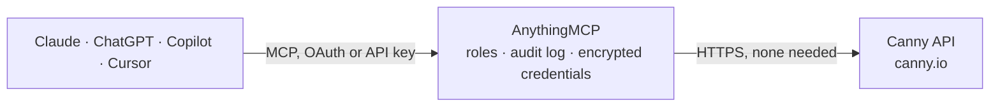

<!-- Generated by scripts/export-github-catalog.mjs in the anythingmcp-website repository. Do not edit by hand. -->

# Canny MCP connector

Canny customer feedback: boards, posts and feature requests, votes, comments, status changes, users and companies with MRR, categories, tags and the public changelog. The AnythingMCP connector gives Claude, ChatGPT, Microsoft Copilot, Cursor and Gemini 29 MCP tools for Canny: 16 read and 13 can change data.

**Category:** [Customer Support](../support.md) · **Tools:** 29 · **Setup guide:** [anythingmcp.com](https://anythingmcp.com/guides/canny-to-mcp) · [Deutsch](https://anythingmcp.com/de/guides/canny-to-mcp) · [Italiano](https://anythingmcp.com/it/guides/canny-to-mcp) · [Español](https://anythingmcp.com/es/guides/canny-to-mcp) · [日本語](https://anythingmcp.com/ja/guides/canny-to-mcp) · [Русский](https://anythingmcp.com/ru/guides/canny-to-mcp) · [中文](https://anythingmcp.com/zh/guides/canny-to-mcp)

## Start without code

No installation and no terminal: AnythingMCP Cloud runs the Canny connector for you, operated by helpcode.ai in Frankfurt, Germany.

1. **Click the button above** and create an account or sign in. The Canny connector opens, ready to install.
2. **Nothing to enter:** this connector needs no credentials. Every click is in the [step-by-step guide](https://anythingmcp.com/guides/canny-to-mcp).
3. **Click Install.** AnythingMCP shows the address of your MCP server.
4. **Add that address to your assistant:** [Claude](https://anythingmcp.com/guides/connect-canny-to-claude) · [ChatGPT](https://anythingmcp.com/guides/connect-canny-to-chatgpt) · [Microsoft Copilot](https://anythingmcp.com/guides/connect-canny-to-copilot) · [Cursor](https://anythingmcp.com/guides/connect-canny-to-cursor) · [Gemini CLI](https://anythingmcp.com/guides/connect-canny-to-gemini) · [Meta Muse](https://anythingmcp.com/guides/connect-canny-to-muse).
5. **Ask your first question**, for example: *Show me the feature request titled "Bulk CSV export" on the Product board and its current votes and status*

Prefer help with the setup? [Talk to us](https://anythingmcp.com/contact).

## How it works

- **The AI client** speaks MCP (Streamable HTTP) to AnythingMCP and only sees tool names, descriptions and results. It never gets the Canny credentials.
- **AnythingMCP** checks the client's role, builds the call from the tool definition, adds the credentials (none needed), calls Canny, logs the call and returns the result.
- **Canny** sees an ordinary API client with the rights of the account the credentials belong to.

## Tools

| Tool | What it does | Access |
|---|---|---|
| [`canny_list_boards`](#canny_list_boards) | All feedback boards of the Canny company with id, name, postCount, isPrivate and url. | read |
| [`canny_get_board`](#canny_get_board) | One feedback board by id: name, postCount, isPrivate, created date and admin url. | read |
| [`canny_list_posts`](#canny_list_posts) | List feedback posts (ideas and feature requests) with title, details, status, score (votes), commentCount, author, board, category, tags, owner, eta and url. | read |
| [`canny_get_post`](#canny_get_post) | One post with its details, status, score, author, owner, category, tags, custom fields, eta, linked Jira or Linear issues, merge history and url. | read |
| [`canny_create_post`](#canny_create_post) | Create a post (idea or feature request) on a board for a user. | write |
| [`canny_update_post`](#canny_update_post) | Update a post's title, details, ETA, images, custom fields or owner. | write |
| [`canny_change_post_status`](#canny_change_post_status) | Change a post's status (open, under review, planned, in progress, complete, closed or a custom status), recorded under an admin, optionally with a comment… | read |
| [`canny_change_post_category`](#canny_change_post_category) | Move a post to another category of its board, or remove its category with the text null. | write |
| [`canny_add_post_tag`](#canny_add_post_tag) | Add a tag to a post. | write |
| [`canny_remove_post_tag`](#canny_remove_post_tag) | Remove a tag from a post. | write |
| [`canny_list_comments`](#canny_list_comments) | List portal comments, newest first, with value, author, post, parent, internal flag and likes. | read |
| [`canny_get_comment`](#canny_get_comment) | One portal comment by id with its value, author, post, images and internal flag. | read |
| [`canny_create_comment`](#canny_create_comment) | Add a comment to a post, as a reply when parent_id is set. | write |
| [`canny_list_votes`](#canny_list_votes) | List votes, newest first, with the voter, post, priority and time. | read |
| [`canny_create_vote`](#canny_create_vote) | Record a vote by a user on a post, optionally with a priority, for example when a customer asks for a feature in a call or ticket. | write |
| [`canny_list_users`](#canny_list_users) | List the end users of the workspace with id, name, email, userID (the id in your app), companies and admin flag. | read |
| [`canny_get_user`](#canny_get_user) | Find one user by exactly one of: Canny id, email, or the user id in your application. | read |
| [`canny_create_or_update_user`](#canny_create_or_update_user) | Create a user, or update the one matching email, user_id or id, and return its Canny id for use as author or voter. | write |
| [`canny_list_companies`](#canny_list_companies) | List companies (customer accounts) with id, name, domain, monthlySpend, memberCount and custom fields, ordered by creation. | read |
| [`canny_update_company`](#canny_update_company) | Update a company's name, domain, monthly spend (MRR in dollars), creation date or custom fields. | write |
| [`canny_list_categories`](#canny_list_categories) | List post categories (and subcategories with parentID), newest first, with name, postCount and board. | read |
| [`canny_create_category`](#canny_create_category) | Create a category, or a subcategory with parent_id, on a board. | write |
| [`canny_list_tags`](#canny_list_tags) | List tags, newest first, with id, name, postCount and board. | read |
| [`canny_create_tag`](#canny_create_tag) | Create a tag on a board, or return the existing tag with that name. | write |
| [`canny_list_status_changes`](#canny_list_status_changes) | History of post status changes, newest first: post, old and new status, changer and the attached comment. | read |
| [`canny_list_changelog_entries`](#canny_list_changelog_entries) | List changelog entries, drafts and scheduled ones included, with title, markdown details, status, types, labels, linked posts, publishedAt and url. | read |
| [`canny_create_changelog_entry`](#canny_create_changelog_entry) | Write a changelog entry as a draft (default), publish it now or schedule it, and link the posts it ships. | write |
| [`canny_update_changelog_entry`](#canny_update_changelog_entry) | Change the title, details, types, labels, linked posts or notify flag of a changelog entry. | write |
| [`canny_change_changelog_entry_status`](#canny_change_changelog_entry_status) | Publish a changelog entry now, schedule it for a future time, or set it back to draft (unpublish or unschedule). | read |

## Tool reference

Every parameter as the AI client sees it in `tools/list`. Source: [`packages/backend/src/adapters/intl/canny.json`](../../../packages/backend/src/adapters/intl/canny.json).

### `canny_list_boards`

All feedback boards of the Canny company with id, name, postCount, isPrivate and url. Start here: most other tools take a board id.

**Access:** read · **Call:** `POST /api/v1/boards/list`

No parameters.

### `canny_get_board`

One feedback board by id: name, postCount, isPrivate, created date and admin url.

**Access:** read · **Call:** `POST /api/v1/boards/retrieve`

| Parameter | Type | Required | Description |
|---|---|---|---|
| `id` | string | yes | Board id from canny_list_boards. |

### `canny_list_posts`

List feedback posts (ideas and feature requests) with title, details, status, score (votes), commentCount, author, board, category, tags, owner, eta and url. Filter by board, author, company, tags, status or a search text; sort by newest, oldest, score, trending, statusChanged or relevance.

**Access:** read · **Call:** `POST /api/v1/posts/list`

| Parameter | Type | Required | Description |
|---|---|---|---|
| `board_id` | string | no | Only posts on this board. |
| `author_id` | string | no | Only posts by this Canny user id. |
| `company_id` | string | no | Only posts by users of the company with this identifier (the company id from canny_list_companies). |
| `tag_ids` | string[] | no | Only posts with at least one of these tag ids. |
| `search` | string | no | Only posts matching this search text. |
| `status` | string | no | Comma-separated statuses, e.g. open,under review,planned,in progress,complete,closed or a custom status. |
| `sort` | `newest` \| `oldest` \| `relevance` \| `score` \| `statusChanged` \| `trending` | no | Order of the posts. |
| `limit` | integer | no | Results per page (default 10). |
| `skip` | integer | no | Results to skip, for paging (default 0). |

### `canny_get_post`

One post with its details, status, score, author, owner, category, tags, custom fields, eta, linked Jira or Linear issues, merge history and url. Pass the post id, or its urlName together with the board id.

**Access:** read · **Call:** `POST /api/v1/posts/retrieve`

| Parameter | Type | Required | Description |
|---|---|---|---|
| `id` | string | no | Post id. |
| `url_name` | string | no | The urlName of the post (the last part of its URL); needs board_id. |
| `board_id` | string | no | Board id, only needed with url_name. |

### `canny_create_post`

Create a post (idea or feature request) on a board for a user. Create or look up the author first with canny_create_or_update_user.

**Access:** write · **Call:** `POST /api/v1/posts/create`

| Parameter | Type | Required | Description |
|---|---|---|---|
| `board_id` | string | yes | Board id. |
| `author_id` | string | yes | Canny user id of the author (from canny_create_or_update_user or canny_get_user). |
| `title` | string | yes | Post title, up to 400 characters. |
| `details` | string | yes | Post details, up to 10,000 characters. |
| `by_id` | string | no | Canny admin id that creates the post on behalf of the author. |
| `category_id` | string | no | Category or subcategory id. |
| `owner_id` | string | no | Admin id responsible for the work. |
| `eta` | string | no | Estimated completion month as MM/YYYY, e.g. 06/2027. |
| `eta_public` | boolean | no | Show the ETA to all users. |
| `custom_fields` | object | no | Custom field values keyed by field name; include every field the board requires. |
| `image_urls` | string[] | no | URLs of images to attach. |
| `created_at` | string | no | Original creation time in ISO 8601 when importing from another tool. |

### `canny_update_post`

Update a post's title, details, ETA, images, custom fields or owner. Only the fields given change. Changing the owner needs changer_id.

**Access:** write · **Call:** `POST /api/v1/posts/update`

| Parameter | Type | Required | Description |
|---|---|---|---|
| `post_id` | string | yes | Post id. |
| `title` | string | no | New title, up to 400 characters. |
| `details` | string | no | New details, up to 10,000 characters. |
| `eta` | string | no | Estimated completion month as MM/YYYY. |
| `eta_public` | boolean | no | Show the ETA to all users. |
| `custom_fields` | object | no | Custom field values keyed by field name. |
| `image_urls` | string[] | no | Replaces all images; an empty list removes them. |
| `owner_id` | string | no | Admin id to make the owner. |
| `changer_id` | string | no | Admin id making the change; required with owner_id. |

### `canny_change_post_status`

Change a post's status (open, under review, planned, in progress, complete, closed or a custom status), recorded under an admin, optionally with a comment and an email to the voters.

**Access:** read · **Call:** `POST /api/v1/posts/change_status`

| Parameter | Type | Required | Description |
|---|---|---|---|
| `post_id` | string | yes | Post id. |
| `status` | string | yes | New status, e.g. planned, in progress or complete. |
| `changer_id` | string | yes | Canny admin id recorded as having changed the status. |
| `should_notify_voters` | boolean | yes | Email the non-admin voters about the change. |
| `comment_value` | string | no | Comment attached to the status change. |
| `comment_image_urls` | string[] | no | Image URLs for that comment. |

### `canny_change_post_category`

Move a post to another category of its board, or remove its category with the text null.

**Access:** write · **Call:** `POST /api/v1/posts/change_category`

| Parameter | Type | Required | Description |
|---|---|---|---|
| `post_id` | string | yes | Post id. |
| `category_id` | string | yes | Category id, or null to remove the category. |

### `canny_add_post_tag`

Add a tag to a post. Tags come from canny_list_tags or canny_create_tag.

**Access:** write · **Call:** `POST /api/v1/posts/add_tag`

| Parameter | Type | Required | Description |
|---|---|---|---|
| `post_id` | string | yes | Post id. |
| `tag_id` | string | yes | Tag id. |

### `canny_remove_post_tag`

Remove a tag from a post. Removing a tag the post does not have changes nothing.

**Access:** write · **Call:** `POST /api/v1/posts/remove_tag`

| Parameter | Type | Required | Description |
|---|---|---|---|
| `post_id` | string | yes | Post id. |
| `tag_id` | string | yes | Tag id. |

### `canny_list_comments`

List portal comments, newest first, with value, author, post, parent, internal flag and likes. Filter by post, board, author or company. Paged with a cursor.

**Access:** read · **Call:** `POST /api/v2/comments/list`

| Parameter | Type | Required | Description |
|---|---|---|---|
| `post_id` | string | no | Only comments on this post. |
| `board_id` | string | no | Only comments on this board. |
| `author_id` | string | no | Only comments by this user id. |
| `company_id` | string | no | Only comments by users of this company identifier. |
| `limit` | integer | no | Results per page, 1 to 100 (default 10). |
| `cursor` | string | no | The cursor value of the previous answer, to fetch the next page. |

### `canny_get_comment`

One portal comment by id with its value, author, post, images and internal flag.

**Access:** read · **Call:** `POST /api/v1/comments/retrieve`

| Parameter | Type | Required | Description |
|---|---|---|---|
| `id` | string | yes | Comment id. |

### `canny_create_comment`

Add a comment to a post, as a reply when parent_id is set. internal comments are visible to the team only.

**Access:** write · **Call:** `POST /api/v1/comments/create`

| Parameter | Type | Required | Description |
|---|---|---|---|
| `post_id` | string | yes | Post id. |
| `author_id` | string | yes | Canny user id of the author. |
| `value` | string | yes | Comment text, under 2,500 characters. |
| `parent_id` | string | no | Comment id to reply to. |
| `internal` | boolean | no | Team-only comment (the author must be a team member). |
| `should_notify_voters` | boolean | no | Allow the comment to trigger email notifications (default false). |
| `image_urls` | string[] | no | Image URLs to attach. |
| `created_at` | string | no | Original creation time in ISO 8601 when importing. |

### `canny_list_votes`

List votes, newest first, with the voter, post, priority and time. Filter by post, board, user or company. Paged with a cursor.

**Access:** read · **Call:** `POST /api/v2/votes/list`

| Parameter | Type | Required | Description |
|---|---|---|---|
| `post_id` | string | no | Only votes on this post. |
| `board_id` | string | no | Only votes on this board. |
| `user_id` | string | no | Only votes by this Canny user id. |
| `company_id` | string | no | Only votes by users of this company identifier. |
| `limit` | integer | no | Results per page, 1 to 100 (default 10). |
| `cursor` | string | no | The cursor value of the previous answer, to fetch the next page. |

### `canny_create_vote`

Record a vote by a user on a post, optionally with a priority, for example when a customer asks for a feature in a call or ticket.

**Access:** write · **Call:** `POST /api/v1/votes/create`

| Parameter | Type | Required | Description |
|---|---|---|---|
| `post_id` | string | yes | Post id. |
| `voter_id` | string | yes | Canny user id of the voter. |
| `by_id` | string | no | Canny admin id casting the vote on the voter's behalf. |
| `vote_priority` | `0` \| `10` \| `20` | no | 0 nice to have, 10 important, 20 must have. |
| `created_at` | string | no | Original vote time in ISO 8601 when importing. |

### `canny_list_users`

List the end users of the workspace with id, name, email, userID (the id in your app), companies and admin flag. Paged with a cursor.

**Access:** read · **Call:** `POST /api/v2/users/list`

| Parameter | Type | Required | Description |
|---|---|---|---|
| `limit` | integer | no | Results per page, 1 to 100 (default 10). |
| `cursor` | string | no | The cursor value of the previous answer, to fetch the next page. |

### `canny_get_user`

Find one user by exactly one of: Canny id, email, or the user id in your application.

**Access:** read · **Call:** `POST /api/v1/users/retrieve`

| Parameter | Type | Required | Description |
|---|---|---|---|
| `id` | string | no | Canny user id. |
| `email` | string | no | User email. |
| `user_id` | string | no | The user's id in your application (SSO or API created users). |

### `canny_create_or_update_user`

Create a user, or update the one matching email, user_id or id, and return its Canny id for use as author or voter. Can also link the user to companies, which creates the companies.

**Access:** write · **Call:** `POST /api/v1/users/create_or_update`

| Parameter | Type | Required | Description |
|---|---|---|---|
| `name` | string | yes | User name, up to 50 characters, without : or /. |
| `email` | string | no | User email. |
| `user_id` | string | no | The user's id in your application. |
| `id` | string | no | Canny user id, to update an existing user. |
| `alias` | string | no | Alias shown instead of the name. |
| `avatar_url` | string | no | Avatar image URL. |
| `companies` | object[] | no | Companies, e.g. [{"id": "acme-1", "name": "Acme", "domain": "acme.com", "monthlySpend": 500}]. Needs user_id. |
| `custom_fields` | object | no | Custom user fields; names under 30 characters, text values under 200. |
| `created` | string | no | When the user was created in your system, ISO 8601. |

### `canny_list_companies`

List companies (customer accounts) with id, name, domain, monthlySpend, memberCount and custom fields, ordered by creation. Search by name or filter by segment. Paged with a cursor except when searching.

**Access:** read · **Call:** `POST /api/v2/companies/list`

| Parameter | Type | Required | Description |
|---|---|---|---|
| `search` | string | no | Text to search in company names. |
| `segment` | string | no | URL name of a segment to filter by. |
| `limit` | integer | no | Results per page, 1 to 100 (default 10). |
| `cursor` | string | no | The cursor value of the previous answer, to fetch the next page. |

### `canny_update_company`

Update a company's name, domain, monthly spend (MRR in dollars), creation date or custom fields. Synced CRMs may overwrite these values.

**Access:** write · **Call:** `POST /api/v1/companies/update`

| Parameter | Type | Required | Description |
|---|---|---|---|
| `id` | string | yes | Company identifier. |
| `name` | string | no | Company name, up to 100 characters. |
| `domain` | string | no | Bare domain, e.g. acme.com. |
| `monthly_spend` | number | no | Monthly recurring revenue in dollars. |
| `custom_fields` | object | no | Custom company fields. |
| `created` | string | no | When the company was created in your system, ISO 8601. |

### `canny_list_categories`

List post categories (and subcategories with parentID), newest first, with name, postCount and board. Filter by board.

**Access:** read · **Call:** `POST /api/v1/categories/list`

| Parameter | Type | Required | Description |
|---|---|---|---|
| `board_id` | string | no | Only categories of this board. |
| `limit` | integer | no | Results per page (default 10). |
| `skip` | integer | no | Results to skip, for paging (default 0). |

### `canny_create_category`

Create a category, or a subcategory with parent_id, on a board.

**Access:** write · **Call:** `POST /api/v1/categories/create`

| Parameter | Type | Required | Description |
|---|---|---|---|
| `board_id` | string | yes | Board id. |
| `name` | string | yes | Category name, 1 to 30 characters. |
| `parent_id` | string | no | Parent category id for a subcategory. |
| `subscribe_admins` | boolean | yes | Subscribe all admins to new posts in this category. |

### `canny_list_tags`

List tags, newest first, with id, name, postCount and board. Filter by board.

**Access:** read · **Call:** `POST /api/v1/tags/list`

| Parameter | Type | Required | Description |
|---|---|---|---|
| `board_id` | string | no | Only tags of this board. |
| `limit` | integer | no | Results per page (default 10). |
| `skip` | integer | no | Results to skip, for paging (default 0). |

### `canny_create_tag`

Create a tag on a board, or return the existing tag with that name.

**Access:** write · **Call:** `POST /api/v1/tags/create`

| Parameter | Type | Required | Description |
|---|---|---|---|
| `board_id` | string | yes | Board id. |
| `name` | string | yes | Tag name, 1 to 30 characters. |

### `canny_list_status_changes`

History of post status changes, newest first: post, old and new status, changer and the attached comment. Filter by board. Paged with a cursor.

**Access:** read · **Call:** `POST /api/v2/status_changes/list`

| Parameter | Type | Required | Description |
|---|---|---|---|
| `board_id` | string | no | Only status changes on this board. |
| `limit` | integer | no | Results per page, 1 to 100 (default 10). |
| `cursor` | string | no | The cursor value of the previous answer, to fetch the next page. |

### `canny_list_changelog_entries`

List changelog entries, drafts and scheduled ones included, with title, markdown details, status, types, labels, linked posts, publishedAt and url.

**Access:** read · **Call:** `POST /api/v1/entries/list`

| Parameter | Type | Required | Description |
|---|---|---|---|
| `label_ids` | string[] | no | Only entries with at least one of these label ids. |
| `type` | `new` \| `improved` \| `fixed` | no | Only entries of this type. |
| `sort` | `created` \| `lastSaved` \| `publishedAt` \| `nonPublishedFirst` | no | Order: created, lastSaved, publishedAt (most recent first) or nonPublishedFirst (default). |
| `limit` | integer | no | Results per page (default 10). |
| `skip` | integer | no | Entries to skip, up to 1,000 (default 0). |

### `canny_create_changelog_entry`

Write a changelog entry as a draft (default), publish it now or schedule it, and link the posts it ships. notify emails users once it is published.

**Access:** write · **Call:** `POST /api/v1/entries/create`

| Parameter | Type | Required | Description |
|---|---|---|---|
| `title` | string | yes | Entry title. |
| `details` | string | yes | Entry text in markdown. |
| `type` | `new` \| `improved` \| `fixed` | no | Entry type. |
| `published` | boolean | no | Publish immediately (default false: draft). |
| `published_on` | string | no | Published date in the past, ISO 8601, with published true. |
| `scheduled_for` | string | no | Future publish time in ISO 8601; published must be false. |
| `notify` | boolean | no | Email users when it is published (default false). |
| `label_ids` | string[] | no | Label ids. |
| `post_ids` | string[] | no | Post ids shipped by this entry. |

### `canny_update_changelog_entry`

Change the title, details, types, labels, linked posts or notify flag of a changelog entry. Lists given replace the old ones. Publishing state is not changed here.

**Access:** write · **Call:** `POST /api/v1/entries/update`

| Parameter | Type | Required | Description |
|---|---|---|---|
| `entry_id` | string | yes | Changelog entry id. |
| `title` | string | no | New title. |
| `details` | string | no | New text in markdown. |
| `types` | string[] | no | Replaces the types: new, improved, fixed. |
| `label_ids` | string[] | no | Replaces the labels. |
| `post_ids` | string[] | no | Replaces the linked posts. |
| `notify` | boolean | no | Email users when it is published. |

### `canny_change_changelog_entry_status`

Publish a changelog entry now, schedule it for a future time, or set it back to draft (unpublish or unschedule). Publishing emails users when the entry has notify on.

**Access:** read · **Call:** `POST /api/v1/entries/change_status`

| Parameter | Type | Required | Description |
|---|---|---|---|
| `entry_id` | string | yes | Changelog entry id. |
| `status` | `published` \| `scheduled` \| `draft` | yes | New status. |
| `published_on` | string | no | Published date in the past, ISO 8601, with status published. |
| `scheduled_for` | string | no | Future publish time in ISO 8601; required with status scheduled. |

## Run it yourself

AnythingMCP is open source (AGPL-3.0). [Run it with Docker](../../../README.md#run-it-yourself), open **Connectors → Store**, pick **Canny** and enter `CANNY_API_KEY`, then add your MCP server URL to the AI client.

[← Customer Support connectors](../support.md) · [All categories](../README.md)
