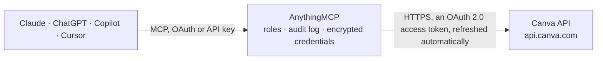

<!-- Generated by scripts/export-github-catalog.mjs in the anythingmcp-website repository. Do not edit by hand. -->

# Canva MCP connector

Let your AI work in Canva: find and read designs, create new ones, export them to PDF, PNG, PowerPoint or video with download links, organise folders, upload images from a link, read brand templates … The AnythingMCP connector gives Claude, ChatGPT, Microsoft Copilot, Cursor and Gemini 27 MCP tools for Canva: 16 read and 11 can change data.

**Category:** [Productivity](../productivity.md) · **Tools:** 27 · **Setup guide:** [anythingmcp.com](https://anythingmcp.com/guides/canva-to-mcp) · [Deutsch](https://anythingmcp.com/de/guides/canva-to-mcp) · [Italiano](https://anythingmcp.com/it/guides/canva-to-mcp) · [Español](https://anythingmcp.com/es/guides/canva-to-mcp) · [日本語](https://anythingmcp.com/ja/guides/canva-to-mcp) · [Русский](https://anythingmcp.com/ru/guides/canva-to-mcp) · [中文](https://anythingmcp.com/zh/guides/canva-to-mcp)

## Start without code

No installation and no terminal: AnythingMCP Cloud runs the Canva connector for you, operated by helpcode.ai in Frankfurt, Germany.

1. **Click the button above** and create an account or sign in. The Canva connector opens, ready to install.
2. **Sign in with your Canva account** when AnythingMCP asks. The first time, an admin creates a small app in the Canva developer console. Every click is in the [step-by-step guide](https://anythingmcp.com/guides/canva-to-mcp).
3. **Click Install.** AnythingMCP shows the address of your MCP server.
4. **Add that address to your assistant:** [Claude](https://anythingmcp.com/guides/connect-canva-to-claude) · [ChatGPT](https://anythingmcp.com/guides/connect-canva-to-chatgpt) · [Microsoft Copilot](https://anythingmcp.com/guides/connect-canva-to-copilot) · [Cursor](https://anythingmcp.com/guides/connect-canva-to-cursor) · [Gemini CLI](https://anythingmcp.com/guides/connect-canva-to-gemini) · [Meta Muse](https://anythingmcp.com/guides/connect-canva-to-muse).
5. **Ask your first question**, for example: *Show me the design used for invoice template INV-2026-0412, I need its edit link and page count.*

Prefer help with the setup? [Talk to us](https://anythingmcp.com/contact).

## How it works

- **The AI client** speaks MCP (Streamable HTTP) to AnythingMCP and only sees tool names, descriptions and results. It never gets the Canva credentials.
- **AnythingMCP** checks the client's role, builds the call from the tool definition, adds the credentials (an OAuth 2.0 access token, refreshed automatically), calls Canva, logs the call and returns the result.
- **Canva** sees an ordinary API client with the rights of the account the credentials belong to.

## Tools

| Tool | What it does | Access |
|---|---|---|
| [`canva_get_me`](#canva_get_me) | Read who authorized the connector: the Canva user_id and team_id. | read |
| [`canva_get_profile`](#canva_get_profile) | Read the display name of the signed-in Canva user (scope profile:read). | read |
| [`canva_get_capabilities`](#canva_get_capabilities) | List the paid features the signed-in user can use through the API, e.g. brand_template, autofill, resize, export_png_transparency. | read |
| [`canva_list_designs`](#canva_list_designs) | List or search the user's designs, with id, title, owner, page_count, a thumbnail (its URL expires after 15 minutes), edit_url and view_url (valid 30 days,… | read |
| [`canva_get_design`](#canva_get_design) | Read one design by id: title, owner, page_count, thumbnail, edit_url, view_url and timestamps (scope design:meta:read). | read |
| [`canva_create_design`](#canva_create_design) | Create a new, empty design and return it with id, edit_url and view_url (scope design:content:write). | write |
| [`canva_get_design_export_formats`](#canva_get_design_export_formats) | List the file formats a design can be exported to (pdf, jpg, png, svg, pptx, gif, mp4, html_bundle, html_standalone, csv), depending on its type. | read |
| [`canva_create_export`](#canva_create_export) | Start exporting a design to a file. | write |
| [`canva_get_export`](#canva_get_export) | Read an export job: status (in_progress, success or failed), and on success urls[], one download link per file (multi-page images give one per page; links… | read |
| [`canva_list_folder_items`](#canva_list_folder_items) | List what a folder contains, with each item's type (design, folder, image, brand_template) and details. | read |
| [`canva_get_folder`](#canva_get_folder) | Read a folder by id: name, thumbnail and timestamps (scope folder:read). | read |
| [`canva_create_folder`](#canva_create_folder) | Create a folder in the user's Projects (parent_folder_id root), in Uploads (uploads) or inside another folder. | write |
| [`canva_rename_folder`](#canva_rename_folder) | Rename a folder; the name is the only thing that can be changed (scope folder:write). | write |
| [`canva_move_folder_item`](#canva_move_folder_item) | Move a design, folder or image into another folder (to_folder_id root for the top level of Projects). | write |
| [`canva_delete_folder`](#canva_delete_folder) | Delete a folder. | write |
| [`canva_get_asset`](#canva_get_asset) | Read an uploaded asset (image or video): name, tags, owner, thumbnail and timestamps (scope asset:read). | read |
| [`canva_update_asset`](#canva_update_asset) | Rename an asset or replace its tags. | write |
| [`canva_delete_asset`](#canva_delete_asset) | Move an asset to the Trash. | write |
| [`canva_upload_asset_from_url`](#canva_upload_asset_from_url) | Start uploading an image or video from a public URL into the user's Uploads. | write |
| [`canva_get_asset_upload`](#canva_get_asset_upload) | Read an upload job started with canva_upload_asset_from_url: status in_progress, success (with asset and its id) or failed (error.code file_too_big,… | read |
| [`canva_list_brand_templates`](#canva_list_brand_templates) | List the brand templates the user can use, with id, title, view_url, create_url and thumbnail. | read |
| [`canva_get_brand_template`](#canva_get_brand_template) | Read one brand template by id: title, view_url, create_url (opens a new design from it), thumbnail and timestamps (scope brandtemplate:meta:read, plan with… | read |
| [`canva_get_brand_template_dataset`](#canva_get_brand_template_dataset) | Read the autofill fields of a brand template: each field name with its type (text, image or chart). | read |
| [`canva_create_comment`](#canva_create_comment) | Start a comment thread on a design, optionally assigned to a collaborator. | write |
| [`canva_get_comment_thread`](#canva_get_comment_thread) | Read a comment thread on a design: the comment, its author, assignee, resolution state and timestamps. | read |
| [`canva_list_comment_replies`](#canva_list_comment_replies) | List the replies in a comment thread, oldest first, with author and text. | read |
| [`canva_reply_to_comment`](#canva_reply_to_comment) | Reply to a comment thread on a design (up to 100 replies per thread). | write |

## Tool reference

Every parameter as the AI client sees it in `tools/list`. Source: [`packages/backend/src/adapters/intl/canva.json`](../../../packages/backend/src/adapters/intl/canva.json).

### `canva_get_me`

Read who authorized the connector: the Canva user_id and team_id. Needs no scope; a quick check that the authorization works.

**Access:** read · **Call:** `GET /users/me`

No parameters.

### `canva_get_profile`

Read the display name of the signed-in Canva user (scope profile:read).

**Access:** read · **Call:** `GET /users/me/profile`

No parameters.

### `canva_get_capabilities`

List the paid features the signed-in user can use through the API, e.g. brand_template, autofill, resize, export_png_transparency. An empty list means a free plan: brand templates are then not available (scope profile:read).

**Access:** read · **Call:** `GET /users/me/capabilities`

No parameters.

### `canva_list_designs`

List or search the user's designs, with id, title, owner, page_count, a thumbnail (its URL expires after 15 minutes), edit_url and view_url (valid 30 days, open them only as the user) and created_at and updated_at as Unix seconds. The answer has items[] and, when there are more, continuation (scope design:meta:read).

**Access:** read · **Call:** `GET /designs`

| Parameter | Type | Required | Description |
|---|---|---|---|
| `query` | string | no | Search text, up to 255 characters. |
| `ownership` | `any` \| `owned` \| `shared` | no | Whose designs: any (default), owned or shared. |
| `sort_by` | `relevance` \| `modified_descending` \| `modified_ascending` \| `title_descending` \| `title_ascending` | no | Order of the results (default relevance). |
| `limit` | integer | no | Items per page, 1 to 100 (default 25). |
| `continuation` | string | no | The continuation token of the previous answer, for the next page. |

### `canva_get_design`

Read one design by id: title, owner, page_count, thumbnail, edit_url, view_url and timestamps (scope design:meta:read). The design id is the part after /design/ in a Canva link, e.g. DAFVztcvd9z.

**Access:** read · **Call:** `GET /designs/{design_id}`

| Parameter | Type | Required | Description |
|---|---|---|---|
| `design_id` | string | yes | The design id, e.g. DAFVztcvd9z. |

### `canva_create_design`

Create a new, empty design and return it with id, edit_url and view_url (scope design:content:write). design_type is either a preset, {"type": "preset", "name": "presentation"} (doc, email, presentation or whiteboard), or a custom size in pixels, {"type": "custom", "width": 1080, "height": 1080} (40 to 8000 each). asset_id optionally places an image asset on it. The design opens in the user's Projects.

**Access:** write · **Call:** `POST /designs`

| Parameter | Type | Required | Description |
|---|---|---|---|
| `design_type` | object | yes | {"type": "preset", "name": "doc\|email\|presentation\|whiteboard"} or {"type": "custom", "width": <px>, "height": <px>}. |
| `title` | string | no | Title of the design, 1 to 255 characters. |
| `asset_id` | string | no | Id of an image asset to put on the design. |

### `canva_get_design_export_formats`

List the file formats a design can be exported to (pdf, jpg, png, svg, pptx, gif, mp4, html_bundle, html_standalone, csv), depending on its type. Check it before canva_create_export (scope design:content:read).

**Access:** read · **Call:** `GET /designs/{design_id}/export-formats`

| Parameter | Type | Required | Description |
|---|---|---|---|
| `design_id` | string | yes | The design id. |

### `canva_create_export`

Start exporting a design to a file. format is an object with type and options, e.g. {"type": "pdf", "size": "a4"}, {"type": "png", "width": 1080, "pages": [1]}, {"type": "jpg", "quality": 80} (quality is required for jpg), {"type": "pptx"} or {"type": "mp4", "quality": "horizontal_1080p"}. Returns job.id with status in_progress: read it with canva_get_export until status is success, which carries the download URLs. Limited to 75 exports per 5 minutes per user (scope design:content:read).

**Access:** write · **Call:** `POST /exports`

| Parameter | Type | Required | Description |
|---|---|---|---|
| `design_id` | string | yes | The design id. |
| `format` | object | yes | Export format with type (pdf, jpg, png, gif, pptx, mp4, html_bundle, html_standalone, csv) and its options: pages (page numbers from 1), export_quality (regular or pro), size for pdf (a4, a3, letter, legal), width and height for images, quality for jpg (1 to 100) and mp4, lossless, transparent_background and as_single_image for png. |

### `canva_get_export`

Read an export job: status (in_progress, success or failed), and on success urls[], one download link per file (multi-page images give one per page; links expire after 24 hours). A failed job explains why in error.code, e.g. license_required for premium elements (scope design:content:read).

**Access:** read · **Call:** `GET /exports/{export_id}`

| Parameter | Type | Required | Description |
|---|---|---|---|
| `export_id` | string | yes | The job id returned by canva_create_export. |

### `canva_list_folder_items`

List what a folder contains, with each item's type (design, folder, image, brand_template) and details. Use root for the top level of the user's Projects and uploads for the Uploads folder. Videos are not listed; brand templates only when item_types names them. The answer has items[] and continuation (scope folder:read).

**Access:** read · **Call:** `GET /folders/{folder_id}/items`

| Parameter | Type | Required | Description |
|---|---|---|---|
| `folder_id` | string | yes | The folder id, or root for the top level of Projects, or uploads. |
| `item_types` | string | no | Comma-separated item types, e.g. design,folder (default: design, folder and image). |
| `sort_by` | `created_ascending` \| `created_descending` \| `modified_ascending` \| `modified_descending` \| `title_ascending` \| `title_descending` | no | Order (default modified_descending). |
| `limit` | integer | no | Items per page, 1 to 100 (default 50). |
| `continuation` | string | no | The continuation token of the previous answer, for the next page. |

### `canva_get_folder`

Read a folder by id: name, thumbnail and timestamps (scope folder:read). root and uploads are aliases, not folders, and cannot be read here.

**Access:** read · **Call:** `GET /folders/{folder_id}`

| Parameter | Type | Required | Description |
|---|---|---|---|
| `folder_id` | string | yes | The folder id. |

### `canva_create_folder`

Create a folder in the user's Projects (parent_folder_id root), in Uploads (uploads) or inside another folder. Returns the folder with its id (scope folder:write).

**Access:** write · **Call:** `POST /folders`

| Parameter | Type | Required | Description |
|---|---|---|---|
| `name` | string | yes | Folder name, 1 to 255 characters. |
| `parent_folder_id` | string | yes | Where to create it: root, uploads or a folder id. |

### `canva_rename_folder`

Rename a folder; the name is the only thing that can be changed (scope folder:write).

**Access:** write · **Call:** `PATCH /folders/{folder_id}`

| Parameter | Type | Required | Description |
|---|---|---|---|
| `folder_id` | string | yes | The folder id. |
| `name` | string | yes | New name, 1 to 255 characters. |

### `canva_move_folder_item`

Move a design, folder or image into another folder (to_folder_id root for the top level of Projects). Fails with item_in_multiple_folders when the item sits in more than one folder (scope folder:write).

**Access:** write · **Call:** `POST /folders/move`

| Parameter | Type | Required | Description |
|---|---|---|---|
| `item_id` | string | yes | Id of the design, folder or image asset to move. |
| `to_folder_id` | string | yes | Target folder id, or root. |

### `canva_delete_folder`

Delete a folder. The user's own designs and files in it move to the Trash; items owned by others go back to their owner's Projects. Installed switched off; confirm with the user first (scope folder:write).

**Access:** write · **Call:** `DELETE /folders/{folder_id}`

| Parameter | Type | Required | Description |
|---|---|---|---|
| `folder_id` | string | yes | The folder id. |

### `canva_get_asset`

Read an uploaded asset (image or video): name, tags, owner, thumbnail and timestamps (scope asset:read).

**Access:** read · **Call:** `GET /assets/{asset_id}`

| Parameter | Type | Required | Description |
|---|---|---|---|
| `asset_id` | string | yes | The asset id. |

### `canva_update_asset`

Rename an asset or replace its tags. tags replaces the whole list (up to 50 tags) (scope asset:write).

**Access:** write · **Call:** `PATCH /assets/{asset_id}`

| Parameter | Type | Required | Description |
|---|---|---|---|
| `asset_id` | string | yes | The asset id. |
| `name` | string | no | New name, up to 50 characters. |
| `tags` | string[] | no | The complete new list of tags. |

### `canva_delete_asset`

Move an asset to the Trash. Designs that already use it keep it. Installed switched off; confirm with the user first (scope asset:write).

**Access:** write · **Call:** `DELETE /assets/{asset_id}`

| Parameter | Type | Required | Description |
|---|---|---|---|
| `asset_id` | string | yes | The asset id. |

### `canva_upload_asset_from_url`

Start uploading an image or video from a public URL into the user's Uploads. Returns job.id with status in_progress; read it with canva_get_asset_upload until status is success, which carries the new asset and its id (scope asset:write). This is a Canva preview API: it can change without notice. Canva downloads the file itself, so the URL must answer 200 to an automated request; sites that refuse such downloads make the job fail with fetch_failed.

**Access:** write · **Call:** `POST /url-asset-uploads`

| Parameter | Type | Required | Description |
|---|---|---|---|
| `name` | string | yes | Name of the asset, up to 50 characters. |
| `url` | string | yes | Public https URL of the file, up to 2048 characters. |

### `canva_get_asset_upload`

Read an upload job started with canva_upload_asset_from_url: status in_progress, success (with asset and its id) or failed (error.code file_too_big, import_failed or fetch_failed) (scope asset:read). This is a Canva preview API: it can change without notice.

**Access:** read · **Call:** `GET /url-asset-uploads/{job_id}`

| Parameter | Type | Required | Description |
|---|---|---|---|
| `job_id` | string | yes | The job id returned by canva_upload_asset_from_url. |

### `canva_list_brand_templates`

List the brand templates the user can use, with id, title, view_url, create_url and thumbnail. Needs a Canva plan with brand templates (Pro, Teams or Enterprise; canva_get_capabilities shows brand_template) and scope brandtemplate:meta:read. items is empty when there are none.

**Access:** read · **Call:** `GET /brand-templates`

| Parameter | Type | Required | Description |
|---|---|---|---|
| `query` | string | no | Search text. |
| `ownership` | `any` \| `owned` \| `shared` | no | Whose templates: any (default), owned or shared. |
| `sort_by` | `relevance` \| `modified_descending` \| `modified_ascending` \| `title_descending` \| `title_ascending` | no | Order (default relevance). |
| `dataset` | `any` \| `non_empty` | no | non_empty for only templates with autofill fields (default any). |
| `limit` | integer | no | Items per page, 1 to 100 (default 25). |
| `continuation` | string | no | The continuation token of the previous answer, for the next page. |

### `canva_get_brand_template`

Read one brand template by id: title, view_url, create_url (opens a new design from it), thumbnail and timestamps (scope brandtemplate:meta:read, plan with brand templates).

**Access:** read · **Call:** `GET /brand-templates/{brand_template_id}`

| Parameter | Type | Required | Description |
|---|---|---|---|
| `brand_template_id` | string | yes | The brand template id. |

### `canva_get_brand_template_dataset`

Read the autofill fields of a brand template: each field name with its type (text, image or chart). Shows what data the template expects (scope brandtemplate:content:read, plan with brand templates).

**Access:** read · **Call:** `GET /brand-templates/{brand_template_id}/dataset`

| Parameter | Type | Required | Description |
|---|---|---|---|
| `brand_template_id` | string | yes | The brand template id. |

### `canva_create_comment`

Start a comment thread on a design, optionally assigned to a collaborator. Collaborators see it and may be notified, so confirm the text with the user. Returns the thread with its id (scope comment:write). This is a Canva preview API: it can change without notice.

**Access:** write · **Call:** `POST /designs/{design_id}/comments`

| Parameter | Type | Required | Description |
|---|---|---|---|
| `design_id` | string | yes | The design id. |
| `message_plaintext` | string | yes | The comment, up to 2048 characters. Mention a user as [user_id:team_id]. |
| `assignee_id` | string | no | User id to assign the comment to; must be mentioned in the message. |

### `canva_get_comment_thread`

Read a comment thread on a design: the comment, its author, assignee, resolution state and timestamps. Canva has no call that lists all threads of a design, so the thread id must be known (scope comment:read). This is a Canva preview API: it can change without notice.

**Access:** read · **Call:** `GET /designs/{design_id}/comments/{thread_id}`

| Parameter | Type | Required | Description |
|---|---|---|---|
| `design_id` | string | yes | The design id. |
| `thread_id` | string | yes | The thread id. |

### `canva_list_comment_replies`

List the replies in a comment thread, oldest first, with author and text. The answer has items[] and continuation (scope comment:read). This is a Canva preview API: it can change without notice.

**Access:** read · **Call:** `GET /designs/{design_id}/comments/{thread_id}/replies`

| Parameter | Type | Required | Description |
|---|---|---|---|
| `design_id` | string | yes | The design id. |
| `thread_id` | string | yes | The thread id. |
| `limit` | integer | no | Replies per page, 1 to 100 (default 50). |
| `continuation` | string | no | The continuation token of the previous answer. |

### `canva_reply_to_comment`

Reply to a comment thread on a design (up to 100 replies per thread). Collaborators see it, so confirm the text with the user (scope comment:write). This is a Canva preview API: it can change without notice.

**Access:** write · **Call:** `POST /designs/{design_id}/comments/{thread_id}/replies`

| Parameter | Type | Required | Description |
|---|---|---|---|
| `design_id` | string | yes | The design id. |
| `thread_id` | string | yes | The thread id. |
| `message_plaintext` | string | yes | The reply, up to 2048 characters. |

## Run it yourself

AnythingMCP is open source (AGPL-3.0). [Run it with Docker](../../../README.md#run-it-yourself), open **Connectors → Store**, pick **Canva** and enter `CANVA_CLIENT_ID`, `CANVA_CLIENT_SECRET`, then add your MCP server URL to the AI client.

[← Productivity connectors](../productivity.md) · [All categories](../README.md)
