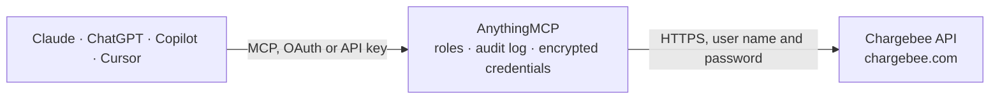

<!-- Generated by scripts/export-github-catalog.mjs in the anythingmcp-website repository. Do not edit by hand. -->

# Chargebee MCP connector

Drive Chargebee (subscription billing) from any AI agent: customers, subscriptions, invoices, plans, addons, coupons. 14 tools, Basic-auth, per-site base URL. The AnythingMCP connector gives Claude, ChatGPT, Microsoft Copilot, Cursor and Gemini 14 MCP tools for Chargebee: 9 read and 5 can change data.

**Category:** [Payments](../payments.md) · **Tools:** 14 · **Setup guide:** [anythingmcp.com](https://anythingmcp.com/guides/chargebee-to-mcp) · [Deutsch](https://anythingmcp.com/de/guides/chargebee-to-mcp) · [Italiano](https://anythingmcp.com/it/guides/chargebee-to-mcp) · [Español](https://anythingmcp.com/es/guides/chargebee-to-mcp) · [日本語](https://anythingmcp.com/ja/guides/chargebee-to-mcp) · [Русский](https://anythingmcp.com/ru/guides/chargebee-to-mcp) · [中文](https://anythingmcp.com/zh/guides/chargebee-to-mcp)

## Start without code

No installation and no terminal: AnythingMCP Cloud runs the Chargebee connector for you, operated by helpcode.ai in Frankfurt, Germany.

1. **Click the button above** and create an account or sign in. The Chargebee connector opens, ready to install.
2. **Paste the API key or token from your Chargebee account.** Every click is in the [step-by-step guide](https://anythingmcp.com/guides/chargebee-to-mcp).
3. **Click Install.** AnythingMCP shows the address of your MCP server.
4. **Add that address to your assistant:** [Claude](https://anythingmcp.com/guides/connect-chargebee-to-claude) · [ChatGPT](https://anythingmcp.com/guides/connect-chargebee-to-chatgpt) · [Microsoft Copilot](https://anythingmcp.com/guides/connect-chargebee-to-copilot) · [Cursor](https://anythingmcp.com/guides/connect-chargebee-to-cursor) · [Gemini CLI](https://anythingmcp.com/guides/connect-chargebee-to-gemini) · [Meta Muse](https://anythingmcp.com/guides/connect-chargebee-to-muse).
5. **Ask your first question**, for example: *Show invoice INV-2026-045 for customer Nordic Glass Oy, I need amount due and status.*

Prefer help with the setup? [Talk to us](https://anythingmcp.com/contact).

## How it works

- **The AI client** speaks MCP (Streamable HTTP) to AnythingMCP and only sees tool names, descriptions and results. It never gets the Chargebee credentials.
- **AnythingMCP** checks the client's role, builds the call from the tool definition, adds the credentials (user name and password), calls Chargebee, logs the call and returns the result.
- **Chargebee** sees an ordinary API client with the rights of the account the credentials belong to.

## Tools

| Tool | What it does | Access |
|---|---|---|
| [`chargebee_list_customers`](#chargebee_list_customers) | List customers with filters. | read |
| [`chargebee_get_customer`](#chargebee_get_customer) | Fetch a customer by ID. | read |
| [`chargebee_create_customer`](#chargebee_create_customer) | Create a customer. | write |
| [`chargebee_list_subscriptions`](#chargebee_list_subscriptions) | List subscriptions with filters. | read |
| [`chargebee_get_subscription`](#chargebee_get_subscription) | Fetch a subscription by ID. | read |
| [`chargebee_create_subscription_for_customer`](#chargebee_create_subscription_for_customer) | Create a subscription for an existing customer. | write |
| [`chargebee_cancel_subscription`](#chargebee_cancel_subscription) | Cancel a subscription. | write |
| [`chargebee_pause_subscription`](#chargebee_pause_subscription) | Pause a subscription. | write |
| [`chargebee_resume_subscription`](#chargebee_resume_subscription) | Resume a paused subscription. | write |
| [`chargebee_list_invoices`](#chargebee_list_invoices) | List invoices. | read |
| [`chargebee_get_invoice`](#chargebee_get_invoice) | Fetch an invoice with line items. | read |
| [`chargebee_list_items`](#chargebee_list_items) | List items (Chargebee 2.0 catalog: plans + addons + charges are all items). | read |
| [`chargebee_list_item_prices`](#chargebee_list_item_prices) | List item prices (each item has multiple prices per currency/interval). | read |
| [`chargebee_list_coupons`](#chargebee_list_coupons) | List coupons (discounts). | read |

## Tool reference

Every parameter as the AI client sees it in `tools/list`. Source: [`packages/backend/src/adapters/intl/chargebee.json`](../../../packages/backend/src/adapters/intl/chargebee.json).

### `chargebee_list_customers`

List customers with filters.

**Access:** read · **Call:** `GET /customers`

| Parameter | Type | Required | Description |
|---|---|---|---|
| `email` | string | no | Filter by email. |
| `company` | string | no | Filter by company. |
| `first_name` | string | no | First name. |
| `last_name` | string | no | Last name. |
| `auto_collection` | string | no | on or off. |
| `limit` | integer | no | Per page (max 100). |
| `offset` | string | no | Pagination offset cursor. |

### `chargebee_get_customer`

Fetch a customer by ID.

**Access:** read · **Call:** `GET /customers/{customerId}`

| Parameter | Type | Required | Description |
|---|---|---|---|
| `customerId` | string | yes | Customer ID (you assign it or Chargebee auto-generates). |

### `chargebee_create_customer`

Create a customer. id is optional — Chargebee generates one if omitted.

**Access:** write · **Call:** `POST /customers`

| Parameter | Type | Required | Description |
|---|---|---|---|
| `id` | string | no | Optional customer ID. |
| `first_name` | string | no | First name. |
| `last_name` | string | no | Last name. |
| `email` | string | no | Email. |
| `phone` | string | no | Phone. |
| `company` | string | no | Company. |
| `vat_number` | string | no | VAT number. |
| `auto_collection` | string | no | on (auto-charge cards) or off (manual). |
| `net_term_days` | integer | no | Days for invoice payment. |
| `allow_direct_debit` | boolean | no | Allow SEPA/Bacs etc. |
| `locale` | string | no | Customer locale (en, de, fr, ...). |
| `billing_address` | object | no | {first_name?, last_name?, company?, line1, city, state, country, zip, phone?}. |

### `chargebee_list_subscriptions`

List subscriptions with filters.

**Access:** read · **Call:** `GET /subscriptions`

| Parameter | Type | Required | Description |
|---|---|---|---|
| `customer_id` | string | no | Filter by customer. |
| `plan_id` | string | no | Filter by plan. |
| `status` | string | no | future, in_trial, active, non_renewing, cancelled, paused. |
| `limit` | integer | no | Per page (max 100). |
| `offset` | string | no | Cursor. |

### `chargebee_get_subscription`

Fetch a subscription by ID.

**Access:** read · **Call:** `GET /subscriptions/{subscriptionId}`

| Parameter | Type | Required | Description |
|---|---|---|---|
| `subscriptionId` | string | yes | Subscription ID. |

### `chargebee_create_subscription_for_customer`

Create a subscription for an existing customer. Uses 'item-prices' model (Chargebee 2.0+).

**Access:** write · **Call:** `POST /customers/{customerId}/subscription_for_items`

| Parameter | Type | Required | Description |
|---|---|---|---|
| `customerId` | string | yes | Customer ID. |
| `subscription_items` | any[] | yes | Array of items: [{item_price_id:'plan-1-EUR-monthly', quantity?:1, billing_cycles?:N}]. At least one plan item required. |
| `auto_collection` | string | no | on or off. |
| `po_number` | string | no | Purchase order #. |
| `start_date` | integer | no | Unix timestamp — future start (delay). Omit for now. |
| `trial_end` | integer | no | Unix timestamp end of trial. |

### `chargebee_cancel_subscription`

Cancel a subscription. end_of_term=true delays cancellation to current period end.

**Access:** write · **Call:** `POST /subscriptions/{subscriptionId}/cancel_for_items`

| Parameter | Type | Required | Description |
|---|---|---|---|
| `subscriptionId` | string | yes | Subscription ID. |
| `end_of_term` | boolean | no | If true, cancel at period end (graceful). |
| `credit_option_for_current_term_charges` | string | no | none, prorate, full. |

### `chargebee_pause_subscription`

Pause a subscription. Specify pause_option (immediately/end_of_term/specific_date).

**Access:** write · **Call:** `POST /subscriptions/{subscriptionId}/pause`

| Parameter | Type | Required | Description |
|---|---|---|---|
| `subscriptionId` | string | yes | Subscription ID. |
| `pause_option` | string | no | immediately, end_of_term, specific_date. |
| `pause_date` | integer | no | Unix timestamp (required if pause_option=specific_date). |
| `resume_date` | integer | no | Optional auto-resume Unix timestamp. |

### `chargebee_resume_subscription`

Resume a paused subscription.

**Access:** write · **Call:** `POST /subscriptions/{subscriptionId}/resume`

| Parameter | Type | Required | Description |
|---|---|---|---|
| `subscriptionId` | string | yes | Subscription ID. |
| `resume_option` | string | no | immediately, specific_date. |
| `resume_date` | integer | no | Unix timestamp (required if resume_option=specific_date). |

### `chargebee_list_invoices`

List invoices.

**Access:** read · **Call:** `GET /invoices`

| Parameter | Type | Required | Description |
|---|---|---|---|
| `customer_id` | string | no | Filter by customer. |
| `subscription_id` | string | no | Filter by subscription. |
| `status` | string | no | paid, posted, payment_due, not_paid, voided, pending. |
| `limit` | integer | no | Per page. |
| `offset` | string | no | Cursor. |

### `chargebee_get_invoice`

Fetch an invoice with line items.

**Access:** read · **Call:** `GET /invoices/{invoiceId}`

| Parameter | Type | Required | Description |
|---|---|---|---|
| `invoiceId` | string | yes | Invoice ID. |

### `chargebee_list_items`

List items (Chargebee 2.0 catalog: plans + addons + charges are all items).

**Access:** read · **Call:** `GET /items`

| Parameter | Type | Required | Description |
|---|---|---|---|
| `type` | string | no | plan, addon, charge. |
| `status` | string | no | active, archived, deleted. |
| `limit` | integer | no | Per page. |

### `chargebee_list_item_prices`

List item prices (each item has multiple prices per currency/interval).

**Access:** read · **Call:** `GET /item_prices`

| Parameter | Type | Required | Description |
|---|---|---|---|
| `item_id` | string | no | Filter by item ID. |
| `status` | string | no | active, archived, deleted. |
| `limit` | integer | no | Per page. |

### `chargebee_list_coupons`

List coupons (discounts). Each has id, name, discount_type (fixed_amount/percentage), discount_amount/percentage, valid_till, duration_type (one_time/forever/limited_period).

**Access:** read · **Call:** `GET /coupons`

| Parameter | Type | Required | Description |
|---|---|---|---|
| `limit` | integer | no | Per page. |
| `status` | string | no | active, expired, archived, deleted. |

## Run it yourself

AnythingMCP is open source (AGPL-3.0). [Run it with Docker](../../../README.md#run-it-yourself), open **Connectors → Store**, pick **Chargebee** and enter `CHARGEBEE_SITE`, `CHARGEBEE_API_KEY`, then add your MCP server URL to the AI client.

[← Payments connectors](../payments.md) · [All categories](../README.md)
