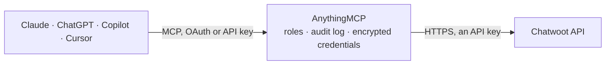

<!-- Generated by scripts/export-github-catalog.mjs in the anythingmcp-website repository. Do not edit by hand. -->

# Chatwoot MCP connector

Chatwoot omnichannel support inbox, Cloud or self-hosted: conversations and messages across WhatsApp, e-mail, web chat and social channels, contacts, labels, agents, teams, canned responses and … The AnythingMCP connector gives Claude, ChatGPT, Microsoft Copilot, Cursor and Gemini 29 MCP tools for Chatwoot: 23 read and 6 can change data.

**Category:** [Customer Support](../support.md) · **Tools:** 29 · **Setup guide:** [anythingmcp.com](https://anythingmcp.com/guides/chatwoot-to-mcp) · [Deutsch](https://anythingmcp.com/de/guides/chatwoot-to-mcp) · [Italiano](https://anythingmcp.com/it/guides/chatwoot-to-mcp) · [Español](https://anythingmcp.com/es/guides/chatwoot-to-mcp) · [日本語](https://anythingmcp.com/ja/guides/chatwoot-to-mcp) · [Русский](https://anythingmcp.com/ru/guides/chatwoot-to-mcp) · [中文](https://anythingmcp.com/zh/guides/chatwoot-to-mcp)

## Start without code

No installation and no terminal: AnythingMCP Cloud runs the Chatwoot connector for you, operated by helpcode.ai in Frankfurt, Germany.

1. **Click the button above** and create an account or sign in. The Chatwoot connector opens, ready to install.
2. **Paste the API key or token from your Chatwoot account.** Every click is in the [step-by-step guide](https://anythingmcp.com/guides/chatwoot-to-mcp).
3. **Click Install.** AnythingMCP shows the address of your MCP server.
4. **Add that address to your assistant:** [Claude](https://anythingmcp.com/guides/connect-chatwoot-to-claude) · [ChatGPT](https://anythingmcp.com/guides/connect-chatwoot-to-chatgpt) · [Microsoft Copilot](https://anythingmcp.com/guides/connect-chatwoot-to-copilot) · [Cursor](https://anythingmcp.com/guides/connect-chatwoot-to-cursor) · [Gemini CLI](https://anythingmcp.com/guides/connect-chatwoot-to-gemini) · [Meta Muse](https://anythingmcp.com/guides/connect-chatwoot-to-muse).
5. **Ask your first question**, for example: *Open conversation 4821 — who is the contact, current status, and what was the last message text and time?*

Prefer help with the setup? [Talk to us](https://anythingmcp.com/contact).

## How it works

- **The AI client** speaks MCP (Streamable HTTP) to AnythingMCP and only sees tool names, descriptions and results. It never gets the Chatwoot credentials.
- **AnythingMCP** checks the client's role, builds the call from the tool definition, adds the credentials (an API key), calls Chatwoot, logs the call and returns the result.
- **Chatwoot** sees an ordinary API client with the rights of the account the credentials belong to.

## Tools

| Tool | What it does | Access |
|---|---|---|
| [`chatwoot_get_profile`](#chatwoot_get_profile) | Get the user behind the access token: id, name, email, role, availability and every account the token can reach (accounts[].id and name). | read |
| [`chatwoot_get_account`](#chatwoot_get_account) | Get the Chatwoot account configured in CHATWOOT_ACCOUNT_ID: name, locale, domain, support e-mail, status, enabled features and custom attributes. | read |
| [`chatwoot_list_inboxes`](#chatwoot_list_inboxes) | List the inboxes (channels) of the account: id, name, channel type (WhatsApp, API, web widget, e-mail, Instagram, Telegram...), phone number,… | read |
| [`chatwoot_list_inbox_agents`](#chatwoot_list_inbox_agents) | List the agents who are members of one inbox (id, name, email, role, availability). | read |
| [`chatwoot_list_agents`](#chatwoot_list_agents) | List the agents and administrators of the account: id, name, email, role (agent or administrator), availability (online, busy, offline) and whether they… | read |
| [`chatwoot_add_agent`](#chatwoot_add_agent) | Invite a person to the account as an agent or administrator. | write |
| [`chatwoot_update_agent`](#chatwoot_update_agent) | Change an agent's role (agent or administrator), availability or auto-offline setting. | write |
| [`chatwoot_remove_agent`](#chatwoot_remove_agent) | Remove an agent from the account. | write |
| [`chatwoot_list_teams`](#chatwoot_list_teams) | List the teams of the account (id, name, description, whether auto-assignment is on). | read |
| [`chatwoot_list_team_members`](#chatwoot_list_team_members) | List the agents in one team (id, name, email, role, availability). | read |
| [`chatwoot_list_labels`](#chatwoot_list_labels) | List the labels defined in the account: id, title, description and color. | read |
| [`chatwoot_list_canned_responses`](#chatwoot_list_canned_responses) | List the canned responses (saved replies) of the account: id, short code and content. | read |
| [`chatwoot_list_custom_attributes`](#chatwoot_list_custom_attributes) | List the custom attribute definitions of the account for conversations (attribute_model 0) or contacts (1): key, display name, type and allowed values. | read |
| [`chatwoot_list_conversations`](#chatwoot_list_conversations) | List conversations, 25 per page, newest activity first, with counts (mine, assigned, unassigned, all). | read |
| [`chatwoot_count_conversations`](#chatwoot_count_conversations) | Count conversations without listing them: mine_count, assigned_count, unassigned_count and all_count for a status, inbox, team or label. | read |
| [`chatwoot_filter_conversations`](#chatwoot_filter_conversations) | Filter conversations with Chatwoot's advanced filter, 25 per page: a list of conditions on status, assignee_id, inbox_id, team_id, contact_id, priority,… | read |
| [`chatwoot_get_conversation`](#chatwoot_get_conversation) | Get one conversation by its id (the number shown in the Chatwoot URL): status, priority, inbox, labels, contact, assignee, team, custom and additional… | read |
| [`chatwoot_list_messages`](#chatwoot_list_messages) | List the messages of a conversation, oldest first: the latest 20 by default, or 20 older than before. | read |
| [`chatwoot_list_contacts`](#chatwoot_list_contacts) | List contacts with an e-mail, phone number or identifier, 15 per page: id, name, e-mail, phone, identifier, custom and additional attributes, last activity. | read |
| [`chatwoot_search_contacts`](#chatwoot_search_contacts) | Search contacts by name, e-mail, phone number or identifier (case-insensitive, partial), 15 per page. | read |
| [`chatwoot_get_contact`](#chatwoot_get_contact) | Get one contact: name, e-mail, phone, identifier, custom and additional attributes, last activity and the inboxes the contact is reachable on (with the… | read |
| [`chatwoot_list_contact_conversations`](#chatwoot_list_contact_conversations) | List the conversations of one contact across all inboxes, with status, labels, assignee and last message. | read |
| [`chatwoot_get_report_summary`](#chatwoot_get_report_summary) | Get the totals of a period for the account, an agent, an inbox, a label or a team: conversations, incoming and outgoing messages, resolutions, handled… | read |
| [`chatwoot_get_report_timeseries`](#chatwoot_get_report_timeseries) | Get one metric over time as [{value, timestamp}] buckets, for the account, an agent, an inbox, a label or a team, grouped by hour, day, week, month or year. | read |
| [`chatwoot_get_summary_by`](#chatwoot_get_summary_by) | Compare agents, inboxes or teams over a period, one row each: conversations, resolved and handled conversations, average resolution, first response and… | read |
| [`chatwoot_get_live_conversation_stats`](#chatwoot_get_live_conversation_stats) | Right now: how many conversations are open, unattended (no reply yet) and unassigned for the whole account (type account), or open and unattended per agent… | read |
| [`chatwoot_send_message`](#chatwoot_send_message) | Send a reply in an existing conversation, or add a private note that only agents see (private true). | write |
| [`chatwoot_set_conversation_labels`](#chatwoot_set_conversation_labels) | Set the labels of a conversation. | write |
| [`chatwoot_create_conversation`](#chatwoot_create_conversation) | Start a new conversation with an existing contact in an inbox, optionally with a first message, status, assignee and team. | write |

## Tool reference

Every parameter as the AI client sees it in `tools/list`. Source: [`packages/backend/src/adapters/intl/chatwoot.json`](../../../packages/backend/src/adapters/intl/chatwoot.json).

### `chatwoot_get_profile`

Get the user behind the access token: id, name, email, role, availability and every account the token can reach (accounts[].id and name). Use it to check the connection and to find the account id for CHATWOOT_ACCOUNT_ID.

**Access:** read · **Call:** `GET /api/v1/profile`

No parameters.

### `chatwoot_get_account`

Get the Chatwoot account configured in CHATWOOT_ACCOUNT_ID: name, locale, domain, support e-mail, status, enabled features and custom attributes.

**Access:** read · **Call:** `GET /api/v1/accounts/{{CHATWOOT_ACCOUNT_ID}}`

No parameters.

### `chatwoot_list_inboxes`

List the inboxes (channels) of the account: id, name, channel type (WhatsApp, API, web widget, e-mail, Instagram, Telegram...), phone number, auto-assignment, working hours and CSAT settings. The id is what other tools take as inbox_id. Channel secrets are never returned.

**Access:** read · **Call:** `GET /api/v1/accounts/{{CHATWOOT_ACCOUNT_ID}}/inboxes`

No parameters.

### `chatwoot_list_inbox_agents`

List the agents who are members of one inbox (id, name, email, role, availability). Agents only see conversations of inboxes they belong to.

**Access:** read · **Call:** `GET /api/v1/accounts/{{CHATWOOT_ACCOUNT_ID}}/inbox_members/{inbox_id}`

| Parameter | Type | Required | Description |
|---|---|---|---|
| `inbox_id` | integer | yes | Inbox id from chatwoot_list_inboxes. |

### `chatwoot_list_agents`

List the agents and administrators of the account: id, name, email, role (agent or administrator), availability (online, busy, offline) and whether they confirmed their invitation. The id is what assignee_id takes.

**Access:** read · **Call:** `GET /api/v1/accounts/{{CHATWOOT_ACCOUNT_ID}}/agents`

No parameters.

### `chatwoot_add_agent`

Invite a person to the account as an agent or administrator. Chatwoot sends them an invitation e-mail at once to set a password, and on Chatwoot Cloud every agent counts toward the paid seats. Needs an administrator token. Installed switched off. Show the name, e-mail and role to the user and wait for a yes before calling.

**Access:** write · **Call:** `POST /api/v1/accounts/{{CHATWOOT_ACCOUNT_ID}}/agents`

| Parameter | Type | Required | Description |
|---|---|---|---|
| `name` | string | yes | Full name of the agent. |
| `email` | string | yes | E-mail address the invitation goes to. |
| `role` | `agent` \| `administrator` | yes | agent sees only the conversations of their inboxes; administrator manages the whole account, its settings and reports. |
| `availability` | `online` \| `busy` \| `offline` | no | Availability the agent starts with. |
| `auto_offline` | boolean | no | true marks the agent offline automatically when they are away from Chatwoot. |

### `chatwoot_update_agent`

Change an agent's role (agent or administrator), availability or auto-offline setting. Promoting to administrator gives access to every inbox, the settings and the reports. Needs an administrator token. Installed switched off. Show the change to the user and wait for a yes.

**Access:** write · **Call:** `PATCH /api/v1/accounts/{{CHATWOOT_ACCOUNT_ID}}/agents/{agent_id}`

| Parameter | Type | Required | Description |
|---|---|---|---|
| `agent_id` | integer | yes | Agent id from chatwoot_list_agents (the user id, not the e-mail). |
| `role` | `agent` \| `administrator` | yes | Role to set; Chatwoot requires it on every update, so send the current role to keep it. |
| `availability` | `online` \| `busy` \| `offline` | no | New availability. |
| `auto_offline` | boolean | no | true marks the agent offline automatically when they are away from Chatwoot. |

### `chatwoot_remove_agent`

Remove an agent from the account. They lose access to the account at once; to undo it, invite them again. Needs an administrator token. Installed switched off. Name the agent to the user and wait for a yes.

**Access:** write · **Call:** `DELETE /api/v1/accounts/{{CHATWOOT_ACCOUNT_ID}}/agents/{agent_id}`

| Parameter | Type | Required | Description |
|---|---|---|---|
| `agent_id` | integer | yes | Agent id from chatwoot_list_agents (the user id, not the e-mail). |

### `chatwoot_list_teams`

List the teams of the account (id, name, description, whether auto-assignment is on). The id is what team_id takes.

**Access:** read · **Call:** `GET /api/v1/accounts/{{CHATWOOT_ACCOUNT_ID}}/teams`

No parameters.

### `chatwoot_list_team_members`

List the agents in one team (id, name, email, role, availability).

**Access:** read · **Call:** `GET /api/v1/accounts/{{CHATWOOT_ACCOUNT_ID}}/teams/{team_id}/team_members`

| Parameter | Type | Required | Description |
|---|---|---|---|
| `team_id` | integer | yes | Team id from chatwoot_list_teams. |

### `chatwoot_list_labels`

List the labels defined in the account: id, title, description and color. Conversations and contacts are tagged with the title.

**Access:** read · **Call:** `GET /api/v1/accounts/{{CHATWOOT_ACCOUNT_ID}}/labels`

No parameters.

### `chatwoot_list_canned_responses`

List the canned responses (saved replies) of the account: id, short code and content. Optional search narrows by short code or content.

**Access:** read · **Call:** `GET /api/v1/accounts/{{CHATWOOT_ACCOUNT_ID}}/canned_responses`

| Parameter | Type | Required | Description |
|---|---|---|---|
| `search` | string | no | Text to look for in the short code or content. |

### `chatwoot_list_custom_attributes`

List the custom attribute definitions of the account for conversations (attribute_model 0) or contacts (1): key, display name, type and allowed values. The key is what appears in custom_attributes.

**Access:** read · **Call:** `GET /api/v1/accounts/{{CHATWOOT_ACCOUNT_ID}}/custom_attribute_definitions`

| Parameter | Type | Required | Description |
|---|---|---|---|
| `attribute_model` | `0` \| `1` | yes | 0 for conversation attributes, 1 for contact attributes. |

### `chatwoot_list_conversations`

List conversations, 25 per page, newest activity first, with counts (mine, assigned, unassigned, all). Each row has id, status, priority, inbox, labels, unread count, contact, assignee, team and the last message. Page with page until conversations is empty. Times are Unix seconds.

**Access:** read · **Call:** `GET /api/v1/accounts/{{CHATWOOT_ACCOUNT_ID}}/conversations`

| Parameter | Type | Required | Description |
|---|---|---|---|
| `status` | `open` \| `resolved` \| `pending` \| `snoozed` \| `all` | no | Conversation status. Default open. Ignored by Chatwoot when q is set. |
| `assignee_type` | `me` \| `assigned` \| `unassigned` \| `all` | no | Whose conversations: me (assigned to the token's user), assigned, unassigned or all (default). |
| `inbox_id` | integer | no | Only this inbox (id from chatwoot_list_inboxes). |
| `team_id` | integer | no | Only this team (id from chatwoot_list_teams). |
| `labels` | string[] | no | Only conversations carrying any of these label titles, e.g. ["vip"]. |
| `q` | string | no | Text to search for in the messages of the conversations. |
| `page` | integer | no | Page, starting at 1. |

### `chatwoot_count_conversations`

Count conversations without listing them: mine_count, assigned_count, unassigned_count and all_count for a status, inbox, team or label. Cheaper than chatwoot_list_conversations for a dashboard question such as "how many open chats are unassigned?".

**Access:** read · **Call:** `GET /api/v1/accounts/{{CHATWOOT_ACCOUNT_ID}}/conversations/meta`

| Parameter | Type | Required | Description |
|---|---|---|---|
| `status` | `open` \| `resolved` \| `pending` \| `snoozed` \| `all` | no | Conversation status. Default open. Ignored by Chatwoot when q is set. |
| `inbox_id` | integer | no | Only this inbox (id from chatwoot_list_inboxes). |
| `team_id` | integer | no | Only this team (id from chatwoot_list_teams). |
| `labels` | string[] | no | Only conversations carrying any of these label titles, e.g. ["vip"]. |
| `q` | string | no | Text to search for in the messages of the conversations. |

### `chatwoot_filter_conversations`

Filter conversations with Chatwoot's advanced filter, 25 per page: a list of conditions on status, assignee_id, inbox_id, team_id, contact_id, priority, display_id, labels, created_at or last_activity_at, joined with AND or OR. Read-only, although it is a POST.

**Access:** read · **Call:** `POST /api/v1/accounts/{{CHATWOOT_ACCOUNT_ID}}/conversations/filter`

| Parameter | Type | Required | Description |
|---|---|---|---|
| `conditions` | object[] | yes | Conditions, e.g. [{"attribute_key":"status","filter_operator":"equal_to","values":["open"],"query_operator":"AND"},{"attribute_key":"created_at","filter_operator":"is_greater_than","values":["2026-10-01"],"query_operator":null}]. Operators: equal_to, not_equal_to, contains, does_not_contain, is_present, is_not_present, is_greater_than, is_less_than, days_before. query_operator joins a condition with the next one; the last one is ignored. |
| `sort_by` | `last_activity_at_desc` \| `last_activity_at_asc` \| `created_at_desc` \| `created_at_asc` \| `priority_desc` \| `priority_asc` \| `waiting_since_asc` \| `waiting_since_desc` | no | Sort order. |
| `page` | integer | no | Page, starting at 1. |

### `chatwoot_get_conversation`

Get one conversation by its id (the number shown in the Chatwoot URL): status, priority, inbox, labels, contact, assignee, team, custom and additional attributes and the last message. Read the messages with chatwoot_list_messages.

**Access:** read · **Call:** `GET /api/v1/accounts/{{CHATWOOT_ACCOUNT_ID}}/conversations/{conversation_id}`

| Parameter | Type | Required | Description |
|---|---|---|---|
| `conversation_id` | integer | yes | Conversation id (display id). |

### `chatwoot_list_messages`

List the messages of a conversation, oldest first: the latest 20 by default, or 20 older than before. message_type 0 = incoming (from the contact), 1 = outgoing (agent or bot), 2 = activity (system note), 3 = template; private true = internal note. Attachments come with their URL and type.

**Access:** read · **Call:** `GET /api/v1/accounts/{{CHATWOOT_ACCOUNT_ID}}/conversations/{conversation_id}/messages`

| Parameter | Type | Required | Description |
|---|---|---|---|
| `conversation_id` | integer | yes | Conversation id. |
| `before` | integer | no | Return the 20 messages before this message id, to read further back. |
| `after` | integer | no | Return up to 100 messages after this message id. |

### `chatwoot_list_contacts`

List contacts with an e-mail, phone number or identifier, 15 per page: id, name, e-mail, phone, identifier, custom and additional attributes, last activity. meta.count is the total. Sort with sort, e.g. -last_activity_at for the most recent first.

**Access:** read · **Call:** `GET /api/v1/accounts/{{CHATWOOT_ACCOUNT_ID}}/contacts`

| Parameter | Type | Required | Description |
|---|---|---|---|
| `sort` | `name` \| `-name` \| `email` \| `-email` \| `phone_number` \| `-phone_number` \| `last_activity_at` \| `-last_activity_at` \| `created_at` \| `-created_at` | no | Sort field; prefix with - for descending. |
| `page` | integer | no | Page, starting at 1. |

### `chatwoot_search_contacts`

Search contacts by name, e-mail, phone number or identifier (case-insensitive, partial), 15 per page. meta.has_more tells whether another page exists. Use it to find the contact id before reading their conversations.

**Access:** read · **Call:** `GET /api/v1/accounts/{{CHATWOOT_ACCOUNT_ID}}/contacts/search`

| Parameter | Type | Required | Description |
|---|---|---|---|
| `q` | string | yes | Name, e-mail, phone number (e.g. +5511987654321) or identifier to look for. |
| `sort` | `name` \| `-name` \| `email` \| `-email` \| `last_activity_at` \| `-last_activity_at` | no | Sort field; prefix with - for descending. |
| `page` | integer | no | Page, starting at 1. |

### `chatwoot_get_contact`

Get one contact: name, e-mail, phone, identifier, custom and additional attributes, last activity and the inboxes the contact is reachable on (with the source_id each inbox knows them by).

**Access:** read · **Call:** `GET /api/v1/accounts/{{CHATWOOT_ACCOUNT_ID}}/contacts/{contact_id}`

| Parameter | Type | Required | Description |
|---|---|---|---|
| `contact_id` | integer | yes | Contact id. |

### `chatwoot_list_contact_conversations`

List the conversations of one contact across all inboxes, with status, labels, assignee and last message.

**Access:** read · **Call:** `GET /api/v1/accounts/{{CHATWOOT_ACCOUNT_ID}}/contacts/{contact_id}/conversations`

| Parameter | Type | Required | Description |
|---|---|---|---|
| `contact_id` | integer | yes | Contact id. |

### `chatwoot_get_report_summary`

Get the totals of a period for the account, an agent, an inbox, a label or a team: conversations, incoming and outgoing messages, resolutions, handled conversations, average first response time, resolution time and reply time (seconds), plus the same figures for the previous period of equal length under previous. Needs an administrator token.

**Access:** read · **Call:** `GET /api/v2/accounts/{{CHATWOOT_ACCOUNT_ID}}/reports/summary`

| Parameter | Type | Required | Description |
|---|---|---|---|
| `type` | `account` \| `agent` \| `inbox` \| `label` \| `team` | yes | What to summarise. |
| `id` | integer | no | Id of the agent, inbox, label or team; not needed for account. |
| `since` | string | yes | Start, Unix timestamp in seconds, e.g. 1759276800 for 2025-10-01 00:00 UTC. |
| `until` | string | yes | End, Unix timestamp in seconds. |
| `business_hours` | boolean | no | true to count times within business hours only. |

### `chatwoot_get_report_timeseries`

Get one metric over time as [{value, timestamp}] buckets, for the account, an agent, an inbox, a label or a team, grouped by hour, day, week, month or year. Times are seconds for the *_time metrics. Needs an administrator token.

**Access:** read · **Call:** `GET /api/v2/accounts/{{CHATWOOT_ACCOUNT_ID}}/reports`

| Parameter | Type | Required | Description |
|---|---|---|---|
| `metric` | `conversations_count` \| `incoming_messages_count` \| `outgoing_messages_count` \| `avg_first_response_time` \| `avg_resolution_time` \| `resolutions_count` \| `reply_time` | yes | The metric. |
| `type` | `account` \| `agent` \| `inbox` \| `label` \| `team` | yes | What to report on. |
| `id` | integer | no | Id of the agent, inbox, label or team; not needed for account. |
| `since` | string | yes | Start, Unix timestamp in seconds. |
| `until` | string | yes | End, Unix timestamp in seconds. |
| `group_by` | `hour` \| `day` \| `week` \| `month` \| `year` | no | Bucket size. Default day. |
| `timezone_offset` | number | no | Hours from UTC for the buckets, e.g. -3 for Brasília, 1 for CET. |
| `business_hours` | boolean | no | true to count times within business hours only. |

### `chatwoot_get_summary_by`

Compare agents, inboxes or teams over a period, one row each: conversations, resolved and handled conversations, average resolution, first response and reply time (seconds, null when nothing happened). Match the ids with chatwoot_list_agents, chatwoot_list_inboxes or chatwoot_list_teams. Needs an administrator token.

**Access:** read · **Call:** `GET /api/v2/accounts/{{CHATWOOT_ACCOUNT_ID}}/summary_reports/{group}`

| Parameter | Type | Required | Description |
|---|---|---|---|
| `group` | `agent` \| `inbox` \| `team` | yes | What each row is. |
| `since` | string | yes | Start, Unix timestamp in seconds. |
| `until` | string | yes | End, Unix timestamp in seconds. |
| `business_hours` | boolean | no | true to count times within business hours only. |

### `chatwoot_get_live_conversation_stats`

Right now: how many conversations are open, unattended (no reply yet) and unassigned for the whole account (type account), or open and unattended per agent (type agent). Needs an administrator token.

**Access:** read · **Call:** `GET /api/v2/accounts/{{CHATWOOT_ACCOUNT_ID}}/reports/conversations`

| Parameter | Type | Required | Description |
|---|---|---|---|
| `type` | `account` \| `agent` | yes | account for totals, agent for one row per agent. |

### `chatwoot_send_message`

Send a reply in an existing conversation, or add a private note that only agents see (private true). A reply goes out to the contact at once on the conversation's channel. On WhatsApp Cloud API inboxes free text only reaches the contact within 24 hours of their last message. Installed switched off. Show the text and the conversation to the user and wait for a yes before sending.

**Access:** write · **Call:** `POST /api/v1/accounts/{{CHATWOOT_ACCOUNT_ID}}/conversations/{conversation_id}/messages`

| Parameter | Type | Required | Description |
|---|---|---|---|
| `conversation_id` | integer | yes | Conversation id. |
| `content` | string | yes | Message text. |
| `private` | boolean | no | true for an internal note visible to agents only; false (default) sends it to the contact. |

### `chatwoot_set_conversation_labels`

Set the labels of a conversation. Chatwoot REPLACES the whole list: to add a label, read the current ones (chatwoot_get_conversation) and send them together with the new one; to remove one, send the list without it. Labels must exist in the account (chatwoot_list_labels).

**Access:** write · **Call:** `POST /api/v1/accounts/{{CHATWOOT_ACCOUNT_ID}}/conversations/{conversation_id}/labels`

| Parameter | Type | Required | Description |
|---|---|---|---|
| `conversation_id` | integer | yes | Conversation id. |
| `labels` | string[] | yes | The complete list of label titles the conversation should carry afterwards, e.g. ["vip","billing"]. An empty list removes all labels. |

### `chatwoot_create_conversation`

Start a new conversation with an existing contact in an inbox, optionally with a first message, status, assignee and team. With a first message this contacts the customer at once; on WhatsApp Cloud API inboxes a free-text first message only goes out within 24 hours of the contact's last message. Installed switched off. Confirm the contact, inbox and text with the user first.

**Access:** write · **Call:** `POST /api/v1/accounts/{{CHATWOOT_ACCOUNT_ID}}/conversations`

| Parameter | Type | Required | Description |
|---|---|---|---|
| `inbox_id` | integer | yes | Inbox id from chatwoot_list_inboxes. |
| `contact_id` | integer | yes | Contact id from chatwoot_search_contacts. |
| `source_id` | string | no | The contact's source_id in that inbox (from chatwoot_get_contact, contact_inboxes). Needed when the contact has more than one identity in the inbox. |
| `message` | string | no | Optional first message, sent to the contact. |
| `status` | `open` \| `pending` \| `snoozed` | no | Initial status. |
| `assignee_id` | integer | no | Agent id to assign the conversation to. |
| `team_id` | integer | no | Team id to assign the conversation to. |

## Run it yourself

AnythingMCP is open source (AGPL-3.0). [Run it with Docker](../../../README.md#run-it-yourself), open **Connectors → Store**, pick **Chatwoot** and enter `CHATWOOT_URL`, `CHATWOOT_API_TOKEN`, `CHATWOOT_ACCOUNT_ID`, then add your MCP server URL to the AI client.

[← Customer Support connectors](../support.md) · [All categories](../README.md)
