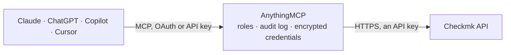

<!-- Generated by scripts/export-github-catalog.mjs in the anythingmcp-website repository. Do not edit by hand. -->

# Checkmk MCP connector

Checkmk monitoring: hosts and their configuration, live service states, acknowledged and unhandled problems, host groups and downtimes. The AnythingMCP connector gives Claude, ChatGPT, Microsoft Copilot, Cursor and Gemini 9 MCP tools for Checkmk, all read-only.

**Category:** [Monitoring](../monitoring.md) · **Tools:** 9 · **Setup guide:** [anythingmcp.com](https://anythingmcp.com/guides/checkmk-to-mcp) · [Deutsch](https://anythingmcp.com/de/guides/checkmk-to-mcp) · [Italiano](https://anythingmcp.com/it/guides/checkmk-to-mcp) · [Español](https://anythingmcp.com/es/guides/checkmk-to-mcp) · [日本語](https://anythingmcp.com/ja/guides/checkmk-to-mcp) · [Русский](https://anythingmcp.com/ru/guides/checkmk-to-mcp) · [中文](https://anythingmcp.com/zh/guides/checkmk-to-mcp)

## Start without code

No installation and no terminal: AnythingMCP Cloud runs the Checkmk connector for you, operated by helpcode.ai in Frankfurt, Germany.

1. **Click the button above** and create an account or sign in. The Checkmk connector opens, ready to install.
2. **Paste the API key or token from your Checkmk account.** Every click is in the [step-by-step guide](https://anythingmcp.com/guides/checkmk-to-mcp).
3. **Click Install.** AnythingMCP shows the address of your MCP server.
4. **Add that address to your assistant:** [Claude](https://anythingmcp.com/guides/connect-checkmk-to-claude) · [ChatGPT](https://anythingmcp.com/guides/connect-checkmk-to-chatgpt) · [Microsoft Copilot](https://anythingmcp.com/guides/connect-checkmk-to-copilot) · [Cursor](https://anythingmcp.com/guides/connect-checkmk-to-cursor) · [Gemini CLI](https://anythingmcp.com/guides/connect-checkmk-to-gemini) · [Meta Muse](https://anythingmcp.com/guides/connect-checkmk-to-muse).
5. **Ask your first question**, for example: *What folder and IP does host web-01.bergmann GmbH have in our monitoring?*

Prefer help with the setup? [Talk to us](https://anythingmcp.com/contact).

## How it works

- **The AI client** speaks MCP (Streamable HTTP) to AnythingMCP and only sees tool names, descriptions and results. It never gets the Checkmk credentials.
- **AnythingMCP** checks the client's role, builds the call from the tool definition, adds the credentials (an API key), calls Checkmk, logs the call and returns the result.
- **Checkmk** sees an ordinary API client with the rights of the account the credentials belong to.

## Tools

| Tool | What it does | Access |
|---|---|---|
| [`checkmk_get_version`](#checkmk_get_version) | Read the Checkmk version and edition of this site. | read |
| [`checkmk_list_hosts`](#checkmk_list_hosts) | List hosts from the *configuration*: what has been set up for monitoring, with folder, attributes and effective settings. | read |
| [`checkmk_get_host_config`](#checkmk_get_host_config) | Read one host's configuration: its folder, IP address, tags, labels and the attributes it inherits. | read |
| [`checkmk_list_host_states`](#checkmk_list_host_states) | Read the *live* state of hosts: up, down or unreachable, with the check output and how long each has been that way. | read |
| [`checkmk_list_service_states`](#checkmk_list_service_states) | Read the *live* state of services — the red, amber and green checks. | read |
| [`checkmk_list_host_services`](#checkmk_list_host_services) | Read every service on one host with its current state and check output — the drill-down after a host has been flagged. | read |
| [`checkmk_list_host_groups`](#checkmk_list_host_groups) | List the host groups configured on this site with their alias, so a query can be scoped to a part of the estate. | read |
| [`checkmk_list_downtimes`](#checkmk_list_downtimes) | List scheduled downtimes with their host, service, comment, author and window — the explanation for why an alert did not fire. | read |
| [`checkmk_list_folders`](#checkmk_list_folders) | List the Checkmk folder tree with each folder's title, path and attributes — how hosts are organised and where settings are inherited from. | read |

## Tool reference

Every parameter as the AI client sees it in `tools/list`. Source: [`packages/backend/src/adapters/de/checkmk.json`](../../../packages/backend/src/adapters/de/checkmk.json).

### `checkmk_get_version`

Read the Checkmk version and edition of this site. No parameters and the lightest permission — the fastest proof that URL, site name and automation secret all line up.

**Access:** read · **Call:** `GET /version`

No parameters.

### `checkmk_list_hosts`

List hosts from the *configuration*: what has been set up for monitoring, with folder, attributes and effective settings. Not the live state.

**Access:** read · **Call:** `GET /domain-types/host_config/collections/all`

| Parameter | Type | Required | Description |
|---|---|---|---|
| `effective_attributes` | boolean | no | When true, include attributes inherited from the folder. |
| `hostnames` | string[] | no | List of exact host names to return, e.g. ["web01", "db01"]. Checkmk has no name-fragment search here; for a fragment use checkmk_list_host_states with a `~` query on `name`. |
| `site` | string | no | Only hosts monitored by this site. |

### `checkmk_get_host_config`

Read one host's configuration: its folder, IP address, tags, labels and the attributes it inherits.

**Access:** read · **Call:** `GET /objects/host_config/{hostName}`

| Parameter | Type | Required | Description |
|---|---|---|---|
| `hostName` | string | yes | Host name as configured in Checkmk. |
| `effective_attributes` | boolean | no | When true, include inherited attributes. |

### `checkmk_list_host_states`

Read the *live* state of hosts: up, down or unreachable, with the check output and how long each has been that way.

**Access:** read · **Call:** `POST /domain-types/host/collections/all`

| Parameter | Type | Required | Description |
|---|---|---|---|
| `query` | string | no | Livestatus filter as JSON, e.g. {"op": "=", "left": "state", "right": "1"} for hosts that are down. |
| `columns` | string | no | One extra Livestatus column to return on top of the defaults, e.g. `last_state_change` or `perf_data`. |

### `checkmk_list_service_states`

Read the *live* state of services — the red, amber and green checks. State 0 is OK, 1 warning, 2 critical, 3 unknown.

**Access:** read · **Call:** `POST /domain-types/service/collections/all`

| Parameter | Type | Required | Description |
|---|---|---|---|
| `query` | string | no | Livestatus filter as JSON, e.g. {"op": ">", "left": "state", "right": "0"} for everything not OK. |
| `host_name` | string | no | Restrict to one host's services. |
| `columns` | string | no | One extra Livestatus column to return on top of the defaults, e.g. `last_state_change` or `perf_data`. |

### `checkmk_list_host_services`

Read every service on one host with its current state and check output — the drill-down after a host has been flagged.

**Access:** read · **Call:** `POST /objects/host/{hostName}/collections/services`

| Parameter | Type | Required | Description |
|---|---|---|---|
| `hostName` | string | yes | Host name as configured in Checkmk. |
| `columns` | string | no | One extra Livestatus column to return on top of the defaults, e.g. `last_state_change` or `perf_data`. |

### `checkmk_list_host_groups`

List the host groups configured on this site with their alias, so a query can be scoped to a part of the estate.

**Access:** read · **Call:** `GET /domain-types/host_group_config/collections/all`

No parameters.

### `checkmk_list_downtimes`

List scheduled downtimes with their host, service, comment, author and window — the explanation for why an alert did not fire.

**Access:** read · **Call:** `GET /domain-types/downtime/collections/all`

| Parameter | Type | Required | Description |
|---|---|---|---|
| `host_name` | string | no | Restrict to one host's downtimes. |
| `downtime_type` | string | no | `host` or `service`. |

### `checkmk_list_folders`

List the Checkmk folder tree with each folder's title, path and attributes — how hosts are organised and where settings are inherited from.

**Access:** read · **Call:** `GET /domain-types/folder_config/collections/all`

| Parameter | Type | Required | Description |
|---|---|---|---|
| `recursive` | boolean | no | When true, return the whole tree rather than the top level. |

## Run it yourself

AnythingMCP is open source (AGPL-3.0). [Run it with Docker](../../../README.md#run-it-yourself), open **Connectors → Store**, pick **Checkmk** and enter `CHECKMK_URL`, `CHECKMK_USERNAME`, `CHECKMK_SECRET`, then add your MCP server URL to the AI client.

[← Monitoring connectors](../monitoring.md) · [All categories](../README.md)
