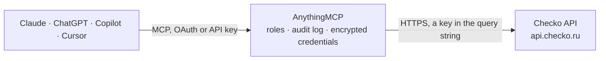

<!-- Generated by scripts/export-github-catalog.mjs in the anythingmcp-website repository. Do not edit by hand. -->

# Checko MCP connector

Checko due diligence on Russian companies and entrepreneurs (EGRUL, EGRIP): company details, directors and founders, contacts, financial statements, reliability score, arbitration cases, enforcement … The AnythingMCP connector gives Claude, ChatGPT, Microsoft Copilot, Cursor and Gemini 14 MCP tools for Checko, all read-only.

**Category:** [Data Enrichment](../enrichment.md) · **Tools:** 14 · **Setup guide:** [anythingmcp.com](https://anythingmcp.com/guides/checko-to-mcp) · [Deutsch](https://anythingmcp.com/de/guides/checko-to-mcp) · [Italiano](https://anythingmcp.com/it/guides/checko-to-mcp) · [Español](https://anythingmcp.com/es/guides/checko-to-mcp) · [日本語](https://anythingmcp.com/ja/guides/checko-to-mcp) · [Русский](https://anythingmcp.com/ru/guides/checko-to-mcp) · [中文](https://anythingmcp.com/zh/guides/checko-to-mcp)

## Start without code

No installation and no terminal: AnythingMCP Cloud runs the Checko connector for you, operated by helpcode.ai in Frankfurt, Germany.

1. **Click the button above** and create an account or sign in. The Checko connector opens, ready to install.
2. **Paste the API key or token from your Checko account.** Every click is in the [step-by-step guide](https://anythingmcp.com/guides/checko-to-mcp).
3. **Click Install.** AnythingMCP shows the address of your MCP server.
4. **Add that address to your assistant:** [Claude](https://anythingmcp.com/guides/connect-checko-to-claude) · [ChatGPT](https://anythingmcp.com/guides/connect-checko-to-chatgpt) · [Microsoft Copilot](https://anythingmcp.com/guides/connect-checko-to-copilot) · [Cursor](https://anythingmcp.com/guides/connect-checko-to-cursor) · [Gemini CLI](https://anythingmcp.com/guides/connect-checko-to-gemini) · [Meta Muse](https://anythingmcp.com/guides/connect-checko-to-muse).
5. **Ask your first question**, for example: *Find INN and current director for ООО СеверТехСнаб (search by name, Moscow)*

Prefer help with the setup? [Talk to us](https://anythingmcp.com/contact).

## How it works

- **The AI client** speaks MCP (Streamable HTTP) to AnythingMCP and only sees tool names, descriptions and results. It never gets the Checko credentials.
- **AnythingMCP** checks the client's role, builds the call from the tool definition, adds the credentials (a key in the query string), calls Checko, logs the call and returns the result.
- **Checko** sees an ordinary API client with the rights of the account the credentials belong to.

## Tools

| Tool | What it does | Access |
|---|---|---|
| [`checko_search`](#checko_search) | Search Russian organisations or entrepreneurs in the EGRUL / EGRIP registers by name, founder, director, OKVED activity code, registration or update date,… | read |
| [`checko_get_company`](#checko_get_company) | Get a Russian organisation from EGRUL by INN, OGRN or OKPO: names, status and liquidation, registration, legal address, main and additional OKVED,… | read |
| [`checko_get_entrepreneur`](#checko_get_entrepreneur) | Get an individual entrepreneur (IP) from EGRIP by INN, OGRNIP or OKPO: full name, status, registration and termination, OKVED codes, region, contacts, SME… | read |
| [`checko_get_person`](#checko_get_person) | Get the business links of a private person by personal INN: organisations where the person is director or founder, and entrepreneur registrations, each with… | read |
| [`checko_get_finances`](#checko_get_finances) | Get the financial statements (balance sheet and profit and loss lines by code, e.g. 2110 revenue, 2400 net profit, 1600 total assets) of an organisation for… | read |
| [`checko_get_reliability`](#checko_get_reliability) | Get a reliability assessment of an organisation or entrepreneur: business scale, financial risk, positive and negative factors with an overall verdict. | read |
| [`checko_get_timeline`](#checko_get_timeline) | Get the history of events and register changes of an organisation, entrepreneur or person: registration, changes of directors, founders, addresses, capital,… | read |
| [`checko_list_legal_cases`](#checko_list_legal_cases) | List arbitration court cases (Kartoteka arbitrazhnykh del) of an organisation or entrepreneur: case number, court, date, claim amount, role, parties, status. | read |
| [`checko_list_enforcements`](#checko_list_enforcements) | List enforcement proceedings (FSSP bailiff service) opened against an organisation: number, date, subject, amount and remaining debt, bailiff department. | read |
| [`checko_list_contracts`](#checko_list_contracts) | List public procurement contracts of an organisation or entrepreneur under 44-FZ, 94-FZ or 223-FZ, as customer or supplier: registry number, date, price,… | read |
| [`checko_list_fedresurs_messages`](#checko_list_fedresurs_messages) | List Fedresurs messages about an organisation or entrepreneur (pledges, leasing, intentions to liquidate or reduce capital, net assets and other notices),… | read |
| [`checko_list_bankruptcy_messages`](#checko_list_bankruptcy_messages) | List EFRSB bankruptcy register messages about an organisation, entrepreneur or person: message type, date, case number, arbitration manager. | read |
| [`checko_list_inspections`](#checko_list_inspections) | List state inspections and control measures (FGIS ERP / ERKNM of the Prosecutor General) of an organisation or entrepreneur: authority, type, dates, result… | read |
| [`checko_get_bank`](#checko_get_bank) | Get a Russian bank or credit institution by BIC from the Bank of Russia directory: name, English name, address, type, correspondent account and its other… | read |

## Tool reference

Every parameter as the AI client sees it in `tools/list`. Source: [`packages/backend/src/adapters/intl/checko.json`](../../../packages/backend/src/adapters/intl/checko.json).

### `checko_search`

Search Russian organisations or entrepreneurs in the EGRUL / EGRIP registers by name, founder, director, OKVED activity code, registration or update date, phone or e-mail. Returns OGRN, INN, KPP, names, status, region, address and main OKVED per hit, 100 per page. Use it to find the INN, then call the detail tools.

**Access:** read · **Call:** `GET /search`

| Parameter | Type | Required | Description |
|---|---|---|---|
| `by` | `name` \| `founder-name` \| `leader-name` \| `okved` \| `reg-date` \| `upd-date` \| `phone` \| `email` | yes | Search type: name (organisation name or entrepreneur full name), founder-name, leader-name, okved, reg-date, upd-date, phone, email. founder-name, leader-name, phone and email work for organisations only. |
| `obj` | `org` \| `ent` | yes | org for organisations, ent for individual entrepreneurs. |
| `query` | string | yes | Search text: at least 4 characters for names; YYYY-MM-DD for dates; +7XXXXXXXXXX or 8XXXXXXXXXX for phones; an OKVED code for okved. |
| `region` | string | no | Two-digit region code, e.g. 77 for Moscow. |
| `okved` | string | no | Only this main OKVED-2 code (not with by=okved). |
| `opf` | string | no | Only this legal form code (OKOPF, 2 or 5 digits); organisations searched by okved, dates, phone or e-mail. |
| `active` | boolean | no | Only active organisations or entrepreneurs. |
| `all_okved_codes` | `all` | no | With by=okved, set to all to also match additional activity codes, not only the main one. |
| `limit` | integer | no | Results per page, at most 100 (default 100). |
| `page` | integer | no | Page number, starting at 1. |

### `checko_get_company`

Get a Russian organisation from EGRUL by INN, OGRN or OKPO: names, status and liquidation, registration, legal address, main and additional OKVED, directors, founders and shares, related companies, licences, branches, contacts (phones, e-mails, website), taxes and tax debts, SME register, risk factors and sanctions. Give one of inn, ogrn or okpo.

**Access:** read · **Call:** `GET /company`

| Parameter | Type | Required | Description |
|---|---|---|---|
| `inn` | string | no | Organisation INN, 10 digits, e.g. 7707083893. |
| `ogrn` | string | no | Organisation OGRN, 13 digits. |
| `okpo` | string | no | OKPO code, if neither INN nor OGRN is known. |

### `checko_get_entrepreneur`

Get an individual entrepreneur (IP) from EGRIP by INN, OGRNIP or OKPO: full name, status, registration and termination, OKVED codes, region, contacts, SME register, taxes and risk factors. Give one of inn, ogrn or okpo.

**Access:** read · **Call:** `GET /entrepreneur`

| Parameter | Type | Required | Description |
|---|---|---|---|
| `inn` | string | no | Entrepreneur INN, 12 digits. |
| `ogrn` | string | no | OGRNIP, 15 digits. |
| `okpo` | string | no | OKPO code, if neither INN nor OGRNIP is known. |

### `checko_get_person`

Get the business links of a private person by personal INN: organisations where the person is director or founder, and entrepreneur registrations, each with status, region, address and main OKVED.

**Access:** read · **Call:** `GET /person`

| Parameter | Type | Required | Description |
|---|---|---|---|
| `inn` | string | yes | Personal INN, 12 digits. |

### `checko_get_finances`

Get the financial statements (balance sheet and profit and loss lines by code, e.g. 2110 revenue, 2400 net profit, 1600 total assets) of an organisation for 2011 to 2025 from Rosstat and the FNS GIR BO register. extended=true returns the extended version.

**Access:** read · **Call:** `GET /finances`

| Parameter | Type | Required | Description |
|---|---|---|---|
| `inn` | string | no | INN: 10 digits for an organisation, 12 for an entrepreneur or a person, e.g. 7707083893. |
| `ogrn` | string | no | OGRN (13 digits) of an organisation or OGRNIP (15 digits) of an entrepreneur; use instead of inn. |
| `extended` | boolean | no | Return the extended statements. |

### `checko_get_reliability`

Get a reliability assessment of an organisation or entrepreneur: business scale, financial risk, positive and negative factors with an overall verdict. A quick due-diligence answer before a contract.

**Access:** read · **Call:** `GET /reliability`

| Parameter | Type | Required | Description |
|---|---|---|---|
| `inn` | string | no | INN: 10 digits for an organisation, 12 for an entrepreneur or a person, e.g. 7707083893. |
| `ogrn` | string | no | OGRN (13 digits) of an organisation or OGRNIP (15 digits) of an entrepreneur; use instead of inn. |

### `checko_get_timeline`

Get the history of events and register changes of an organisation, entrepreneur or person: registration, changes of directors, founders, addresses, capital, statements filed, bankruptcy messages, newest first.

**Access:** read · **Call:** `GET /timeline`

| Parameter | Type | Required | Description |
|---|---|---|---|
| `inn` | string | no | INN of the organisation (10 digits), entrepreneur or person (12 digits). |
| `ogrn` | string | no | OGRN (13 digits) of an organisation or OGRNIP (15 digits) of an entrepreneur; use instead of inn. |

### `checko_list_legal_cases`

List arbitration court cases (Kartoteka arbitrazhnykh del) of an organisation or entrepreneur: case number, court, date, claim amount, role, parties, status. Filter by role, period, claim amount, only actual or only active cases; 100 per page.

**Access:** read · **Call:** `GET /legal-cases`

| Parameter | Type | Required | Description |
|---|---|---|---|
| `inn` | string | no | INN: 10 digits for an organisation, 12 for an entrepreneur or a person, e.g. 7707083893. |
| `ogrn` | string | no | OGRN (13 digits) of an organisation or OGRNIP (15 digits) of an entrepreneur; use instead of inn. |
| `role` | `plaintiff` \| `defendant` | no | plaintiff or defendant. |
| `actual` | boolean | no | Only actual cases (without returned or rejected claims, waived or terminated cases). |
| `active` | boolean | no | Only cases not yet finished. |
| `date_from` | string | no | Start of the period, YYYY-MM-DD. |
| `date_to` | string | no | End of the period, YYYY-MM-DD. |
| `claim_amount_from` | number | no | Minimum claim amount, roubles. |
| `claim_amount_to` | number | no | Maximum claim amount, roubles. |
| `limit` | integer | no | Results per page, at most 100 (default 100). |
| `page` | integer | no | Page number, starting at 1. |
| `sort` | `date` \| `-date` | no | date (oldest first) or -date (newest first). |

### `checko_list_enforcements`

List enforcement proceedings (FSSP bailiff service) opened against an organisation: number, date, subject, amount and remaining debt, bailiff department. 100 per page.

**Access:** read · **Call:** `GET /enforcements`

| Parameter | Type | Required | Description |
|---|---|---|---|
| `inn` | string | no | INN: 10 digits for an organisation, 12 for an entrepreneur or a person, e.g. 7707083893. |
| `ogrn` | string | no | OGRN (13 digits) of an organisation or OGRNIP (15 digits) of an entrepreneur; use instead of inn. |
| `limit` | integer | no | Results per page, at most 100 (default 100). |
| `page` | integer | no | Page number, starting at 1. |
| `sort` | `date` \| `-date` | no | date (oldest first) or -date (newest first). |

### `checko_list_contracts`

List public procurement contracts of an organisation or entrepreneur under 44-FZ, 94-FZ or 223-FZ, as customer or supplier: registry number, date, price, subject, counterparty, region. 100 per page.

**Access:** read · **Call:** `GET /contracts`

| Parameter | Type | Required | Description |
|---|---|---|---|
| `inn` | string | no | INN: 10 digits for an organisation, 12 for an entrepreneur or a person, e.g. 7707083893. |
| `ogrn` | string | no | OGRN (13 digits) of an organisation or OGRNIP (15 digits) of an entrepreneur; use instead of inn. |
| `law` | `44` \| `94` \| `223` | yes | Procurement law: 44, 94 or 223. |
| `role` | `customer` \| `supplier` | no | customer or supplier. |
| `limit` | integer | no | Results per page, at most 100 (default 100). |
| `page` | integer | no | Page number, starting at 1. |
| `sort` | `date` \| `-date` \| `price` \| `-price` | no | date, -date, price or -price. |

### `checko_list_fedresurs_messages`

List Fedresurs messages about an organisation or entrepreneur (pledges, leasing, intentions to liquidate or reduce capital, net assets and other notices), as publisher or participant. 100 per page.

**Access:** read · **Call:** `GET /fedresurs`

| Parameter | Type | Required | Description |
|---|---|---|---|
| `inn` | string | no | INN: 10 digits for an organisation, 12 for an entrepreneur or a person, e.g. 7707083893. |
| `ogrn` | string | no | OGRN (13 digits) of an organisation or OGRNIP (15 digits) of an entrepreneur; use instead of inn. |
| `type` | string | no | Only this message type code (see the Checko Fedresurs type reference). |
| `role` | `all` \| `publisher` | no | all (default) or publisher. |
| `date_from` | string | no | Start of the period, YYYY-MM-DD. |
| `date_to` | string | no | End of the period, YYYY-MM-DD. |
| `limit` | integer | no | Results per page, at most 100 (default 100). |
| `page` | integer | no | Page number, starting at 1. |
| `sort` | `date` \| `-date` | no | date (oldest first) or -date (newest first). |

### `checko_list_bankruptcy_messages`

List EFRSB bankruptcy register messages about an organisation, entrepreneur or person: message type, date, case number, arbitration manager. 100 per page.

**Access:** read · **Call:** `GET /bankruptcy-messages`

| Parameter | Type | Required | Description |
|---|---|---|---|
| `inn` | string | no | INN: 10 digits for an organisation, 12 for an entrepreneur or a person, e.g. 7707083893. |
| `ogrn` | string | no | OGRN (13 digits) of an organisation or OGRNIP (15 digits) of an entrepreneur; use instead of inn. |
| `date_from` | string | no | Start of the period, YYYY-MM-DD. |
| `date_to` | string | no | End of the period, YYYY-MM-DD. |
| `limit` | integer | no | Results per page, at most 100 (default 100). |
| `page` | integer | no | Page number, starting at 1. |
| `sort` | `date` \| `-date` | no | date (oldest first) or -date (newest first). |

### `checko_list_inspections`

List state inspections and control measures (FGIS ERP / ERKNM of the Prosecutor General) of an organisation or entrepreneur: authority, type, dates, result and violations. 100 per page.

**Access:** read · **Call:** `GET /inspections`

| Parameter | Type | Required | Description |
|---|---|---|---|
| `inn` | string | no | INN: 10 digits for an organisation, 12 for an entrepreneur or a person, e.g. 7707083893. |
| `ogrn` | string | no | OGRN (13 digits) of an organisation or OGRNIP (15 digits) of an entrepreneur; use instead of inn. |
| `limit` | integer | no | Results per page, at most 100 (default 100). |
| `page` | integer | no | Page number, starting at 1. |
| `sort` | `date` \| `-date` | no | date (oldest first) or -date (newest first). |

### `checko_get_bank`

Get a Russian bank or credit institution by BIC from the Bank of Russia directory: name, English name, address, type, correspondent account and its other accounts.

**Access:** read · **Call:** `GET /bank`

| Parameter | Type | Required | Description |
|---|---|---|---|
| `bic` | string | yes | Bank BIC, 9 digits, e.g. 044525225. |

## Run it yourself

AnythingMCP is open source (AGPL-3.0). [Run it with Docker](../../../README.md#run-it-yourself), open **Connectors → Store**, pick **Checko** and enter `CHECKO_API_KEY`, then add your MCP server URL to the AI client.

[← Data Enrichment connectors](../enrichment.md) · [All categories](../README.md)
