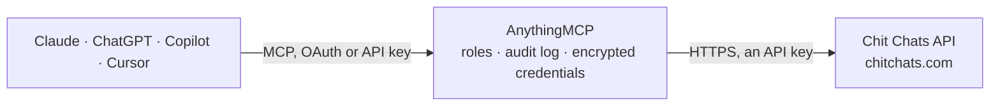

<!-- Generated by scripts/export-github-catalog.mjs in the anythingmcp-website repository. Do not edit by hand. -->

# Chit Chats MCP connector

Let your AI handle Chit Chats shipping: create shipments, compare postage rates, print labels, group parcels in batches for drop-off, track deliveries and see returns. The AnythingMCP connector gives Claude, ChatGPT, Microsoft Copilot, Cursor and Gemini 17 MCP tools for Chit Chats: 8 read and 9 can change data.

**Category:** [Logistics](../logistics.md) · **Tools:** 17 · **Setup guide:** [anythingmcp.com](https://anythingmcp.com/guides/chit-chats-to-mcp) · [Deutsch](https://anythingmcp.com/de/guides/chit-chats-to-mcp) · [Italiano](https://anythingmcp.com/it/guides/chit-chats-to-mcp) · [Español](https://anythingmcp.com/es/guides/chit-chats-to-mcp) · [日本語](https://anythingmcp.com/ja/guides/chit-chats-to-mcp) · [Русский](https://anythingmcp.com/ru/guides/chit-chats-to-mcp) · [中文](https://anythingmcp.com/zh/guides/chit-chats-to-mcp)

## Start without code

No installation and no terminal: AnythingMCP Cloud runs the Chit Chats connector for you, operated by helpcode.ai in Frankfurt, Germany.

1. **Click the button above** and create an account or sign in. The Chit Chats connector opens, ready to install.
2. **Paste the API key or token from your Chit Chats account.** Every click is in the [step-by-step guide](https://anythingmcp.com/guides/chit-chats-to-mcp).
3. **Click Install.** AnythingMCP shows the address of your MCP server.
4. **Add that address to your assistant:** [Claude](https://anythingmcp.com/guides/connect-chit-chats-to-claude) · [ChatGPT](https://anythingmcp.com/guides/connect-chit-chats-to-chatgpt) · [Microsoft Copilot](https://anythingmcp.com/guides/connect-chit-chats-to-copilot) · [Cursor](https://anythingmcp.com/guides/connect-chit-chats-to-cursor) · [Gemini CLI](https://anythingmcp.com/guides/connect-chit-chats-to-gemini) · [Meta Muse](https://anythingmcp.com/guides/connect-chit-chats-to-muse).
5. **Ask your first question.**

Prefer help with the setup? [Talk to us](https://anythingmcp.com/contact).

## How it works

- **The AI client** speaks MCP (Streamable HTTP) to AnythingMCP and only sees tool names, descriptions and results. It never gets the Chit Chats credentials.
- **AnythingMCP** checks the client's role, builds the call from the tool definition, adds the credentials (an API key), calls Chit Chats, logs the call and returns the result.
- **Chit Chats** sees an ordinary API client with the rights of the account the credentials belong to.

## Tools

| Tool | What it does | Access |
|---|---|---|
| [`chit_chats_list_shipments`](#chit_chats_list_shipments) | List shipments of the account, newest first: id, status, batch_id, recipient address, contents, declared value, package size and weight, postage type,… | read |
| [`chit_chats_count_shipments`](#chit_chats_count_shipments) | Count the shipments of the account, optionally only those in one status; returns {"count": n}. | read |
| [`chit_chats_get_shipment`](#chit_chats_get_shipment) | Read one shipment with everything about it: addresses, package, status, postage and carrier, the amounts charged, the label URLs (PNG and ZPL) to print, the… | read |
| [`chit_chats_create_shipment`](#chit_chats_create_shipment) | Create a shipment for one package. | write |
| [`chit_chats_refresh_shipment`](#chit_chats_refresh_shipment) | Refresh a shipment and its postage rates, optionally changing insurance, media mail, signature or the ship date. | write |
| [`chit_chats_buy_postage`](#chit_chats_buy_postage) | Buy postage for a shipment, charging the Chit Chats account balance. | write |
| [`chit_chats_refund_shipment`](#chit_chats_refund_shipment) | Request a postage refund for a shipment, which voids it so it can no longer be shipped. | write |
| [`chit_chats_delete_shipment`](#chit_chats_delete_shipment) | Delete a pending shipment (no postage bought, not yet received). | write |
| [`chit_chats_add_shipments_to_batch`](#chit_chats_add_shipments_to_batch) | Put shipments into a batch (a group of packages dropped off together; the batch has its own label). | write |
| [`chit_chats_remove_shipments_from_batch`](#chit_chats_remove_shipments_from_batch) | Take shipments out of the batch they belong to. | write |
| [`chit_chats_list_returns`](#chit_chats_list_returns) | List return shipments (packages coming back to the account), newest first: id, status (on_hold, in_transit, ready, resolved), resolution and the original… | read |
| [`chit_chats_list_batches`](#chit_chats_list_batches) | List the batches of the account, newest first: id, status, created_at and the batch label URLs (label_png_url, label_zpl_url). | read |
| [`chit_chats_count_batches`](#chit_chats_count_batches) | Count the batches of the account; returns {"count": n}. | read |
| [`chit_chats_get_batch`](#chit_chats_get_batch) | Read one batch: id, status, created_at and the label URLs (PNG and ZPL) to print for the drop-off. | read |
| [`chit_chats_create_batch`](#chit_chats_create_batch) | Create a new, empty batch and return it (the new batch id is in the answer or in the Location header). | write |
| [`chit_chats_delete_batch`](#chit_chats_delete_batch) | Delete an empty batch. | write |
| [`chit_chats_get_tracking`](#chit_chats_get_tracking) | Public tracking of a Chit Chats shipment: destination, package, postage and carrier, carrier tracking code, estimated delivery, resolution and every… | read |

## Tool reference

Every parameter as the AI client sees it in `tools/list`. Source: [`packages/backend/src/adapters/intl/chit-chats.json`](../../../packages/backend/src/adapters/intl/chit-chats.json).

### `chit_chats_list_shipments`

List shipments of the account, newest first: id, status, batch_id, recipient address, contents, declared value, package size and weight, postage type, carrier and carrier tracking code, tracking_url, ship_date, the amounts charged and the label URLs (postage_label_png_url, postage_label_zpl_url). Search with q by shipment id, recipient name or order id. Read-only, paginated.

**Access:** read · **Call:** `GET /api/v1/clients/{{CHIT_CHATS_CLIENT_ID}}/shipments`

| Parameter | Type | Required | Description |
|---|---|---|---|
| `q` | string | no | Full-text search on shipment id, recipient name or order id. |
| `status` | `canceled` \| `pending` \| `ready` \| `in_transit` \| `received` \| `released` \| `inducted` \| `resolved` \| `delivered` \| `exception` \| `voided` | no | Only shipments in this state: pending (being created, no postage yet), ready (postage bought, waiting to be dropped off), in_transit (or in detail received, released, inducted), resolved (or in detail delivered, exception, voided), canceled. |
| `batch_id` | integer | no | Only shipments in this batch. |
| `from_date` | string | no | Only shipments created on or after this date (YYYY-MM-DD). |
| `to_date` | string | no | Date bound on created_at (YYYY-MM-DD), as the Chit Chats API defines to_date. |
| `limit` | integer | no | Records per page (default 100, at most 1000). |
| `page` | integer | no | Page number, starting at 1. A page shorter than limit is the last one. |

### `chit_chats_count_shipments`

Count the shipments of the account, optionally only those in one status; returns {"count": n}. Use it before paging through a long list. Read-only.

**Access:** read · **Call:** `GET /api/v1/clients/{{CHIT_CHATS_CLIENT_ID}}/shipments/count`

| Parameter | Type | Required | Description |
|---|---|---|---|
| `status` | `canceled` \| `pending` \| `ready` \| `in_transit` \| `received` \| `released` \| `inducted` \| `resolved` \| `delivered` \| `exception` \| `voided` | no | Only shipments in this state: pending (being created, no postage yet), ready (postage bought, waiting to be dropped off), in_transit (or in detail received, released, inducted), resolved (or in detail delivered, exception, voided), canceled. |

### `chit_chats_get_shipment`

Read one shipment with everything about it: addresses, package, status, postage and carrier, the amounts charged, the label URLs (PNG and ZPL) to print, the eligible postage rates with prices (rates) and the tracking events (tracking_events). Read-only.

**Access:** read · **Call:** `GET /api/v1/clients/{{CHIT_CHATS_CLIENT_ID}}/shipments/{shipment_id}`

| Parameter | Type | Required | Description |
|---|---|---|---|
| `shipment_id` | string | yes | Chit Chats shipment id, 10 letters and digits such as 8ERNJ8SCQ9 (the id field of a shipment). |

### `chit_chats_create_shipment`

Create a shipment for one package. With a postage_type the rate is selected right away; with postage_type unknown it is created without postage so the rates can be compared first (chit_chats_get_shipment). Creating a shipment does not charge anything: postage is bought separately. International shipments (outside Canada and the US) need line_items. Returns the new shipment.

**Access:** write · **Call:** `POST /api/v1/clients/{{CHIT_CHATS_CLIENT_ID}}/shipments`

| Parameter | Type | Required | Description |
|---|---|---|---|
| `name` | string | yes | Recipient name. |
| `address_1` | string | yes | Recipient street address, first line. |
| `address_2` | string | no | Second address line (apartment, suite). |
| `city` | string | yes | Recipient city. |
| `province_code` | string | no | State or province code, for example BC or WA. Required for Canada and the US. |
| `postal_code` | string | no | Postal or ZIP code. |
| `country_code` | string | yes | Two-letter ISO country code, for example CA, US or GB. |
| `phone` | string | no | Recipient phone number. |
| `email` | string | no | Recipient email, passed to final-mile carriers on international tracked postage. |
| `package_contents` | `merchandise` \| `documents` \| `gift` \| `returned_goods` \| `sample` \| `other` | no | What the package holds (customs category). |
| `description` | string | yes | Short description of the contents, for example "Hand made bracelet". |
| `value` | string | yes | Declared value as a decimal string, for example "84.99". |
| `value_currency` | `cad` \| `usd` | yes | Currency of the declared value. |
| `order_id` | string | no | Your order number, searchable later with q in chit_chats_list_shipments. |
| `order_store` | string | no | Name of the store the order came from. |
| `package_type` | `unknown` \| `card` \| `letter` \| `envelope` \| `thick_envelope` \| `parcel` \| `flat_rate_envelope` \| `flat_rate_legal_envelope` \| `flat_rate_padded_envelope` \| `flat_rate_gift_card_envelope` \| `flat_rate_window_envelope` \| `flat_rate_cardboard_envelope` \| `small_flat_rate_envelope` \| `small_flat_rate_box` \| `medium_flat_rate_box_1` \| `medium_flat_rate_box_2` \| `large_flat_rate_box` | yes | Package type; most goods ship as parcel. |
| `size_unit` | `m` \| `cm` \| `in` | no | Unit of size_x, size_y and size_z. |
| `size_x` | number | no | Length. |
| `size_y` | number | no | Width. |
| `size_z` | number | no | Height. |
| `weight_unit` | `lb` \| `oz` \| `kg` \| `g` | yes | Unit of weight. |
| `weight` | number | yes | Package weight in weight_unit. |
| `insurance_requested` | boolean | no | Ask for insurance on the declared value. |
| `signature_requested` | boolean | no | Ask for a signature on delivery. |
| `postage_type` | string | yes | Postage service, for example chit_chats_canada_tracked, chit_chats_us_edge, chit_chats_select, chit_chats_international_tracked, usps_ground_advantage, usps_priority, usps_first or usps_express. Use unknown to create the shipment without postage and compare rates first (they come back in rates). |
| `cheapest_postage_type_requested` | `yes` \| `no` | no | yes together with postage_type unknown selects the cheapest rate (US destinations only). |
| `tracking_number` | string | no | Tracking number when you supply your own postage. |
| `ship_date` | string | no | today or a date YYYY-MM-DD. |
| `vat_reference` | string | no | Your VAT or tax identification number for international shipments. |
| `duties_paid_requested` | boolean | no | Request duties-paid postage; only with chit_chats_international_tracked and a vat_reference. |
| `return_name` | string | no | Optional US return address: name. |
| `return_address_1` | string | no | Return address, first line. |
| `return_address_2` | string | no | Return address, second line. |
| `return_city` | string | no | Return address city. |
| `return_province_code` | string | no | Return address state code. |
| `return_postal_code` | string | no | Return address ZIP code. |
| `return_phone` | string | no | Return address phone. |
| `line_items` | object[] | no | Customs line items, required for destinations outside Canada and the US. |

### `chit_chats_refresh_shipment`

Refresh a shipment and its postage rates, optionally changing insurance, media mail, signature or the ship date. Use it when rates have gone stale or before buying postage. Returns the updated shipment with its new rates. Charges nothing.

**Access:** write · **Call:** `PATCH /api/v1/clients/{{CHIT_CHATS_CLIENT_ID}}/shipments/{shipment_id}/refresh`

| Parameter | Type | Required | Description |
|---|---|---|---|
| `shipment_id` | string | yes | Chit Chats shipment id, 10 letters and digits such as 8ERNJ8SCQ9 (the id field of a shipment). |
| `insurance_requested` | boolean | no | Turn insurance on or off. |
| `media_mail_requested` | boolean | no | Ask for USPS Media Mail rates. |
| `signature_requested` | boolean | no | Turn signature confirmation on or off. |
| `ship_date` | string | no | today or a date YYYY-MM-DD. |

### `chit_chats_buy_postage`

Buy postage for a shipment, charging the Chit Chats account balance. Optionally choose the rate with postage_type (one of the postage_type values in the shipment rates). The purchase runs in the background: the shipment status is postage_requested at first; read it again with chit_chats_get_shipment until it is ready (label URLs filled) or postage_purchase_failed. Spends money: installed switched off; confirm the shipment and price with the user before every call.

**Access:** write · **Call:** `PATCH /api/v1/clients/{{CHIT_CHATS_CLIENT_ID}}/shipments/{shipment_id}/buy`

| Parameter | Type | Required | Description |
|---|---|---|---|
| `shipment_id` | string | yes | Chit Chats shipment id, 10 letters and digits such as 8ERNJ8SCQ9 (the id field of a shipment). |
| `postage_type` | string | no | Rate to buy, from the postage_type of an entry in the shipment rates. Without it the rate selected on the shipment is bought. |

### `chit_chats_refund_shipment`

Request a postage refund for a shipment, which voids it so it can no longer be shipped. Irreversible: installed switched off; confirm with the user first.

**Access:** write · **Call:** `PATCH /api/v1/clients/{{CHIT_CHATS_CLIENT_ID}}/shipments/{shipment_id}/refund`

| Parameter | Type | Required | Description |
|---|---|---|---|
| `shipment_id` | string | yes | Chit Chats shipment id, 10 letters and digits such as 8ERNJ8SCQ9 (the id field of a shipment). |

### `chit_chats_delete_shipment`

Delete a pending shipment (no postage bought, not yet received). A shipment with postage cannot be deleted; refund it instead. Irreversible: installed switched off.

**Access:** write · **Call:** `DELETE /api/v1/clients/{{CHIT_CHATS_CLIENT_ID}}/shipments/{shipment_id}`

| Parameter | Type | Required | Description |
|---|---|---|---|
| `shipment_id` | string | yes | Chit Chats shipment id, 10 letters and digits such as 8ERNJ8SCQ9 (the id field of a shipment). |

### `chit_chats_add_shipments_to_batch`

Put shipments into a batch (a group of packages dropped off together; the batch has its own label). Returns 200 when done. Charges nothing.

**Access:** write · **Call:** `PATCH /api/v1/clients/{{CHIT_CHATS_CLIENT_ID}}/shipments/add_to_batch`

| Parameter | Type | Required | Description |
|---|---|---|---|
| `batch_id` | integer | yes | Numeric batch id (the id field of a batch). |
| `shipment_ids` | string[] | yes | Shipment ids, for example ["ABCDE12345", "Q5P4R3S2T1"]. |

### `chit_chats_remove_shipments_from_batch`

Take shipments out of the batch they belong to. Returns 200 when done.

**Access:** write · **Call:** `PATCH /api/v1/clients/{{CHIT_CHATS_CLIENT_ID}}/shipments/remove_from_batch`

| Parameter | Type | Required | Description |
|---|---|---|---|
| `shipment_ids` | string[] | yes | Shipment ids, for example ["ABCDE12345", "Q5P4R3S2T1"]. |

### `chit_chats_list_returns`

List return shipments (packages coming back to the account), newest first: id, status (on_hold, in_transit, ready, resolved), resolution and the original shipment with its recipient. Read-only, paginated.

**Access:** read · **Call:** `GET /api/v1/clients/{{CHIT_CHATS_CLIENT_ID}}/returns`

| Parameter | Type | Required | Description |
|---|---|---|---|
| `status` | `on_hold` \| `in_transit` \| `ready` \| `resolved` | no | on_hold: received, waiting for you to choose a return method; in_transit: on its way back; ready: waiting for pickup at your branch; resolved. |
| `limit` | integer | no | Records per page (default 100, at most 1000). |
| `page` | integer | no | Page number, starting at 1. A page shorter than limit is the last one. |

### `chit_chats_list_batches`

List the batches of the account, newest first: id, status, created_at and the batch label URLs (label_png_url, label_zpl_url). Read-only, paginated.

**Access:** read · **Call:** `GET /api/v1/clients/{{CHIT_CHATS_CLIENT_ID}}/batches`

| Parameter | Type | Required | Description |
|---|---|---|---|
| `state` | `pending` \| `ready` \| `received` | no | pending: not received yet; ready: not received, every shipment ready; received: dropped off and received by Chit Chats. |
| `to_date` | string | no | Date bound on created_at (YYYY-MM-DD), as the Chit Chats API defines to_date. |
| `limit` | integer | no | Records per page (default 100, at most 1000). |
| `page` | integer | no | Page number, starting at 1. A page shorter than limit is the last one. |

### `chit_chats_count_batches`

Count the batches of the account; returns {"count": n}. Read-only.

**Access:** read · **Call:** `GET /api/v1/clients/{{CHIT_CHATS_CLIENT_ID}}/batches/count`

| Parameter | Type | Required | Description |
|---|---|---|---|
| `state` | `pending` \| `ready` \| `received` | no | Only batches in this state. |

### `chit_chats_get_batch`

Read one batch: id, status, created_at and the label URLs (PNG and ZPL) to print for the drop-off. List its shipments with chit_chats_list_shipments and batch_id. Read-only.

**Access:** read · **Call:** `GET /api/v1/clients/{{CHIT_CHATS_CLIENT_ID}}/batches/{batch_id}`

| Parameter | Type | Required | Description |
|---|---|---|---|
| `batch_id` | integer | yes | Numeric batch id (the id field of a batch). |

### `chit_chats_create_batch`

Create a new, empty batch and return it (the new batch id is in the answer or in the Location header). Add shipments with chit_chats_add_shipments_to_batch.

**Access:** write · **Call:** `POST /api/v1/clients/{{CHIT_CHATS_CLIENT_ID}}/batches`

No parameters.

### `chit_chats_delete_batch`

Delete an empty batch. Fails when the batch still holds shipments. Irreversible: installed switched off.

**Access:** write · **Call:** `DELETE /api/v1/clients/{{CHIT_CHATS_CLIENT_ID}}/batches/{batch_id}`

| Parameter | Type | Required | Description |
|---|---|---|---|
| `batch_id` | integer | yes | Numeric batch id (the id field of a batch). |

### `chit_chats_get_tracking`

Public tracking of a Chit Chats shipment: destination, package, postage and carrier, carrier tracking code, estimated delivery, resolution and every tracking event with time and location. Works for any recent Chit Chats shipment id, also one not created by this account. Read-only.

**Access:** read · **Call:** `GET /tracking/{shipment_id}.json`

| Parameter | Type | Required | Description |
|---|---|---|---|
| `shipment_id` | string | yes | Chit Chats shipment id, 10 letters and digits such as 8ERNJ8SCQ9 (the id field of a shipment). |

## Run it yourself

AnythingMCP is open source (AGPL-3.0). [Run it with Docker](../../../README.md#run-it-yourself), open **Connectors → Store**, pick **Chit Chats** and enter `CHIT_CHATS_ACCESS_TOKEN`, `CHIT_CHATS_CLIENT_ID`, then add your MCP server URL to the AI client.

[← Logistics connectors](../logistics.md) · [All categories](../README.md)
