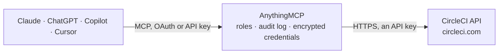

<!-- Generated by scripts/export-github-catalog.mjs in the anythingmcp-website repository. Do not edit by hand. -->

# CircleCI MCP connector

Let your AI check CircleCI: pipelines, workflows and jobs, failed tests and artifacts, Insights metrics and flaky tests, contexts and variable names, and start pipelines or rerun and cancel workflows after you confirm. The AnythingMCP connector gives Claude, ChatGPT, Microsoft Copilot, Cursor and Gemini 22 MCP tools for CircleCI: 19 read and 3 can change data.

**Category:** [Infrastructure](../infrastructure.md) · **Tools:** 22 · **Setup guide:** [anythingmcp.com](https://anythingmcp.com/guides/circleci-to-mcp) · [Deutsch](https://anythingmcp.com/de/guides/circleci-to-mcp) · [Italiano](https://anythingmcp.com/it/guides/circleci-to-mcp) · [Español](https://anythingmcp.com/es/guides/circleci-to-mcp) · [日本語](https://anythingmcp.com/ja/guides/circleci-to-mcp) · [Русский](https://anythingmcp.com/ru/guides/circleci-to-mcp) · [中文](https://anythingmcp.com/zh/guides/circleci-to-mcp)

## Start without code

No installation and no terminal: AnythingMCP Cloud runs the CircleCI connector for you, operated by helpcode.ai in Frankfurt, Germany.

1. **Click the button above** and create an account or sign in. The CircleCI connector opens, ready to install.
2. **Paste the API key or token from your CircleCI account.** Every click is in the [step-by-step guide](https://anythingmcp.com/guides/circleci-to-mcp).
3. **Click Install.** AnythingMCP shows the address of your MCP server.
4. **Add that address to your assistant:** [Claude](https://anythingmcp.com/guides/connect-circleci-to-claude) · [ChatGPT](https://anythingmcp.com/guides/connect-circleci-to-chatgpt) · [Microsoft Copilot](https://anythingmcp.com/guides/connect-circleci-to-copilot) · [Cursor](https://anythingmcp.com/guides/connect-circleci-to-cursor) · [Gemini CLI](https://anythingmcp.com/guides/connect-circleci-to-gemini) · [Meta Muse](https://anythingmcp.com/guides/connect-circleci-to-muse).
5. **Ask your first question**, for example: *Show me pipeline #412 for gh/greenworks/web-ui and its workflows and jobs, I need the failed job number.*

Prefer help with the setup? [Talk to us](https://anythingmcp.com/contact).

## How it works

- **The AI client** speaks MCP (Streamable HTTP) to AnythingMCP and only sees tool names, descriptions and results. It never gets the CircleCI credentials.
- **AnythingMCP** checks the client's role, builds the call from the tool definition, adds the credentials (an API key), calls CircleCI, logs the call and returns the result.
- **CircleCI** sees an ordinary API client with the rights of the account the credentials belong to.

## Tools

| Tool | What it does | Access |
|---|---|---|
| [`circleci_get_current_user`](#circleci_get_current_user) | Get the CircleCI user the personal API token belongs to: id, login and name. | read |
| [`circleci_list_collaborations`](#circleci_list_collaborations) | List the organizations the user belongs to: id, name, VCS type and slug (e.g. gh/acme, or circleci/<org-id> for GitHub App and GitLab organizations). | read |
| [`circleci_get_project`](#circleci_get_project) | Get a project by slug: name, project id, organization name, slug and id, and the connected repository URL and default branch. | read |
| [`circleci_list_pipeline_definitions`](#circleci_list_pipeline_definitions) | List the pipeline definitions of a project: id, name, description and where the config and code come from. | read |
| [`circleci_list_pipelines`](#circleci_list_pipelines) | List the pipelines of a project, newest first: id, number, state, branch or tag, commit, trigger, actor, time and setup errors. | read |
| [`circleci_get_pipeline`](#circleci_get_pipeline) | Get one pipeline by id: number, state, branch or tag, commit, trigger, actor, time and setup errors. | read |
| [`circleci_get_pipeline_by_number`](#circleci_get_pipeline_by_number) | Get one pipeline of a project by its number (the #123 shown in the CircleCI app). | read |
| [`circleci_list_pipeline_workflows`](#circleci_list_pipeline_workflows) | List the workflows of a pipeline: id, name, status (success, running, failed, on_hold, canceled ...), start and stop time and who started them. | read |
| [`circleci_get_workflow`](#circleci_get_workflow) | Get one workflow by id: name, status, pipeline id and number, project, start and stop time, and who started, canceled or errored it. | read |
| [`circleci_list_workflow_jobs`](#circleci_list_workflow_jobs) | List the jobs of a workflow: id, job number, name, type (build or approval), status, dependencies, start and stop time. | read |
| [`circleci_get_job`](#circleci_get_job) | Get the details of a job by project and job number: name, status, duration, executor and resource class, parallelism and per-run status, contexts used,… | read |
| [`circleci_list_job_tests`](#circleci_list_job_tests) | Summarize the test results a job uploaded with store_test_results: how many passed, were skipped and failed, and for every failed test its name, class,… | read |
| [`circleci_list_job_artifacts`](#circleci_list_job_artifacts) | List the artifacts a job stored with store_artifacts: path, node index and download URL. | read |
| [`circleci_get_workflow_metrics`](#circleci_get_workflow_metrics) | Insights summary for every workflow of a project over a reporting window (default last 90 days): runs, success rate, failed runs, duration statistics,… | read |
| [`circleci_get_workflow_summary`](#circleci_get_workflow_summary) | Insights for one workflow: metrics for the last 90 days (runs, success rate, duration, credits, time to recovery) and their trend against the previous period. | read |
| [`circleci_list_flaky_tests`](#circleci_list_flaky_tests) | List the project's flaky tests (tests that passed and failed on the same commit): test name, class, file, job and workflow, how often it flaked and the time… | read |
| [`circleci_trigger_pipeline`](#circleci_trigger_pipeline) | Start a new pipeline for a project from a pipeline definition, on a branch or tag. | write |
| [`circleci_rerun_workflow`](#circleci_rerun_workflow) | Rerun a workflow as a new workflow: all jobs, only from the failed job (from_failed), or chosen jobs. | write |
| [`circleci_cancel_workflow`](#circleci_cancel_workflow) | Cancel a running workflow; its running jobs stop and jobs not yet started will not run, which can leave a deployment half done. | write |
| [`circleci_list_contexts`](#circleci_list_contexts) | List the contexts (shared sets of environment variables) of an organization: id, name and creation time. | read |
| [`circleci_list_context_env_var_names`](#circleci_list_context_env_var_names) | List the names of the environment variables in a context, with created and updated time. | read |
| [`circleci_list_project_env_var_names`](#circleci_list_project_env_var_names) | List the names of a project's environment variables (Project Settings > Environment Variables) with their creation time. | read |

## Tool reference

Every parameter as the AI client sees it in `tools/list`. Source: [`packages/backend/src/adapters/intl/circleci.json`](../../../packages/backend/src/adapters/intl/circleci.json).

### `circleci_get_current_user`

Get the CircleCI user the personal API token belongs to: id, login and name. A quick check that the token works. Read-only.

**Access:** read · **Call:** `GET /me`

No parameters.

### `circleci_list_collaborations`

List the organizations the user belongs to: id, name, VCS type and slug (e.g. gh/acme, or circleci/<org-id> for GitHub App and GitLab organizations). The organization id is what circleci_list_contexts needs. Read-only.

**Access:** read · **Call:** `GET /me/collaborations`

No parameters.

### `circleci_get_project`

Get a project by slug: name, project id, organization name, slug and id, and the connected repository URL and default branch. The project id is what circleci_list_pipeline_definitions needs. Read-only.

**Access:** read · **Call:** `GET /project/{project_slug}`

| Parameter | Type | Required | Description |
|---|---|---|---|
| `project_slug` | string | yes | Project slug as shown in Project Settings > Overview: gh/<org>/<repo> or bb/<workspace>/<repo> for GitHub OAuth and Bitbucket Cloud projects, circleci/<org-id>/<project-id> for GitHub App and GitLab projects. Slashes stay as they are. |

### `circleci_list_pipeline_definitions`

List the pipeline definitions of a project: id, name, description and where the config and code come from. A definition id is needed to start a pipeline with circleci_trigger_pipeline. Read-only.

**Access:** read · **Call:** `GET /projects/{project_id}/pipeline-definitions`

| Parameter | Type | Required | Description |
|---|---|---|---|
| `project_id` | string | yes | Project id (a UUID) from circleci_get_project, not the slug. |

### `circleci_list_pipelines`

List the pipelines of a project, newest first: id, number, state, branch or tag, commit, trigger, actor, time and setup errors. Optionally only one branch. Read-only.

**Access:** read · **Call:** `GET /project/{project_slug}/pipeline`

| Parameter | Type | Required | Description |
|---|---|---|---|
| `project_slug` | string | yes | Project slug as shown in Project Settings > Overview: gh/<org>/<repo> or bb/<workspace>/<repo> for GitHub OAuth and Bitbucket Cloud projects, circleci/<org-id>/<project-id> for GitHub App and GitLab projects. Slashes stay as they are. |
| `branch` | string | no | Only pipelines for this branch. |
| `page_token` | string | no | next_page_token from the previous answer, for the next page. Omit for the first page. |

### `circleci_get_pipeline`

Get one pipeline by id: number, state, branch or tag, commit, trigger, actor, time and setup errors. Read-only.

**Access:** read · **Call:** `GET /pipeline/{pipeline_id}`

| Parameter | Type | Required | Description |
|---|---|---|---|
| `pipeline_id` | string | yes | Pipeline id (a UUID), from circleci_list_pipelines or circleci_get_pipeline_by_number. |

### `circleci_get_pipeline_by_number`

Get one pipeline of a project by its number (the #123 shown in the CircleCI app). Read-only.

**Access:** read · **Call:** `GET /project/{project_slug}/pipeline/{pipeline_number}`

| Parameter | Type | Required | Description |
|---|---|---|---|
| `project_slug` | string | yes | Project slug as shown in Project Settings > Overview: gh/<org>/<repo> or bb/<workspace>/<repo> for GitHub OAuth and Bitbucket Cloud projects, circleci/<org-id>/<project-id> for GitHub App and GitLab projects. Slashes stay as they are. |
| `pipeline_number` | integer | yes | Pipeline number, e.g. 123. |

### `circleci_list_pipeline_workflows`

List the workflows of a pipeline: id, name, status (success, running, failed, on_hold, canceled ...), start and stop time and who started them. Read-only.

**Access:** read · **Call:** `GET /pipeline/{pipeline_id}/workflow`

| Parameter | Type | Required | Description |
|---|---|---|---|
| `pipeline_id` | string | yes | Pipeline id (a UUID), from circleci_list_pipelines or circleci_get_pipeline_by_number. |
| `page_token` | string | no | next_page_token from the previous answer, for the next page. Omit for the first page. |

### `circleci_get_workflow`

Get one workflow by id: name, status, pipeline id and number, project, start and stop time, and who started, canceled or errored it. Read-only.

**Access:** read · **Call:** `GET /workflow/{workflow_id}`

| Parameter | Type | Required | Description |
|---|---|---|---|
| `workflow_id` | string | yes | Workflow id (a UUID), from circleci_list_pipeline_workflows. |

### `circleci_list_workflow_jobs`

List the jobs of a workflow: id, job number, name, type (build or approval), status, dependencies, start and stop time. Use job_number with the job tools. Read-only.

**Access:** read · **Call:** `GET /workflow/{workflow_id}/job`

| Parameter | Type | Required | Description |
|---|---|---|---|
| `workflow_id` | string | yes | Workflow id (a UUID), from circleci_list_pipeline_workflows. |
| `page_token` | string | no | next_page_token from the previous answer, for the next page. Omit for the first page. |

### `circleci_get_job`

Get the details of a job by project and job number: name, status, duration, executor and resource class, parallelism and per-run status, contexts used, messages, timing and web link. Read-only.

**Access:** read · **Call:** `GET /project/{project_slug}/job/{job_number}`

| Parameter | Type | Required | Description |
|---|---|---|---|
| `project_slug` | string | yes | Project slug as shown in Project Settings > Overview: gh/<org>/<repo> or bb/<workspace>/<repo> for GitHub OAuth and Bitbucket Cloud projects, circleci/<org-id>/<project-id> for GitHub App and GitLab projects. Slashes stay as they are. |
| `job_number` | integer | yes | Job number, from circleci_list_workflow_jobs (job_number). |

### `circleci_list_job_tests`

Summarize the test results a job uploaded with store_test_results: how many passed, were skipped and failed, and for every failed test its name, class, file, result, run time and failure message. Only jobs that store test results have any. Read-only.

**Access:** read · **Call:** `GET /project/{project_slug}/{job_number}/tests`

| Parameter | Type | Required | Description |
|---|---|---|---|
| `project_slug` | string | yes | Project slug as shown in Project Settings > Overview: gh/<org>/<repo> or bb/<workspace>/<repo> for GitHub OAuth and Bitbucket Cloud projects, circleci/<org-id>/<project-id> for GitHub App and GitLab projects. Slashes stay as they are. |
| `job_number` | integer | yes | Job number, from circleci_list_workflow_jobs (job_number). |
| `page_token` | string | no | next_page_token from the previous answer, for the next page. Omit for the first page. |

### `circleci_list_job_artifacts`

List the artifacts a job stored with store_artifacts: path, node index and download URL. Downloading a URL needs the same token. Read-only.

**Access:** read · **Call:** `GET /project/{project_slug}/{job_number}/artifacts`

| Parameter | Type | Required | Description |
|---|---|---|---|
| `project_slug` | string | yes | Project slug as shown in Project Settings > Overview: gh/<org>/<repo> or bb/<workspace>/<repo> for GitHub OAuth and Bitbucket Cloud projects, circleci/<org-id>/<project-id> for GitHub App and GitLab projects. Slashes stay as they are. |
| `job_number` | integer | yes | Job number, from circleci_list_workflow_jobs (job_number). |
| `page_token` | string | no | next_page_token from the previous answer, for the next page. Omit for the first page. |

### `circleci_get_workflow_metrics`

Insights summary for every workflow of a project over a reporting window (default last 90 days): runs, success rate, failed runs, duration statistics, credits used and time to recovery. Data is refreshed daily, not real time. Read-only.

**Access:** read · **Call:** `GET /insights/{project_slug}/workflows`

| Parameter | Type | Required | Description |
|---|---|---|---|
| `project_slug` | string | yes | Project slug as shown in Project Settings > Overview: gh/<org>/<repo> or bb/<workspace>/<repo> for GitHub OAuth and Bitbucket Cloud projects, circleci/<org-id>/<project-id> for GitHub App and GitLab projects. Slashes stay as they are. |
| `reporting_window` | `last-24-hours` \| `last-7-days` \| `last-30-days` \| `last-60-days` \| `last-90-days` | no | Window to aggregate. |
| `branch` | string | no | Only this branch; default is the default branch. |
| `all_branches` | boolean | no | All branches combined instead of one branch. |
| `page_token` | string | no | next_page_token from the previous answer, for the next page. Omit for the first page. |

### `circleci_get_workflow_summary`

Insights for one workflow: metrics for the last 90 days (runs, success rate, duration, credits, time to recovery) and their trend against the previous period. Read-only.

**Access:** read · **Call:** `GET /insights/{project_slug}/workflows/{workflow_name}/summary`

| Parameter | Type | Required | Description |
|---|---|---|---|
| `project_slug` | string | yes | Project slug as shown in Project Settings > Overview: gh/<org>/<repo> or bb/<workspace>/<repo> for GitHub OAuth and Bitbucket Cloud projects, circleci/<org-id>/<project-id> for GitHub App and GitLab projects. Slashes stay as they are. |
| `workflow_name` | string | yes | Workflow name as written in .circleci/config.yml, e.g. build-and-test. From circleci_get_workflow_metrics. |
| `branch` | string | no | Only this branch; default is the default branch. |
| `all_branches` | boolean | no | All branches combined instead of one branch. |

### `circleci_list_flaky_tests`

List the project's flaky tests (tests that passed and failed on the same commit): test name, class, file, job and workflow, how often it flaked and the time wasted. A test stops counting as flaky two weeks after its last flake. Read-only.

**Access:** read · **Call:** `GET /insights/{project_slug}/flaky-tests`

| Parameter | Type | Required | Description |
|---|---|---|---|
| `project_slug` | string | yes | Project slug as shown in Project Settings > Overview: gh/<org>/<repo> or bb/<workspace>/<repo> for GitHub OAuth and Bitbucket Cloud projects, circleci/<org-id>/<project-id> for GitHub App and GitLab projects. Slashes stay as they are. |

### `circleci_trigger_pipeline`

Start a new pipeline for a project from a pipeline definition, on a branch or tag. This uses credits and runs whatever the config does, including deployments. Get definition_id from circleci_list_pipeline_definitions, tell the user the project, branch and parameters, and call only after the user confirms. Returns the new pipeline's id, number and state. Not available for GitLab projects.

**Access:** write · **Call:** `POST /project/{project_slug}/pipeline/run`

| Parameter | Type | Required | Description |
|---|---|---|---|
| `project_slug` | string | yes | Project slug as shown in Project Settings > Overview: gh/<org>/<repo> or bb/<workspace>/<repo> for GitHub OAuth and Bitbucket Cloud projects, circleci/<org-id>/<project-id> for GitHub App and GitLab projects. Slashes stay as they are. |
| `definition_id` | string | yes | Pipeline definition id from circleci_list_pipeline_definitions. |
| `branch` | string | no | Branch to build, e.g. main (or pull/<n>/head for a GitHub pull request). Use either branch or tag. |
| `tag` | string | no | Tag to build instead of a branch. |
| `parameters` | object | no | Pipeline parameters declared in the config, e.g. {"deploy": true}. At most 100 entries. |

### `circleci_rerun_workflow`

Rerun a workflow as a new workflow: all jobs, only from the failed job (from_failed), or chosen jobs. This uses credits and repeats any deploy jobs it includes. Tell the user which workflow and jobs and call only after the user confirms. Returns the new workflow id.

**Access:** write · **Call:** `POST /workflow/{workflow_id}/rerun`

| Parameter | Type | Required | Description |
|---|---|---|---|
| `workflow_id` | string | yes | Workflow id (a UUID), from circleci_list_pipeline_workflows. |
| `from_failed` | boolean | no | Rerun from the failed job onward. Do not combine with jobs. |
| `jobs` | string[] | no | Job ids (UUIDs from circleci_list_workflow_jobs) to rerun. Do not combine with from_failed. |
| `sparse_tree` | boolean | no | With jobs: rerun only those jobs and what depends on them. |

### `circleci_cancel_workflow`

Cancel a running workflow; its running jobs stop and jobs not yet started will not run, which can leave a deployment half done. Tell the user which workflow and call only after the user confirms.

**Access:** write · **Call:** `POST /workflow/{workflow_id}/cancel`

| Parameter | Type | Required | Description |
|---|---|---|---|
| `workflow_id` | string | yes | Workflow id (a UUID), from circleci_list_pipeline_workflows. |

### `circleci_list_contexts`

List the contexts (shared sets of environment variables) of an organization: id, name and creation time. Pass the organization id from circleci_list_collaborations, or the organization slug (e.g. gh/acme) for GitHub OAuth and Bitbucket organizations. Read-only.

**Access:** read · **Call:** `GET /context`

| Parameter | Type | Required | Description |
|---|---|---|---|
| `owner_id` | string | no | Organization id (a UUID) from circleci_list_collaborations. Use this or owner_slug. |
| `owner_slug` | string | no | Organization slug, e.g. gh/acme. Not supported for GitHub App and GitLab organizations; use owner_id there. |
| `page_token` | string | no | next_page_token from the previous answer, for the next page. Omit for the first page. |

### `circleci_list_context_env_var_names`

List the names of the environment variables in a context, with created and updated time. CircleCI never returns the values. Read-only.

**Access:** read · **Call:** `GET /context/{context_id}/environment-variable`

| Parameter | Type | Required | Description |
|---|---|---|---|
| `context_id` | string | yes | Context id from circleci_list_contexts. |
| `page_token` | string | no | next_page_token from the previous answer, for the next page. Omit for the first page. |

### `circleci_list_project_env_var_names`

List the names of a project's environment variables (Project Settings > Environment Variables) with their creation time. Values are left out. Read-only.

**Access:** read · **Call:** `GET /project/{project_slug}/envvar`

| Parameter | Type | Required | Description |
|---|---|---|---|
| `project_slug` | string | yes | Project slug as shown in Project Settings > Overview: gh/<org>/<repo> or bb/<workspace>/<repo> for GitHub OAuth and Bitbucket Cloud projects, circleci/<org-id>/<project-id> for GitHub App and GitLab projects. Slashes stay as they are. |
| `page_token` | string | no | next_page_token from the previous answer, for the next page. Omit for the first page. |

## Run it yourself

AnythingMCP is open source (AGPL-3.0). [Run it with Docker](../../../README.md#run-it-yourself), open **Connectors → Store**, pick **CircleCI** and enter `CIRCLECI_TOKEN`, then add your MCP server URL to the AI client.

[← Infrastructure connectors](../infrastructure.md) · [All categories](../README.md)
