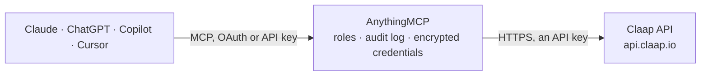

<!-- Generated by scripts/export-github-catalog.mjs in the anythingmcp-website repository. Do not edit by hand. -->

# Claap MCP connector

Read a Claap workspace: meeting and call recordings with participants, AI notes and full transcripts, folders, views and AI fields, plus the deals, companies and contacts Claap links to those … The AnythingMCP connector gives Claude, ChatGPT, Microsoft Copilot, Cursor and Gemini 18 MCP tools for Claap, all read-only.

**Category:** [Productivity](../productivity.md) · **Tools:** 18 · **Setup guide:** [anythingmcp.com](https://anythingmcp.com/guides/claap-to-mcp) · [Deutsch](https://anythingmcp.com/de/guides/claap-to-mcp) · [Italiano](https://anythingmcp.com/it/guides/claap-to-mcp) · [Español](https://anythingmcp.com/es/guides/claap-to-mcp) · [日本語](https://anythingmcp.com/ja/guides/claap-to-mcp) · [Русский](https://anythingmcp.com/ru/guides/claap-to-mcp) · [中文](https://anythingmcp.com/zh/guides/claap-to-mcp)

## Start without code

No installation and no terminal: AnythingMCP Cloud runs the Claap connector for you, operated by helpcode.ai in Frankfurt, Germany.

1. **Click the button above** and create an account or sign in. The Claap connector opens, ready to install.
2. **Paste the API key or token from your Claap account.** Every click is in the [step-by-step guide](https://anythingmcp.com/guides/claap-to-mcp).
3. **Click Install.** AnythingMCP shows the address of your MCP server.
4. **Add that address to your assistant:** [Claude](https://anythingmcp.com/guides/connect-claap-to-claude) · [ChatGPT](https://anythingmcp.com/guides/connect-claap-to-chatgpt) · [Microsoft Copilot](https://anythingmcp.com/guides/connect-claap-to-copilot) · [Cursor](https://anythingmcp.com/guides/connect-claap-to-cursor) · [Gemini CLI](https://anythingmcp.com/guides/connect-claap-to-gemini) · [Meta Muse](https://anythingmcp.com/guides/connect-claap-to-muse).
5. **Ask your first question**, for example: *Find the recording for the June 2, 2026 discovery call with Solaris Energies GmbH recorded by emma@helios-consulting.de*

Prefer help with the setup? [Talk to us](https://anythingmcp.com/contact).

## How it works

- **The AI client** speaks MCP (Streamable HTTP) to AnythingMCP and only sees tool names, descriptions and results. It never gets the Claap credentials.
- **AnythingMCP** checks the client's role, builds the call from the tool definition, adds the credentials (an API key), calls Claap, logs the call and returns the result.
- **Claap** sees an ordinary API client with the rights of the account the credentials belong to.

## Tools

| Tool | What it does | Access |
|---|---|---|
| [`claap_get_workspace`](#claap_get_workspace) | Get the Claap workspace the API key belongs to: id, name, creation date, number of members and number of recordings. | read |
| [`claap_list_recordings`](#claap_list_recordings) | List the workspace's recordings (meetings, calls, uploads), newest first, with id, title, URL, duration, recorder, meeting participants and times, folder,… | read |
| [`claap_get_recording`](#claap_get_recording) | Get one recording by id: title, URL, duration, recorder, meeting participants, folder, labels, linked deal and companies, AI notes (key takeaways, action… | read |
| [`claap_get_recording_transcript`](#claap_get_recording_transcript) | Get the transcript of a recording, as JSON segments with speaker and timestamps or as readable text. | read |
| [`claap_list_recording_views`](#claap_list_recording_views) | List the public recording views of the workspace (saved filters such as 'Discovery calls this week'), including the built-in default views flagged isDefault. | read |
| [`claap_list_recording_ai_fields`](#claap_list_recording_ai_fields) | List the recording AI fields of the workspace (questions the AI answers for every recording, e.g. budget, next steps), sorted by title, with id, title, type… | read |
| [`claap_get_folder`](#claap_get_folder) | Get one folder (channel) by id: title, description, whether it is searchable, and member and public permissions. | read |
| [`claap_list_deals`](#claap_list_deals) | List the deals Claap tracks from the connected CRM, most recently opened first, with id, name, stage, amount, owner, company and activity. | read |
| [`claap_get_deal`](#claap_get_deal) | Get one deal by id: title, status, stage and pipeline, amount, opened and closed dates, owner, company and contact ids, AI summary and, optionally, the AI… | read |
| [`claap_list_deal_stages`](#claap_list_deal_stages) | List the deal stages of the CRM connected to the workspace (HubSpot only), with the pipeline each stage belongs to. | read |
| [`claap_list_deal_owners`](#claap_list_deal_owners) | List the deal owners of the CRM connected to the workspace (HubSpot only), with name and email. | read |
| [`claap_list_deal_views`](#claap_list_deal_views) | List the public deal views of the workspace, including the built-in defaults flagged isDefault. | read |
| [`claap_list_companies`](#claap_list_companies) | List companies Claap knows from meetings and the CRM, newest first by default, with id, name, domain and last interaction. | read |
| [`claap_get_company`](#claap_get_company) | Get one company by id with name, domains, deal ids, contact ids, last interaction, source and CRM link. | read |
| [`claap_list_contacts`](#claap_list_contacts) | List contacts (external meeting participants and CRM contacts), by name by default, with id, name, email, company and last interaction. | read |
| [`claap_get_contact`](#claap_get_contact) | Get one contact by id with name, email, company id, whether they are external, CRM link and an AI summary. | read |
| [`claap_list_users`](#claap_list_users) | List the users of the workspace in any state (active, invited, suspended) with id, name, email and role. | read |
| [`claap_list_user_groups`](#claap_list_user_groups) | List the user groups (teams) of the workspace with their members. | read |

## Tool reference

Every parameter as the AI client sees it in `tools/list`. Source: [`packages/backend/src/adapters/intl/claap.json`](../../../packages/backend/src/adapters/intl/claap.json).

### `claap_get_workspace`

Get the Claap workspace the API key belongs to: id, name, creation date, number of members and number of recordings. Use it to check the connection; every other tool reads this workspace.

**Access:** read · **Call:** `GET /v1/workspaces/mine`

No parameters.

### `claap_list_recordings`

List the workspace's recordings (meetings, calls, uploads), newest first, with id, title, URL, duration, recorder, meeting participants and times, folder, labels, source platform and available transcript languages. Filter by date, folder, recorder, source or view; page with cursor.

**Access:** read · **Call:** `GET /v1/recordings`

| Parameter | Type | Required | Description |
|---|---|---|---|
| `created_after` | string | no | Only recordings created at or after this date/time (ISO 8601, e.g. 2026-09-01). |
| `created_before` | string | no | Only recordings created before this date/time (ISO 8601). |
| `folder_id` | string | no | Only recordings in this folder (channel) id. |
| `labels` | string | no | Comma-separated label names; only with folder_id. |
| `recorder_email` | string | no | Only recordings made by this user's email. |
| `recorder_id` | string | no | Only recordings made by this Claap user id (from claap_list_users). |
| `sources` | string | no | Comma-separated sources: Zoom, GoogleMeet, MsTeams, Aircall, Allo, Ringover, LemlistVoip, Call, Loom, MobileApp, Uploaded, Api. |
| `sort` | `created_desc` \| `created_asc` \| `duration_desc` \| `duration_asc` \| `title_asc` \| `title_desc` | no | Sort order (default created_desc, or the view's sort). |
| `view_id` | string | no | Optional view id from claap_list_recording_views: its filters and sort apply. |
| `limit` | integer | no | Results per page, 1 to 100 (default 20). |
| `cursor` | string | no | pagination.nextCursor from the previous answer, to read the next page. |

### `claap_get_recording`

Get one recording by id: title, URL, duration, recorder, meeting participants, folder, labels, linked deal and companies, AI notes (key takeaways, action items, outline), AI field values and available transcript languages. Use it after claap_list_recordings for one meeting.

**Access:** read · **Call:** `GET /v1/recordings/{recording_id}`

| Parameter | Type | Required | Description |
|---|---|---|---|
| `recording_id` | string | yes | Recording id from claap_list_recordings. |

### `claap_get_recording_transcript`

Get the transcript of a recording, as JSON segments with speaker and timestamps or as readable text. Use format text to summarise a meeting or search what was said; set lang for a translation.

**Access:** read · **Call:** `GET /v1/recordings/{recording_id}/transcript`

| Parameter | Type | Required | Description |
|---|---|---|---|
| `recording_id` | string | yes | Recording id from claap_list_recordings. |
| `format` | `text` \| `json` | no | text for a readable transcript, json for segments with speakers and timestamps. |
| `lang` | string | no | Optional 2-letter language code for a specific transcript or translation (e.g. en, de); default the original language. |

### `claap_list_recording_views`

List the public recording views of the workspace (saved filters such as 'Discovery calls this week'), including the built-in default views flagged isDefault. Pass a view id to claap_list_recordings to apply it.

**Access:** read · **Call:** `GET /v1/recordings/views`

No parameters.

### `claap_list_recording_ai_fields`

List the recording AI fields of the workspace (questions the AI answers for every recording, e.g. budget, next steps), sorted by title, with id, title, type and prompt. Values appear on recordings.

**Access:** read · **Call:** `GET /v1/recordings/fields`

| Parameter | Type | Required | Description |
|---|---|---|---|
| `include_archived` | boolean | no | true to include archived fields. |

### `claap_get_folder`

Get one folder (channel) by id: title, description, whether it is searchable, and member and public permissions. Folder ids appear on recordings as channel.id.

**Access:** read · **Call:** `GET /v1/folders/{folder_id}`

| Parameter | Type | Required | Description |
|---|---|---|---|
| `folder_id` | string | yes | Folder (channel) id, from the channel of a recording. |

### `claap_list_deals`

List the deals Claap tracks from the connected CRM, most recently opened first, with id, name, stage, amount, owner, company and activity. Filter with a deal view; page with cursor.

**Access:** read · **Call:** `GET /v1/deals`

| Parameter | Type | Required | Description |
|---|---|---|---|
| `view_id` | string | no | Optional view id from claap_list_deal_views: its filters and sort apply. |
| `limit` | integer | no | Results per page, 1 to 100 (default 20). |
| `cursor` | string | no | pagination.nextCursor from the previous answer, to read the next page. |

### `claap_get_deal`

Get one deal by id: title, status, stage and pipeline, amount, opened and closed dates, owner, company and contact ids, AI summary and, optionally, the AI field values computed from its calls and emails.

**Access:** read · **Call:** `GET /v1/deals/{deal_id}`

| Parameter | Type | Required | Description |
|---|---|---|---|
| `deal_id` | string | yes | Deal id from claap_list_deals. |
| `return_ai_fields` | boolean | no | true to include the deal's AI field values. |

### `claap_list_deal_stages`

List the deal stages of the CRM connected to the workspace (HubSpot only), with the pipeline each stage belongs to. Use it to read stage names on deals. Answers 400 when the workspace has no HubSpot CRM connected.

**Access:** read · **Call:** `GET /v1/deals/stages`

No parameters.

### `claap_list_deal_owners`

List the deal owners of the CRM connected to the workspace (HubSpot only), with name and email. Answers 400 when the workspace has no HubSpot CRM connected.

**Access:** read · **Call:** `GET /v1/deals/owners`

| Parameter | Type | Required | Description |
|---|---|---|---|
| `email` | string | no | Optional: only the owner with this email. |

### `claap_list_deal_views`

List the public deal views of the workspace, including the built-in defaults flagged isDefault. Pass a view id to claap_list_deals to apply its filters.

**Access:** read · **Call:** `GET /v1/deals/views`

No parameters.

### `claap_list_companies`

List companies Claap knows from meetings and the CRM, newest first by default, with id, name, domain and last interaction. Sort by name or last interaction; page with cursor.

**Access:** read · **Call:** `GET /v1/companies`

| Parameter | Type | Required | Description |
|---|---|---|---|
| `sort` | `created_desc` \| `created_asc` \| `last_interaction_desc` \| `last_interaction_asc` \| `name_asc` \| `name_desc` | no | Sort order. |
| `view_id` | string | no | Optional view id from claap_list_company_views: its filters and sort apply. |
| `limit` | integer | no | Results per page, 1 to 100 (default 20). |
| `cursor` | string | no | pagination.nextCursor from the previous answer, to read the next page. |

### `claap_get_company`

Get one company by id with name, domains, deal ids, contact ids, last interaction, source and CRM link. If it was merged into another company, the surviving one is returned.

**Access:** read · **Call:** `GET /v1/companies/{company_id}`

| Parameter | Type | Required | Description |
|---|---|---|---|
| `company_id` | string | yes | Company id from claap_list_companies or a deal. |

### `claap_list_contacts`

List contacts (external meeting participants and CRM contacts), by name by default, with id, name, email, company and last interaction. Page with cursor.

**Access:** read · **Call:** `GET /v1/contacts`

| Parameter | Type | Required | Description |
|---|---|---|---|
| `sort` | `name_asc` \| `name_desc` \| `email_asc` \| `email_desc` \| `last_interaction_desc` \| `last_interaction_asc` | no | Sort order. |
| `view_id` | string | no | Optional view id from claap_list_contact_views: its filters and sort apply. |
| `limit` | integer | no | Results per page, 1 to 100 (default 20). |
| `cursor` | string | no | pagination.nextCursor from the previous answer, to read the next page. |

### `claap_get_contact`

Get one contact by id with name, email, company id, whether they are external, CRM link and an AI summary. Use it to prepare a meeting with that person.

**Access:** read · **Call:** `GET /v1/contacts/{contact_id}`

| Parameter | Type | Required | Description |
|---|---|---|---|
| `contact_id` | string | yes | Contact id from claap_list_contacts. |

### `claap_list_users`

List the users of the workspace in any state (active, invited, suspended) with id, name, email and role. Use it to find a recorder id or email for claap_list_recordings.

**Access:** read · **Call:** `GET /v1/users`

| Parameter | Type | Required | Description |
|---|---|---|---|
| `email` | string | no | Optional: only the user with this email. |
| `limit` | integer | no | Results per page, 1 to 100 (default 20). |
| `cursor` | string | no | pagination.nextCursor from the previous answer, to read the next page. |

### `claap_list_user_groups`

List the user groups (teams) of the workspace with their members. Use it to see who belongs to which team.

**Access:** read · **Call:** `GET /v1/user-groups`

| Parameter | Type | Required | Description |
|---|---|---|---|
| `limit` | integer | no | Results per page, 1 to 100 (default 20). |
| `cursor` | string | no | pagination.nextCursor from the previous answer, to read the next page. |

## Run it yourself

AnythingMCP is open source (AGPL-3.0). [Run it with Docker](../../../README.md#run-it-yourself), open **Connectors → Store**, pick **Claap** and enter `CLAAP_API_KEY`, then add your MCP server URL to the AI client.

[← Productivity connectors](../productivity.md) · [All categories](../README.md)
