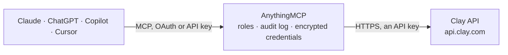

<!-- Generated by scripts/export-github-catalog.mjs in the anythingmcp-website repository. Do not edit by hand. -->

# Clay MCP connector

Clay GTM data from any AI agent: search Clay's people and company database, run Clay enrichment and custom functions, query Clay tables, search Workflow runs and check credits. The AnythingMCP connector gives Claude, ChatGPT, Microsoft Copilot, Cursor and Gemini 13 MCP tools for Clay: 11 read and 2 can change data.

**Category:** [Data Enrichment](../enrichment.md) · **Tools:** 13 · **Setup guide:** [anythingmcp.com](https://anythingmcp.com/guides/clay-to-mcp) · [Deutsch](https://anythingmcp.com/de/guides/clay-to-mcp) · [Italiano](https://anythingmcp.com/it/guides/clay-to-mcp) · [Español](https://anythingmcp.com/es/guides/clay-to-mcp) · [日本語](https://anythingmcp.com/ja/guides/clay-to-mcp) · [Русский](https://anythingmcp.com/ru/guides/clay-to-mcp) · [中文](https://anythingmcp.com/zh/guides/clay-to-mcp)

## Start without code

No installation and no terminal: AnythingMCP Cloud runs the Clay connector for you, operated by helpcode.ai in Frankfurt, Germany.

1. **Click the button above** and create an account or sign in. The Clay connector opens, ready to install.
2. **Paste the API key or token from your Clay account.** Every click is in the [step-by-step guide](https://anythingmcp.com/guides/clay-to-mcp).
3. **Click Install.** AnythingMCP shows the address of your MCP server.
4. **Add that address to your assistant:** [Claude](https://anythingmcp.com/guides/connect-clay-to-claude) · [ChatGPT](https://anythingmcp.com/guides/connect-clay-to-chatgpt) · [Microsoft Copilot](https://anythingmcp.com/guides/connect-clay-to-copilot) · [Cursor](https://anythingmcp.com/guides/connect-clay-to-cursor) · [Gemini CLI](https://anythingmcp.com/guides/connect-clay-to-gemini) · [Meta Muse](https://anythingmcp.com/guides/connect-clay-to-muse).
5. **Ask your first question**, for example: *Get the Clay company record for Greenfield Solar GmbH and show domain, company size and revenue.*

Prefer help with the setup? [Talk to us](https://anythingmcp.com/contact).

## How it works

- **The AI client** speaks MCP (Streamable HTTP) to AnythingMCP and only sees tool names, descriptions and results. It never gets the Clay credentials.
- **AnythingMCP** checks the client's role, builds the call from the tool definition, adds the credentials (an API key), calls Clay, logs the call and returns the result.
- **Clay** sees an ordinary API client with the rights of the account the credentials belong to.

## Tools

| Tool | What it does | Access |
|---|---|---|
| [`clay_get_me`](#clay_get_me) | Get the Clay user and workspace the API key belongs to. | read |
| [`clay_get_credit_balance`](#clay_get_credit_balance) | Get the current credit balances of the workspace. | read |
| [`clay_get_search_query_reference`](#clay_get_search_query_reference) | Get the reference of the Clay search query language (markdown): the queryable people and company fields, operators and grammar. | read |
| [`clay_create_search`](#clay_create_search) | Start a search of Clay's people or company database with a Clay search query, e.g. select from people where experiences.any(is_current = true and job_title… | read |
| [`clay_get_search_results`](#clay_get_search_results) | Fetch the next page of records of a search. | read |
| [`clay_query_tables`](#clay_query_tables) | Read rows of known Clay tables (Enterprise plans) with selected fields, filters, ordering, grouping and joins. | read |
| [`clay_run_routine`](#clay_run_routine) | Run a Clay function (Clay-managed or a custom function with API access enabled) on 1 to 100 input items, for example to find work emails or enrich companies. | write |
| [`clay_get_run_results`](#clay_get_run_results) | Get the progress and results of a routine run. | read |
| [`clay_get_batch_run_results`](#clay_get_batch_run_results) | Get the progress of a batch routine run started from the Clay CLI or API, and when complete the download URL of its results file. | read |
| [`clay_get_runs_query_reference`](#clay_get_runs_query_reference) | Get the reference of the workflow-run query language (markdown): queryable run fields, node predicates, content search and grammar. | read |
| [`clay_query_workflow_runs`](#clay_query_workflow_runs) | Search Clay Workflow runs with a run query: a select query returns matching runs newest first with a cursor, a count query returns the number of runs. | read |
| [`clay_get_privacy_deletion_status`](#clay_get_privacy_deletion_status) | Check a privacy deletion job from clay_privacy_delete_people, including its cascading cleanup. | read |
| [`clay_privacy_delete_people`](#clay_privacy_delete_people) | Delete people from Clay Audiences for a privacy request (for example a GDPR erasure), matched by email, LinkedIn slug or phone. | write |

## Tool reference

Every parameter as the AI client sees it in `tools/list`. Source: [`packages/backend/src/adapters/intl/clay.json`](../../../packages/backend/src/adapters/intl/clay.json).

### `clay_get_me`

Get the Clay user and workspace the API key belongs to. Use it to check the key and to learn the workspace id.

**Access:** read · **Call:** `GET /me`

No parameters.

### `clay_get_credit_balance`

Get the current credit balances of the workspace. Reading balances costs no credits.

**Access:** read · **Call:** `GET /credits/balance`

No parameters.

### `clay_get_search_query_reference`

Get the reference of the Clay search query language (markdown): the queryable people and company fields, operators and grammar. Read it before writing a query for clay_create_search.

**Access:** read · **Call:** `GET /search/query-mode/reference`

No parameters.

### `clay_create_search`

Start a search of Clay's people or company database with a Clay search query, e.g. select from people where experiences.any(is_current = true and job_title is_similar_to ("VP Sales")). Returns a search_id; fetch the records with clay_get_search_results.

**Access:** read · **Call:** `POST /search/query-mode`

| Parameter | Type | Required | Description |
|---|---|---|---|
| `query` | string | yes | Clay search query, starting with "select from people" or "select from companies". Count queries and job searches are not supported. |

### `clay_get_search_results`

Fetch the next page of records of a search. Each call advances the search; call again while has_more is true. People come with name, location and matched experiences; companies with domain, industry, size, revenue and LinkedIn URL.

**Access:** read · **Call:** `POST /search/query-mode/{search_id}/run`

| Parameter | Type | Required | Description |
|---|---|---|---|
| `search_id` | string | yes | search_id from clay_create_search. |
| `limit` | integer | no | Records in this page (default 20, at most 500 on paid plans, 50 on free and trial). |

### `clay_query_tables`

Read rows of known Clay tables (Enterprise plans) with selected fields, filters, ordering, grouping and joins. Returns rows with each cell's status and value, and a cursor for the next page.

**Access:** read · **Call:** `POST /tables/query`

| Parameter | Type | Required | Description |
|---|---|---|---|
| `query` | object | yes | Structured query: {"tables": [{"id": "t_0te9i4tZEHwc9hihBXu"}], "select": [{"field": "Company Name", "as": "company_name"}, {"field": "Domain"}], "filter": {"field": "Domain", "op": "is_not_empty"}, "order_by": [{"field": "Domain", "direction": "asc"}], "field_mode": "names"}. Filter ops: =, !=, >, >=, <, <=, contains, not_contains, starts_with, ends_with, in, not_in, is_empty, is_not_empty; combine with {"and": [...]}, {"or": [...]}, {"not": {...}}. Up to 5 tables, 20 selected fields, 3 order_by entries (order_by disables cursor paging). |
| `limit` | integer | no | Rows per page (default 50, at most 100). |
| `cursor` | string | no | cursor from the previous page. |

### `clay_run_routine`

Run a Clay function (Clay-managed or a custom function with API access enabled) on 1 to 100 input items, for example to find work emails or enrich companies. Runs are asynchronous and spend Clay credits; poll clay_get_run_results with the returned routine_run_id.

**Access:** write · **Call:** `POST /routines/{routine_id}/run`

| Parameter | Type | Required | Description |
|---|---|---|---|
| `routine_id` | string | yes | Routine id, e.g. function:t_abc123 for a custom function (the t_... id from the function details in Clay, prefixed with function:). |
| `items` | object[] | yes | Inputs: [{"id": "row-1", "inputs": {"domain": "clay.com"}}]. id (at most 64 characters) is yours and comes back with the result; inputs are the function's input names. |
| `webhook_id` | string | no | Id of a registered Clay webhook to notify when the run finishes. |

### `clay_get_run_results`

Get the progress and results of a routine run. While it runs: HTTP 202 with total and finished counts. When done: status complete and data with one entry per input id, each complete with result or failed with error. Paged with cursor.

**Access:** read · **Call:** `GET /routines/run/{routine_run_id}/results`

| Parameter | Type | Required | Description |
|---|---|---|---|
| `routine_run_id` | string | yes | routine_run_id from clay_run_routine. |
| `limit` | integer | no | Results per page (default 20, at most 100). |
| `cursor` | string | no | cursor from the previous page. |

### `clay_get_batch_run_results`

Get the progress of a batch routine run started from the Clay CLI or API, and when complete the download URL of its results file.

**Access:** read · **Call:** `GET /routines/run-batch/{routine_run_id}/results`

| Parameter | Type | Required | Description |
|---|---|---|---|
| `routine_run_id` | string | yes | Batch routine_run_id. |

### `clay_get_runs_query_reference`

Get the reference of the workflow-run query language (markdown): queryable run fields, node predicates, content search and grammar. Read it before clay_query_workflow_runs. Beta.

**Access:** read · **Call:** `GET /workflows/runs/query/reference`

No parameters.

### `clay_query_workflow_runs`

Search Clay Workflow runs with a run query: a select query returns matching runs newest first with a cursor, a count query returns the number of runs. Beta; data can lag a few seconds.

**Access:** read · **Call:** `POST /workflows/runs/query`

| Parameter | Type | Required | Description |
|---|---|---|---|
| `query` | string | yes | Run query in the grammar from clay_get_runs_query_reference (at most 2000 characters). |
| `limit` | integer | no | Runs per page (1-100). |
| `cursor` | string | no | cursor from the previous page. |

### `clay_get_privacy_deletion_status`

Check a privacy deletion job from clay_privacy_delete_people, including its cascading cleanup. Status stays available up to five days after the job ends.

**Access:** read · **Call:** `GET /audiences/privacy-delete/{job_id}`

| Parameter | Type | Required | Description |
|---|---|---|---|
| `job_id` | string | yes | Job id returned by clay_privacy_delete_people. |

### `clay_privacy_delete_people`

Delete people from Clay Audiences for a privacy request (for example a GDPR erasure), matched by email, LinkedIn slug or phone. Run with dry_run true first to see how many people match. Switched off by default.

**Access:** write · **Call:** `POST /audiences/privacy-delete`

| Parameter | Type | Required | Description |
|---|---|---|---|
| `person_identifiers` | object[] | yes | 1-100 identifiers; people matching any are deleted: {"type": "email", "value": "jane@example.com"}, {"type": "linkedin", "value": "jane-doe"} (the slug after /in/, not the URL) or {"type": "phone", "value": "+4915112345678"}. |
| `dry_run` | boolean | no | true only counts the matching people without deleting (default false). |

## Run it yourself

AnythingMCP is open source (AGPL-3.0). [Run it with Docker](../../../README.md#run-it-yourself), open **Connectors → Store**, pick **Clay** and enter `CLAY_API_KEY`, then add your MCP server URL to the AI client.

[← Data Enrichment connectors](../enrichment.md) · [All categories](../README.md)
