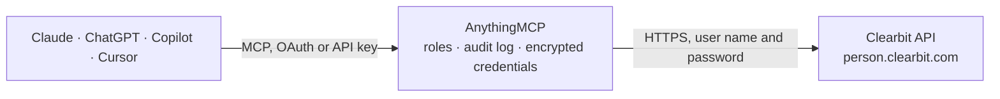

<!-- Generated by scripts/export-github-catalog.mjs in the anythingmcp-website repository. Do not edit by hand. -->

# Clearbit MCP connector

Enrich emails, domains and IPs via Clearbit (HubSpot Breeze Intelligence). 6 tools, Bearer auth. The AnythingMCP connector gives Claude, ChatGPT, Microsoft Copilot, Cursor and Gemini 6 MCP tools for Clearbit, all read-only.

**Category:** [Data Enrichment](../enrichment.md) · **Tools:** 6 · **Setup guide:** [anythingmcp.com](https://anythingmcp.com/guides/clearbit-to-mcp) · [Deutsch](https://anythingmcp.com/de/guides/clearbit-to-mcp) · [Italiano](https://anythingmcp.com/it/guides/clearbit-to-mcp) · [Español](https://anythingmcp.com/es/guides/clearbit-to-mcp) · [日本語](https://anythingmcp.com/ja/guides/clearbit-to-mcp) · [Русский](https://anythingmcp.com/ru/guides/clearbit-to-mcp) · [中文](https://anythingmcp.com/zh/guides/clearbit-to-mcp)

## Start without code

No installation and no terminal: AnythingMCP Cloud runs the Clearbit connector for you, operated by helpcode.ai in Frankfurt, Germany.

1. **Click the button above** and create an account or sign in. The Clearbit connector opens, ready to install.
2. **Paste the API key or token from your Clearbit account.** Every click is in the [step-by-step guide](https://anythingmcp.com/guides/clearbit-to-mcp).
3. **Click Install.** AnythingMCP shows the address of your MCP server.
4. **Add that address to your assistant:** [Claude](https://anythingmcp.com/guides/connect-clearbit-to-claude) · [ChatGPT](https://anythingmcp.com/guides/connect-clearbit-to-chatgpt) · [Microsoft Copilot](https://anythingmcp.com/guides/connect-clearbit-to-copilot) · [Cursor](https://anythingmcp.com/guides/connect-clearbit-to-cursor) · [Gemini CLI](https://anythingmcp.com/guides/connect-clearbit-to-gemini) · [Meta Muse](https://anythingmcp.com/guides/connect-clearbit-to-muse).
5. **Ask your first question**, for example: *Enrich lead email lena.meyer@windly-solutions.de — need name, title, company and LinkedIn for outreach*

Prefer help with the setup? [Talk to us](https://anythingmcp.com/contact).

## How it works

- **The AI client** speaks MCP (Streamable HTTP) to AnythingMCP and only sees tool names, descriptions and results. It never gets the Clearbit credentials.
- **AnythingMCP** checks the client's role, builds the call from the tool definition, adds the credentials (user name and password), calls Clearbit, logs the call and returns the result.
- **Clearbit** sees an ordinary API client with the rights of the account the credentials belong to.

## Tools

| Tool | What it does | Access |
|---|---|---|
| [`clearbit_person_enrich`](#clearbit_person_enrich) | Enrich a person by email. | read |
| [`clearbit_company_enrich`](#clearbit_company_enrich) | Enrich a company by domain. | read |
| [`clearbit_combined_enrich`](#clearbit_combined_enrich) | Combined person + company enrichment in one call by email. | read |
| [`clearbit_discovery_search`](#clearbit_discovery_search) | Search Clearbit's company database by filters (industry, size, location, tech, type). | read |
| [`clearbit_reveal_by_ip`](#clearbit_reveal_by_ip) | Reverse-IP lookup: given an IP, return the company it belongs to (B2B intent / website-visitor identification). | read |
| [`clearbit_company_autocomplete`](#clearbit_company_autocomplete) | Autocomplete company names (no auth required, public). | read |

## Tool reference

Every parameter as the AI client sees it in `tools/list`. Source: [`packages/backend/src/adapters/intl/clearbit.json`](../../../packages/backend/src/adapters/intl/clearbit.json).

### `clearbit_person_enrich`

Enrich a person by email. Returns name, location, employment (company name, title, role, seniority, domain), social profiles (twitter, linkedin, github, etc.), avatar.

**Access:** read · **Call:** `GET /v2/people/find`

| Parameter | Type | Required | Description |
|---|---|---|---|
| `email` | string | yes | Email to enrich. |
| `webhook_url` | string | no | If passed, Clearbit returns 202 and posts results to this URL when data is ready. |

### `clearbit_company_enrich`

Enrich a company by domain. Returns name, legal_name, description, industry, employees, employeesRange, founded_year, location, tech[] (tech stack), metrics (annualRevenue, raisedFunding, etc.), social profiles, logo.

**Access:** read · **Call:** `GET https://company.clearbit.com/v2/companies/find`

| Parameter | Type | Required | Description |
|---|---|---|---|
| `domain` | string | yes | Domain (e.g. 'acme.com'). |
| `webhook_url` | string | no | Async webhook URL. |

### `clearbit_combined_enrich`

Combined person + company enrichment in one call by email. Returns {person: {...}, company: {...}}.

**Access:** read · **Call:** `GET https://person-stream.clearbit.com/v2/combined/find`

| Parameter | Type | Required | Description |
|---|---|---|---|
| `email` | string | yes | Email. |

### `clearbit_discovery_search`

Search Clearbit's company database by filters (industry, size, location, tech, type). Useful for ICP-based prospecting. Returns paginated companies (NOT contacts — pair with another tool for people).

**Access:** read · **Call:** `GET https://discovery.clearbit.com/v1/companies/search`

| Parameter | Type | Required | Description |
|---|---|---|---|
| `query` | string | yes | Filter expression, e.g. 'tech:Salesforce AND employees:1000~10000 AND location:United States'. See https://dashboard.clearbit.com/docs#discovery-api-search-companies for full syntax. |
| `sort` | string | no | alexa_us_rank, alexa_global_rank, employees, annual_revenue (with :asc or :desc suffix). |
| `page` | integer | no | 1-based page. |
| `page_size` | integer | no | Per page (default 50, max 100). |

### `clearbit_reveal_by_ip`

Reverse-IP lookup: given an IP, return the company it belongs to (B2B intent / website-visitor identification). Great for showing 'Acme Corp is browsing your site'.

**Access:** read · **Call:** `GET https://reveal.clearbit.com/v1/companies/find`

| Parameter | Type | Required | Description |
|---|---|---|---|
| `ip` | string | yes | IPv4 or IPv6 address. |

### `clearbit_company_autocomplete`

Autocomplete company names (no auth required, public). Returns top matches with name, domain, logo. Use for company-picker UIs.

**Access:** read · **Call:** `GET https://autocomplete.clearbit.com/v1/companies/suggest`

| Parameter | Type | Required | Description |
|---|---|---|---|
| `query` | string | yes | Partial company name. |

## Run it yourself

AnythingMCP is open source (AGPL-3.0). [Run it with Docker](../../../README.md#run-it-yourself), open **Connectors → Store**, pick **Clearbit** and enter `CLEARBIT_API_KEY`, then add your MCP server URL to the AI client.

[← Data Enrichment connectors](../enrichment.md) · [All categories](../README.md)
