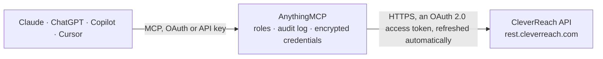

<!-- Generated by scripts/export-github-catalog.mjs in the anythingmcp-website repository. Do not edit by hand. -->

# CleverReach MCP connector

CleverReach email marketing (Germany): groups and receivers with attributes, tags and events, upserts, activation and double opt-in mails, blacklist and bounces, draft mailings with previews and … The AnythingMCP connector gives Claude, ChatGPT, Microsoft Copilot, Cursor and Gemini 43 MCP tools for CleverReach: 26 read and 17 can change data.

**Category:** [Marketing Automation](../marketing-automation.md) · **Tools:** 43 · **Setup guide:** [anythingmcp.com](https://anythingmcp.com/guides/cleverreach-to-mcp) · [Deutsch](https://anythingmcp.com/de/guides/cleverreach-to-mcp) · [Italiano](https://anythingmcp.com/it/guides/cleverreach-to-mcp) · [Español](https://anythingmcp.com/es/guides/cleverreach-to-mcp) · [日本語](https://anythingmcp.com/ja/guides/cleverreach-to-mcp) · [Русский](https://anythingmcp.com/ru/guides/cleverreach-to-mcp) · [中文](https://anythingmcp.com/zh/guides/cleverreach-to-mcp)

## Start without code

No installation and no terminal: AnythingMCP Cloud runs the CleverReach connector for you, operated by helpcode.ai in Frankfurt, Germany.

1. **Click the button above** and create an account or sign in. The CleverReach connector opens, ready to install.
2. **Sign in with your CleverReach account** when AnythingMCP asks. The first time, an admin creates a small app in the CleverReach developer console. Every click is in the [step-by-step guide](https://anythingmcp.com/guides/cleverreach-to-mcp).
3. **Click Install.** AnythingMCP shows the address of your MCP server.
4. **Add that address to your assistant:** [Claude](https://anythingmcp.com/guides/connect-cleverreach-to-claude) · [ChatGPT](https://anythingmcp.com/guides/connect-cleverreach-to-chatgpt) · [Microsoft Copilot](https://anythingmcp.com/guides/connect-cleverreach-to-copilot) · [Cursor](https://anythingmcp.com/guides/connect-cleverreach-to-cursor) · [Gemini CLI](https://anythingmcp.com/guides/connect-cleverreach-to-gemini) · [Meta Muse](https://anythingmcp.com/guides/connect-cleverreach-to-muse).
5. **Ask your first question**, for example: *Status and tags for subscriber anna.keller@berlinbikes.de in group 'Newsletter DE'?*

Prefer help with the setup? [Talk to us](https://anythingmcp.com/contact).

## How it works

- **The AI client** speaks MCP (Streamable HTTP) to AnythingMCP and only sees tool names, descriptions and results. It never gets the CleverReach credentials.
- **AnythingMCP** checks the client's role, builds the call from the tool definition, adds the credentials (an OAuth 2.0 access token, refreshed automatically), calls CleverReach, logs the call and returns the result.
- **CleverReach** sees an ordinary API client with the rights of the account the credentials belong to.

## Tools

| Tool | What it does | Access |
|---|---|---|
| [`cleverreach_whoami`](#cleverreach_whoami) | Information about the CleverReach account the token belongs to: client id, company, login and contact data. | read |
| [`cleverreach_list_groups`](#cleverreach_list_groups) | List the groups (receiver lists) of the account with id, name, description (receiver_info), locked and backup flags and last changes. | read |
| [`cleverreach_get_group`](#cleverreach_get_group) | Get one group (receiver list) by id: name, receiver_info, locked, backup and timestamps. | read |
| [`cleverreach_get_group_stats`](#cleverreach_get_group_stats) | Counts of a group: total, active, inactive and bounced receivers, average points, quality and order figures. | read |
| [`cleverreach_create_group`](#cleverreach_create_group) | Create a group (receiver list) with a name and optional description. | write |
| [`cleverreach_update_group`](#cleverreach_update_group) | Rename a group or change its description, locked or backup flag. | write |
| [`cleverreach_list_group_filters`](#cleverreach_list_group_filters) | List the filters (segments) of a group with id, name, operator and rules. | read |
| [`cleverreach_list_group_receivers`](#cleverreach_list_group_receivers) | List the receivers (subscribers) of a group with email, active flag, registered, activated and deactivated timestamps, source and attributes. | read |
| [`cleverreach_get_receiver`](#cleverreach_get_receiver) | Get one receiver by id or email: global attributes, tags, points, bounce state. | read |
| [`cleverreach_find_receivers`](#cleverreach_find_receivers) | Find receivers across groups with a temporary filter: rules on email, source, timestamps, points or attributes, combined with AND or OR. | read |
| [`cleverreach_list_receiver_groups`](#cleverreach_list_receiver_groups) | List the groups a receiver (id or email) is in, optionally only those where it is active or inactive. | read |
| [`cleverreach_list_receiver_events`](#cleverreach_list_receiver_events) | List the events of a receiver (id or email): custom events added by shops or apps, with type, value and timestamp. | read |
| [`cleverreach_create_receiver`](#cleverreach_create_receiver) | Add one receiver (subscriber) to a group with email, timestamps, source, attributes and tags. | write |
| [`cleverreach_update_receiver`](#cleverreach_update_receiver) | Update a receiver in a group (by id or email): attributes, tags, source or timestamps. | write |
| [`cleverreach_upsert_receivers`](#cleverreach_upsert_receivers) | Create or update many receivers of a group in one call, matched by email (send large lists in chunks of a few hundred). | write |
| [`cleverreach_activate_receiver`](#cleverreach_activate_receiver) | Activate a receiver in a group (by id or email) so mailings reach it. | write |
| [`cleverreach_deactivate_receiver`](#cleverreach_deactivate_receiver) | Deactivate a receiver in a group (by id or email), e.g. after an unsubscribe request. | write |
| [`cleverreach_delete_receiver`](#cleverreach_delete_receiver) | Delete a receiver from a group for good, e.g. for a data erasure request; its history in that group is lost. | write |
| [`cleverreach_add_receiver_tags`](#cleverreach_add_receiver_tags) | Add tags to a receiver (id or email). | write |
| [`cleverreach_remove_receiver_tags`](#cleverreach_remove_receiver_tags) | Remove tags from a receiver (id or email): one tag, several comma-separated, or all tags of an origin with origin.*. | write |
| [`cleverreach_list_tags`](#cleverreach_list_tags) | List the tags used in the account with their origin and how many receivers carry them. | read |
| [`cleverreach_list_attributes`](#cleverreach_list_attributes) | List receiver attributes (data fields): global ones, or with group_id the group-specific ones. | read |
| [`cleverreach_create_attribute`](#cleverreach_create_attribute) | Create a receiver attribute (data field), global or for one group: name, type (text, number, gender, date), description, preview and default value. | write |
| [`cleverreach_list_blacklist`](#cleverreach_list_blacklist) | List the account blacklist: addresses and patterns that never receive mailings, with comment and date. | read |
| [`cleverreach_get_blacklist_entry`](#cleverreach_get_blacklist_entry) | Check whether an email address is on the blacklist and read its comment and date. | read |
| [`cleverreach_add_to_blacklist`](#cleverreach_add_to_blacklist) | Put an email address on the account blacklist so no mailing reaches it any more, with an optional comment (e.g. complaint by phone). | write |
| [`cleverreach_remove_from_blacklist`](#cleverreach_remove_from_blacklist) | Remove an email address from the blacklist so it can receive mailings again. | write |
| [`cleverreach_list_bounces`](#cleverreach_list_bounces) | List bounces of the account: email, category (hardbounce, softbounce, blocked, delayed, spam), occurrences, bounce message, last update and whether it came… | read |
| [`cleverreach_list_bounced_receivers`](#cleverreach_list_bounced_receivers) | List receivers that have a bounce date, page by page, to clean up lists. | read |
| [`cleverreach_list_forms`](#cleverreach_list_forms) | List the signup forms of the account with id, name and group. | read |
| [`cleverreach_send_form_mail`](#cleverreach_send_form_mail) | Send the double opt-in (activate) or opt-out confirmation (deactivate) email of a form to a receiver already in the form's group. | write |
| [`cleverreach_list_mailings`](#cleverreach_list_mailings) | List mailings by state (finished, draft, waiting, running, automation) with id, name, subject, sender and dates. | read |
| [`cleverreach_get_mailing`](#cleverreach_get_mailing) | Get one mailing by id: name, subject, sender, HTML and text content, receivers (groups or filter), settings and state. | read |
| [`cleverreach_create_mailing`](#cleverreach_create_mailing) | Create a mailing as a draft: name, subject, sender, HTML and text content, target groups or filter and tracking settings. | write |
| [`cleverreach_update_mailing`](#cleverreach_update_mailing) | Update a draft mailing: name, subject, sender, content, receivers, settings or tags. | write |
| [`cleverreach_send_mailing_preview`](#cleverreach_send_mailing_preview) | Send a preview of a mailing to test addresses. | write |
| [`cleverreach_get_mailing_links`](#cleverreach_get_mailing_links) | List the links in a mailing with their ids and URLs; link ids filter cleverreach_list_report_receivers by clicks. | read |
| [`cleverreach_list_templates`](#cleverreach_list_templates) | List the user's own mailing templates with id and name, to start a new mailing from a design. | read |
| [`cleverreach_list_mailing_channels`](#cleverreach_list_mailing_channels) | List mailing categories (channels) with id and name, used to group mailings and reports. | read |
| [`cleverreach_list_reports`](#cleverreach_list_reports) | List reports of sent mailings with sent count, opens, clicks, bounces, unsubscribes and send date. | read |
| [`cleverreach_get_report`](#cleverreach_get_report) | Get the report of one sent mailing (same id as the mailing): recipients, opens, clicks, bounces, unsubscribes and rates. | read |
| [`cleverreach_get_report_stats`](#cleverreach_get_report_stats) | Detailed statistics of a report by mode: full, clients, mediaclients, countries, quality (bounces), firsthours, traffic, daily (with start and end), links,… | read |
| [`cleverreach_list_report_receivers`](#cleverreach_list_report_receivers) | List the receivers of a report by state: sent, opened, clicked (optionally one link), notopened, notclicked, bounced or unsubscribed. | read |

## Tool reference

Every parameter as the AI client sees it in `tools/list`. Source: [`packages/backend/src/adapters/de/cleverreach.json`](../../../packages/backend/src/adapters/de/cleverreach.json).

### `cleverreach_whoami`

Information about the CleverReach account the token belongs to: client id, company, login and contact data. Needs no ids; checks the token.

**Access:** read · **Call:** `GET /debug/whoami`

No parameters.

### `cleverreach_list_groups`

List the groups (receiver lists) of the account with id, name, description (receiver_info), locked and backup flags and last changes. Group ids are needed by most receiver tools.

**Access:** read · **Call:** `GET /groups`

| Parameter | Type | Required | Description |
|---|---|---|---|
| `order` | string | no | Sort, e.g. name or stamp. |

### `cleverreach_get_group`

Get one group (receiver list) by id: name, receiver_info, locked, backup and timestamps.

**Access:** read · **Call:** `GET /groups/{group_id}`

| Parameter | Type | Required | Description |
|---|---|---|---|
| `group_id` | string | yes | Group (receiver list) id from cleverreach_list_groups. |

### `cleverreach_get_group_stats`

Counts of a group: total, active, inactive and bounced receivers, average points, quality and order figures.

**Access:** read · **Call:** `GET /groups/{group_id}/stats`

| Parameter | Type | Required | Description |
|---|---|---|---|
| `group_id` | string | yes | Group (receiver list) id from cleverreach_list_groups. |

### `cleverreach_create_group`

Create a group (receiver list) with a name and optional description. Returns the new group with its id.

**Access:** write · **Call:** `POST /groups`

| Parameter | Type | Required | Description |
|---|---|---|---|
| `name` | string | yes | Group name. |
| `receiver_info` | string | no | Description shown in CleverReach. |
| `locked` | boolean | no | Lock the group against changes in the CleverReach interface. |
| `backup` | boolean | no | Keep backups of the group. |

### `cleverreach_update_group`

Rename a group or change its description, locked or backup flag. Only the fields passed change.

**Access:** write · **Call:** `PUT /groups/{group_id}`

| Parameter | Type | Required | Description |
|---|---|---|---|
| `group_id` | string | yes | Group (receiver list) id from cleverreach_list_groups. |
| `name` | string | no | Group name. |
| `receiver_info` | string | no | Description shown in CleverReach. |
| `locked` | boolean | no | Lock the group against changes in the CleverReach interface. |
| `backup` | boolean | no | Keep backups of the group. |

### `cleverreach_list_group_filters`

List the filters (segments) of a group with id, name, operator and rules. A filter id can target a mailing at a segment.

**Access:** read · **Call:** `GET /groups/{group_id}/filters`

| Parameter | Type | Required | Description |
|---|---|---|---|
| `group_id` | string | yes | Group (receiver list) id from cleverreach_list_groups. |

### `cleverreach_list_group_receivers`

List the receivers (subscribers) of a group with email, active flag, registered, activated and deactivated timestamps, source and attributes. Filter by state or by given emails or ids.

**Access:** read · **Call:** `GET /groups/{group_id}/receivers`

| Parameter | Type | Required | Description |
|---|---|---|---|
| `group_id` | string | yes | Group (receiver list) id from cleverreach_list_groups. |
| `type` | `all` \| `active` \| `inactive` \| `bounce` | no | all (default), active, inactive or bounce. |
| `pagesize` | integer | no | Receivers per page, at most 5000. |
| `page` | integer | no | Page, starting at 0. |
| `detail` | integer | no | Extra detail, bitwise: 0 none, 1 events, 2 orders, 4 tags (7 = all). |
| `email_list` | string | no | Only these emails, comma-separated. |
| `id_list` | string | no | Only these receiver ids, comma-separated. |
| `order_by` | string | no | Field to sort by plus asc or desc, e.g. "activated desc". |

### `cleverreach_get_receiver`

Get one receiver by id or email: global attributes, tags, points, bounce state. Pass group_id to also get its group attributes and active state in that group.

**Access:** read · **Call:** `GET /receivers/{receiver}`

| Parameter | Type | Required | Description |
|---|---|---|---|
| `receiver` | string | yes | Receiver id or the receiver's email address. |
| `group_id` | string | no | Group id for the group-specific fields (activated, deactivated, attributes). |

### `cleverreach_find_receivers`

Find receivers across groups with a temporary filter: rules on email, source, timestamps, points or attributes, combined with AND or OR. Nothing is saved.

**Access:** read · **Call:** `POST /receivers/filter`

| Parameter | Type | Required | Description |
|---|---|---|---|
| `rules` | object[] | yes | Rules: [{"field": "email", "logic": "contains", "condition": "@example.com"}]. logic: eq, neq, sm, bg, isnull, notisnull, contains, begins, ends. Fields: email, source, imported, registered, activated, deactivated, bounced, points or an attribute name. |
| `groups` | string[] | no | Group ids to search in. |
| `operator` | `AND` \| `OR` | no | AND (default) or OR between the rules. |
| `orderby` | string | no | Sort, e.g. "activated desc". |
| `detail` | integer | no | Extra detail, bitwise: 0 none, 1 events, 2 orders, 4 tags (7 = all). |
| `pagesize` | integer | no | Receivers per page. |
| `page` | integer | no | Page, starting at 0. |
| `activeonly` | boolean | no | Only active receivers. |

### `cleverreach_list_receiver_groups`

List the groups a receiver (id or email) is in, optionally only those where it is active or inactive.

**Access:** read · **Call:** `GET /receivers/{receiver}/groups`

| Parameter | Type | Required | Description |
|---|---|---|---|
| `receiver` | string | yes | Receiver id or the receiver's email address. |
| `state` | `all` \| `active` \| `inactive` | no | all (default), active or inactive. |

### `cleverreach_list_receiver_events`

List the events of a receiver (id or email): custom events added by shops or apps, with type, value and timestamp.

**Access:** read · **Call:** `GET /receivers/{receiver}/events`

| Parameter | Type | Required | Description |
|---|---|---|---|
| `receiver` | string | yes | Receiver id or the receiver's email address. |
| `group_id` | string | no | Only events in this group. |

### `cleverreach_create_receiver`

Add one receiver (subscriber) to a group with email, timestamps, source, attributes and tags. Without registered and activated the receiver is active at once; for double opt-in send activated 0 and then cleverreach_send_form_mail.

**Access:** write · **Call:** `POST /groups/{group_id}/receivers`

| Parameter | Type | Required | Description |
|---|---|---|---|
| `group_id` | string | yes | Group (receiver list) id from cleverreach_list_groups. |
| `email` | string | yes | Email address. |
| `registered` | string | no | Registration time; set it to now for a new receiver as a Unix timestamp in seconds, e.g. "1730000000". |
| `activated` | string | no | Activation time; set it only to activate at once without a double opt-in mail, leave it out (or "0") when a DOI mail will activate the receiver as a Unix timestamp in seconds, e.g. "1730000000". |
| `deactivated` | string | no | Deactivation time; any value other than 0 makes the receiver inactive. Leave it out unless you mean that as a Unix timestamp in seconds, e.g. "1730000000". |
| `source` | string | no | Where the address came from, e.g. Website signup. |
| `global_attributes` | object | no | Global attributes (all groups) by name, e.g. {"firstname": "Anna", "lastname": "Weber"}. Names from cleverreach_list_attributes. |
| `attributes` | object | no | Group attributes (this group only) by name, e.g. {"customer_number": "4711"}. |
| `tags` | string[] | no | Tags, letters, numbers, _ and -; prefix an origin with a period, e.g. shop.vip. |

### `cleverreach_update_receiver`

Update a receiver in a group (by id or email): attributes, tags, source or timestamps. The email cannot change here. Leave deactivated out unless you mean to deactivate.

**Access:** write · **Call:** `PUT /groups/{group_id}/receivers/{receiver}`

| Parameter | Type | Required | Description |
|---|---|---|---|
| `group_id` | string | yes | Group (receiver list) id from cleverreach_list_groups. |
| `receiver` | string | yes | Receiver id or the receiver's email address. |
| `registered` | string | no | Registration time; set it to now for a new receiver as a Unix timestamp in seconds, e.g. "1730000000". |
| `activated` | string | no | Activation time; set it only to activate at once without a double opt-in mail, leave it out (or "0") when a DOI mail will activate the receiver as a Unix timestamp in seconds, e.g. "1730000000". |
| `deactivated` | string | no | Deactivation time; any value other than 0 makes the receiver inactive. Leave it out unless you mean that as a Unix timestamp in seconds, e.g. "1730000000". |
| `source` | string | no | Where the address came from, e.g. Website signup. |
| `global_attributes` | object | no | Global attributes (all groups) by name, e.g. {"firstname": "Anna", "lastname": "Weber"}. Names from cleverreach_list_attributes. |
| `attributes` | object | no | Group attributes (this group only) by name, e.g. {"customer_number": "4711"}. |
| `tags` | string[] | no | Tags, letters, numbers, _ and -; prefix an origin with a period, e.g. shop.vip. |

### `cleverreach_upsert_receivers`

Create or update many receivers of a group in one call, matched by email (send large lists in chunks of a few hundred). Each item takes email plus the fields of cleverreach_create_receiver. deactivated 0 can reactivate receivers.

**Access:** write · **Call:** `POST /groups/{group_id}/receivers/upsert`

| Parameter | Type | Required | Description |
|---|---|---|---|
| `group_id` | string | yes | Group (receiver list) id from cleverreach_list_groups. |
| `receivers` | object[] | yes | Receivers: [{"email": "a@example.com", "registered": "1730000000", "global_attributes": {"firstname": "Anna"}, "tags": ["shop.customer"]}, ...]. |

### `cleverreach_activate_receiver`

Activate a receiver in a group (by id or email) so mailings reach it. Only with the receiver's consent, e.g. after a confirmed opt-in.

**Access:** write · **Call:** `PUT /groups/{group_id}/receivers/{receiver}/activate`

| Parameter | Type | Required | Description |
|---|---|---|---|
| `group_id` | string | yes | Group (receiver list) id from cleverreach_list_groups. |
| `receiver` | string | yes | Receiver id or the receiver's email address. |

### `cleverreach_deactivate_receiver`

Deactivate a receiver in a group (by id or email), e.g. after an unsubscribe request. The receiver stays in the group but gets no mailings.

**Access:** write · **Call:** `PUT /groups/{group_id}/receivers/{receiver}/deactivate`

| Parameter | Type | Required | Description |
|---|---|---|---|
| `group_id` | string | yes | Group (receiver list) id from cleverreach_list_groups. |
| `receiver` | string | yes | Receiver id or the receiver's email address. |

### `cleverreach_delete_receiver`

Delete a receiver from a group for good, e.g. for a data erasure request; its history in that group is lost. Installed switched off; confirm with the user first.

**Access:** write · **Call:** `DELETE /groups/{group_id}/receivers/{receiver}`

| Parameter | Type | Required | Description |
|---|---|---|---|
| `group_id` | string | yes | Group (receiver list) id from cleverreach_list_groups. |
| `receiver` | string | yes | Receiver id or the receiver's email address. |

### `cleverreach_add_receiver_tags`

Add tags to a receiver (id or email). Tags use letters, numbers, _ and -; an origin prefix goes before a period (shop.vip). Pass group_id to trigger tag-based automations.

**Access:** write · **Call:** `POST /receivers/{receiver}/tags`

| Parameter | Type | Required | Description |
|---|---|---|---|
| `receiver` | string | yes | Receiver id or the receiver's email address. |
| `tags` | string[] | yes | Tags to add, e.g. ["shop.vip", "newsletter"]. |
| `group_id` | string | no | Group id; needed for automations reacting to the tag. |

### `cleverreach_remove_receiver_tags`

Remove tags from a receiver (id or email): one tag, several comma-separated, or all tags of an origin with origin.*.

**Access:** write · **Call:** `DELETE /receivers/{receiver}/tags/{tags}`

| Parameter | Type | Required | Description |
|---|---|---|---|
| `receiver` | string | yes | Receiver id or the receiver's email address. |
| `tags` | string | yes | Tag or comma-separated tags, e.g. shop.vip or shop.* |

### `cleverreach_list_tags`

List the tags used in the account with their origin and how many receivers carry them. Filter by group or origin.

**Access:** read · **Call:** `GET /tags`

| Parameter | Type | Required | Description |
|---|---|---|---|
| `group_id` | string | no | Only tags in this group. |
| `origin` | string | no | Only tags of this origin, e.g. shop. |
| `order_by` | `tag` \| `origin` \| `count` | no | tag, origin or count. |
| `limit` | integer | no | Tags per page. |
| `page` | integer | no | Page, starting at 0. |

### `cleverreach_list_attributes`

List receiver attributes (data fields): global ones, or with group_id the group-specific ones. Each has id, name, type (text, number, gender, date), description and default value.

**Access:** read · **Call:** `GET /attributes`

| Parameter | Type | Required | Description |
|---|---|---|---|
| `group_id` | string | no | Group id for group attributes; leave out for global attributes. |

### `cleverreach_create_attribute`

Create a receiver attribute (data field), global or for one group: name, type (text, number, gender, date), description, preview and default value.

**Access:** write · **Call:** `POST /attributes`

| Parameter | Type | Required | Description |
|---|---|---|---|
| `name` | string | yes | Attribute name, lower case letters, numbers and underscores, e.g. interest_outdoor. |
| `type` | `text` \| `number` \| `gender` \| `date` | yes | Data type. |
| `group_id` | string | no | Group id for a group attribute; leave out for a global one. |
| `description` | string | no | Label shown in CleverReach. |
| `preview_value` | string | no | Value used in previews. |
| `default_value` | string | no | Default value. |

### `cleverreach_list_blacklist`

List the account blacklist: addresses and patterns that never receive mailings, with comment and date.

**Access:** read · **Call:** `GET /blacklist`

No parameters.

### `cleverreach_get_blacklist_entry`

Check whether an email address is on the blacklist and read its comment and date. A 404 means it is not blacklisted.

**Access:** read · **Call:** `GET /blacklist/{email}`

| Parameter | Type | Required | Description |
|---|---|---|---|
| `email` | string | yes | Email address. |

### `cleverreach_add_to_blacklist`

Put an email address on the account blacklist so no mailing reaches it any more, with an optional comment (e.g. complaint by phone).

**Access:** write · **Call:** `POST /blacklist`

| Parameter | Type | Required | Description |
|---|---|---|---|
| `email` | string | yes | Email address (or a pattern such as *@example.com). |
| `comment` | string | no | Why it was blacklisted. |

### `cleverreach_remove_from_blacklist`

Remove an email address from the blacklist so it can receive mailings again. Confirm with the user first.

**Access:** write · **Call:** `DELETE /blacklist/{email}`

| Parameter | Type | Required | Description |
|---|---|---|---|
| `email` | string | yes | Email address. |

### `cleverreach_list_bounces`

List bounces of the account: email, category (hardbounce, softbounce, blocked, delayed, spam), occurrences, bounce message, last update and whether it came from a mailing or a DOI mail.

**Access:** read · **Call:** `GET /bounces`

| Parameter | Type | Required | Description |
|---|---|---|---|
| `pagesize` | integer | no | Entries per page, at most 500. |
| `page` | integer | no | Page, starting at 0. |

### `cleverreach_list_bounced_receivers`

List receivers that have a bounce date, page by page, to clean up lists.

**Access:** read · **Call:** `GET /receivers/bounced`

| Parameter | Type | Required | Description |
|---|---|---|---|
| `limit` | integer | no | Receivers per page. |
| `page` | integer | no | Page, starting at 0. |

### `cleverreach_list_forms`

List the signup forms of the account with id, name and group. Form ids are used to send double opt-in or opt-out mails.

**Access:** read · **Call:** `GET /forms`

No parameters.

### `cleverreach_send_form_mail`

Send the double opt-in (activate) or opt-out confirmation (deactivate) email of a form to a receiver already in the form's group. Pass doidata as proof of consent.

**Access:** write · **Call:** `POST /forms/{form_id}/send/{type}`

| Parameter | Type | Required | Description |
|---|---|---|---|
| `form_id` | string | yes | Form id from cleverreach_list_forms. |
| `type` | `activate` \| `deactivate` | yes | activate (double opt-in mail) or deactivate (unsubscribe confirmation). |
| `email` | string | yes | Receiver email. |
| `doidata` | object | yes | Consent proof: {"user_ip": "1.2.3.4", "referer": "https://example.com/newsletter", "user_agent": "Mozilla/5.0 ..."}. |

### `cleverreach_list_mailings`

List mailings by state (finished, draft, waiting, running, automation) with id, name, subject, sender and dates. start and end filter by the time that fits the state.

**Access:** read · **Call:** `GET /mailings`

| Parameter | Type | Required | Description |
|---|---|---|---|
| `state` | `all` \| `finished` \| `draft` \| `waiting` \| `running` \| `automation` | no | all (default), finished, draft, waiting, running or automation. |
| `limit` | integer | no | Mailings to return (at most 1000; 100 when state is not all). |
| `page` | integer | no | Page, starting at 0; only when state is not all. |
| `channel_id` | string | no | Only this category (channel) id. |
| `start` | integer | no | From this Unix timestamp. |
| `end` | integer | no | Up to this Unix timestamp. |
| `omit_body` | boolean | no | Leave out the HTML and text bodies (recommended for lists). |

### `cleverreach_get_mailing`

Get one mailing by id: name, subject, sender, HTML and text content, receivers (groups or filter), settings and state.

**Access:** read · **Call:** `GET /mailings/{mailing_id}`

| Parameter | Type | Required | Description |
|---|---|---|---|
| `mailing_id` | string | yes | Mailing id from cleverreach_list_mailings. |

### `cleverreach_create_mailing`

Create a mailing as a draft: name, subject, sender, HTML and text content, target groups or filter and tracking settings. It is not sent; send it from CleverReach after a preview.

**Access:** write · **Call:** `POST /mailings`

| Parameter | Type | Required | Description |
|---|---|---|---|
| `name` | string | yes | Internal name. |
| `subject` | string | yes | Subject line. |
| `sender_name` | string | yes | Sender name. |
| `sender_email` | string | yes | Sender email (a verified sender of the account). |
| `content` | object | no | Content: {"type": "html/text", "html": "<html>...</html>", "text": "..."}; type html, text or html/text. |
| `receivers` | object | no | Recipients: {"groups": ["123456"]} or {"filter": "66"}. |
| `settings` | object | no | Settings: {"editor": "advanced", "open_tracking": true, "click_tracking": true, "unsubscribe_form_id": "23", "category_id": "54"}; editor wizard, freeform, advanced or plaintext. |
| `tags` | string[] | no | Tags of the mailing. |

### `cleverreach_update_mailing`

Update a draft mailing: name, subject, sender, content, receivers, settings or tags. Only the fields passed change.

**Access:** write · **Call:** `PUT /mailings/{mailing_id}`

| Parameter | Type | Required | Description |
|---|---|---|---|
| `mailing_id` | string | yes | Mailing id. |
| `name` | string | no | Internal name. |
| `subject` | string | no | Subject line. |
| `sender_name` | string | no | Sender name. |
| `sender_email` | string | no | Sender email (a verified sender of the account). |
| `content` | object | no | Content: {"type": "html/text", "html": "<html>...</html>", "text": "..."}; type html, text or html/text. |
| `receivers` | object | no | Recipients: {"groups": ["123456"]} or {"filter": "66"}. |
| `settings` | object | no | Settings: {"editor": "advanced", "open_tracking": true, "click_tracking": true, "unsubscribe_form_id": "23", "category_id": "54"}; editor wizard, freeform, advanced or plaintext. |
| `tags` | string[] | no | Tags of the mailing. |

### `cleverreach_send_mailing_preview`

Send a preview of a mailing to test addresses. Only email addresses of users of the CleverReach account are accepted as preview receivers.

**Access:** write · **Call:** `POST /mailings/{mailing_id}/sendpreview`

| Parameter | Type | Required | Description |
|---|---|---|---|
| `mailing_id` | string | yes | Mailing id. |
| `receivers` | string[] | yes | Preview addresses (users of the account). |
| `previewText` | string | no | Text added to the subject (default " - PREVIEW"). |

### `cleverreach_get_mailing_links`

List the links in a mailing with their ids and URLs; link ids filter cleverreach_list_report_receivers by clicks.

**Access:** read · **Call:** `GET /mailings/{mailing_id}/links`

| Parameter | Type | Required | Description |
|---|---|---|---|
| `mailing_id` | string | yes | Mailing id. |

### `cleverreach_list_templates`

List the user's own mailing templates with id and name, to start a new mailing from a design.

**Access:** read · **Call:** `GET /mailings/templates/user`

No parameters.

### `cleverreach_list_mailing_channels`

List mailing categories (channels) with id and name, used to group mailings and reports.

**Access:** read · **Call:** `GET /mailings/channel`

No parameters.

### `cleverreach_list_reports`

List reports of sent mailings with sent count, opens, clicks, bounces, unsubscribes and send date. Filter by group, category or time range.

**Access:** read · **Call:** `GET /reports`

| Parameter | Type | Required | Description |
|---|---|---|---|
| `pagesize` | integer | no | Reports per page. |
| `page` | integer | no | Page, starting at 0. |
| `group_id` | string | no | Only reports for this group. |
| `channel_id` | string | no | Only this category id. |
| `start` | integer | no | From this Unix timestamp (needs end). |
| `end` | integer | no | Up to this Unix timestamp (needs start). |
| `mode` | `full` \| `basic` | no | full or basic (smaller answer). |

### `cleverreach_get_report`

Get the report of one sent mailing (same id as the mailing): recipients, opens, clicks, bounces, unsubscribes and rates. Split tests carry their versions.

**Access:** read · **Call:** `GET /reports/{report_id}`

| Parameter | Type | Required | Description |
|---|---|---|---|
| `report_id` | string | yes | Report (mailing) id. |

### `cleverreach_get_report_stats`

Detailed statistics of a report by mode: full, clients, mediaclients, countries, quality (bounces), firsthours, traffic, daily (with start and end), links, conversion or custom.

**Access:** read · **Call:** `GET /reports/{report_id}/stats/{mode}`

| Parameter | Type | Required | Description |
|---|---|---|---|
| `report_id` | string | yes | Report (mailing) id. |
| `mode` | `full` \| `clients` \| `mediaclients` \| `countries` \| `quality` \| `firsthours` \| `traffic` \| `daily` \| `links` \| `conversion` \| `custom` | yes | Statistic. |
| `start` | string | no | For daily: from this Unix timestamp. |
| `end` | string | no | For daily: up to this Unix timestamp. |

### `cleverreach_list_report_receivers`

List the receivers of a report by state: sent, opened, clicked (optionally one link), notopened, notclicked, bounced or unsubscribed.

**Access:** read · **Call:** `GET /reports/{report_id}/receivers/{state}`

| Parameter | Type | Required | Description |
|---|---|---|---|
| `report_id` | string | yes | Report (mailing) id. |
| `state` | `sent` \| `opened` \| `clicked` \| `notopened` \| `notclicked` \| `bounced` \| `unsubscribed` | yes | Which receivers. |
| `linkid` | string | no | For clicked: only this link id (cleverreach_get_mailing_links). |
| `from` | string | no | From this Unix timestamp. |
| `to` | string | no | Up to this Unix timestamp. |
| `detail` | integer | no | Extra detail, bitwise: 0 none, 1 events, 2 orders, 4 tags (7 = all). |
| `pagesize` | integer | no | Receivers per page. |
| `page` | integer | no | Page, starting at 0. |

## Run it yourself

AnythingMCP is open source (AGPL-3.0). [Run it with Docker](../../../README.md#run-it-yourself), open **Connectors → Store**, pick **CleverReach** and enter `CLEVERREACH_CLIENT_ID`, `CLEVERREACH_CLIENT_SECRET`, then add your MCP server URL to the AI client.

[← Marketing Automation connectors](../marketing-automation.md) · [All categories](../README.md)
