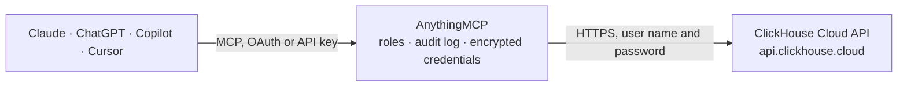

<!-- Generated by scripts/export-github-catalog.mjs in the anythingmcp-website repository. Do not edit by hand. -->

# ClickHouse Cloud MCP connector

Manage a ClickHouse Cloud organization: services (start, stop, scaling, IP access, metrics), backups, ClickPipes, usage costs and credits, audit log, notifications, members, invitations, roles and API keys. The AnythingMCP connector gives Claude, ChatGPT, Microsoft Copilot, Cursor and Gemini 26 MCP tools for ClickHouse Cloud: 21 read and 5 can change data.

**Category:** [Infrastructure](../infrastructure.md) · **Tools:** 26 · **Setup guide:** [anythingmcp.com](https://anythingmcp.com/guides/clickhouse-cloud-to-mcp) · [Deutsch](https://anythingmcp.com/de/guides/clickhouse-cloud-to-mcp) · [Italiano](https://anythingmcp.com/it/guides/clickhouse-cloud-to-mcp) · [Español](https://anythingmcp.com/es/guides/clickhouse-cloud-to-mcp) · [日本語](https://anythingmcp.com/ja/guides/clickhouse-cloud-to-mcp) · [Русский](https://anythingmcp.com/ru/guides/clickhouse-cloud-to-mcp) · [中文](https://anythingmcp.com/zh/guides/clickhouse-cloud-to-mcp)

## Start without code

No installation and no terminal: AnythingMCP Cloud runs the ClickHouse Cloud connector for you, operated by helpcode.ai in Frankfurt, Germany.

1. **Click the button above** and create an account or sign in. The ClickHouse Cloud connector opens, ready to install.
2. **Paste the API key or token from your ClickHouse Cloud account.** Every click is in the [step-by-step guide](https://anythingmcp.com/guides/clickhouse-cloud-to-mcp).
3. **Click Install.** AnythingMCP shows the address of your MCP server.
4. **Add that address to your assistant:** [Claude](https://anythingmcp.com/guides/connect-clickhouse-cloud-to-claude) · [ChatGPT](https://anythingmcp.com/guides/connect-clickhouse-cloud-to-chatgpt) · [Microsoft Copilot](https://anythingmcp.com/guides/connect-clickhouse-cloud-to-copilot) · [Cursor](https://anythingmcp.com/guides/connect-clickhouse-cloud-to-cursor) · [Gemini CLI](https://anythingmcp.com/guides/connect-clickhouse-cloud-to-gemini) · [Meta Muse](https://anythingmcp.com/guides/connect-clickhouse-cloud-to-muse).
5. **Ask your first question**, for example: *What's the current state and IP access list for service 'reporting-prod' in ArcticAnalytics OÜ?*

Prefer help with the setup? [Talk to us](https://anythingmcp.com/contact).

## How it works

- **The AI client** speaks MCP (Streamable HTTP) to AnythingMCP and only sees tool names, descriptions and results. It never gets the ClickHouse Cloud credentials.
- **AnythingMCP** checks the client's role, builds the call from the tool definition, adds the credentials (user name and password), calls ClickHouse Cloud, logs the call and returns the result.
- **ClickHouse Cloud** sees an ordinary API client with the rights of the account the credentials belong to.

## Tools

| Tool | What it does | Access |
|---|---|---|
| [`clickhouse_cloud_whoami`](#clickhouse_cloud_whoami) | Who the API key is: key id, name, organization and assigned roles (actorType tells a key from a user). | read |
| [`clickhouse_cloud_list_organizations`](#clickhouse_cloud_list_organizations) | Organizations the API key belongs to (an organization key sees exactly one): id, name, creation date, private endpoints, BYOC configuration. | read |
| [`clickhouse_cloud_get_organization`](#clickhouse_cloud_get_organization) | Details of one organization: name, creation date, private endpoints and BYOC settings. | read |
| [`clickhouse_cloud_list_services`](#clickhouse_cloud_list_services) | All ClickHouse services of the organization: id, name, cloud provider and region, state (running, idle, stopped, starting, stopping, provisioning, ...),… | read |
| [`clickhouse_cloud_get_service`](#clickhouse_cloud_get_service) | One service with its current state, endpoints, ClickHouse version, scaling settings (min and max replica memory in GB, replicas, idle scaling and timeout),… | read |
| [`clickhouse_cloud_get_service_settings`](#clickhouse_cloud_get_service_settings) | ClickHouse server settings changed on the service (the values that differ from the defaults). | read |
| [`clickhouse_cloud_get_service_metrics`](#clickhouse_cloud_get_service_metrics) | Current Prometheus metrics of a service as Prometheus text exposition (queries, inserts, memory, storage, merges, ...). | read |
| [`clickhouse_cloud_list_backups`](#clickhouse_cloud_list_backups) | Backups of a service, newest first: id, status (done, error, in_progress), start and finish time, size in bytes, duration in seconds, type (full or… | read |
| [`clickhouse_cloud_get_backup`](#clickhouse_cloud_get_backup) | One backup of a service: status, start and finish time, size in bytes, duration and type. | read |
| [`clickhouse_cloud_get_backup_configuration`](#clickhouse_cloud_get_backup_configuration) | Backup schedule of a service: backup period in hours, retention period in hours and the daily start time (UTC) when set. | read |
| [`clickhouse_cloud_list_clickpipes`](#clickhouse_cloud_list_clickpipes) | ClickPipes (managed ingestion from Kafka, S3, Postgres, MySQL, ...) of a service: id, name, state, source, destination table and scaling. | read |
| [`clickhouse_cloud_get_clickpipe`](#clickhouse_cloud_get_clickpipe) | One ClickPipe with its state, source, destination, field mappings and settings. | read |
| [`clickhouse_cloud_get_usage_cost`](#clickhouse_cloud_get_usage_cost) | Usage cost of the organization per day and per entity (data warehouse, service, ClickPipe) in ClickHouse Credits (CHC), with the metrics behind it (compute,… | read |
| [`clickhouse_cloud_get_credit_balances`](#clickhouse_cloud_get_credit_balances) | Remaining prepaid credits of the organization, in total and per credit balance. | read |
| [`clickhouse_cloud_list_activities`](#clickhouse_cloud_list_activities) | Audit log of the organization: who did what and when (service created, stopped, scaled, key created, member invited, ...), with actor, IP address and target… | read |
| [`clickhouse_cloud_list_notifications`](#clickhouse_cloud_list_notifications) | Notifications of the organization (billing, service health, ClickPipe failures, upgrades, ...), newest first, with severity, resource and description. | read |
| [`clickhouse_cloud_list_quotas`](#clickhouse_cloud_list_quotas) | Quotas of the organization (for example the maximum number of services) with the current usage and whether they can be raised. | read |
| [`clickhouse_cloud_list_members`](#clickhouse_cloud_list_members) | Members of the organization: user id, name, e-mail, role and assigned roles, join date. | read |
| [`clickhouse_cloud_list_invitations`](#clickhouse_cloud_list_invitations) | Open invitations to the organization: e-mail, role, creation and expiry date. | read |
| [`clickhouse_cloud_list_roles`](#clickhouse_cloud_list_roles) | Roles defined in the organization (built-in and custom) with their permissions; the role ids are used by clickhouse_cloud_create_invitation. | read |
| [`clickhouse_cloud_list_api_keys`](#clickhouse_cloud_list_api_keys) | API keys of the organization: id, name, state, roles, key suffix, creation, expiry and last use. | read |
| [`clickhouse_cloud_change_service_state`](#clickhouse_cloud_change_service_state) | Start, stop or wake a service. | write |
| [`clickhouse_cloud_update_service`](#clickhouse_cloud_update_service) | Rename a service, change its release channel, add or remove IP access list entries or tags. | write |
| [`clickhouse_cloud_update_replica_scaling`](#clickhouse_cloud_update_replica_scaling) | Change the autoscaling of a service: memory per replica (min and max in GB, multiples of 4), number of replicas, idle scaling and idle timeout. | write |
| [`clickhouse_cloud_change_clickpipe_state`](#clickhouse_cloud_change_clickpipe_state) | Start or stop a ClickPipe, or resync it (a database CDC pipe copies the source tables again). | write |
| [`clickhouse_cloud_create_invitation`](#clickhouse_cloud_create_invitation) | Invite a person to the organization by e-mail. | write |

## Tool reference

Every parameter as the AI client sees it in `tools/list`. Source: [`packages/backend/src/adapters/intl/clickhouse-cloud.json`](../../../packages/backend/src/adapters/intl/clickhouse-cloud.json).

### `clickhouse_cloud_whoami`

Who the API key is: key id, name, organization and assigned roles (actorType tells a key from a user). Beta endpoint at ClickHouse; use it to check which organization and permissions the key has.

**Access:** read · **Call:** `GET /v1/whoami`

No parameters.

### `clickhouse_cloud_list_organizations`

Organizations the API key belongs to (an organization key sees exactly one): id, name, creation date, private endpoints, BYOC configuration. The id is the organization_id every other tool needs.

**Access:** read · **Call:** `GET /v1/organizations`

| Parameter | Type | Required | Description |
|---|---|---|---|
| `limit` | integer | no | Items per page, 1 to 250 (default 250). |
| `cursor` | string | no | The nextCursor value of the previous page. Leave out for the first page. |

### `clickhouse_cloud_get_organization`

Details of one organization: name, creation date, private endpoints and BYOC settings.

**Access:** read · **Call:** `GET /v1/organizations/{organization_id}`

| Parameter | Type | Required | Description |
|---|---|---|---|
| `organization_id` | string | yes | Organization id (UUID) from clickhouse_cloud_list_organizations. |

### `clickhouse_cloud_list_services`

All ClickHouse services of the organization: id, name, cloud provider and region, state (running, idle, stopped, starting, stopping, provisioning, ...), ClickHouse version, tier, endpoints (host and port to connect to), replica memory and count, idle scaling, IP access list, tags.

**Access:** read · **Call:** `GET /v1/organizations/{organization_id}/services`

| Parameter | Type | Required | Description |
|---|---|---|---|
| `organization_id` | string | yes | Organization id (UUID) from clickhouse_cloud_list_organizations. |
| `filter` | string[] | no | Only resources with these tags, e.g. ["tag:Environment=Production"] or ["tag:isActive"] for a key without value. Several entries must all match. |

### `clickhouse_cloud_get_service`

One service with its current state, endpoints, ClickHouse version, scaling settings (min and max replica memory in GB, replicas, idle scaling and timeout), IP access list, release channel and tags.

**Access:** read · **Call:** `GET /v1/organizations/{organization_id}/services/{service_id}`

| Parameter | Type | Required | Description |
|---|---|---|---|
| `organization_id` | string | yes | Organization id (UUID) from clickhouse_cloud_list_organizations. |
| `service_id` | string | yes | Service id (UUID) from clickhouse_cloud_list_services. |

### `clickhouse_cloud_get_service_settings`

ClickHouse server settings changed on the service (the values that differ from the defaults).

**Access:** read · **Call:** `GET /v1/organizations/{organization_id}/services/{service_id}/clickhouseSettings`

| Parameter | Type | Required | Description |
|---|---|---|---|
| `organization_id` | string | yes | Organization id (UUID) from clickhouse_cloud_list_organizations. |
| `service_id` | string | yes | Service id (UUID) from clickhouse_cloud_list_services. |

### `clickhouse_cloud_get_service_metrics`

Current Prometheus metrics of a service as Prometheus text exposition (queries, inserts, memory, storage, merges, ...). Set filtered_metrics to true for the short curated list.

**Access:** read · **Call:** `GET /v1/organizations/{organization_id}/services/{service_id}/prometheus`

| Parameter | Type | Required | Description |
|---|---|---|---|
| `organization_id` | string | yes | Organization id (UUID) from clickhouse_cloud_list_organizations. |
| `service_id` | string | yes | Service id (UUID) from clickhouse_cloud_list_services. |
| `filtered_metrics` | `true` \| `false` | no | true returns only the curated metric list instead of every metric. |

### `clickhouse_cloud_list_backups`

Backups of a service, newest first: id, status (done, error, in_progress), start and finish time, size in bytes, duration in seconds, type (full or incremental).

**Access:** read · **Call:** `GET /v1/organizations/{organization_id}/services/{service_id}/backups`

| Parameter | Type | Required | Description |
|---|---|---|---|
| `organization_id` | string | yes | Organization id (UUID) from clickhouse_cloud_list_organizations. |
| `service_id` | string | yes | Service id (UUID) from clickhouse_cloud_list_services. |

### `clickhouse_cloud_get_backup`

One backup of a service: status, start and finish time, size in bytes, duration and type.

**Access:** read · **Call:** `GET /v1/organizations/{organization_id}/services/{service_id}/backups/{backup_id}`

| Parameter | Type | Required | Description |
|---|---|---|---|
| `organization_id` | string | yes | Organization id (UUID) from clickhouse_cloud_list_organizations. |
| `service_id` | string | yes | Service id (UUID) from clickhouse_cloud_list_services. |
| `backup_id` | string | yes | Backup id from clickhouse_cloud_list_backups. |

### `clickhouse_cloud_get_backup_configuration`

Backup schedule of a service: backup period in hours, retention period in hours and the daily start time (UTC) when set.

**Access:** read · **Call:** `GET /v1/organizations/{organization_id}/services/{service_id}/backupConfiguration`

| Parameter | Type | Required | Description |
|---|---|---|---|
| `organization_id` | string | yes | Organization id (UUID) from clickhouse_cloud_list_organizations. |
| `service_id` | string | yes | Service id (UUID) from clickhouse_cloud_list_services. |

### `clickhouse_cloud_list_clickpipes`

ClickPipes (managed ingestion from Kafka, S3, Postgres, MySQL, ...) of a service: id, name, state, source, destination table and scaling. Needs a key with the ClickPipes manage permission.

**Access:** read · **Call:** `GET /v1/organizations/{organization_id}/services/{service_id}/clickpipes`

| Parameter | Type | Required | Description |
|---|---|---|---|
| `organization_id` | string | yes | Organization id (UUID) from clickhouse_cloud_list_organizations. |
| `service_id` | string | yes | Service id (UUID) from clickhouse_cloud_list_services. |

### `clickhouse_cloud_get_clickpipe`

One ClickPipe with its state, source, destination, field mappings and settings.

**Access:** read · **Call:** `GET /v1/organizations/{organization_id}/services/{service_id}/clickpipes/{clickpipe_id}`

| Parameter | Type | Required | Description |
|---|---|---|---|
| `organization_id` | string | yes | Organization id (UUID) from clickhouse_cloud_list_organizations. |
| `service_id` | string | yes | Service id (UUID) from clickhouse_cloud_list_services. |
| `clickpipe_id` | string | yes | ClickPipe id from clickhouse_cloud_list_clickpipes. |

### `clickhouse_cloud_get_usage_cost`

Usage cost of the organization per day and per entity (data warehouse, service, ClickPipe) in ClickHouse Credits (CHC), with the metrics behind it (compute, storage, backup, data transfer, ...) and the grand total. At most 31 days per call.

**Access:** read · **Call:** `GET /v1/organizations/{organization_id}/usageCost`

| Parameter | Type | Required | Description |
|---|---|---|---|
| `organization_id` | string | yes | Organization id (UUID) from clickhouse_cloud_list_organizations. |
| `from_date` | string | yes | First day, YYYY-MM-DD (UTC). |
| `to_date` | string | yes | Last day, inclusive, YYYY-MM-DD; at most 30 days after from_date. |
| `filter` | string[] | no | Only resources with these tags, e.g. ["tag:Environment=Production"] or ["tag:isActive"] for a key without value. Several entries must all match. |

### `clickhouse_cloud_get_credit_balances`

Remaining prepaid credits of the organization, in total and per credit balance. Needs a key with the billing view permission.

**Access:** read · **Call:** `GET /v1/organizations/{organization_id}/creditBalances`

| Parameter | Type | Required | Description |
|---|---|---|---|
| `organization_id` | string | yes | Organization id (UUID) from clickhouse_cloud_list_organizations. |

### `clickhouse_cloud_list_activities`

Audit log of the organization: who did what and when (service created, stopped, scaled, key created, member invited, ...), with actor, IP address and target ids.

**Access:** read · **Call:** `GET /v1/organizations/{organization_id}/activities`

| Parameter | Type | Required | Description |
|---|---|---|---|
| `organization_id` | string | yes | Organization id (UUID) from clickhouse_cloud_list_organizations. |
| `from_date` | string | no | Only activities from this time on, ISO 8601 date-time, e.g. 2026-10-01T00:00:00Z. |
| `to_date` | string | no | Only activities up to this time, ISO 8601 date-time. |

### `clickhouse_cloud_list_notifications`

Notifications of the organization (billing, service health, ClickPipe failures, upgrades, ...), newest first, with severity, resource and description.

**Access:** read · **Call:** `GET /v1/organizations/{organization_id}/notifications`

| Parameter | Type | Required | Description |
|---|---|---|---|
| `organization_id` | string | yes | Organization id (UUID) from clickhouse_cloud_list_organizations. |
| `severity` | `info` \| `warning` \| `critical` | no | info, warning or critical. |
| `type` | string | no | Only this notification type. |
| `resource_id` | string | no | Only notifications about this resource (a service also matches its ClickPipes). |
| `resource_type` | `service` \| `organization` \| `clickpipe` \| `postgres` | no | Only this kind of resource. |
| `from_date` | string | no | From this time, RFC 3339, e.g. 2026-10-01T00:00:00Z. |
| `to_date` | string | no | Up to this time, RFC 3339. |
| `limit` | integer | no | Items per page, 1 to 250 (default 100). |
| `cursor` | string | no | The nextCursor value of the previous page. Leave out for the first page. |

### `clickhouse_cloud_list_quotas`

Quotas of the organization (for example the maximum number of services) with the current usage and whether they can be raised.

**Access:** read · **Call:** `GET /v1/organizations/{organization_id}/quotas`

| Parameter | Type | Required | Description |
|---|---|---|---|
| `organization_id` | string | yes | Organization id (UUID) from clickhouse_cloud_list_organizations. |

### `clickhouse_cloud_list_members`

Members of the organization: user id, name, e-mail, role and assigned roles, join date.

**Access:** read · **Call:** `GET /v1/organizations/{organization_id}/members`

| Parameter | Type | Required | Description |
|---|---|---|---|
| `organization_id` | string | yes | Organization id (UUID) from clickhouse_cloud_list_organizations. |

### `clickhouse_cloud_list_invitations`

Open invitations to the organization: e-mail, role, creation and expiry date.

**Access:** read · **Call:** `GET /v1/organizations/{organization_id}/invitations`

| Parameter | Type | Required | Description |
|---|---|---|---|
| `organization_id` | string | yes | Organization id (UUID) from clickhouse_cloud_list_organizations. |

### `clickhouse_cloud_list_roles`

Roles defined in the organization (built-in and custom) with their permissions; the role ids are used by clickhouse_cloud_create_invitation.

**Access:** read · **Call:** `GET /v1/organizations/{organization_id}/roles`

| Parameter | Type | Required | Description |
|---|---|---|---|
| `organization_id` | string | yes | Organization id (UUID) from clickhouse_cloud_list_organizations. |

### `clickhouse_cloud_list_api_keys`

API keys of the organization: id, name, state, roles, key suffix, creation, expiry and last use. Secrets are never returned.

**Access:** read · **Call:** `GET /v1/organizations/{organization_id}/keys`

| Parameter | Type | Required | Description |
|---|---|---|---|
| `organization_id` | string | yes | Organization id (UUID) from clickhouse_cloud_list_organizations. |
| `limit` | integer | no | Items per page, 1 to 250 (default 250). |
| `cursor` | string | no | The nextCursor value of the previous page. Leave out for the first page. |

### `clickhouse_cloud_change_service_state`

Start, stop or wake a service. stop shuts the compute down (data is kept, billing for compute stops); start brings a stopped service back; awake wakes an idle service. Returns the service with its new state, which moves through starting or stopping first.

**Access:** write · **Call:** `PATCH /v1/organizations/{organization_id}/services/{service_id}/state`

| Parameter | Type | Required | Description |
|---|---|---|---|
| `organization_id` | string | yes | Organization id (UUID) from clickhouse_cloud_list_organizations. |
| `service_id` | string | yes | Service id (UUID) from clickhouse_cloud_list_services. |
| `command` | `start` \| `stop` \| `awake` | yes | start, stop or awake. |

### `clickhouse_cloud_update_service`

Rename a service, change its release channel, add or remove IP access list entries or tags. Only the fields you pass change.

**Access:** write · **Call:** `PATCH /v1/organizations/{organization_id}/services/{service_id}`

| Parameter | Type | Required | Description |
|---|---|---|---|
| `organization_id` | string | yes | Organization id (UUID) from clickhouse_cloud_list_organizations. |
| `service_id` | string | yes | Service id (UUID) from clickhouse_cloud_list_services. |
| `name` | string | no | New name, letters, digits and spaces, up to 50 characters. |
| `release_channel` | `slow` \| `default` \| `fast` | no | slow, default or fast (fast gets new ClickHouse releases first). |
| `ip_access_list` | object | no | IP access changes: {"add": [{"source": "203.0.113.0/24", "description": "office"}], "remove": [{"source": "0.0.0.0/0"}]}. remove runs before add. |
| `tags` | object | no | Tag changes: {"add": [{"key": "Environment", "value": "Production"}], "remove": [{"key": "Old"}]}. |

### `clickhouse_cloud_update_replica_scaling`

Change the autoscaling of a service: memory per replica (min and max in GB, multiples of 4), number of replicas, idle scaling and idle timeout. Production tier only for memory limits. Only the fields you pass change.

**Access:** write · **Call:** `PATCH /v1/organizations/{organization_id}/services/{service_id}/replicaScaling`

| Parameter | Type | Required | Description |
|---|---|---|---|
| `organization_id` | string | yes | Organization id (UUID) from clickhouse_cloud_list_organizations. |
| `service_id` | string | yes | Service id (UUID) from clickhouse_cloud_list_services. |
| `min_replica_memory_gb` | number | no | Minimum memory per replica in GB, a multiple of 4. |
| `max_replica_memory_gb` | number | no | Maximum memory per replica in GB, a multiple of 4. |
| `autoscaling_mode` | `vertical` \| `horizontal` | no | vertical (fixed replica count, memory scales) or horizontal (replica count scales). Leave out to keep the current mode. |
| `num_replicas` | integer | no | Fixed replica count for vertical autoscaling. |
| `min_replicas` | integer | no | Minimum replica count for horizontal autoscaling. |
| `max_replicas` | integer | no | Maximum replica count for horizontal autoscaling. |
| `idle_scaling` | boolean | no | true lets the service scale to zero when idle. |
| `idle_timeout_minutes` | number | no | Minutes without queries before the service idles, at least 5. |

### `clickhouse_cloud_change_clickpipe_state`

Start or stop a ClickPipe, or resync it (a database CDC pipe copies the source tables again). Returns the ClickPipe with its new state.

**Access:** write · **Call:** `PATCH /v1/organizations/{organization_id}/services/{service_id}/clickpipes/{clickpipe_id}/state`

| Parameter | Type | Required | Description |
|---|---|---|---|
| `organization_id` | string | yes | Organization id (UUID) from clickhouse_cloud_list_organizations. |
| `service_id` | string | yes | Service id (UUID) from clickhouse_cloud_list_services. |
| `clickpipe_id` | string | yes | ClickPipe id from clickhouse_cloud_list_clickpipes. |
| `command` | `start` \| `stop` \| `resync` | yes | start, stop or resync. |

### `clickhouse_cloud_create_invitation`

Invite a person to the organization by e-mail. Only someone with this address can accept. Give the roles with assigned_role_ids from clickhouse_cloud_list_roles.

**Access:** write · **Call:** `POST /v1/organizations/{organization_id}/invitations`

| Parameter | Type | Required | Description |
|---|---|---|---|
| `organization_id` | string | yes | Organization id (UUID) from clickhouse_cloud_list_organizations. |
| `email` | string | yes | E-mail address of the person to invite. |
| `assigned_role_ids` | string[] | no | Role ids from clickhouse_cloud_list_roles to give the person. |

## Run it yourself

AnythingMCP is open source (AGPL-3.0). [Run it with Docker](../../../README.md#run-it-yourself), open **Connectors → Store**, pick **ClickHouse Cloud** and enter `CLICKHOUSE_CLOUD_KEY_ID`, `CLICKHOUSE_CLOUD_KEY_SECRET`, then add your MCP server URL to the AI client.

[← Infrastructure connectors](../infrastructure.md) · [All categories](../README.md)
