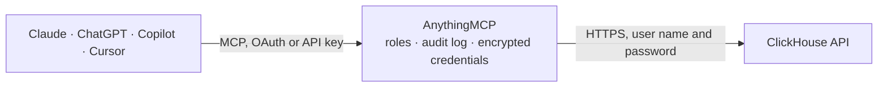

<!-- Generated by scripts/export-github-catalog.mjs in the anythingmcp-website repository. Do not edit by hand. -->

# ClickHouse MCP connector

Read-only SQL on a ClickHouse server or ClickHouse Cloud service over the HTTP interface: databases, tables, columns, CREATE statements, table sizes, running and recent queries, and any SELECT with readonly=1. The AnythingMCP connector gives Claude, ChatGPT, Microsoft Copilot, Cursor and Gemini 10 MCP tools for ClickHouse, all read-only.

**Category:** [Databases](../database.md) · **Tools:** 10 · **Setup guide:** [anythingmcp.com](https://anythingmcp.com/guides/clickhouse-to-mcp) · [Deutsch](https://anythingmcp.com/de/guides/clickhouse-to-mcp) · [Italiano](https://anythingmcp.com/it/guides/clickhouse-to-mcp) · [Español](https://anythingmcp.com/es/guides/clickhouse-to-mcp) · [日本語](https://anythingmcp.com/ja/guides/clickhouse-to-mcp) · [Русский](https://anythingmcp.com/ru/guides/clickhouse-to-mcp) · [中文](https://anythingmcp.com/zh/guides/clickhouse-to-mcp)

## Start without code

No installation and no terminal: AnythingMCP Cloud runs the ClickHouse connector for you, operated by helpcode.ai in Frankfurt, Germany.

1. **Click the button above** and create an account or sign in. The ClickHouse connector opens, ready to install.
2. **Paste the API key or token from your ClickHouse account.** Every click is in the [step-by-step guide](https://anythingmcp.com/guides/clickhouse-to-mcp).
3. **Click Install.** AnythingMCP shows the address of your MCP server.
4. **Add that address to your assistant:** [Claude](https://anythingmcp.com/guides/connect-clickhouse-to-claude) · [ChatGPT](https://anythingmcp.com/guides/connect-clickhouse-to-chatgpt) · [Microsoft Copilot](https://anythingmcp.com/guides/connect-clickhouse-to-copilot) · [Cursor](https://anythingmcp.com/guides/connect-clickhouse-to-cursor) · [Gemini CLI](https://anythingmcp.com/guides/connect-clickhouse-to-gemini) · [Meta Muse](https://anythingmcp.com/guides/connect-clickhouse-to-muse).
5. **Ask your first question**, for example: *What is the status and gross amount of invoice INV-2026-117 for customer NordSea GmbH?*

Prefer help with the setup? [Talk to us](https://anythingmcp.com/contact).

## How it works

- **The AI client** speaks MCP (Streamable HTTP) to AnythingMCP and only sees tool names, descriptions and results. It never gets the ClickHouse credentials.
- **AnythingMCP** checks the client's role, builds the call from the tool definition, adds the credentials (user name and password), calls ClickHouse, logs the call and returns the result.
- **ClickHouse** sees an ordinary API client with the rights of the account the credentials belong to.

## Tools

| Tool | What it does | Access |
|---|---|---|
| [`clickhouse_server_info`](#clickhouse_server_info) | Version, uptime in seconds, server time zone, the user the connector signs in as, its default database and its effective readonly level. | read |
| [`clickhouse_query`](#clickhouse_query) | Run one read-only SQL statement (SELECT, WITH, SHOW, DESCRIBE, EXPLAIN, EXISTS) and return the result. | read |
| [`clickhouse_list_databases`](#clickhouse_list_databases) | Every database the user can see, with its engine and comment. | read |
| [`clickhouse_list_tables`](#clickhouse_list_tables) | Tables and views of one database: engine (MergeTree family, View, MaterializedView, Dictionary, ...), total rows and bytes when the engine knows them,… | read |
| [`clickhouse_describe_table`](#clickhouse_describe_table) | Columns of a table in order: name, type, default kind and expression, comment, and whether the column is part of the partition, sorting or primary key. | read |
| [`clickhouse_show_create_table`](#clickhouse_show_create_table) | The CREATE statement of a table or view: engine, ORDER BY, PARTITION BY, TTL and settings, or the SELECT behind a view. | read |
| [`clickhouse_search_columns`](#clickhouse_search_columns) | Find columns by name across databases (case-insensitive LIKE), up to 500 matches: database, table, column, type and comment. | read |
| [`clickhouse_table_sizes`](#clickhouse_table_sizes) | Storage per table of one database from the active parts: rows, part count, bytes on disk, compressed and uncompressed size, last modification. | read |
| [`clickhouse_running_queries`](#clickhouse_running_queries) | Queries running right now on the node that answers: query id, user, elapsed seconds, rows read, memory and the first 500 characters of the SQL. | read |
| [`clickhouse_recent_queries`](#clickhouse_recent_queries) | The last 100 finished or failed queries of the past minutes from the query log: time, user, type (QueryFinish, ExceptionBeforeStart,… | read |

## Tool reference

Every parameter as the AI client sees it in `tools/list`. Source: [`packages/backend/src/adapters/intl/clickhouse.json`](../../../packages/backend/src/adapters/intl/clickhouse.json).

### `clickhouse_server_info`

Version, uptime in seconds, server time zone, the user the connector signs in as, its default database and its effective readonly level. A quick check that the address and credentials work.

**Access:** read · **Call:** `POST /`

No parameters.

### `clickhouse_query`

Run one read-only SQL statement (SELECT, WITH, SHOW, DESCRIBE, EXPLAIN, EXISTS) and return the result. The request carries readonly=1, so ClickHouse refuses INSERT, ALTER, CREATE, DROP and SET. Always add a LIMIT: the whole result comes back in one answer.

**Access:** read · **Call:** `POST /`

| Parameter | Type | Required | Description |
|---|---|---|---|
| `query` | string | yes | One SQL statement, without a FORMAT clause and without a trailing semicolon, e.g. SELECT toDate(ts) AS day, count() FROM db.events GROUP BY day ORDER BY day DESC LIMIT 30. |
| `database` | string | no | Default database for unqualified table names. Leave out to use the user's default. |
| `format` | `JSON` \| `JSONCompact` \| `CSVWithNames` \| `TabSeparatedWithNames` | no | Output format: JSON (default, rows as objects with column names), JSONCompact (rows as arrays, smaller), CSVWithNames or TabSeparatedWithNames. |

### `clickhouse_list_databases`

Every database the user can see, with its engine and comment.

**Access:** read · **Call:** `POST /`

No parameters.

### `clickhouse_list_tables`

Tables and views of one database: engine (MergeTree family, View, MaterializedView, Dictionary, ...), total rows and bytes when the engine knows them, readable size and comment.

**Access:** read · **Call:** `POST /`

| Parameter | Type | Required | Description |
|---|---|---|---|
| `database` | string | yes | Database name from clickhouse_list_databases. |
| `name_like` | string | no | Only tables whose name matches this LIKE pattern, e.g. events%. Default % (all). |

### `clickhouse_describe_table`

Columns of a table in order: name, type, default kind and expression, comment, and whether the column is part of the partition, sorting or primary key.

**Access:** read · **Call:** `POST /`

| Parameter | Type | Required | Description |
|---|---|---|---|
| `database` | string | yes | Database name from clickhouse_list_databases. |
| `table` | string | yes | Table name from clickhouse_list_tables. |

### `clickhouse_show_create_table`

The CREATE statement of a table or view: engine, ORDER BY, PARTITION BY, TTL and settings, or the SELECT behind a view.

**Access:** read · **Call:** `POST /`

| Parameter | Type | Required | Description |
|---|---|---|---|
| `database` | string | yes | Database name from clickhouse_list_databases. |
| `table` | string | yes | Table name from clickhouse_list_tables. |

### `clickhouse_search_columns`

Find columns by name across databases (case-insensitive LIKE), up to 500 matches: database, table, column, type and comment. Use it to find where a field such as customer_id or revenue lives.

**Access:** read · **Call:** `POST /`

| Parameter | Type | Required | Description |
|---|---|---|---|
| `name_like` | string | yes | Column name pattern for ILIKE, e.g. %customer%. |
| `database_like` | string | no | Only databases matching this LIKE pattern. Default % (all). |

### `clickhouse_table_sizes`

Storage per table of one database from the active parts: rows, part count, bytes on disk, compressed and uncompressed size, last modification. Needs SELECT on system.parts.

**Access:** read · **Call:** `POST /`

| Parameter | Type | Required | Description |
|---|---|---|---|
| `database` | string | yes | Database name from clickhouse_list_databases. |

### `clickhouse_running_queries`

Queries running right now on the node that answers: query id, user, elapsed seconds, rows read, memory and the first 500 characters of the SQL. Needs SELECT on system.processes.

**Access:** read · **Call:** `POST /`

No parameters.

### `clickhouse_recent_queries`

The last 100 finished or failed queries of the past minutes from the query log: time, user, type (QueryFinish, ExceptionBeforeStart, ExceptionWhileProcessing), duration in ms, rows read and returned, memory, error code and the first 500 characters of the SQL. Needs SELECT on system.query_log.

**Access:** read · **Call:** `POST /`

| Parameter | Type | Required | Description |
|---|---|---|---|
| `minutes` | integer | no | How far back to look, in minutes. Default 60. |

## Run it yourself

AnythingMCP is open source (AGPL-3.0). [Run it with Docker](../../../README.md#run-it-yourself), open **Connectors → Store**, pick **ClickHouse** and enter `CLICKHOUSE_URL`, `CLICKHOUSE_USER`, `CLICKHOUSE_PASSWORD`, then add your MCP server URL to the AI client.

[← Databases connectors](../database.md) · [All categories](../README.md)
