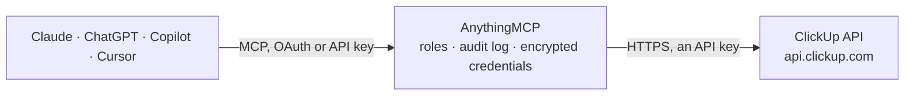

<!-- Generated by scripts/export-github-catalog.mjs in the anythingmcp-website repository. Do not edit by hand. -->

# ClickUp MCP connector

Drive ClickUp (project management) from any AI agent: spaces, folders, lists, tasks, comments, time tracking, custom fields, teams, members. 16 tools, API token auth. The AnythingMCP connector gives Claude, ChatGPT, Microsoft Copilot, Cursor and Gemini 15 MCP tools for ClickUp: 11 read and 4 can change data.

**Category:** [Project Management](../project-management.md) · **Tools:** 15 · **Setup guide:** [anythingmcp.com](https://anythingmcp.com/guides/clickup-to-mcp) · [Deutsch](https://anythingmcp.com/de/guides/clickup-to-mcp) · [Italiano](https://anythingmcp.com/it/guides/clickup-to-mcp) · [Español](https://anythingmcp.com/es/guides/clickup-to-mcp) · [日本語](https://anythingmcp.com/ja/guides/clickup-to-mcp) · [Русский](https://anythingmcp.com/ru/guides/clickup-to-mcp) · [中文](https://anythingmcp.com/zh/guides/clickup-to-mcp)

## Start without code

No installation and no terminal: AnythingMCP Cloud runs the ClickUp connector for you, operated by helpcode.ai in Frankfurt, Germany.

1. **Click the button above** and create an account or sign in. The ClickUp connector opens, ready to install.
2. **Paste the API key or token from your ClickUp account.** Every click is in the [step-by-step guide](https://anythingmcp.com/guides/clickup-to-mcp).
3. **Click Install.** AnythingMCP shows the address of your MCP server.
4. **Add that address to your assistant:** [Claude](https://anythingmcp.com/guides/connect-clickup-to-claude) · [ChatGPT](https://anythingmcp.com/guides/connect-clickup-to-chatgpt) · [Microsoft Copilot](https://anythingmcp.com/guides/connect-clickup-to-copilot) · [Cursor](https://anythingmcp.com/guides/connect-clickup-to-cursor) · [Gemini CLI](https://anythingmcp.com/guides/connect-clickup-to-gemini) · [Meta Muse](https://anythingmcp.com/guides/connect-clickup-to-muse).
5. **Ask your first question**, for example: *Show status, due date and custom field 'Invoice total' for task INV-894 in Finance list.*

Prefer help with the setup? [Talk to us](https://anythingmcp.com/contact).

## How it works

- **The AI client** speaks MCP (Streamable HTTP) to AnythingMCP and only sees tool names, descriptions and results. It never gets the ClickUp credentials.
- **AnythingMCP** checks the client's role, builds the call from the tool definition, adds the credentials (an API key), calls ClickUp, logs the call and returns the result.
- **ClickUp** sees an ordinary API client with the rights of the account the credentials belong to.

## Tools

| Tool | What it does | Access |
|---|---|---|
| [`clickup_get_authorized_user`](#clickup_get_authorized_user) | Return the authenticated user: id, username, email, color, profilePicture, initials. | read |
| [`clickup_list_teams`](#clickup_list_teams) | List workspaces (called 'teams' in the API — confusingly different from per-workspace 'teams' which are user groups). | read |
| [`clickup_list_spaces`](#clickup_list_spaces) | List spaces in a workspace. | read |
| [`clickup_list_folders`](#clickup_list_folders) | List folders in a space. | read |
| [`clickup_list_lists`](#clickup_list_lists) | List lists in a folder. | read |
| [`clickup_list_folderless_lists`](#clickup_list_folderless_lists) | List lists that live directly in a space (no parent folder). | read |
| [`clickup_list_tasks`](#clickup_list_tasks) | List tasks in a list with filtering. | read |
| [`clickup_get_task`](#clickup_get_task) | Fetch a single task by ID with all fields including custom_fields, checklists, comments_count, dependencies, watchers. | read |
| [`clickup_create_task`](#clickup_create_task) | Create a task in a list. | write |
| [`clickup_update_task`](#clickup_update_task) | Update a task. | write |
| [`clickup_delete_task`](#clickup_delete_task) | Delete a task. | write |
| [`clickup_create_task_comment`](#clickup_create_task_comment) | Add a comment to a task. | write |
| [`clickup_list_task_comments`](#clickup_list_task_comments) | List comments on a task. | read |
| [`clickup_get_list_custom_fields`](#clickup_get_list_custom_fields) | List custom fields available on a list, with their IDs and types. | read |
| [`clickup_list_team_members`](#clickup_list_team_members) | List members of a workspace. | read |

## Tool reference

Every parameter as the AI client sees it in `tools/list`. Source: [`packages/backend/src/adapters/intl/clickup.json`](../../../packages/backend/src/adapters/intl/clickup.json).

### `clickup_get_authorized_user`

Return the authenticated user: id, username, email, color, profilePicture, initials. Health check + whoami.

**Access:** read · **Call:** `GET /user`

No parameters.

### `clickup_list_teams`

List workspaces (called 'teams' in the API — confusingly different from per-workspace 'teams' which are user groups). Each returns id, name, color, avatar, members[].

**Access:** read · **Call:** `GET /team`

No parameters.

### `clickup_list_spaces`

List spaces in a workspace. Each space has id, name, private flag, statuses[], features (multiple_assignees, due_dates, custom_fields, etc.).

**Access:** read · **Call:** `GET /team/{teamId}/space`

| Parameter | Type | Required | Description |
|---|---|---|---|
| `teamId` | string | yes | Workspace ID. |
| `archived` | boolean | no | Include archived. Default false. |

### `clickup_list_folders`

List folders in a space. Each folder has id, name, override_statuses flag, hidden flag, lists[].

**Access:** read · **Call:** `GET /space/{spaceId}/folder`

| Parameter | Type | Required | Description |
|---|---|---|---|
| `spaceId` | string | yes | Space ID. |
| `archived` | boolean | no | Include archived. |

### `clickup_list_lists`

List lists in a folder.

**Access:** read · **Call:** `GET /folder/{folderId}/list`

| Parameter | Type | Required | Description |
|---|---|---|---|
| `folderId` | string | yes | Folder ID. |
| `archived` | boolean | no | Include archived. |

### `clickup_list_folderless_lists`

List lists that live directly in a space (no parent folder).

**Access:** read · **Call:** `GET /space/{spaceId}/list`

| Parameter | Type | Required | Description |
|---|---|---|---|
| `spaceId` | string | yes | Space ID. |
| `archived` | boolean | no | Include archived. |

### `clickup_list_tasks`

List tasks in a list with filtering. Supports filter by assignees, statuses, due_date_gt/lt, custom_fields, tags. Cursor pagination via page (0-indexed).

**Access:** read · **Call:** `GET /list/{listId}/task`

| Parameter | Type | Required | Description |
|---|---|---|---|
| `listId` | string | yes | List ID. |
| `archived` | boolean | no | Include archived. |
| `page` | integer | no | 0-indexed page. |
| `order_by` | string | no | id, created, updated, due_date. |
| `reverse` | boolean | no | Sort desc. |
| `subtasks` | boolean | no | Include subtasks. |
| `statuses` | any[] | no | Filter by status names. |
| `assignees` | any[] | no | Filter by assignee user IDs. |
| `tags` | any[] | no | Filter by tag names. |
| `due_date_gt` | integer | no | Due after this Unix ms. |
| `due_date_lt` | integer | no | Due before this Unix ms. |
| `include_closed` | boolean | no | Include closed tasks. |

### `clickup_get_task`

Fetch a single task by ID with all fields including custom_fields, checklists, comments_count, dependencies, watchers.

**Access:** read · **Call:** `GET /task/{taskId}`

| Parameter | Type | Required | Description |
|---|---|---|---|
| `taskId` | string | yes | Task ID (or custom_id if custom_task_ids=true). |
| `custom_task_ids` | boolean | no | If true, taskId is interpreted as a custom_id (like 'PROJ-42'). |
| `team_id` | string | no | Required when custom_task_ids=true. |
| `include_subtasks` | boolean | no | Include subtasks in response. |

### `clickup_create_task`

Create a task in a list. Required: name. Date fields are Unix ms. Assignees are user IDs.

**Access:** write · **Call:** `POST /list/{listId}/task`

| Parameter | Type | Required | Description |
|---|---|---|---|
| `listId` | string | yes | List ID. |
| `name` | string | yes | Task title. |
| `description` | string | no | Markdown description. |
| `markdown_description` | string | no | Explicit Markdown description (ClickUp prefers this over `description`). |
| `assignees` | any[] | no | Array of user IDs. |
| `tags` | any[] | no | Tag name strings. |
| `status` | string | no | Status name (case-insensitive). Must exist on the list. |
| `priority` | integer | no | 1=Urgent, 2=High, 3=Normal, 4=Low. |
| `due_date` | integer | no | Due date Unix ms. |
| `due_date_time` | boolean | no | If true, due_date includes a time component. |
| `start_date` | integer | no | Start date Unix ms. |
| `time_estimate` | integer | no | Time estimate in ms. |
| `parent` | string | no | Parent task ID — creates this as a subtask. |
| `custom_fields` | any[] | no | [{id, value}] custom fields. |
| `notify_all` | boolean | no | Notify assignees and watchers. |

### `clickup_update_task`

Update a task. Common: change status, reassign, change due_date.

**Access:** write · **Call:** `PUT /task/{taskId}`

| Parameter | Type | Required | Description |
|---|---|---|---|
| `taskId` | string | yes | Task ID. |
| `name` | string | no | New name. |
| `description` | string | no | New description. |
| `status` | string | no | New status (must exist on list). |
| `priority` | integer | no | 1-4. |
| `due_date` | integer | no | Unix ms. |
| `start_date` | integer | no | Unix ms. |
| `time_estimate` | integer | no | Ms. |
| `assignees` | object | no | {add:[id1,id2], rem:[id3]} — incremental update of assignees (NOT a full replacement). |
| `archived` | boolean | no | Archive/unarchive. |

### `clickup_delete_task`

Delete a task. Moves to trash (recoverable for 30 days from UI).

**Access:** write · **Call:** `DELETE /task/{taskId}`

| Parameter | Type | Required | Description |
|---|---|---|---|
| `taskId` | string | yes | Task ID. |

### `clickup_create_task_comment`

Add a comment to a task.

**Access:** write · **Call:** `POST /task/{taskId}/comment`

| Parameter | Type | Required | Description |
|---|---|---|---|
| `taskId` | string | yes | Task ID. |
| `comment_text` | string | yes | Comment body (Markdown). |
| `assignee` | integer | no | Optional user ID to assign as a follow-up. |
| `notify_all` | boolean | no | Notify watchers. |

### `clickup_list_task_comments`

List comments on a task. Returns each comment's id, comment_text, assignee, resolved, date.

**Access:** read · **Call:** `GET /task/{taskId}/comment`

| Parameter | Type | Required | Description |
|---|---|---|---|
| `taskId` | string | yes | Task ID. |
| `start` | integer | no | Pagination cursor (Unix ms of comment to start from). |

### `clickup_get_list_custom_fields`

List custom fields available on a list, with their IDs and types. Required to compose custom_fields arrays.

**Access:** read · **Call:** `GET /list/{listId}/field`

| Parameter | Type | Required | Description |
|---|---|---|---|
| `listId` | string | yes | List ID. |

### `clickup_list_team_members`

List members of a workspace. Returns id (use as assignee), username, email, color, role.

**Access:** read · **Call:** `GET /team/{teamId}/member`

| Parameter | Type | Required | Description |
|---|---|---|---|
| `teamId` | string | yes | Workspace ID. |

## Run it yourself

AnythingMCP is open source (AGPL-3.0). [Run it with Docker](../../../README.md#run-it-yourself), open **Connectors → Store**, pick **ClickUp** and enter `CLICKUP_API_TOKEN`, then add your MCP server URL to the AI client.

[← Project Management connectors](../project-management.md) · [All categories](../README.md)
