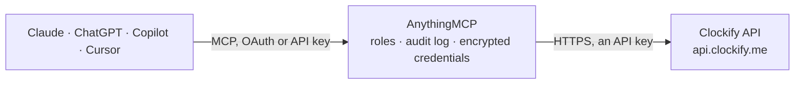

<!-- Generated by scripts/export-github-catalog.mjs in the anythingmcp-website repository. Do not edit by hand. -->

# Clockify MCP connector

Manage Clockify (time tracking, projects, tasks, clients, tags, workspace users, reports) from any AI agent. 18 tools, X-Api-Key auth. The AnythingMCP connector gives Claude, ChatGPT, Microsoft Copilot, Cursor and Gemini 18 MCP tools for Clockify: 8 read and 10 can change data.

**Category:** [Time Tracking](../time-tracking.md) · **Tools:** 18 · **Setup guide:** [anythingmcp.com](https://anythingmcp.com/guides/clockify-to-mcp) · [Deutsch](https://anythingmcp.com/de/guides/clockify-to-mcp) · [Italiano](https://anythingmcp.com/it/guides/clockify-to-mcp) · [Español](https://anythingmcp.com/es/guides/clockify-to-mcp) · [日本語](https://anythingmcp.com/ja/guides/clockify-to-mcp) · [Русский](https://anythingmcp.com/ru/guides/clockify-to-mcp) · [中文](https://anythingmcp.com/zh/guides/clockify-to-mcp)

## Start without code

No installation and no terminal: AnythingMCP Cloud runs the Clockify connector for you, operated by helpcode.ai in Frankfurt, Germany.

1. **Click the button above** and create an account or sign in. The Clockify connector opens, ready to install.
2. **Paste the API key or token from your Clockify account.** Every click is in the [step-by-step guide](https://anythingmcp.com/guides/clockify-to-mcp).
3. **Click Install.** AnythingMCP shows the address of your MCP server.
4. **Add that address to your assistant:** [Claude](https://anythingmcp.com/guides/connect-clockify-to-claude) · [ChatGPT](https://anythingmcp.com/guides/connect-clockify-to-chatgpt) · [Microsoft Copilot](https://anythingmcp.com/guides/connect-clockify-to-copilot) · [Cursor](https://anythingmcp.com/guides/connect-clockify-to-cursor) · [Gemini CLI](https://anythingmcp.com/guides/connect-clockify-to-gemini) · [Meta Muse](https://anythingmcp.com/guides/connect-clockify-to-muse).
5. **Ask your first question**, for example: *Show time entries for Mika Laine on project 'BrandRefresh' for 2026-10-12*

Prefer help with the setup? [Talk to us](https://anythingmcp.com/contact).

## How it works

- **The AI client** speaks MCP (Streamable HTTP) to AnythingMCP and only sees tool names, descriptions and results. It never gets the Clockify credentials.
- **AnythingMCP** checks the client's role, builds the call from the tool definition, adds the credentials (an API key), calls Clockify, logs the call and returns the result.
- **Clockify** sees an ordinary API client with the rights of the account the credentials belong to.

## Tools

| Tool | What it does | Access |
|---|---|---|
| [`clockify_get_user`](#clockify_get_user) | Return the authenticated user: id, email, name, activeWorkspace, defaultWorkspace, profile picture URL. | read |
| [`clockify_list_workspaces`](#clockify_list_workspaces) | List workspaces the user belongs to. | read |
| [`clockify_list_workspace_users`](#clockify_list_workspace_users) | List all users (members) of a workspace. | read |
| [`clockify_find_tasks`](#clockify_find_tasks) | List tasks within a project. | read |
| [`clockify_add_task`](#clockify_add_task) | Add a task to a project. | write |
| [`clockify_add_project`](#clockify_add_project) | Create a project in a workspace. | write |
| [`clockify_add_client`](#clockify_add_client) | Create a client in a workspace. | write |
| [`clockify_add_tag`](#clockify_add_tag) | Create a tag in a workspace. | write |
| [`clockify_list_clients`](#clockify_list_clients) | List clients in a workspace. | read |
| [`clockify_list_projects`](#clockify_list_projects) | List projects in a workspace. | read |
| [`clockify_list_tags`](#clockify_list_tags) | List tags in a workspace. | read |
| [`clockify_list_time_entries`](#clockify_list_time_entries) | List a user's time entries in a workspace. | read |
| [`clockify_start_time_entry`](#clockify_start_time_entry) | Start a new time entry. | write |
| [`clockify_stop_current_entry`](#clockify_stop_current_entry) | Stop the currently running time entry for a user. | write |
| [`clockify_update_time_entry`](#clockify_update_time_entry) | Update a time entry's description, project, task, tags, billable status, or time range. | write |
| [`clockify_delete_time_entry`](#clockify_delete_time_entry) | Permanently delete a time entry. | write |
| [`clockify_detailed_report`](#clockify_detailed_report) | Detailed report: line-by-line time entries for a workspace over a date range, with totals (time, billable time, earned amount). | write |
| [`clockify_summary_report`](#clockify_summary_report) | Summary report: aggregated time/earnings grouped by one or more dimensions (PROJECT, USER, CLIENT, TASK, TAG, DATE) for a workspace over a date range. | write |

## Tool reference

Every parameter as the AI client sees it in `tools/list`. Source: [`packages/backend/src/adapters/intl/clockify.json`](../../../packages/backend/src/adapters/intl/clockify.json).

### `clockify_get_user`

Return the authenticated user: id, email, name, activeWorkspace, defaultWorkspace, profile picture URL.

**Access:** read · **Call:** `GET /user`

No parameters.

### `clockify_list_workspaces`

List workspaces the user belongs to.

**Access:** read · **Call:** `GET /workspaces`

No parameters.

### `clockify_list_workspace_users`

List all users (members) of a workspace. Returns each user's id, email, name, status (ACTIVE/INACTIVE), and memberships. Filter by name/email/status.

**Access:** read · **Call:** `GET /workspaces/{workspace_id}/users`

| Parameter | Type | Required | Description |
|---|---|---|---|
| `workspace_id` | string | yes | Workspace ID. |
| `name` | string | no | Substring filter by name. |
| `email` | string | no | Filter by email. |
| `status` | string | no | ACTIVE, INACTIVE, PENDING, DECLINED, or ALL. |
| `page` | integer | no | 1-based. |
| `page_size` | integer | no | Default 50, max 5000. |

### `clockify_find_tasks`

List tasks within a project. Returns id, name, status (ACTIVE/DONE), assigneeIds, estimate, billable.

**Access:** read · **Call:** `GET /workspaces/{workspace_id}/projects/{project_id}/tasks`

| Parameter | Type | Required | Description |
|---|---|---|---|
| `workspace_id` | string | yes | Workspace ID. |
| `project_id` | string | yes | Project ID. |
| `name` | string | no | Substring filter. |
| `is_active` | boolean | no | true = only ACTIVE tasks. |
| `page` | integer | no | 1-based. |
| `page_size` | integer | no | Default 50. |

### `clockify_add_task`

Add a task to a project. Required: name. Optionally assign users, set an estimate, or mark billable.

**Access:** write · **Call:** `POST /workspaces/{workspace_id}/projects/{project_id}/tasks`

| Parameter | Type | Required | Description |
|---|---|---|---|
| `workspace_id` | string | yes | Workspace ID. |
| `project_id` | string | yes | Project ID. |
| `name` | string | yes | Task name. |
| `assignee_ids` | any[] | no | Array of user ID strings to assign. |
| `estimate` | string | no | ISO 8601 duration, e.g. PT2H30M. |
| `billable` | boolean | no | Billable flag. |

### `clockify_add_project`

Create a project in a workspace. Required: name. Optionally link a client, set color, billable, public, hourly rate.

**Access:** write · **Call:** `POST /workspaces/{workspace_id}/projects`

| Parameter | Type | Required | Description |
|---|---|---|---|
| `workspace_id` | string | yes | Workspace ID. |
| `name` | string | yes | Project name. |
| `client_id` | string | no | Client ID to attach. |
| `color` | string | no | Hex color, e.g. #03A9F4. |
| `billable` | boolean | no | Billable by default. |
| `is_public` | boolean | no | Visible to all workspace members. |
| `note` | string | no | Free-text note. |

### `clockify_add_client`

Create a client in a workspace. Required: name.

**Access:** write · **Call:** `POST /workspaces/{workspace_id}/clients`

| Parameter | Type | Required | Description |
|---|---|---|---|
| `workspace_id` | string | yes | Workspace ID. |
| `name` | string | yes | Client name. |
| `email` | string | no | Client email. |
| `address` | string | no | Client address. |
| `note` | string | no | Free-text note. |

### `clockify_add_tag`

Create a tag in a workspace. Required: name.

**Access:** write · **Call:** `POST /workspaces/{workspace_id}/tags`

| Parameter | Type | Required | Description |
|---|---|---|---|
| `workspace_id` | string | yes | Workspace ID. |
| `name` | string | yes | Tag name. |

### `clockify_list_clients`

List clients in a workspace.

**Access:** read · **Call:** `GET /workspaces/{workspace_id}/clients`

| Parameter | Type | Required | Description |
|---|---|---|---|
| `workspace_id` | string | yes | Workspace ID. |
| `name` | string | no | Substring filter by name. |
| `archived` | boolean | no | Include archived. |
| `page` | integer | no | 1-based. |
| `page_size` | integer | no | Default 50, max 5000. |

### `clockify_list_projects`

List projects in a workspace. Returns id, name, clientId, billable, color, archived, public, estimate, hourlyRate.

**Access:** read · **Call:** `GET /workspaces/{workspace_id}/projects`

| Parameter | Type | Required | Description |
|---|---|---|---|
| `workspace_id` | string | yes | Workspace ID. |
| `name` | string | no | Substring filter. |
| `clients` | string | no | Comma-separated client IDs to filter to. |
| `archived` | boolean | no | Include archived. |
| `billable` | boolean | no | Filter billable. |
| `page` | integer | no | 1-based. |
| `page_size` | integer | no | Default 50. |

### `clockify_list_tags`

List tags in a workspace.

**Access:** read · **Call:** `GET /workspaces/{workspace_id}/tags`

| Parameter | Type | Required | Description |
|---|---|---|---|
| `workspace_id` | string | yes | Workspace ID. |
| `name` | string | no | Substring filter. |
| `archived` | boolean | no | Include archived. |

### `clockify_list_time_entries`

List a user's time entries in a workspace. Filter by start/end window, project, tag, billable. Returns each entry's id, description, project, task, tags, billable, timeInterval (start/end/duration).

**Access:** read · **Call:** `GET /workspaces/{workspace_id}/user/{user_id}/time-entries`

| Parameter | Type | Required | Description |
|---|---|---|---|
| `workspace_id` | string | yes | Workspace ID. |
| `user_id` | string | yes | User ID (use clockify_get_user for own ID). |
| `start` | string | no | ISO 8601 UTC (e.g. 2026-05-20T00:00:00Z). |
| `end` | string | no | ISO 8601 UTC. |
| `project` | string | no | Project ID filter. |
| `tags` | string | no | Comma-separated tag IDs. |
| `billable` | boolean | no | Filter billable. |
| `in_progress` | boolean | no | Only currently running. |
| `page` | integer | no | 1-based. |
| `page_size` | integer | no | Default 50, max 5000. |

### `clockify_start_time_entry`

Start a new time entry. Omit `end` to start a running timer; supply both `start` and `end` to log a completed entry. Starting a new entry stops any currently-running one for the same user.

**Access:** write · **Call:** `POST /workspaces/{workspace_id}/time-entries`

| Parameter | Type | Required | Description |
|---|---|---|---|
| `workspace_id` | string | yes | Workspace ID. |
| `start` | string | yes | ISO 8601 UTC start time. |
| `end` | string | no | ISO 8601 UTC end time (omit for running). |
| `billable` | boolean | no | Billable. |
| `description` | string | no | Free-text. |
| `project_id` | string | no | Project ID. |
| `task_id` | string | no | Task ID inside the project. |
| `tag_ids` | any[] | no | Array of tag ID strings. |

### `clockify_stop_current_entry`

Stop the currently running time entry for a user. Sets `end` to the supplied timestamp (default now).

**Access:** write · **Call:** `PATCH /workspaces/{workspace_id}/user/{user_id}/time-entries`

| Parameter | Type | Required | Description |
|---|---|---|---|
| `workspace_id` | string | yes | Workspace ID. |
| `user_id` | string | yes | User ID. |
| `end` | string | yes | ISO 8601 UTC end time. |

### `clockify_update_time_entry`

Update a time entry's description, project, task, tags, billable status, or time range.

**Access:** write · **Call:** `PUT /workspaces/{workspace_id}/time-entries/{time_entry_id}`

| Parameter | Type | Required | Description |
|---|---|---|---|
| `workspace_id` | string | yes | Workspace ID. |
| `time_entry_id` | string | yes | Time entry ID. |
| `start` | string | yes | New start (ISO 8601 UTC). |
| `end` | string | no | New end (ISO 8601 UTC). |
| `billable` | boolean | no | Billable. |
| `description` | string | no | New description. |
| `project_id` | string | no | Move to project. |
| `task_id` | string | no | Move to task. |
| `tag_ids` | any[] | no | Replace tags. |

### `clockify_delete_time_entry`

Permanently delete a time entry.

**Access:** write · **Call:** `DELETE /workspaces/{workspace_id}/time-entries/{time_entry_id}`

| Parameter | Type | Required | Description |
|---|---|---|---|
| `workspace_id` | string | yes | Workspace ID. |
| `time_entry_id` | string | yes | Time entry ID. |

### `clockify_detailed_report`

Detailed report: line-by-line time entries for a workspace over a date range, with totals (time, billable time, earned amount). Served by the Reports API host. Filter/paginate via detailed_filter.

**Access:** write · **Call:** `POST https://reports.api.clockify.me/v1/workspaces/{workspace_id}/reports/detailed`

| Parameter | Type | Required | Description |
|---|---|---|---|
| `workspace_id` | string | yes | Workspace ID. |
| `date_range_start` | string | yes | ISO 8601 with millis, e.g. 2026-05-01T00:00:00.000. |
| `date_range_end` | string | yes | ISO 8601 with millis, e.g. 2026-05-31T23:59:59.999. |
| `detailed_filter` | object | no | {page:1, pageSize:50, sortColumn:'DATE'}. pageSize max 1000. |
| `users` | object | no | User filter: {ids:[...], contains:'CONTAINS'}. |
| `projects` | object | no | Project filter: {ids:[...], contains:'CONTAINS'}. |

### `clockify_summary_report`

Summary report: aggregated time/earnings grouped by one or more dimensions (PROJECT, USER, CLIENT, TASK, TAG, DATE) for a workspace over a date range. Served by the Reports API host.

**Access:** write · **Call:** `POST https://reports.api.clockify.me/v1/workspaces/{workspace_id}/reports/summary`

| Parameter | Type | Required | Description |
|---|---|---|---|
| `workspace_id` | string | yes | Workspace ID. |
| `date_range_start` | string | yes | ISO 8601 with millis. |
| `date_range_end` | string | yes | ISO 8601 with millis. |
| `summary_filter` | object | yes | {groups:['PROJECT','USER'], sortColumn:'GROUP'}. groups required for grouping. |
| `users` | object | no | User filter: {ids:[...], contains:'CONTAINS'}. |
| `projects` | object | no | Project filter: {ids:[...], contains:'CONTAINS'}. |

## Run it yourself

AnythingMCP is open source (AGPL-3.0). [Run it with Docker](../../../README.md#run-it-yourself), open **Connectors → Store**, pick **Clockify** and enter `CLOCKIFY_API_KEY`, then add your MCP server URL to the AI client.

[← Time Tracking connectors](../time-tracking.md) · [All categories](../README.md)
