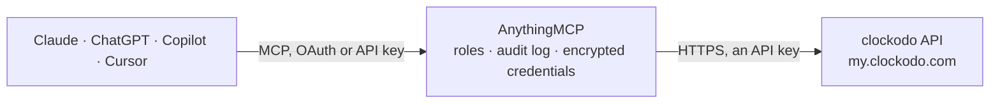

<!-- Generated by scripts/export-github-catalog.mjs in the anythingmcp-website repository. Do not edit by hand. -->

# clockodo MCP connector

clockodo time tracking for German SMBs: time entries, customers, projects, services, users, absences and the running clock. The AnythingMCP connector gives Claude, ChatGPT, Microsoft Copilot, Cursor and Gemini 9 MCP tools for clockodo: 8 read and 1 can change data.

**Category:** [Time Tracking](../time-tracking.md) · **Tools:** 9 · **Setup guide:** [anythingmcp.com](https://anythingmcp.com/guides/clockodo-to-mcp) · [Deutsch](https://anythingmcp.com/de/guides/clockodo-to-mcp) · [Italiano](https://anythingmcp.com/it/guides/clockodo-to-mcp) · [Español](https://anythingmcp.com/es/guides/clockodo-to-mcp) · [日本語](https://anythingmcp.com/ja/guides/clockodo-to-mcp) · [Русский](https://anythingmcp.com/ru/guides/clockodo-to-mcp) · [中文](https://anythingmcp.com/zh/guides/clockodo-to-mcp)

## Start without code

No installation and no terminal: AnythingMCP Cloud runs the clockodo connector for you, operated by helpcode.ai in Frankfurt, Germany.

1. **Click the button above** and create an account or sign in. The clockodo connector opens, ready to install.
2. **Paste the API key or token from your clockodo account.** Every click is in the [step-by-step guide](https://anythingmcp.com/guides/clockodo-to-mcp).
3. **Click Install.** AnythingMCP shows the address of your MCP server.
4. **Add that address to your assistant:** [Claude](https://anythingmcp.com/guides/connect-clockodo-to-claude) · [ChatGPT](https://anythingmcp.com/guides/connect-clockodo-to-chatgpt) · [Microsoft Copilot](https://anythingmcp.com/guides/connect-clockodo-to-copilot) · [Cursor](https://anythingmcp.com/guides/connect-clockodo-to-cursor) · [Gemini CLI](https://anythingmcp.com/guides/connect-clockodo-to-gemini) · [Meta Muse](https://anythingmcp.com/guides/connect-clockodo-to-muse).
5. **Ask your first question**, for example: *Who is currently running the clock right now in our account?*

Prefer help with the setup? [Talk to us](https://anythingmcp.com/contact).

## How it works

- **The AI client** speaks MCP (Streamable HTTP) to AnythingMCP and only sees tool names, descriptions and results. It never gets the clockodo credentials.
- **AnythingMCP** checks the client's role, builds the call from the tool definition, adds the credentials (an API key), calls clockodo, logs the call and returns the result.
- **clockodo** sees an ordinary API client with the rights of the account the credentials belong to.

## Tools

| Tool | What it does | Access |
|---|---|---|
| [`clockodo_list_users`](#clockodo_list_users) | List the clockodo users in this account with their name, e-mail, role and whether they are active. | read |
| [`clockodo_list_customers`](#clockodo_list_customers) | List customers with their number, billing rate and active flag. | read |
| [`clockodo_list_projects`](#clockodo_list_projects) | List projects, optionally narrowed to one customer, with their budget, billing rate and completion flag. | read |
| [`clockodo_list_services`](#clockodo_list_services) | List the service types (Leistungsarten) time can be booked against, with their default billability. | read |
| [`clockodo_list_entries`](#clockodo_list_entries) | Read time entries in a date range — the core query. | read |
| [`clockodo_get_clock`](#clockodo_get_clock) | Read the currently running clock: which entry is ticking right now, for which user, project and service, and since when. | read |
| [`clockodo_list_absences`](#clockodo_list_absences) | List absences (holiday, sick leave, training) for a year, with their type, date range and approval status. | read |
| [`clockodo_get_entry`](#clockodo_get_entry) | Read one time entry by its id: the exact start and end time, duration, text, project, service and billability. | read |
| [`clockodo_create_entry`](#clockodo_create_entry) | Book a time entry against a customer, project and service. | write |

## Tool reference

Every parameter as the AI client sees it in `tools/list`. Source: [`packages/backend/src/adapters/de/clockodo.json`](../../../packages/backend/src/adapters/de/clockodo.json).

### `clockodo_list_users`

List the clockodo users in this account with their name, e-mail, role and whether they are active. No parameters — use it to check the key and e-mail pair.

**Access:** read · **Call:** `GET /v3/users`

No parameters.

### `clockodo_list_customers`

List customers with their number, billing rate and active flag. Customers sit above projects in clockodo's hierarchy.

**Access:** read · **Call:** `GET /v3/customers`

| Parameter | Type | Required | Description |
|---|---|---|---|
| `filter_active` | boolean | no | When true, only active customers. |
| `page` | number | no | Page number, starting at 1. |

### `clockodo_list_projects`

List projects, optionally narrowed to one customer, with their budget, billing rate and completion flag.

**Access:** read · **Call:** `GET /v4/projects`

| Parameter | Type | Required | Description |
|---|---|---|---|
| `filter_customers_id` | number | no | Restrict to one customer's projects. |
| `filter_active` | boolean | no | When true, only active projects. |
| `page` | number | no | Page number, starting at 1. |

### `clockodo_list_services`

List the service types (Leistungsarten) time can be booked against, with their default billability.

**Access:** read · **Call:** `GET /v4/services`

No parameters.

### `clockodo_list_entries`

Read time entries in a date range — the core query. Narrow by user, customer, project or billability to answer 'how much did we spend' and 'what is still unbilled'.

**Access:** read · **Call:** `GET /v2/entries`

| Parameter | Type | Required | Description |
|---|---|---|---|
| `time_since` | string | yes | Start of the range, ISO 8601 in UTC, e.g. 2026-09-01T00:00:00Z. |
| `time_until` | string | yes | End of the range, ISO 8601 in UTC, e.g. 2026-09-30T23:59:59Z. |
| `filter_users_id` | number | no | Restrict to one user's entries. |
| `filter_customers_id` | number | no | Restrict to one customer. |
| `filter_projects_id` | number | no | Restrict to one project. |
| `filter_billable` | number | no | 0 not billable, 1 billable and unbilled, 2 already billed. |
| `page` | number | no | Page number, starting at 1. |

### `clockodo_get_clock`

Read the currently running clock: which entry is ticking right now, for which user, project and service, and since when.

**Access:** read · **Call:** `GET /v2/clock`

No parameters.

### `clockodo_list_absences`

List absences (holiday, sick leave, training) for a year, with their type, date range and approval status.

**Access:** read · **Call:** `GET /v4/absences`

| Parameter | Type | Required | Description |
|---|---|---|---|
| `year` | string | yes | Calendar year, e.g. 2026. |
| `users_id` | number | no | Restrict to one user's absences. |

### `clockodo_get_entry`

Read one time entry by its id: the exact start and end time, duration, text, project, service and billability.

**Access:** read · **Call:** `GET /v2/entries/{id}`

| Parameter | Type | Required | Description |
|---|---|---|---|
| `id` | number | yes | Numeric entry id. |

### `clockodo_create_entry`

Book a time entry against a customer, project and service. Writes to the live account — a wrong entry has to be deleted in the clockodo UI.

**Access:** write · **Call:** `POST /v2/entries`

| Parameter | Type | Required | Description |
|---|---|---|---|
| `customers_id` | number | yes | Numeric customer id the time is booked to. |
| `services_id` | number | yes | Numeric service (Leistungsart) id. |
| `billable` | number | yes | 0 not billable, 1 billable. |
| `time_since` | string | yes | Entry start, ISO 8601 in UTC, e.g. 2026-09-17T08:00:00Z. |
| `time_until` | string | yes | Entry end, ISO 8601 in UTC, e.g. 2026-09-17T12:30:00Z. |
| `projects_id` | number | no | Numeric project id, when the customer has projects. |
| `text` | string | no | What was done — shown on the invoice if the entry is billed. |
| `users_id` | number | no | User the entry belongs to. Defaults to the key's own user. |

## Run it yourself

AnythingMCP is open source (AGPL-3.0). [Run it with Docker](../../../README.md#run-it-yourself), open **Connectors → Store**, pick **clockodo** and enter `CLOCKODO_API_KEY`, `CLOCKODO_API_USER`, then add your MCP server URL to the AI client.

[← Time Tracking connectors](../time-tracking.md) · [All categories](../README.md)
