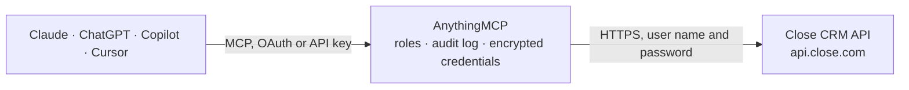

<!-- Generated by scripts/export-github-catalog.mjs in the anythingmcp-website repository. Do not edit by hand. -->

# Close CRM MCP connector

Drive Close (sales-team CRM) from any AI agent: leads, contacts, opportunities, activities (calls/emails/SMS/notes), tasks, smart views and custom fields. 16 tools, API-key Basic-auth. The AnythingMCP connector gives Claude, ChatGPT, Microsoft Copilot, Cursor and Gemini 16 MCP tools for Close CRM: 9 read and 7 can change data.

**Category:** [CRM](../crm.md) · **Tools:** 16 · **Setup guide:** [anythingmcp.com](https://anythingmcp.com/guides/close-to-mcp) · [Deutsch](https://anythingmcp.com/de/guides/close-to-mcp) · [Italiano](https://anythingmcp.com/it/guides/close-to-mcp) · [Español](https://anythingmcp.com/es/guides/close-to-mcp) · [日本語](https://anythingmcp.com/ja/guides/close-to-mcp) · [Русский](https://anythingmcp.com/ru/guides/close-to-mcp) · [中文](https://anythingmcp.com/zh/guides/close-to-mcp)

## Start without code

No installation and no terminal: AnythingMCP Cloud runs the Close CRM connector for you, operated by helpcode.ai in Frankfurt, Germany.

1. **Click the button above** and create an account or sign in. The Close CRM connector opens, ready to install.
2. **Paste the API key or token from your Close CRM account.** Every click is in the [step-by-step guide](https://anythingmcp.com/guides/close-to-mcp).
3. **Click Install.** AnythingMCP shows the address of your MCP server.
4. **Add that address to your assistant:** [Claude](https://anythingmcp.com/guides/connect-close-to-claude) · [ChatGPT](https://anythingmcp.com/guides/connect-close-to-chatgpt) · [Microsoft Copilot](https://anythingmcp.com/guides/connect-close-to-copilot) · [Cursor](https://anythingmcp.com/guides/connect-close-to-cursor) · [Gemini CLI](https://anythingmcp.com/guides/connect-close-to-gemini) · [Meta Muse](https://anythingmcp.com/guides/connect-close-to-muse).
5. **Ask your first question**, for example: *Find the lead for invoice INV-2026-0785 and tell me company name and outstanding balance.*

Prefer help with the setup? [Talk to us](https://anythingmcp.com/contact).

## How it works

- **The AI client** speaks MCP (Streamable HTTP) to AnythingMCP and only sees tool names, descriptions and results. It never gets the Close CRM credentials.
- **AnythingMCP** checks the client's role, builds the call from the tool definition, adds the credentials (user name and password), calls Close CRM, logs the call and returns the result.
- **Close CRM** sees an ordinary API client with the rights of the account the credentials belong to.

## Tools

| Tool | What it does | Access |
|---|---|---|
| [`close_get_me`](#close_get_me) | Return the user the API key belongs to plus the organization context (id, name, plan, addresses). | read |
| [`close_list_leads`](#close_list_leads) | List leads (companies) with optional query filter and pagination. | read |
| [`close_get_lead`](#close_get_lead) | Fetch one lead by ID. | read |
| [`close_create_lead`](#close_create_lead) | Create a new lead (company). | write |
| [`close_update_lead`](#close_update_lead) | Partial-update a lead. | write |
| [`close_list_contacts`](#close_list_contacts) | List contacts (people) — typically scoped to a lead via the lead_id query param. | read |
| [`close_create_contact`](#close_create_contact) | Create a contact on a lead. | write |
| [`close_list_opportunities`](#close_list_opportunities) | List opportunities (deals). | read |
| [`close_create_opportunity`](#close_create_opportunity) | Create an opportunity (deal). | write |
| [`close_update_opportunity`](#close_update_opportunity) | Update an opportunity. | write |
| [`close_create_note_activity`](#close_create_note_activity) | Log a free-text note on a lead (timeline). | write |
| [`close_list_activities`](#close_list_activities) | List activities (timeline events) — call, email, sms, note, meeting, etc. | read |
| [`close_create_task`](#close_create_task) | Create a task on a lead. | write |
| [`close_list_lead_statuses`](#close_list_lead_statuses) | List the lead status values configured on the organization (e.g. 'Potential', 'Qualified', 'Customer', 'Bad Fit'). | read |
| [`close_list_opportunity_statuses`](#close_list_opportunity_statuses) | List the opportunity (pipeline stage) status values — typically active stages + won/lost terminal states. | read |
| [`close_list_lead_custom_fields`](#close_list_lead_custom_fields) | List the custom fields defined on leads with their IDs (cf_XYZ), types, and pick-list options. | read |

## Tool reference

Every parameter as the AI client sees it in `tools/list`. Source: [`packages/backend/src/adapters/intl/close.json`](../../../packages/backend/src/adapters/intl/close.json).

### `close_get_me`

Return the user the API key belongs to plus the organization context (id, name, plan, addresses). Health check + whoami.

**Access:** read · **Call:** `GET /me/`

No parameters.

### `close_list_leads`

List leads (companies) with optional query filter and pagination. Each lead has display_name, status_id, contacts[], opportunities[], custom fields, addresses, url, description, integration_links.

**Access:** read · **Call:** `GET /lead/`

| Parameter | Type | Required | Description |
|---|---|---|---|
| `query` | string | no | Close query string — e.g. 'has:opportunities lead_status:"Customer"' or 'has:contacts'. Empty string returns all. |
| `_fields` | string | no | Comma-separated fields to return (sparse). Default returns all. |
| `_limit` | integer | no | Max per page (default 100, max 100). |
| `_skip` | integer | no | Pagination offset. |

### `close_get_lead`

Fetch one lead by ID. Returns display_name, contacts[], opportunities[], tasks[], custom fields, all the activity rollups.

**Access:** read · **Call:** `GET /lead/{leadId}/`

| Parameter | Type | Required | Description |
|---|---|---|---|
| `leadId` | string | yes | Lead ID (starts with 'lead_'). |

### `close_create_lead`

Create a new lead (company). Pass contacts inline to create them in one call. Display_name auto-derives from name if omitted.

**Access:** write · **Call:** `POST /lead/`

| Parameter | Type | Required | Description |
|---|---|---|---|
| `name` | string | yes | Company name (e.g. 'ACME Inc'). |
| `url` | string | no | Website URL. |
| `description` | string | no | Free-text description. |
| `status_id` | string | no | Lead status ID (discover via close_list_lead_statuses). |
| `addresses` | any[] | no | Array of {address_1, address_2?, city, state, zipcode, country, label}. |
| `contacts` | any[] | no | Inline contacts to create: [{name, title?, emails:[{type,email}], phones:[{type,phone}], urls?:[{type,url}]}]. |
| `custom` | object | no | Custom fields keyed by 'cf_XYZ' field IDs. |

### `close_update_lead`

Partial-update a lead. Pass only fields to change.

**Access:** write · **Call:** `PUT /lead/{leadId}/`

| Parameter | Type | Required | Description |
|---|---|---|---|
| `leadId` | string | yes | Lead ID. |
| `name` | string | no | New name. |
| `url` | string | no | New URL. |
| `description` | string | no | New description. |
| `status_id` | string | no | New status. |
| `addresses` | any[] | no | Full address array (replaces). |
| `custom` | object | no | Custom fields to update (cf_XYZ keys). |

### `close_list_contacts`

List contacts (people) — typically scoped to a lead via the lead_id query param.

**Access:** read · **Call:** `GET /contact/`

| Parameter | Type | Required | Description |
|---|---|---|---|
| `lead_id` | string | no | Filter by lead. |
| `_limit` | integer | no | Max per page. |
| `_skip` | integer | no | Pagination offset. |

### `close_create_contact`

Create a contact on a lead. Required: lead_id + name. Emails/phones are arrays of {type, email|phone}.

**Access:** write · **Call:** `POST /contact/`

| Parameter | Type | Required | Description |
|---|---|---|---|
| `lead_id` | string | yes | Parent lead ID. |
| `name` | string | yes | Person's full name. |
| `title` | string | no | Job title. |
| `emails` | any[] | no | [{type:'office'\|'mobile'\|'home'\|'direct'\|'fax'\|'other', email}]. |
| `phones` | any[] | no | [{type, phone}]. |
| `urls` | any[] | no | [{type:'url', url}]. |
| `custom` | object | no | Custom fields (cf_XYZ). |

### `close_list_opportunities`

List opportunities (deals). Filter by lead_id, status_id, status_type (active/won/lost), date_won range.

**Access:** read · **Call:** `GET /opportunity/`

| Parameter | Type | Required | Description |
|---|---|---|---|
| `lead_id` | string | no | Filter by lead. |
| `status_id` | string | no | Filter by status. |
| `status_type` | string | no | active, won, lost. |
| `_limit` | integer | no | Per page. |
| `_skip` | integer | no | Pagination offset. |

### `close_create_opportunity`

Create an opportunity (deal). Value is in cents (e.g. 100000 = $1000.00). value_period: one_time, monthly, annual.

**Access:** write · **Call:** `POST /opportunity/`

| Parameter | Type | Required | Description |
|---|---|---|---|
| `lead_id` | string | yes | Parent lead ID. |
| `note` | string | no | Opportunity note (description). |
| `value` | integer | no | Deal value in cents. |
| `value_currency` | string | no | ISO 4217 (USD, EUR, ...). |
| `value_period` | string | no | one_time, monthly, annual. |
| `status_id` | string | no | Status ID. |
| `confidence` | integer | no | Win probability 0-100. |
| `custom` | object | no | Custom fields. |

### `close_update_opportunity`

Update an opportunity. Common uses: set status_id (move pipeline stage), update value, set confidence.

**Access:** write · **Call:** `PUT /opportunity/{opportunityId}/`

| Parameter | Type | Required | Description |
|---|---|---|---|
| `opportunityId` | string | yes | Opportunity ID (oppo_XXX). |
| `status_id` | string | no | New status. |
| `value` | integer | no | New value (cents). |
| `value_currency` | string | no | New currency. |
| `value_period` | string | no | New period. |
| `confidence` | integer | no | New confidence 0-100. |
| `note` | string | no | New note. |
| `custom` | object | no | Custom fields. |

### `close_create_note_activity`

Log a free-text note on a lead (timeline). Use for AI-generated meeting notes, summaries, observations. Do NOT use for fake emails/calls (those have their own typed activities).

**Access:** write · **Call:** `POST /activity/note/`

| Parameter | Type | Required | Description |
|---|---|---|---|
| `lead_id` | string | yes | Lead to attach the note to. |
| `note` | string | yes | Note body. Supports basic plain-text. |

### `close_list_activities`

List activities (timeline events) — call, email, sms, note, meeting, etc. Filter by lead_id, contact_id, type, date range.

**Access:** read · **Call:** `GET /activity/`

| Parameter | Type | Required | Description |
|---|---|---|---|
| `lead_id` | string | no | Filter by lead. |
| `contact_id` | string | no | Filter by contact. |
| `_type` | string | no | Activity type: call, email, sms, note, meeting, task_completed, etc. |
| `date_created__gte` | string | no | Created on/after (ISO 8601). |
| `date_created__lt` | string | no | Created before (ISO 8601). |
| `_limit` | integer | no | Per page. |
| `_skip` | integer | no | Pagination offset. |

### `close_create_task`

Create a task on a lead. Tasks are reminders for the assignee user.

**Access:** write · **Call:** `POST /task/`

| Parameter | Type | Required | Description |
|---|---|---|---|
| `lead_id` | string | yes | Parent lead ID. |
| `text` | string | yes | Task text. |
| `due_date` | string | no | ISO 8601 date YYYY-MM-DD. |
| `assigned_to` | string | no | User ID to assign to (defaults to the API key's user). |

### `close_list_lead_statuses`

List the lead status values configured on the organization (e.g. 'Potential', 'Qualified', 'Customer', 'Bad Fit').

**Access:** read · **Call:** `GET /status/lead/`

No parameters.

### `close_list_opportunity_statuses`

List the opportunity (pipeline stage) status values — typically active stages + won/lost terminal states.

**Access:** read · **Call:** `GET /status/opportunity/`

No parameters.

### `close_list_lead_custom_fields`

List the custom fields defined on leads with their IDs (cf_XYZ), types, and pick-list options. Required to compose `custom` objects in create/update.

**Access:** read · **Call:** `GET /custom_fields/lead/`

No parameters.

## Run it yourself

AnythingMCP is open source (AGPL-3.0). [Run it with Docker](../../../README.md#run-it-yourself), open **Connectors → Store**, pick **Close CRM** and enter `CLOSE_API_KEY`, then add your MCP server URL to the AI client.

[← CRM connectors](../crm.md) · [All categories](../README.md)
