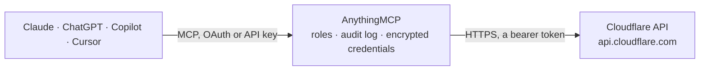

<!-- Generated by scripts/export-github-catalog.mjs in the anythingmcp-website repository. Do not edit by hand. -->

# Cloudflare MCP connector

Let your AI manage your Cloudflare zones: review and change DNS records, purge the cache, read zone settings, redirect, transform and cache rules, check traffic analytics, and list Workers and R2 buckets. The AnythingMCP connector gives Claude, ChatGPT, Microsoft Copilot, Cursor and Gemini 26 MCP tools for Cloudflare: 21 read and 5 can change data.

**Category:** [Infrastructure](../infrastructure.md) · **Tools:** 26 · **Setup guide:** [anythingmcp.com](https://anythingmcp.com/guides/cloudflare-to-mcp) · [Deutsch](https://anythingmcp.com/de/guides/cloudflare-to-mcp) · [Italiano](https://anythingmcp.com/it/guides/cloudflare-to-mcp) · [Español](https://anythingmcp.com/es/guides/cloudflare-to-mcp) · [日本語](https://anythingmcp.com/ja/guides/cloudflare-to-mcp) · [Русский](https://anythingmcp.com/ru/guides/cloudflare-to-mcp) · [中文](https://anythingmcp.com/zh/guides/cloudflare-to-mcp)

## Start without code

No installation and no terminal: AnythingMCP Cloud runs the Cloudflare connector for you, operated by helpcode.ai in Frankfurt, Germany.

1. **Click the button above** and create an account or sign in. The Cloudflare connector opens, ready to install.
2. **Paste the API key or token from your Cloudflare account.** Every click is in the [step-by-step guide](https://anythingmcp.com/guides/cloudflare-to-mcp).
3. **Click Install.** AnythingMCP shows the address of your MCP server.
4. **Add that address to your assistant:** [Claude](https://anythingmcp.com/guides/connect-cloudflare-to-claude) · [ChatGPT](https://anythingmcp.com/guides/connect-cloudflare-to-chatgpt) · [Microsoft Copilot](https://anythingmcp.com/guides/connect-cloudflare-to-copilot) · [Cursor](https://anythingmcp.com/guides/connect-cloudflare-to-cursor) · [Gemini CLI](https://anythingmcp.com/guides/connect-cloudflare-to-gemini) · [Meta Muse](https://anythingmcp.com/guides/connect-cloudflare-to-muse).
5. **Ask your first question**, for example: *What is the A record for app.prod.meridian.io right now; I need the IP and whether it's proxied*

Prefer help with the setup? [Talk to us](https://anythingmcp.com/contact).

## How it works

- **The AI client** speaks MCP (Streamable HTTP) to AnythingMCP and only sees tool names, descriptions and results. It never gets the Cloudflare credentials.
- **AnythingMCP** checks the client's role, builds the call from the tool definition, adds the credentials (a bearer token), calls Cloudflare, logs the call and returns the result.
- **Cloudflare** sees an ordinary API client with the rights of the account the credentials belong to.

## Tools

| Tool | What it does | Access |
|---|---|---|
| [`cloudflare_list_zones`](#cloudflare_list_zones) | List the zones (domains) the token can see: id, name, status (active, pending, initializing, moved), plan, name_servers, paused and account (id, name). | read |
| [`cloudflare_get_zone`](#cloudflare_get_zone) | Get one zone: name, status, plan, name servers (the ones Cloudflare assigned and the original ones), account, created and activated dates, paused and… | read |
| [`cloudflare_list_accounts`](#cloudflare_list_accounts) | List the Cloudflare accounts the token has access to: id, name, type and settings. | read |
| [`cloudflare_list_zone_settings`](#cloudflare_list_zone_settings) | Read all settings of a zone, each as id, value and editable: SSL mode (ssl), always_use_https, min_tls_version, cache_level, browser_cache_ttl,… | read |
| [`cloudflare_get_zone_setting`](#cloudflare_get_zone_setting) | Read one zone setting by its id, e.g. ssl, always_use_https, min_tls_version, security_level, cache_level, development_mode: value, editable and modified_on. | read |
| [`cloudflare_list_dns_records`](#cloudflare_list_dns_records) | List a zone's DNS records with filters: id, type, name, content, proxied, ttl (1 = automatic), priority, comment, tags and modified_on. | read |
| [`cloudflare_get_dns_record`](#cloudflare_get_dns_record) | Get one DNS record by id: type, name, content, proxied, ttl, priority, data (SRV, CAA ...), comment, tags, created_on and modified_on. | read |
| [`cloudflare_export_dns_records`](#cloudflare_export_dns_records) | Export all DNS records of a zone as a BIND zone file (plain text), handy for a backup before changes or to review everything at once. | read |
| [`cloudflare_create_dns_record`](#cloudflare_create_dns_record) | Create a DNS record in a zone. | write |
| [`cloudflare_update_dns_record`](#cloudflare_update_dns_record) | Change fields of an existing DNS record (only the fields given), e.g. point it at a new IP, switch proxying on or off, change the TTL or comment. | write |
| [`cloudflare_delete_dns_record`](#cloudflare_delete_dns_record) | Delete a DNS record. | write |
| [`cloudflare_purge_cache`](#cloudflare_purge_cache) | Remove cached content from Cloudflare's edge so the next request fetches it from the origin. | write |
| [`cloudflare_purge_everything`](#cloudflare_purge_everything) | Purge the zone's entire cache. | write |
| [`cloudflare_list_rulesets`](#cloudflare_list_rulesets) | List a zone's rulesets: id, name, kind (zone, managed, custom), phase and last_updated. | read |
| [`cloudflare_get_ruleset`](#cloudflare_get_ruleset) | Get one ruleset with all its rules: for each rule id, description, expression (the filter, e.g. http.host eq "example.com"), action, action_parameters,… | read |
| [`cloudflare_get_phase_rules`](#cloudflare_get_phase_rules) | Get the zone's own rules for one phase (its entry point ruleset): e.g. http_request_dynamic_redirect for single redirects, http_request_transform for URL… | read |
| [`cloudflare_list_page_rules`](#cloudflare_list_page_rules) | List a zone's legacy Page Rules: id, targets (URL patterns), actions (forwarding_url, cache_level, always_use_https ...), priority and status. | read |
| [`cloudflare_get_zone_traffic`](#cloudflare_get_zone_traffic) | Daily traffic of a zone between two dates from the GraphQL Analytics API: per day requests, bytes, cached requests and bytes, threats, page views, unique… | read |
| [`cloudflare_graphql_analytics`](#cloudflare_graphql_analytics) | Run a query against Cloudflare's GraphQL Analytics API (read-only) for anything cloudflare_get_zone_traffic does not cover: e.g. httpRequestsAdaptiveGroups… | read |
| [`cloudflare_list_workers`](#cloudflare_list_workers) | List the Workers scripts of an account: id (the script name), created_on, modified_on, usage_model, handlers (fetch, scheduled ...), compatibility_date and… | read |
| [`cloudflare_get_worker_settings`](#cloudflare_get_worker_settings) | Get a Worker's settings: bindings (KV, R2, D1, Durable Objects, environment variables; secret values are never returned), compatibility date and flags,… | read |
| [`cloudflare_get_worker_content`](#cloudflare_get_worker_content) | Download a Worker's deployed code as text, cut at 200 KB. | read |
| [`cloudflare_list_worker_routes`](#cloudflare_list_worker_routes) | List a zone's Worker routes: id, pattern (e.g. example.com/api/*) and the script that handles it. | read |
| [`cloudflare_list_worker_domains`](#cloudflare_list_worker_domains) | List the custom domains attached to Workers in an account: hostname, zone, service (the Worker) and environment. | read |
| [`cloudflare_list_r2_buckets`](#cloudflare_list_r2_buckets) | List an account's R2 buckets: name, creation_date, location and jurisdiction. | read |
| [`cloudflare_get_r2_bucket`](#cloudflare_get_r2_bucket) | Get one R2 bucket: name, creation_date, location, jurisdiction and storage_class. | read |

## Tool reference

Every parameter as the AI client sees it in `tools/list`. Source: [`packages/backend/src/adapters/intl/cloudflare.json`](../../../packages/backend/src/adapters/intl/cloudflare.json).

### `cloudflare_list_zones`

List the zones (domains) the token can see: id, name, status (active, pending, initializing, moved), plan, name_servers, paused and account (id, name). The zone id is what the zone tools take.

**Access:** read · **Call:** `GET /zones`

| Parameter | Type | Required | Description |
|---|---|---|---|
| `name` | string | no | Only the zone with this domain name, e.g. example.com. Prefix with contains: or starts_with: to match part of it. |
| `status` | `active` \| `pending` \| `initializing` \| `moved` | no | Only zones with this status. |
| `account_id` | string | no | Only zones of this account. |
| `page` | integer | no | Page number, from 1. result_info.total_pages says how many there are. |
| `per_page` | integer | no | Zones per page, 5 to 50 (default 20). |
| `order` | `name` \| `status` \| `account.id` \| `account.name` \| `plan.id` | no | Sort by name, status, account.id, account.name or plan.id. |
| `direction` | `asc` \| `desc` | no | asc or desc. |

### `cloudflare_get_zone`

Get one zone: name, status, plan, name servers (the ones Cloudflare assigned and the original ones), account, created and activated dates, paused and development_mode.

**Access:** read · **Call:** `GET /zones/{zone_id}`

| Parameter | Type | Required | Description |
|---|---|---|---|
| `zone_id` | string | yes | Zone id (32 hex characters), from cloudflare_list_zones. |

### `cloudflare_list_accounts`

List the Cloudflare accounts the token has access to: id, name, type and settings. Workers, R2 and other account tools take the id.

**Access:** read · **Call:** `GET /accounts`

| Parameter | Type | Required | Description |
|---|---|---|---|
| `name` | string | no | Only accounts whose name matches. |
| `page` | integer | no | Page number, from 1. result_info.total_pages says how many there are. |
| `per_page` | integer | no | Accounts per page, 5 to 50 (default 20). |

### `cloudflare_list_zone_settings`

Read all settings of a zone, each as id, value and editable: SSL mode (ssl), always_use_https, min_tls_version, cache_level, browser_cache_ttl, development_mode, security_level, http3, brotli, rocket_loader and more.

**Access:** read · **Call:** `GET /zones/{zone_id}/settings`

| Parameter | Type | Required | Description |
|---|---|---|---|
| `zone_id` | string | yes | Zone id (32 hex characters), from cloudflare_list_zones. |

### `cloudflare_get_zone_setting`

Read one zone setting by its id, e.g. ssl, always_use_https, min_tls_version, security_level, cache_level, development_mode: value, editable and modified_on.

**Access:** read · **Call:** `GET /zones/{zone_id}/settings/{setting_id}`

| Parameter | Type | Required | Description |
|---|---|---|---|
| `zone_id` | string | yes | Zone id (32 hex characters), from cloudflare_list_zones. |
| `setting_id` | string | yes | Setting id, e.g. ssl or always_use_https. |

### `cloudflare_list_dns_records`

List a zone's DNS records with filters: id, type, name, content, proxied, ttl (1 = automatic), priority, comment, tags and modified_on. Pages with page and per_page; result_info has the total.

**Access:** read · **Call:** `GET /zones/{zone_id}/dns_records`

| Parameter | Type | Required | Description |
|---|---|---|---|
| `zone_id` | string | yes | Zone id (32 hex characters), from cloudflare_list_zones. |
| `type` | `A` \| `AAAA` \| `CAA` \| `CERT` \| `CNAME` \| `DNSKEY` \| `DS` \| `HTTPS` \| `LOC` \| `MX` \| `NAPTR` \| `NS` \| `OPENPGPKEY` \| `PTR` \| `SMIMEA` \| `SRV` \| `SSHFP` \| `SVCB` \| `TLSA` \| `TXT` \| `URI` | no | Only records of this type. |
| `name` | string | no | Only records with exactly this full name, e.g. www.example.com. |
| `name_contains` | string | no | Only records whose name contains this text. |
| `content` | string | no | Only records with exactly this content, e.g. an IP address. |
| `content_contains` | string | no | Only records whose content contains this text. |
| `proxied` | boolean | no | true for proxied (orange cloud) records only, false for DNS-only ones. |
| `comment_contains` | string | no | Only records whose comment contains this text. |
| `tag` | string | no | Only records with this tag, as name:value or just name. |
| `order` | `type` \| `name` \| `content` \| `ttl` \| `proxied` | no | Sort by type (default), name, content, ttl or proxied. |
| `direction` | `asc` \| `desc` | no | asc or desc. |
| `page` | integer | no | Page number, from 1. result_info.total_pages says how many there are. |
| `per_page` | integer | no | Records per page, 1 to 1000 (default 100). |

### `cloudflare_get_dns_record`

Get one DNS record by id: type, name, content, proxied, ttl, priority, data (SRV, CAA ...), comment, tags, created_on and modified_on.

**Access:** read · **Call:** `GET /zones/{zone_id}/dns_records/{dns_record_id}`

| Parameter | Type | Required | Description |
|---|---|---|---|
| `zone_id` | string | yes | Zone id (32 hex characters), from cloudflare_list_zones. |
| `dns_record_id` | string | yes | DNS record id, from cloudflare_list_dns_records. |

### `cloudflare_export_dns_records`

Export all DNS records of a zone as a BIND zone file (plain text), handy for a backup before changes or to review everything at once. Cut at 200 KB.

**Access:** read · **Call:** `GET /zones/{zone_id}/dns_records/export`

| Parameter | Type | Required | Description |
|---|---|---|---|
| `zone_id` | string | yes | Zone id (32 hex characters), from cloudflare_list_zones. |

### `cloudflare_create_dns_record`

Create a DNS record in a zone. Returns the new record with its id. Check with cloudflare_list_dns_records first: an identical record, or a CNAME next to an A record of the same name, is refused. Show the user the record and wait for confirmation; DNS changes go live within seconds.

**Access:** write · **Call:** `POST /zones/{zone_id}/dns_records`

| Parameter | Type | Required | Description |
|---|---|---|---|
| `zone_id` | string | yes | Zone id (32 hex characters), from cloudflare_list_zones. |
| `type` | `A` \| `AAAA` \| `CAA` \| `CERT` \| `CNAME` \| `DNSKEY` \| `DS` \| `HTTPS` \| `LOC` \| `MX` \| `NAPTR` \| `NS` \| `OPENPGPKEY` \| `PTR` \| `SMIMEA` \| `SRV` \| `SSHFP` \| `SVCB` \| `TLSA` \| `TXT` \| `URI` | yes | Record type. |
| `name` | string | yes | Full record name, e.g. www.example.com, or @ for the zone apex. |
| `content` | string | no | Record value: an IPv4 address for A, IPv6 for AAAA, a host name for CNAME, MX and NS, the text for TXT. SRV and CAA use data instead. |
| `ttl` | integer | no | Time to live in seconds, 60 to 86400, or 1 for automatic (default 1). |
| `proxied` | boolean | no | Route traffic through Cloudflare (orange cloud). Only for A, AAAA and CNAME; default false. |
| `priority` | integer | no | Priority, required for MX and URI records (lower wins). |
| `data` | object | no | Structured value for SRV ({"port": 5060, "priority": 10, "weight": 5, "target": "sip.example.com"}), CAA ({"flags": 0, "tag": "issue", "value": "letsencrypt.org"}) and similar types. |
| `comment` | string | no | A note on the record, e.g. who added it and why. |
| `tags` | string[] | no | Tags as name:value, e.g. ["owner:web-team"]. Paid plans only. |

### `cloudflare_update_dns_record`

Change fields of an existing DNS record (only the fields given), e.g. point it at a new IP, switch proxying on or off, change the TTL or comment. Read the record first, show the user old and new values and wait for confirmation: a wrong value takes a site or its email offline.

**Access:** write · **Call:** `PATCH /zones/{zone_id}/dns_records/{dns_record_id}`

| Parameter | Type | Required | Description |
|---|---|---|---|
| `zone_id` | string | yes | Zone id (32 hex characters), from cloudflare_list_zones. |
| `dns_record_id` | string | yes | DNS record id. |
| `type` | `A` \| `AAAA` \| `CAA` \| `CERT` \| `CNAME` \| `DNSKEY` \| `DS` \| `HTTPS` \| `LOC` \| `MX` \| `NAPTR` \| `NS` \| `OPENPGPKEY` \| `PTR` \| `SMIMEA` \| `SRV` \| `SSHFP` \| `SVCB` \| `TLSA` \| `TXT` \| `URI` | no | New record type, rarely needed. |
| `name` | string | no | New full record name. |
| `content` | string | no | Record value: an IPv4 address for A, IPv6 for AAAA, a host name for CNAME, MX and NS, the text for TXT. SRV and CAA use data instead. |
| `ttl` | integer | no | Time to live in seconds, 60 to 86400, or 1 for automatic (default 1). |
| `proxied` | boolean | no | Route traffic through Cloudflare (orange cloud). Only for A, AAAA and CNAME; default false. |
| `priority` | integer | no | Priority, required for MX and URI records (lower wins). |
| `data` | object | no | Structured value for SRV ({"port": 5060, "priority": 10, "weight": 5, "target": "sip.example.com"}), CAA ({"flags": 0, "tag": "issue", "value": "letsencrypt.org"}) and similar types. |
| `comment` | string | no | A note on the record, e.g. who added it and why. |
| `tags` | string[] | no | Tags as name:value, e.g. ["owner:web-team"]. Paid plans only. |

### `cloudflare_delete_dns_record`

Delete a DNS record. Whatever relied on it (a website, mail delivery, a domain verification) stops working within seconds. Switched off at install; export the zone first with cloudflare_export_dns_records.

**Access:** write · **Call:** `DELETE /zones/{zone_id}/dns_records/{dns_record_id}`

| Parameter | Type | Required | Description |
|---|---|---|---|
| `zone_id` | string | yes | Zone id (32 hex characters), from cloudflare_list_zones. |
| `dns_record_id` | string | yes | DNS record id. |

### `cloudflare_purge_cache`

Remove cached content from Cloudflare's edge so the next request fetches it from the origin. Pass exactly one of files (full URLs), tags, hosts or prefixes, at most 100 entries. A success means the purge was accepted; it completes within seconds. Free plans allow 5 purge requests per minute by tag, host or prefix.

**Access:** write · **Call:** `POST /zones/{zone_id}/purge_cache`

| Parameter | Type | Required | Description |
|---|---|---|---|
| `zone_id` | string | yes | Zone id (32 hex characters), from cloudflare_list_zones. |
| `files` | string[] | no | Full URLs to purge, e.g. ["https://www.example.com/css/site.css"]. |
| `tags` | string[] | no | Cache-Tag header values to purge. |
| `hosts` | string[] | no | Host names whose whole cache to purge, e.g. ["www.example.com"]. |
| `prefixes` | string[] | no | URL prefixes without scheme, e.g. ["www.example.com/blog/"]. |

### `cloudflare_purge_everything`

Purge the zone's entire cache. Every visitor's next request goes to the origin, which can overload it on a busy site. Switched off at install; prefer cloudflare_purge_cache with specific URLs.

**Access:** write · **Call:** `POST /zones/{zone_id}/purge_cache`

| Parameter | Type | Required | Description |
|---|---|---|---|
| `zone_id` | string | yes | Zone id (32 hex characters), from cloudflare_list_zones. |

### `cloudflare_list_rulesets`

List a zone's rulesets: id, name, kind (zone, managed, custom), phase and last_updated. Each phase (redirects, transform rules, cache rules, WAF custom rules ...) has one zone entry point ruleset holding the zone's own rules.

**Access:** read · **Call:** `GET /zones/{zone_id}/rulesets`

| Parameter | Type | Required | Description |
|---|---|---|---|
| `zone_id` | string | yes | Zone id (32 hex characters), from cloudflare_list_zones. |
| `cursor` | string | no | result_info.cursors.after from the previous page. |
| `per_page` | integer | no | Rulesets per page, 1 to 50. |

### `cloudflare_get_ruleset`

Get one ruleset with all its rules: for each rule id, description, expression (the filter, e.g. http.host eq "example.com"), action, action_parameters, enabled and position.

**Access:** read · **Call:** `GET /zones/{zone_id}/rulesets/{ruleset_id}`

| Parameter | Type | Required | Description |
|---|---|---|---|
| `zone_id` | string | yes | Zone id (32 hex characters), from cloudflare_list_zones. |
| `ruleset_id` | string | yes | Ruleset id, from cloudflare_list_rulesets. |

### `cloudflare_get_phase_rules`

Get the zone's own rules for one phase (its entry point ruleset): e.g. http_request_dynamic_redirect for single redirects, http_request_transform for URL rewrites, http_response_headers_transform for response headers, http_request_cache_settings for cache rules, http_request_firewall_custom for WAF custom rules. A 404 means the zone has no rules in that phase.

**Access:** read · **Call:** `GET /zones/{zone_id}/rulesets/phases/{phase}/entrypoint`

| Parameter | Type | Required | Description |
|---|---|---|---|
| `zone_id` | string | yes | Zone id (32 hex characters), from cloudflare_list_zones. |
| `phase` | `http_request_dynamic_redirect` \| `http_request_redirect` \| `http_request_transform` \| `http_request_late_transform` \| `http_response_headers_transform` \| `http_request_origin` \| `http_request_cache_settings` \| `http_response_cache_settings` \| `http_config_settings` \| `http_request_firewall_custom` \| `http_request_firewall_managed` \| `http_response_firewall_managed` \| `http_ratelimit` \| `http_response_compression` \| `http_custom_errors` \| `http_log_custom_fields` \| `http_request_sanitize` \| `http_request_sbfm` \| `ddos_l7` | yes | Ruleset phase. |

### `cloudflare_list_page_rules`

List a zone's legacy Page Rules: id, targets (URL patterns), actions (forwarding_url, cache_level, always_use_https ...), priority and status. Cloudflare is replacing Page Rules with rulesets; newer zones may have none.

**Access:** read · **Call:** `GET /zones/{zone_id}/pagerules`

| Parameter | Type | Required | Description |
|---|---|---|---|
| `zone_id` | string | yes | Zone id (32 hex characters), from cloudflare_list_zones. |
| `status` | `active` \| `disabled` | no | active or disabled. |
| `order` | `status` \| `priority` | no | Sort by status or priority (default priority). |
| `direction` | `asc` \| `desc` | no | asc or desc. |

### `cloudflare_get_zone_traffic`

Daily traffic of a zone between two dates from the GraphQL Analytics API: per day requests, bytes, cached requests and bytes, threats, page views, unique visitors, encrypted requests, and breakdowns by response status and by country. The range a plan may query is limited (Free: recent weeks).

**Access:** read · **Call:** `POST /graphql`

| Parameter | Type | Required | Description |
|---|---|---|---|
| `zone_id` | string | yes | Zone id (32 hex characters), from cloudflare_list_zones. |
| `since` | string | yes | First day, YYYY-MM-DD. |
| `until` | string | yes | Last day, YYYY-MM-DD. |
| `limit` | integer | no | Days to return at most (default 31). |

### `cloudflare_graphql_analytics`

Run a query against Cloudflare's GraphQL Analytics API (read-only) for anything cloudflare_get_zone_traffic does not cover: e.g. httpRequestsAdaptiveGroups by path, host, status or country, firewallEventsAdaptive, workersInvocationsAdaptive. Start from viewer { zones(filter: {zoneTag: $zoneTag}) { ... } } or viewer { accounts(filter: {accountTag: $accountTag}) { ... } }; adaptive datasets need a datetime filter and a limit. Errors come back in errors with data null.

**Access:** read · **Call:** `POST /graphql`

| Parameter | Type | Required | Description |
|---|---|---|---|
| `query` | string | yes | GraphQL query text. |
| `variables` | object | no | Variables for the query, e.g. {"zoneTag": "<zone id>", "since": "2026-10-09T00:00:00Z"}. |

### `cloudflare_list_workers`

List the Workers scripts of an account: id (the script name), created_on, modified_on, usage_model, handlers (fetch, scheduled ...), compatibility_date and tags.

**Access:** read · **Call:** `GET /accounts/{account_id}/workers/scripts`

| Parameter | Type | Required | Description |
|---|---|---|---|
| `account_id` | string | yes | Account id (32 hex characters), from cloudflare_list_accounts or a zone's account.id. |

### `cloudflare_get_worker_settings`

Get a Worker's settings: bindings (KV, R2, D1, Durable Objects, environment variables; secret values are never returned), compatibility date and flags, usage model, logpush and observability.

**Access:** read · **Call:** `GET /accounts/{account_id}/workers/scripts/{script_name}/settings`

| Parameter | Type | Required | Description |
|---|---|---|---|
| `account_id` | string | yes | Account id (32 hex characters), from cloudflare_list_accounts or a zone's account.id. |
| `script_name` | string | yes | Worker script name, from cloudflare_list_workers. |

### `cloudflare_get_worker_content`

Download a Worker's deployed code as text, cut at 200 KB. Workers made of several modules come back as one multipart text with each file in its own part.

**Access:** read · **Call:** `GET /accounts/{account_id}/workers/scripts/{script_name}/content/v2`

| Parameter | Type | Required | Description |
|---|---|---|---|
| `account_id` | string | yes | Account id (32 hex characters), from cloudflare_list_accounts or a zone's account.id. |
| `script_name` | string | yes | Worker script name. |

### `cloudflare_list_worker_routes`

List a zone's Worker routes: id, pattern (e.g. example.com/api/*) and the script that handles it.

**Access:** read · **Call:** `GET /zones/{zone_id}/workers/routes`

| Parameter | Type | Required | Description |
|---|---|---|---|
| `zone_id` | string | yes | Zone id (32 hex characters), from cloudflare_list_zones. |

### `cloudflare_list_worker_domains`

List the custom domains attached to Workers in an account: hostname, zone, service (the Worker) and environment.

**Access:** read · **Call:** `GET /accounts/{account_id}/workers/domains`

| Parameter | Type | Required | Description |
|---|---|---|---|
| `account_id` | string | yes | Account id (32 hex characters), from cloudflare_list_accounts or a zone's account.id. |
| `hostname` | string | no | Only this hostname. |
| `service` | string | no | Only domains of this Worker. |
| `zone_id` | string | no | Only domains in this zone. |

### `cloudflare_list_r2_buckets`

List an account's R2 buckets: name, creation_date, location and jurisdiction. Pages with cursor (result_info.cursor). Needs R2 to be enabled on the account.

**Access:** read · **Call:** `GET /accounts/{account_id}/r2/buckets`

| Parameter | Type | Required | Description |
|---|---|---|---|
| `account_id` | string | yes | Account id (32 hex characters), from cloudflare_list_accounts or a zone's account.id. |
| `name_contains` | string | no | Only buckets whose name contains this text. |
| `per_page` | integer | no | Buckets per page, 1 to 1000 (default 20). |
| `cursor` | string | no | result_info.cursor from the previous page. |
| `direction` | `asc` \| `desc` | no | asc or desc. |

### `cloudflare_get_r2_bucket`

Get one R2 bucket: name, creation_date, location, jurisdiction and storage_class.

**Access:** read · **Call:** `GET /accounts/{account_id}/r2/buckets/{bucket_name}`

| Parameter | Type | Required | Description |
|---|---|---|---|
| `account_id` | string | yes | Account id (32 hex characters), from cloudflare_list_accounts or a zone's account.id. |
| `bucket_name` | string | yes | Bucket name. |

## Run it yourself

AnythingMCP is open source (AGPL-3.0). [Run it with Docker](../../../README.md#run-it-yourself), open **Connectors → Store**, pick **Cloudflare** and enter `CLOUDFLARE_API_TOKEN`, then add your MCP server URL to the AI client.

[← Infrastructure connectors](../infrastructure.md) · [All categories](../README.md)
