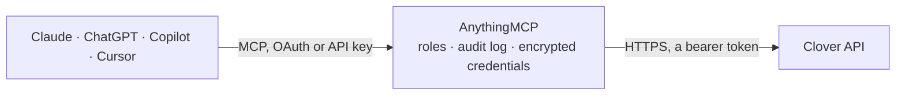

<!-- Generated by scripts/export-github-catalog.mjs in the anythingmcp-website repository. Do not edit by hand. -->

# Clover MCP connector

Clover point of sale (Fiserv): merchant details and settings, inventory items with stock, categories, tax rates, discounts and modifiers, orders with line items, payments, refunds and tenders, … The AnythingMCP connector gives Claude, ChatGPT, Microsoft Copilot, Cursor and Gemini 50 MCP tools for Clover: 35 read and 15 can change data.

**Category:** [Payments](../payments.md) · **Tools:** 50 · **Setup guide:** [anythingmcp.com](https://anythingmcp.com/guides/clover-to-mcp) · [Deutsch](https://anythingmcp.com/de/guides/clover-to-mcp) · [Italiano](https://anythingmcp.com/it/guides/clover-to-mcp) · [Español](https://anythingmcp.com/es/guides/clover-to-mcp) · [日本語](https://anythingmcp.com/ja/guides/clover-to-mcp) · [Русский](https://anythingmcp.com/ru/guides/clover-to-mcp) · [中文](https://anythingmcp.com/zh/guides/clover-to-mcp)

## Start without code

No installation and no terminal: AnythingMCP Cloud runs the Clover connector for you, operated by helpcode.ai in Frankfurt, Germany.

1. **Click the button above** and create an account or sign in. The Clover connector opens, ready to install.
2. **Paste the API key or token from your Clover account.** Every click is in the [step-by-step guide](https://anythingmcp.com/guides/clover-to-mcp).
3. **Click Install.** AnythingMCP shows the address of your MCP server.
4. **Add that address to your assistant:** [Claude](https://anythingmcp.com/guides/connect-clover-to-claude) · [ChatGPT](https://anythingmcp.com/guides/connect-clover-to-chatgpt) · [Microsoft Copilot](https://anythingmcp.com/guides/connect-clover-to-copilot) · [Cursor](https://anythingmcp.com/guides/connect-clover-to-cursor) · [Gemini CLI](https://anythingmcp.com/guides/connect-clover-to-gemini) · [Meta Muse](https://anythingmcp.com/guides/connect-clover-to-muse).
5. **Ask your first question**, for example: *Show payment details for payment on order ORD-2026-0721 (we need card last4 and tip)*

Prefer help with the setup? [Talk to us](https://anythingmcp.com/contact).

## How it works

- **The AI client** speaks MCP (Streamable HTTP) to AnythingMCP and only sees tool names, descriptions and results. It never gets the Clover credentials.
- **AnythingMCP** checks the client's role, builds the call from the tool definition, adds the credentials (a bearer token), calls Clover, logs the call and returns the result.
- **Clover** sees an ordinary API client with the rights of the account the credentials belong to.

## Tools

| Tool | What it does | Access |
|---|---|---|
| [`clover_get_merchant`](#clover_get_merchant) | Get the merchant behind the token: business name, address, phone, website, owner and default currency. | read |
| [`clover_get_merchant_address`](#clover_get_merchant_address) | Get the business address of the merchant: street lines, city, state, zip and country, as stored in Clover. | read |
| [`clover_get_merchant_properties`](#clover_get_merchant_properties) | Get merchant settings: default currency, time zone, locale, tips and tax settings, receipt and order options. | read |
| [`clover_list_order_types`](#clover_list_order_types) | List order types of the merchant (dine in, take out, delivery and custom ones) with label, taxable flag, fee and hours. | read |
| [`clover_list_roles`](#clover_list_roles) | List the employee roles of the merchant (admin, manager, employee and custom roles) with their system role and employees. | read |
| [`clover_list_items`](#clover_list_items) | List inventory items with name, price, price type, SKU, code, cost, stock tracking and visibility. | read |
| [`clover_get_item`](#clover_get_item) | Get one inventory item by id with price, price type, SKU, code, cost and, when expanded, categories, tax rates, modifier groups and stock. | read |
| [`clover_create_item`](#clover_create_item) | Create an inventory item. | write |
| [`clover_update_item`](#clover_update_item) | Update an inventory item (Clover updates with POST): name, price in cents, SKU, code, cost, visibility or categories. | write |
| [`clover_list_item_stocks`](#clover_list_item_stocks) | List the stock of all inventory items: item id, quantity on hand (decimal) and the low-stock alert threshold. | read |
| [`clover_get_item_stock`](#clover_get_item_stock) | Get the stock of one inventory item: quantity on hand, stock alert threshold and when it last changed. | read |
| [`clover_update_item_stock`](#clover_update_item_stock) | Set the stock of an inventory item to a new absolute quantity (not a change). | write |
| [`clover_list_categories`](#clover_list_categories) | List item categories with name, sort order and colour; expand items to get the items in each category. | read |
| [`clover_get_category`](#clover_get_category) | Get one item category by id with name, sort order and colour; expand items to list its items. | read |
| [`clover_list_category_items`](#clover_list_category_items) | List the items in one category with price, SKU and, when expanded, stock, tax rates and modifier groups. | read |
| [`clover_create_category`](#clover_create_category) | Create an item category shown on the register, with a name, sort order and colour. | write |
| [`clover_update_category`](#clover_update_category) | Rename a category or change its sort order or colour (Clover updates with POST). | write |
| [`clover_list_tax_rates`](#clover_list_tax_rates) | List tax rates with name, rate (in units of 1/100000, so 825000 = 8.25%), flat amount, type and whether it is the default. | read |
| [`clover_list_discounts`](#clover_list_discounts) | List the predefined discounts of the merchant: name, amount in cents (negative) or percentage. | read |
| [`clover_list_modifier_groups`](#clover_list_modifier_groups) | List modifier groups (e.g. Toppings) with min and max selections and, when expanded, their modifiers with prices in cents. | read |
| [`clover_list_orders`](#clover_list_orders) | List orders with state, total in cents, payment state, employee, order type and times. | read |
| [`clover_get_order`](#clover_get_order) | Get one order by id with total, state, payment state and, when expanded, line items, discounts, payments, refunds and customers. | read |
| [`clover_create_atomic_order`](#clover_create_atomic_order) | Create a complete order in one call from an order cart: line items (inventory items or ad hoc), modifiers, discounts and service charge, with totals and… | write |
| [`clover_calculate_order`](#clover_calculate_order) | Calculate an order cart without saving it: totals, taxes, discounts and service charges for the same cart as clover_create_atomic_order. | read |
| [`clover_create_order`](#clover_create_order) | Create an empty custom order (title, note, state, order type), then add lines with clover_add_line_item. | write |
| [`clover_update_order`](#clover_update_order) | Update an order (Clover updates with POST): title, note, state, order type or tax removal. | write |
| [`clover_list_order_line_items`](#clover_list_order_line_items) | List the line items of an order with name, price in cents, quantity, discounts, modifications and refund state. | read |
| [`clover_get_order_line_item`](#clover_get_order_line_item) | Get one line item of an order with name, price in cents, unit quantity, note, discounts and modifications. | read |
| [`clover_add_line_item`](#clover_add_line_item) | Add a line item to an order: an inventory item by id, or an ad hoc line with name and price in cents. | write |
| [`clover_void_line_item`](#clover_void_line_item) | Remove (void) a line item from an order. | write |
| [`clover_list_order_discounts`](#clover_list_order_discounts) | List the order-level discounts applied to an order with name, amount in cents or percentage and approver. | read |
| [`clover_add_order_discount`](#clover_add_order_discount) | Apply a discount to a whole order: a name plus an amount in cents (negative, e.g. -500) or a percentage, or a predefined discount by id. | write |
| [`clover_delete_order`](#clover_delete_order) | Delete an order. | write |
| [`clover_list_payments`](#clover_list_payments) | List payments with amount, tip and tax in cents, result (SUCCESS, FAIL and so on), tender, card type, order and employee. | read |
| [`clover_get_payment`](#clover_get_payment) | Get one payment by id with amount, tip, tax, cash back in cents, result, tender, card transaction details and refunds. | read |
| [`clover_list_order_payments`](#clover_list_order_payments) | List the payments made on one order with amount, tip and tax in cents, result, tender and card details. | read |
| [`clover_list_employee_payments`](#clover_list_employee_payments) | List the payments taken by one employee, with amount, tip and tax in cents, result and tender. | read |
| [`clover_list_refunds`](#clover_list_refunds) | List refunds with amount and tax in cents, the payment and order they belong to, employee and time. | read |
| [`clover_get_refund`](#clover_get_refund) | Get one refund by id with amount, tax and tip in cents, the refunded payment, line items and employee. | read |
| [`clover_list_tenders`](#clover_list_tenders) | List tenders (payment methods such as cash, credit card, debit card, check, gift card, external) with label, label key and whether enabled. | read |
| [`clover_get_tender`](#clover_get_tender) | Get one tender (payment method) by id with label, label key, instructions and whether it opens the cash drawer. | read |
| [`clover_list_customers`](#clover_list_customers) | List customers with name, customer since and marketing consent; expand emailAddresses, phoneNumbers and addresses for contact data. | read |
| [`clover_get_customer`](#clover_get_customer) | Get one customer by id with name, customer since, marketing consent and, when expanded, emails, phone numbers, addresses and notes. | read |
| [`clover_create_customer`](#clover_create_customer) | Create a customer with name, email addresses, phone numbers, addresses and marketing consent. | write |
| [`clover_update_customer`](#clover_update_customer) | Update a customer (Clover updates with POST): name, marketing consent or metadata such as business name and note. | write |
| [`clover_delete_customer`](#clover_delete_customer) | Delete a customer with their contact data. | write |
| [`clover_list_employees`](#clover_list_employees) | List employees with name, nickname, email, role, PIN-protected flags and custom id; expand roles or shifts. | read |
| [`clover_get_employee`](#clover_get_employee) | Get one employee by id with name, nickname, email, role and, when expanded, roles and shifts. | read |
| [`clover_list_shifts`](#clover_list_shifts) | List clock-in and clock-out shifts of all employees with in time, out time and overrides. | read |
| [`clover_list_employee_shifts`](#clover_list_employee_shifts) | List the clock-in and clock-out shifts of one employee with in time, out time and overrides, newest first. | read |

## Tool reference

Every parameter as the AI client sees it in `tools/list`. Source: [`packages/backend/src/adapters/intl/clover.json`](../../../packages/backend/src/adapters/intl/clover.json).

### `clover_get_merchant`

Get the merchant behind the token: business name, address, phone, website, owner and default currency. Expand employees or bank processing for more. Use it to check the token.

**Access:** read · **Call:** `GET /v3/merchants/{{CLOVER_MERCHANT_ID}}`

| Parameter | Type | Required | Description |
|---|---|---|---|
| `expand` | string | no | Comma-separated related data to include: owner, address, properties, employees, tenders, openingHours, gateway, logos. |

### `clover_get_merchant_address`

Get the business address of the merchant: street lines, city, state, zip and country, as stored in Clover.

**Access:** read · **Call:** `GET /v3/merchants/{{CLOVER_MERCHANT_ID}}/address`

No parameters.

### `clover_get_merchant_properties`

Get merchant settings: default currency, time zone, locale, tips and tax settings, receipt and order options.

**Access:** read · **Call:** `GET /v3/merchants/{{CLOVER_MERCHANT_ID}}/properties`

No parameters.

### `clover_list_order_types`

List order types of the merchant (dine in, take out, delivery and custom ones) with label, taxable flag, fee and hours.

**Access:** read · **Call:** `GET /v3/merchants/{{CLOVER_MERCHANT_ID}}/order_types`

| Parameter | Type | Required | Description |
|---|---|---|---|
| `filter` | string[] | no | Filters, each "field operator value", e.g. "modifiedTime>=1767225600000". Several filters are combined with AND. Operators: =, !=, >, >=, <, <=. Fields: id, deletedTime. |
| `expand` | string | no | Comma-separated related data to include: hours, attributes, categories. |
| `limit` | integer | no | Records per page, 1 to 1000 (default 100). |
| `offset` | integer | no | Records to skip, for the next page: offset + limit. |

### `clover_list_roles`

List the employee roles of the merchant (admin, manager, employee and custom roles) with their system role and employees.

**Access:** read · **Call:** `GET /v3/merchants/{{CLOVER_MERCHANT_ID}}/roles`

| Parameter | Type | Required | Description |
|---|---|---|---|
| `filter` | string[] | no | Filters, each "field operator value", e.g. "modifiedTime>=1767225600000". Several filters are combined with AND. Operators: =, !=, >, >=, <, <=. Fields: modifiedTime, systemRole, name, id, deletedTime. |
| `expand` | string | no | Comma-separated related data to include: employees. |
| `limit` | integer | no | Records per page, 1 to 1000 (default 100). |
| `offset` | integer | no | Records to skip, for the next page: offset + limit. |

### `clover_list_items`

List inventory items with name, price, price type, SKU, code, cost, stock tracking and visibility. Filter by name, SKU, price or modifiedTime; expand categories, taxRates or itemStock.

**Access:** read · **Call:** `GET /v3/merchants/{{CLOVER_MERCHANT_ID}}/items`

| Parameter | Type | Required | Description |
|---|---|---|---|
| `filter` | string[] | no | Filters, each "field operator value", e.g. "modifiedTime>=1767225600000". Several filters are combined with AND. Operators: =, !=, >, >=, <, <=. Fields: name, sku, itemCode, price, hidden, available, modifiedTime, id, tags.id, tags.name, itemStock.quantity, itemGroup.id, deleted. |
| `expand` | string | no | Comma-separated related data to include: tags, categories, taxRates, modifierGroups, itemStock, options. |
| `limit` | integer | no | Records per page, 1 to 1000 (default 100). |
| `offset` | integer | no | Records to skip, for the next page: offset + limit. |

### `clover_get_item`

Get one inventory item by id with price, price type, SKU, code, cost and, when expanded, categories, tax rates, modifier groups and stock.

**Access:** read · **Call:** `GET /v3/merchants/{{CLOVER_MERCHANT_ID}}/items/{item_id}`

| Parameter | Type | Required | Description |
|---|---|---|---|
| `item_id` | string | yes | Item id (13 characters). |
| `expand` | string | no | Comma-separated related data to include: tags, categories, taxRates, modifierGroups, itemStock, options. |

### `clover_create_item`

Create an inventory item. price is in cents (1999 = 19.99) and required; priceType FIXED, VARIABLE (entered at sale) or PER_UNIT. Add categories with clover_update_item or in the body.

**Access:** write · **Call:** `POST /v3/merchants/{{CLOVER_MERCHANT_ID}}/items`

| Parameter | Type | Required | Description |
|---|---|---|---|
| `name` | string | yes | Item name. |
| `price` | integer | yes | Price in cents of the merchant currency, e.g. 1999 for 19.99. |
| `priceType` | `FIXED` \| `VARIABLE` \| `PER_UNIT` | no | FIXED (default), VARIABLE or PER_UNIT. |
| `unitName` | string | no | Unit for PER_UNIT items, e.g. kg. |
| `sku` | string | no | SKU. |
| `code` | string | no | Product code or barcode (UPC/EAN). |
| `alternateName` | string | no | Alternate name, e.g. for kitchen tickets. |
| `cost` | integer | no | Cost in cents. |
| `hidden` | boolean | no | Hide the item on the register. |
| `available` | boolean | no | Available for sale. |
| `defaultTaxRates` | boolean | no | Apply the default tax rates (default true). |
| `isRevenue` | boolean | no | Counts as revenue (false for gift cards or deposits). |
| `categories` | object[] | no | Categories: [{id}]. |
| `tags` | object[] | no | Labels: [{id}]. |
| `colorCode` | string | no | Button colour on the register, hex e.g. #FF0000. |

### `clover_update_item`

Update an inventory item (Clover updates with POST): name, price in cents, SKU, code, cost, visibility or categories. Stock is changed with clover_update_item_stock.

**Access:** write · **Call:** `POST /v3/merchants/{{CLOVER_MERCHANT_ID}}/items/{item_id}`

| Parameter | Type | Required | Description |
|---|---|---|---|
| `item_id` | string | yes | Item id. |
| `name` | string | no | Item name. |
| `price` | integer | no | Price in cents. |
| `priceType` | `FIXED` \| `VARIABLE` \| `PER_UNIT` | no | FIXED, VARIABLE or PER_UNIT. |
| `unitName` | string | no | Unit for PER_UNIT items. |
| `sku` | string | no | SKU. |
| `code` | string | no | Product code or barcode. |
| `alternateName` | string | no | Alternate name. |
| `cost` | integer | no | Cost in cents. |
| `hidden` | boolean | no | Hide the item on the register. |
| `available` | boolean | no | Available for sale. |
| `defaultTaxRates` | boolean | no | Apply the default tax rates. |
| `isRevenue` | boolean | no | Counts as revenue. |
| `categories` | object[] | no | Categories: [{id}]. |
| `colorCode` | string | no | Button colour, hex. |

### `clover_list_item_stocks`

List the stock of all inventory items: item id, quantity on hand (decimal) and the low-stock alert threshold.

**Access:** read · **Call:** `GET /v3/merchants/{{CLOVER_MERCHANT_ID}}/item_stocks`

| Parameter | Type | Required | Description |
|---|---|---|---|
| `limit` | integer | no | Records per page, 1 to 1000 (default 100). |
| `offset` | integer | no | Records to skip, for the next page: offset + limit. |

### `clover_get_item_stock`

Get the stock of one inventory item: quantity on hand, stock alert threshold and when it last changed.

**Access:** read · **Call:** `GET /v3/merchants/{{CLOVER_MERCHANT_ID}}/item_stocks/{item_id}`

| Parameter | Type | Required | Description |
|---|---|---|---|
| `item_id` | string | yes | Item id. |

### `clover_update_item_stock`

Set the stock of an inventory item to a new absolute quantity (not a change). Read the current stock first and confirm the new value with the user.

**Access:** write · **Call:** `PUT /v3/merchants/{{CLOVER_MERCHANT_ID}}/item_stocks/{item_id}`

| Parameter | Type | Required | Description |
|---|---|---|---|
| `item_id` | string | yes | Item id. |
| `quantity` | number | yes | New quantity on hand, decimals allowed, e.g. 12 or 3.5. |
| `stockAlertThreshold` | number | no | Quantity at which the item counts as low stock. |

### `clover_list_categories`

List item categories with name, sort order and colour; expand items to get the items in each category.

**Access:** read · **Call:** `GET /v3/merchants/{{CLOVER_MERCHANT_ID}}/categories`

| Parameter | Type | Required | Description |
|---|---|---|---|
| `filter` | string[] | no | Filters, each "field operator value", e.g. "modifiedTime>=1767225600000". Several filters are combined with AND. Operators: =, !=, >, >=, <, <=. Fields: modifiedTime, deleted, sortOrder, name, colorCode, id. |
| `expand` | string | no | Comma-separated related data to include: items. |
| `limit` | integer | no | Records per page, 1 to 1000 (default 100). |
| `offset` | integer | no | Records to skip, for the next page: offset + limit. |

### `clover_get_category`

Get one item category by id with name, sort order and colour; expand items to list its items.

**Access:** read · **Call:** `GET /v3/merchants/{{CLOVER_MERCHANT_ID}}/categories/{category_id}`

| Parameter | Type | Required | Description |
|---|---|---|---|
| `category_id` | string | yes | Category id. |
| `expand` | string | no | Comma-separated related data to include: items. |

### `clover_list_category_items`

List the items in one category with price, SKU and, when expanded, stock, tax rates and modifier groups.

**Access:** read · **Call:** `GET /v3/merchants/{{CLOVER_MERCHANT_ID}}/categories/{category_id}/items`

| Parameter | Type | Required | Description |
|---|---|---|---|
| `category_id` | string | yes | Category id. |
| `filter` | string[] | no | Filters, each "field operator value", e.g. "modifiedTime>=1767225600000". Several filters are combined with AND. Operators: =, !=, >, >=, <, <=. Fields: modifiedTime, deleted, sortOrder, name, colorCode, id. |
| `expand` | string | no | Comma-separated related data to include: categories, itemStock, options, tags, taxRates. |
| `limit` | integer | no | Records per page, 1 to 1000 (default 100). |
| `offset` | integer | no | Records to skip, for the next page: offset + limit. |

### `clover_create_category`

Create an item category shown on the register, with a name, sort order and colour. Items are added to it with clover_update_item.

**Access:** write · **Call:** `POST /v3/merchants/{{CLOVER_MERCHANT_ID}}/categories`

| Parameter | Type | Required | Description |
|---|---|---|---|
| `name` | string | yes | Category name. |
| `sortOrder` | integer | no | Position on the register. |
| `colorCode` | string | no | Colour, hex e.g. #00AA00. |

### `clover_update_category`

Rename a category or change its sort order or colour (Clover updates with POST). name is required by the API.

**Access:** write · **Call:** `POST /v3/merchants/{{CLOVER_MERCHANT_ID}}/categories/{category_id}`

| Parameter | Type | Required | Description |
|---|---|---|---|
| `category_id` | string | yes | Category id. |
| `name` | string | yes | Category name. |
| `sortOrder` | integer | no | Position on the register. |
| `colorCode` | string | no | Colour, hex. |

### `clover_list_tax_rates`

List tax rates with name, rate (in units of 1/100000, so 825000 = 8.25%), flat amount, type and whether it is the default.

**Access:** read · **Call:** `GET /v3/merchants/{{CLOVER_MERCHANT_ID}}/tax_rates`

| Parameter | Type | Required | Description |
|---|---|---|---|
| `filter` | string[] | no | Filters, each "field operator value", e.g. "modifiedTime>=1767225600000". Several filters are combined with AND. Operators: =, !=, >, >=, <, <=. Fields: isDefault, rate, items.id, name, id, taxAmount, taxType. |
| `expand` | string | no | Comma-separated related data to include: items. |
| `limit` | integer | no | Records per page, 1 to 1000 (default 100). |
| `offset` | integer | no | Records to skip, for the next page: offset + limit. |

### `clover_list_discounts`

List the predefined discounts of the merchant: name, amount in cents (negative) or percentage.

**Access:** read · **Call:** `GET /v3/merchants/{{CLOVER_MERCHANT_ID}}/discounts`

| Parameter | Type | Required | Description |
|---|---|---|---|
| `filter` | string[] | no | Filters, each "field operator value", e.g. "modifiedTime>=1767225600000". Several filters are combined with AND. Operators: =, !=, >, >=, <, <=. Fields: amount, modifiedtime, percentage, id. |
| `limit` | integer | no | Records per page, 1 to 1000 (default 100). |
| `offset` | integer | no | Records to skip, for the next page: offset + limit. |

### `clover_list_modifier_groups`

List modifier groups (e.g. Toppings) with min and max selections and, when expanded, their modifiers with prices in cents.

**Access:** read · **Call:** `GET /v3/merchants/{{CLOVER_MERCHANT_ID}}/modifier_groups`

| Parameter | Type | Required | Description |
|---|---|---|---|
| `filter` | string[] | no | Filters, each "field operator value", e.g. "modifiedTime>=1767225600000". Several filters are combined with AND. Operators: =, !=, >, >=, <, <=. Fields: modifiedTime, item.id, sortOrder, name, id, showByDefault. |
| `expand` | string | no | Comma-separated related data to include: modifiers, items. |
| `limit` | integer | no | Records per page, 1 to 1000 (default 100). |
| `offset` | integer | no | Records to skip, for the next page: offset + limit. |

### `clover_list_orders`

List orders with state, total in cents, payment state, employee, order type and times. Filter by createdTime or modifiedTime (ms) and expand lineItems or payments. Time filters cover at most 90 days.

**Access:** read · **Call:** `GET /v3/merchants/{{CLOVER_MERCHANT_ID}}/orders`

| Parameter | Type | Required | Description |
|---|---|---|---|
| `filter` | string[] | no | Filters, each "field operator value", e.g. "modifiedTime>=1767225600000". Several filters are combined with AND. Operators: =, !=, >, >=, <, <=. Fields: id, state, total, payType, title, note, employee.id, employee.name, orderType, device.id, externalReferenceId, clientCreatedTime, createdTime, modifiedTime, deletedTime, testMode, manualTransaction. |
| `expand` | string | no | Comma-separated related data to include: lineItems, payments, refunds, credits, voids, customers, discounts, serviceCharge, employee, orderType, lineItems.discounts, lineItems.modifications. |
| `limit` | integer | no | Records per page, 1 to 1000 (default 100). |
| `offset` | integer | no | Records to skip, for the next page: offset + limit. |

### `clover_get_order`

Get one order by id with total, state, payment state and, when expanded, line items, discounts, payments, refunds and customers.

**Access:** read · **Call:** `GET /v3/merchants/{{CLOVER_MERCHANT_ID}}/orders/{order_id}`

| Parameter | Type | Required | Description |
|---|---|---|---|
| `order_id` | string | yes | Order id. |
| `expand` | string | no | Comma-separated related data to include: lineItems, serviceCharge, discounts, credits, payments, customers, refunds. |

### `clover_create_atomic_order`

Create a complete order in one call from an order cart: line items (inventory items or ad hoc), modifiers, discounts and service charge, with totals and taxes calculated by Clover.

**Access:** write · **Call:** `POST /v3/merchants/{{CLOVER_MERCHANT_ID}}/atomic_order/orders`

| Parameter | Type | Required | Description |
|---|---|---|---|
| `orderCart` | object | yes | The cart: {currency?, title?, note?, orderType?: {id}, lineItems: [{item?: {id}, name?, price?, unitQty?, note?, modifications?: [{modifier: {id}}], discounts?: [{name, percentage\|amount}]}], discounts?: [{name, percentage\|amount}], serviceCharge?: {id}}. Prices in cents; unitQty is quantity x 1000. |

### `clover_calculate_order`

Calculate an order cart without saving it: totals, taxes, discounts and service charges for the same cart as clover_create_atomic_order. Use it to quote a total.

**Access:** read · **Call:** `POST /v3/merchants/{{CLOVER_MERCHANT_ID}}/atomic_order/checkouts`

| Parameter | Type | Required | Description |
|---|---|---|---|
| `orderCart` | object | yes | The cart, same shape as for clover_create_atomic_order. |

### `clover_create_order`

Create an empty custom order (title, note, state, order type), then add lines with clover_add_line_item. For a full order in one call use clover_create_atomic_order.

**Access:** write · **Call:** `POST /v3/merchants/{{CLOVER_MERCHANT_ID}}/orders`

| Parameter | Type | Required | Description |
|---|---|---|---|
| `title` | string | no | Order title, e.g. table or pickup name. |
| `note` | string | no | Order note. |
| `state` | string | no | Order state, e.g. open. |
| `orderType` | object | no | Order type: {id}. |
| `taxRemoved` | boolean | no | Remove tax from the order. |
| `manualTransaction` | boolean | no | Manual transaction flag. |
| `groupLineItems` | boolean | no | Group identical line items. |
| `testMode` | boolean | no | Test order. |

### `clover_update_order`

Update an order (Clover updates with POST): title, note, state, order type or tax removal. Lines are changed with the line item tools.

**Access:** write · **Call:** `POST /v3/merchants/{{CLOVER_MERCHANT_ID}}/orders/{order_id}`

| Parameter | Type | Required | Description |
|---|---|---|---|
| `order_id` | string | yes | Order id. |
| `title` | string | no | Order title. |
| `note` | string | no | Order note. |
| `state` | string | no | Order state, e.g. open or locked. |
| `orderType` | object | no | Order type: {id}. |
| `taxRemoved` | boolean | no | Remove tax from the order. |

### `clover_list_order_line_items`

List the line items of an order with name, price in cents, quantity, discounts, modifications and refund state.

**Access:** read · **Call:** `GET /v3/merchants/{{CLOVER_MERCHANT_ID}}/orders/{order_id}/line_items`

| Parameter | Type | Required | Description |
|---|---|---|---|
| `order_id` | string | yes | Order id. |
| `expand` | string | no | Comma-separated related data to include: discounts, modifications, taxRates, payments. |

### `clover_get_order_line_item`

Get one line item of an order with name, price in cents, unit quantity, note, discounts and modifications.

**Access:** read · **Call:** `GET /v3/merchants/{{CLOVER_MERCHANT_ID}}/orders/{order_id}/line_items/{line_item_id}`

| Parameter | Type | Required | Description |
|---|---|---|---|
| `order_id` | string | yes | Order id. |
| `line_item_id` | string | yes | Line item id. |
| `expand` | string | no | Comma-separated related data to include: discounts, modifications, taxRates, payments. |

### `clover_add_line_item`

Add a line item to an order: an inventory item by id, or an ad hoc line with name and price in cents. unitQty is quantity x 1000 for per-unit items.

**Access:** write · **Call:** `POST /v3/merchants/{{CLOVER_MERCHANT_ID}}/orders/{order_id}/line_items`

| Parameter | Type | Required | Description |
|---|---|---|---|
| `order_id` | string | yes | Order id. |
| `item` | object | no | Inventory item: {id}. |
| `name` | string | no | Name of an ad hoc line. |
| `price` | integer | no | Price in cents (for an ad hoc line or to override). |
| `unitQty` | integer | no | Quantity x 1000 for PER_UNIT items, e.g. 1500 for 1.5 kg. |
| `note` | string | no | Line note. |
| `printed` | boolean | no | Already sent to the kitchen printer. |

### `clover_void_line_item`

Remove (void) a line item from an order. Voided lines stay in reports as voids and cannot be restored, so confirm with the user first.

**Access:** write · **Call:** `DELETE /v3/merchants/{{CLOVER_MERCHANT_ID}}/orders/{order_id}/line_items/{line_item_id}`

| Parameter | Type | Required | Description |
|---|---|---|---|
| `order_id` | string | yes | Order id. |
| `line_item_id` | string | yes | Line item id. |

### `clover_list_order_discounts`

List the order-level discounts applied to an order with name, amount in cents or percentage and approver.

**Access:** read · **Call:** `GET /v3/merchants/{{CLOVER_MERCHANT_ID}}/orders/{order_id}/discounts`

| Parameter | Type | Required | Description |
|---|---|---|---|
| `order_id` | string | yes | Order id. |

### `clover_add_order_discount`

Apply a discount to a whole order: a name plus an amount in cents (negative, e.g. -500) or a percentage, or a predefined discount by id.

**Access:** write · **Call:** `POST /v3/merchants/{{CLOVER_MERCHANT_ID}}/orders/{order_id}/discounts`

| Parameter | Type | Required | Description |
|---|---|---|---|
| `order_id` | string | yes | Order id. |
| `name` | string | yes | Discount name shown on the receipt. |
| `amount` | integer | no | Amount off in cents, negative, e.g. -500 for 5.00 off. |
| `percentage` | integer | no | Percent off, e.g. 10. |
| `discount` | object | no | Predefined discount: {id}. |

### `clover_delete_order`

Delete an order. It cannot be undone and the order disappears from the merchant reports, so confirm with the user first.

**Access:** write · **Call:** `DELETE /v3/merchants/{{CLOVER_MERCHANT_ID}}/orders/{order_id}`

| Parameter | Type | Required | Description |
|---|---|---|---|
| `order_id` | string | yes | Order id. |

### `clover_list_payments`

List payments with amount, tip and tax in cents, result (SUCCESS, FAIL and so on), tender, card type, order and employee. Filter by createdTime (ms); at most 90 days per request.

**Access:** read · **Call:** `GET /v3/merchants/{{CLOVER_MERCHANT_ID}}/payments`

| Parameter | Type | Required | Description |
|---|---|---|---|
| `filter` | string[] | no | Filters, each "field operator value", e.g. "modifiedTime>=1767225600000". Several filters are combined with AND. Operators: =, !=, >, >=, <, <=. Fields: id, result, amount, cardType, tender.id, employee.id, device.id, externalPaymentId, externalReferenceId, offline, voided, createdTime, clientCreatedTime, modifiedTime, order.modifiedTime. |
| `expand` | string | no | Comma-separated related data to include: tender, cardTransaction, refunds, lineItemPayments, taxRates, additionalCharges, order. |
| `limit` | integer | no | Records per page, 1 to 1000 (default 100). |
| `offset` | integer | no | Records to skip, for the next page: offset + limit. |

### `clover_get_payment`

Get one payment by id with amount, tip, tax, cash back in cents, result, tender, card transaction details and refunds.

**Access:** read · **Call:** `GET /v3/merchants/{{CLOVER_MERCHANT_ID}}/payments/{payment_id}`

| Parameter | Type | Required | Description |
|---|---|---|---|
| `payment_id` | string | yes | Payment id. |
| `expand` | string | no | Comma-separated related data to include: tender, cardTransaction, refunds, lineItemPayments, taxRates, additionalCharges, order. |

### `clover_list_order_payments`

List the payments made on one order with amount, tip and tax in cents, result, tender and card details.

**Access:** read · **Call:** `GET /v3/merchants/{{CLOVER_MERCHANT_ID}}/orders/{order_id}/payments`

| Parameter | Type | Required | Description |
|---|---|---|---|
| `order_id` | string | yes | Order id. |
| `filter` | string[] | no | Filters, each "field operator value", e.g. "modifiedTime>=1767225600000". Several filters are combined with AND. Operators: =, !=, >, >=, <, <=. Fields: id, result, amount, cardType, tender.id, employee.id, createdTime, voided. |
| `expand` | string | no | Comma-separated related data to include: tender, cardTransaction, refunds, lineItemPayments, taxRates, additionalCharges, order. |
| `limit` | integer | no | Records per page, 1 to 1000 (default 100). |
| `offset` | integer | no | Records to skip, for the next page: offset + limit. |

### `clover_list_employee_payments`

List the payments taken by one employee, with amount, tip and tax in cents, result and tender. Useful for tips and sales per employee.

**Access:** read · **Call:** `GET /v3/merchants/{{CLOVER_MERCHANT_ID}}/employees/{employee_id}/payments`

| Parameter | Type | Required | Description |
|---|---|---|---|
| `employee_id` | string | yes | Employee id. |
| `filter` | string[] | no | Filters, each "field operator value", e.g. "modifiedTime>=1767225600000". Several filters are combined with AND. Operators: =, !=, >, >=, <, <=. Fields: id, result, amount, cardType, tender.id, createdTime, voided. |
| `expand` | string | no | Comma-separated related data to include: tender, cardTransaction, refunds, lineItemPayments, taxRates, additionalCharges, order. |
| `limit` | integer | no | Records per page, 1 to 1000 (default 100). |
| `offset` | integer | no | Records to skip, for the next page: offset + limit. |

### `clover_list_refunds`

List refunds with amount and tax in cents, the payment and order they belong to, employee and time. Filter by createdTime (ms), at most 90 days.

**Access:** read · **Call:** `GET /v3/merchants/{{CLOVER_MERCHANT_ID}}/refunds`

| Parameter | Type | Required | Description |
|---|---|---|---|
| `filter` | string[] | no | Filters, each "field operator value", e.g. "modifiedTime>=1767225600000". Several filters are combined with AND. Operators: =, !=, >, >=, <, <=. Fields: id, voided, createdTime, clientCreatedTime, orderRef.id, payment.id, employee.id, device.id. |
| `expand` | string | no | Comma-separated related data to include: payment, employee, lineItems, serviceCharge, overrideMerchantTender, transactionInfo. |
| `limit` | integer | no | Records per page, 1 to 1000 (default 100). |
| `offset` | integer | no | Records to skip, for the next page: offset + limit. |

### `clover_get_refund`

Get one refund by id with amount, tax and tip in cents, the refunded payment, line items and employee.

**Access:** read · **Call:** `GET /v3/merchants/{{CLOVER_MERCHANT_ID}}/refunds/{refund_id}`

| Parameter | Type | Required | Description |
|---|---|---|---|
| `refund_id` | string | yes | Refund id. |
| `expand` | string | no | Comma-separated related data to include: payment, employee, lineItems, serviceCharge, overrideMerchantTender, transactionInfo. |

### `clover_list_tenders`

List tenders (payment methods such as cash, credit card, debit card, check, gift card, external) with label, label key and whether enabled.

**Access:** read · **Call:** `GET /v3/merchants/{{CLOVER_MERCHANT_ID}}/tenders`

| Parameter | Type | Required | Description |
|---|---|---|---|
| `filter` | string[] | no | Filters, each "field operator value", e.g. "modifiedTime>=1767225600000". Several filters are combined with AND. Operators: =, !=, >, >=, <, <=. Fields: id, label, labelKey, enabled, visible, opensCashDrawer, modifiedTime, deletedTime. |
| `limit` | integer | no | Records per page, 1 to 1000 (default 100). |
| `offset` | integer | no | Records to skip, for the next page: offset + limit. |

### `clover_get_tender`

Get one tender (payment method) by id with label, label key, instructions and whether it opens the cash drawer.

**Access:** read · **Call:** `GET /v3/merchants/{{CLOVER_MERCHANT_ID}}/tenders/{tender_id}`

| Parameter | Type | Required | Description |
|---|---|---|---|
| `tender_id` | string | yes | Tender id. |

### `clover_list_customers`

List customers with name, customer since and marketing consent; expand emailAddresses, phoneNumbers and addresses for contact data. Filter by name, email or phone.

**Access:** read · **Call:** `GET /v3/merchants/{{CLOVER_MERCHANT_ID}}/customers`

| Parameter | Type | Required | Description |
|---|---|---|---|
| `filter` | string[] | no | Filters, each "field operator value", e.g. "modifiedTime>=1767225600000". Several filters are combined with AND. Operators: =, !=, >, >=, <, <=. Fields: id, firstName, lastName, fullName, emailAddress, phoneNumber, marketingAllowed, customerSince, deletedTime. |
| `expand` | string | no | Comma-separated related data to include: addresses, emailAddresses, phoneNumbers, cards, metadata. |
| `limit` | integer | no | Records per page, 1 to 1000 (default 100). |
| `offset` | integer | no | Records to skip, for the next page: offset + limit. |

### `clover_get_customer`

Get one customer by id with name, customer since, marketing consent and, when expanded, emails, phone numbers, addresses and notes.

**Access:** read · **Call:** `GET /v3/merchants/{{CLOVER_MERCHANT_ID}}/customers/{customer_id}`

| Parameter | Type | Required | Description |
|---|---|---|---|
| `customer_id` | string | yes | Customer id. |
| `expand` | string | no | Comma-separated related data to include: addresses, emailAddresses, phoneNumbers, cards, metadata. |

### `clover_create_customer`

Create a customer with name, email addresses, phone numbers, addresses and marketing consent. Contact lists take objects, e.g. emailAddresses: [{emailAddress}].

**Access:** write · **Call:** `POST /v3/merchants/{{CLOVER_MERCHANT_ID}}/customers`

| Parameter | Type | Required | Description |
|---|---|---|---|
| `firstName` | string | no | First name. |
| `lastName` | string | no | Last name. |
| `marketingAllowed` | boolean | no | The customer agreed to marketing. |
| `emailAddresses` | object[] | no | Emails: [{emailAddress}]. |
| `phoneNumbers` | object[] | no | Phones: [{phoneNumber}]. |
| `addresses` | object[] | no | Addresses: [{address1, address2, city, state, zip, country}]. |
| `metadata` | object | no | Extra data: {businessName, note, dobYear, dobMonth, dobDay}. |

### `clover_update_customer`

Update a customer (Clover updates with POST): name, marketing consent or metadata such as business name and note.

**Access:** write · **Call:** `POST /v3/merchants/{{CLOVER_MERCHANT_ID}}/customers/{customer_id}`

| Parameter | Type | Required | Description |
|---|---|---|---|
| `customer_id` | string | yes | Customer id. |
| `firstName` | string | no | First name. |
| `lastName` | string | no | Last name. |
| `marketingAllowed` | boolean | no | The customer agreed to marketing. |
| `metadata` | object | no | Extra data: {businessName, note, dobYear, dobMonth, dobDay}. |

### `clover_delete_customer`

Delete a customer with their contact data. It cannot be undone, so confirm with the user first.

**Access:** write · **Call:** `DELETE /v3/merchants/{{CLOVER_MERCHANT_ID}}/customers/{customer_id}`

| Parameter | Type | Required | Description |
|---|---|---|---|
| `customer_id` | string | yes | Customer id. |

### `clover_list_employees`

List employees with name, nickname, email, role, PIN-protected flags and custom id; expand roles or shifts.

**Access:** read · **Call:** `GET /v3/merchants/{{CLOVER_MERCHANT_ID}}/employees`

| Parameter | Type | Required | Description |
|---|---|---|---|
| `filter` | string[] | no | Filters, each "field operator value", e.g. "modifiedTime>=1767225600000". Several filters are combined with AND. Operators: =, !=, >, >=, <, <=. Fields: id, name, nickname, email, role, role.id, customId, modifiedTime, deletedTime. |
| `expand` | string | no | Comma-separated related data to include: roles, shifts. |
| `limit` | integer | no | Records per page, 1 to 1000 (default 100). |
| `offset` | integer | no | Records to skip, for the next page: offset + limit. |

### `clover_get_employee`

Get one employee by id with name, nickname, email, role and, when expanded, roles and shifts.

**Access:** read · **Call:** `GET /v3/merchants/{{CLOVER_MERCHANT_ID}}/employees/{employee_id}`

| Parameter | Type | Required | Description |
|---|---|---|---|
| `employee_id` | string | yes | Employee id. |
| `expand` | string | no | Comma-separated related data to include: roles, shifts. |

### `clover_list_shifts`

List clock-in and clock-out shifts of all employees with in time, out time and overrides. Filter by employee.id or in_time (ms).

**Access:** read · **Call:** `GET /v3/merchants/{{CLOVER_MERCHANT_ID}}/shifts`

| Parameter | Type | Required | Description |
|---|---|---|---|
| `filter` | string[] | no | Filters, each "field operator value", e.g. "modifiedTime>=1767225600000". Several filters are combined with AND. Operators: =, !=, >, >=, <, <=. Fields: id, employee.id, employee.name, in_time, out_time, has_in_time, deletedTime. |
| `expand` | string | no | Comma-separated related data to include: employee, overrideInEmployee, overrideOutEmployee. |
| `limit` | integer | no | Records per page, 1 to 1000 (default 100). |
| `offset` | integer | no | Records to skip, for the next page: offset + limit. |

### `clover_list_employee_shifts`

List the clock-in and clock-out shifts of one employee with in time, out time and overrides, newest first.

**Access:** read · **Call:** `GET /v3/merchants/{{CLOVER_MERCHANT_ID}}/employees/{employee_id}/shifts`

| Parameter | Type | Required | Description |
|---|---|---|---|
| `employee_id` | string | yes | Employee id. |
| `filter` | string[] | no | Filters, each "field operator value", e.g. "modifiedTime>=1767225600000". Several filters are combined with AND. Operators: =, !=, >, >=, <, <=. Fields: id, in_time, out_time, has_in_time, deletedTime. |
| `expand` | string | no | Comma-separated related data to include: employee, overrideInEmployee, overrideOutEmployee. |
| `limit` | integer | no | Records per page, 1 to 1000 (default 100). |
| `offset` | integer | no | Records to skip, for the next page: offset + limit. |

## Run it yourself

AnythingMCP is open source (AGPL-3.0). [Run it with Docker](../../../README.md#run-it-yourself), open **Connectors → Store**, pick **Clover** and enter `CLOVER_API_TOKEN`, `CLOVER_MERCHANT_ID`, `CLOVER_API_URL`, then add your MCP server URL to the AI client.

[← Payments connectors](../payments.md) · [All categories](../README.md)
